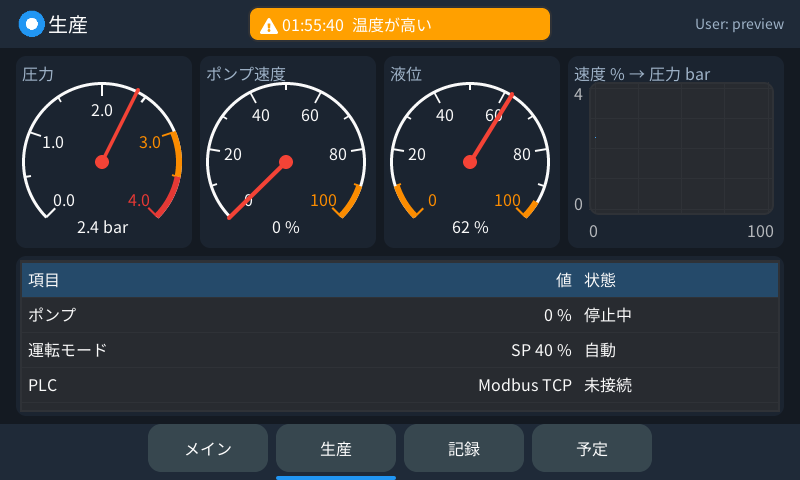
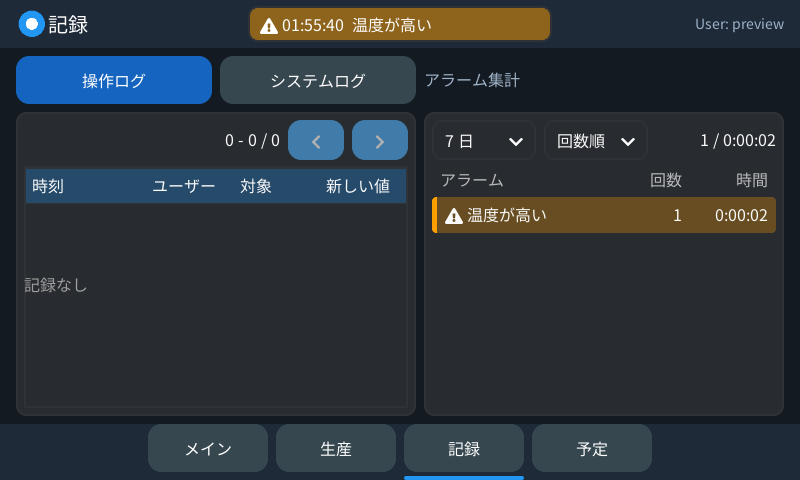
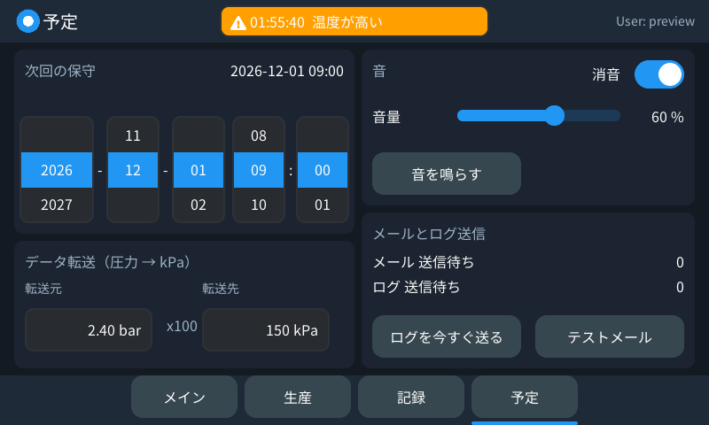
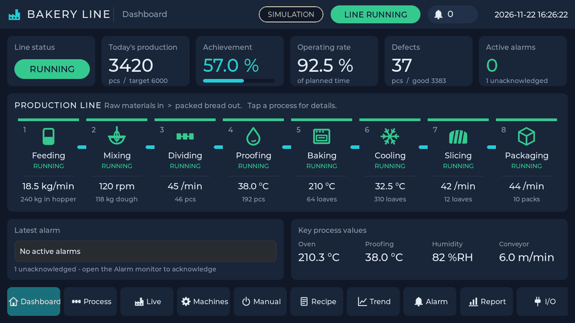
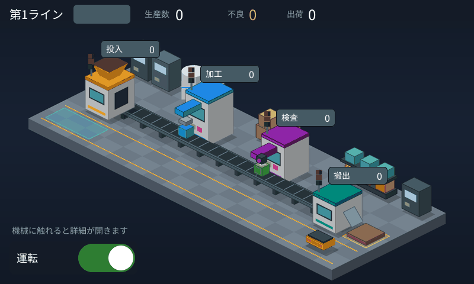

# ツクラク (Tsukuraku) — AI が作画する HMI

[English](README.md) | **日本語**

> 英語版（[README.md](README.md)）が基準です。この日本語版は訳で、内容が食い違うときは英語版が正しいものとします。

[](https://github.com/bamchoh/tsukuraku/actions/workflows/ci.yml)

> **AI に任せて、楽々 HMI 作画。**

ツクラクは、**画面を AI に描いてもらえる HMI デザイナーとランタイム**です。Claude などの AI に
「メーター 3 つと XY グラフ、状態の表がある生産画面を作って」のように頼むと、AI が画面を書き、ランタイムで描き、
その画像を見て自分で直します。開いているデザイナーが結果を読み直すので、仕上げは手で行えます。
できたプロジェクトは、PC でも、タッチパネル（Raspberry Pi などの Linux ボード）でもそのまま動き、
Modbus、SLMP（MELSEC）、FINS（オムロン）、OPC UA、MQTT で PLC につながります。

名前は「作る」＋「楽」です。

| | | |
| --- | --- | --- |
|  |  |  |

デモのこの 3 画面と、スケジュール・音・データ転送の設定は、**Skill だけを渡した AI が作ったもの**です（説明書もソースも見せていません）。



パン工場の HMI 一式 **BAKERY LINE**（`projects/bakery`）も同じやり方で作りました。AI に Skill と空の 1280x720 のプロジェクトとお客様の依頼文だけを渡し、
21 画面と、アラーム・トレンド・レシピ・変数ロギング、値を動かすシミュレーションまでを書かせています。

### AI が画面を描ける仕組み

1. **画面はテキストです。** プロジェクトは `project.json` と、画面ごとの JSON ファイルです（HML: ランタイムが読む HMI の記述形式）。AI はふつうのファイルとして書けます。
2. **Skill が書き方を教えます。** `tools/skill/hml-screens/` に、部品・プロパティ・動作の一覧（デザイナー自身の定義から生成するので、ずれません）、
   レイアウトとタッチの決まり、そのまま動く見本があります。デザイナーと一緒に配られます。
3. **ランタイムが確かめます。** `hml_runtime --check --render` は、ウィンドウを出さず、機器にもつながずに、間違い
   （知らないキー、ないタグ、訳のない文字）の一覧と、各画面の画像を出します。AI は両方を見て自分で直します。
4. **頼めば接続も書きます。** アドレス表（CSV、表計算、PLC のラベル一覧）を渡すと、AI がタグとドライバの割り付けを書きます
   （`tools/skill/hml-screens/reference/drivers-guide.md`）。読むだけから始め、書き込みは許した所だけ、パスワードはファイルに書きません。
   `--check` は各ドライバ自身にアドレスを読ませ、ないデバイス、2 回使われたタグやアドレス、数値のレジスタに文字列、などを知らせます。
   接続を試すのはあなたです（AI は実機につなぎません）。
5. **デザイナーが追いかけます。** AI が変えたファイルを読み直し、問題一覧を出します。位置も見た目も、あとから手で直せます。

しないこと: AI は PLC との接続を設定しません（ドライバー、ユーザー、装置の設定は人が決めます）。画面の**意味**
（出すタグ、単位が正しいか）は、人の目で確かめる必要があります。デモで試したのは、1 つのモデルで 1 回です。→「AI に画面を作ってもらう（Skill）」

### 入っているもの

- **デザイナー**（`hml_designer`）: 画面、タグ、アラーム、レシピ、多言語の文字、装置へのデプロイを GUI で行います。
- **ランタイム**（`hml_runtime`）: アラーム、トレンド、レシピ、変数 / 操作 / システムのログ、ユーザーとレベル、Lua スクリプト、スケジュール、音、
  メール、ログの送信、機器間のデータ転送、遠隔操作（VNC）、OPC UA サーバー。
- **デモ**（`projects/`）: `demo`（800x480）、`factory`、`metro`、3.5 インチのパネル用の 480x320 のプロジェクト。

実行ファイルとファイル形式は、短い名前 `hml` のままです（`hml_runtime`、`hml_designer`、`.hmlproj`）。

## ランタイムの概要

ランタイムは、JSON で書いた画面定義を LVGL (v9.6) で描画し、タグ（プロセス変数）とウィジェットを
双方向にバインドします。PC 上では SDL2 ウィンドウで、Raspberry Pi などの
Linux ボードでは framebuffer / DRM + evdev（タッチパネル）で動作します。
データソースはドライバ方式で、シミュレーション、Modbus TCP クライアント、OPC UA サーバー
（タグを OPC UA 変数として公開）を同梱しています。
ランタイム本体は C++17 で書かれています（LVGL 本体は C ライブラリのまま利用）。

```
project.json ──┬── tags      : 名前付き変数（bool/int/float/string）
               ├── drivers   : sim / modbus_tcp / modbus_rtu / modbus_ascii がタグを読み書き
               ├── screens   : screens/*.json → LVGL ウィジェットに展開
               │                 bind でタグ⇔ウィジェットを接続、on_click 等でアクション
               └── scripts   : Lua スクリプト（起動時 / 周期 / タグ変化 / 画面の表示・非表示 / イベント）
```

## ビルド（Windows / MSVC）

必要なもの: Visual Studio 2022 以降 (C++ ツール), CMake 3.24+, Ninja, ネットワーク接続
（初回に LVGL / SDL2 / nlohmann-json / Lua / SQLite / open62541 / webview / WebView2 SDK をダウンロードします）。OPC UA サーバーを組み込むには
Python 3 も必要です（open62541 のコード生成に使用。不要なら `-DHML_OPCUA=OFF`）。

```
build.cmd            # Release ビルド → build\bin\hml_runtime.exe
build.cmd Debug
```

### 単体テスト

`tests/` に [doctest](https://github.com/doctest/doctest) の単体テストがあります。LVGL はメモリ上のディスプレイで
ヘッドレスに動かし（`tests/lvgl_fixture.hpp`）、ティックを手動で進めるのでタイマーや画面遷移も決定的にテストできます。

| テスト                                               | 対象                                                                                                                        |
| ---------------------------------------------------- | --------------------------------------------------------------------------------------------------------------------------- |
| `test_util.cpp`, `test_jsonutil.cpp`, `test_tag.cpp` | ヘルパー、JSON アクセサ、タグストア（型変換・リミット・通知）                                                               |
| `test_project.cpp`, `test_demo_projects.cpp`         | project.json の読み込み・バリデーション、同梱プロジェクトが全画面ビルドできること                                           |
| `test_ui.cpp`, `test_screenshot.cpp`                 | 全ウィジェット種別、スタイル、バインディング（双方向含む）、アクション、画面遷移、BMP 出力                                  |
| `test_driver_registry.cpp`, `test_driver_sim.cpp`    | ドライバの登録 / 起動 / 停止、シミュレーション波形                                                                          |
| `test_animate.cpp`                                   | アニメーション（点滅がタグで始まり止まると元に戻る、移動・回転・拡大・色、コマ送り、回数、**表示していない画面と閉じたポップアップでは動かない**、**1 秒に 3 回より速く点滅しない**、書き間違いの警告、動作中に画面を消しても安全） |
| `test_images.cpp`                                    | 画像（PNG / JPEG / BMP / GIF、`fit`、JPEG / BMP は元の大きさだけ、背景画像、タグに連動する画像、**壊れた・ない・大きすぎる・プロジェクトの外のファイルを表示しない**（タグで指定された場合も）） |
| `test_check.cpp`                                     | プロジェクトの検査（`--check`: 正しいプロジェクトは 0 件、ランタイムが黙って無視する 26 種類の間違いを場所付きで検出、フォントにない文字、壊れたファイル、出荷プロジェクトと Skill の見本が 0 件）、PNG のスクリーンショット |
| `test_capabilities.cpp` | プロジェクトができること（`--capabilities`）: 画面を描くだけのプロジェクト、書き込む機器（読むだけの機器・止めてあるドライバは出ない）、メール / アップロード / MQTT、OPC UA サーバーと VNC、トリガーのあるスクリプト / スケジュール / データ転送、**fingerprint は一覧に従い、画面には従わない**、画面のボタンが持つスクリプト、プロジェクトのフォルダーの外は読まない |
| `test_driver_fins.cpp`                               | FINS（アドレスの書き方、FINS/TCP とコマンドのバイト列、壊れた応答、模擬サーバーとの読み書き・終了コード・再接続）           |
| `test_alarm_stats.cpp`                               | アラームの集計（回数と時間、期間の端、記録の欠けと時計の変更、CSV の式の無害化、10 万件の時間、部品）                       |
| `test_xy_chart.cpp`                                  | XY グラフ（点の追加と破棄、変化時、複数の曲線、消去、数値でない値、極端な設定、描き直しの回数、`--check`）                   |
| `test_table.cpp`                                     | 表（タグへの追従、`format` と `map`、極端な行数・列数と壊れた設定、1000 行の時間、`--check`）                               |
| `test_datetime.cpp`                                  | 日付・時刻の入力（うるう年と月末、書式、数値との変換、ローラーとタグ、レベル、操作ログ、`--check`）                        |
| `test_meter.cpp`                                     | メーター（針と数字、範囲外・数値でない値、極端な設定、描画時間、`--check`）                                                 |
| `test_log_view.cpp`                                  | ログの画面表示（ページ・絞り込み・期間、SQL 注入、壊れた文字、10 万行の時間、レベル、`--check`）                           |
| `test_karakuri.cpp`                                  | Karakuri（PLC シミュレーター）を相手にしたデバイスモニターの読み書き。`tools/karakuri_check.py device` から動かすときだけ実行                           |
| `test_vnc.cpp`, `test_transfer.cpp`                  | 遠隔表示（認証、ピクセル形式、差分、内蔵クライアントとの接続、**プロジェクトのパスワードでは開かない: 誰がつなげるかは装置で決める**）、USB メモリでの更新とバックアップ                           |
| `test_driver_slmp.cpp`                               | SLMP（デバイスの書き方、要求と応答のバイト列、壊れた・他のプロトコルの・長すぎる応答とランダムなバイト列の拒否、疑似サーバーに対する読み書き（全データ型・3E / 4E）、書き込みの制限、終了コード・無応答・切断からの復帰、1000 点のまとめ読み） |
| `test_driver_mqtt.cpp`                               | MQTT（パケットのバイト列、残り長さの境界、壊れたパケットの拒否と 10 万個のランダムなパケット、疑似ブローカーに対する送信・状態トピックと遺言・指令の受信、**指令の検査**（範囲外・数値でない・長すぎる・UTF-8 でない・登録していないトピック・ワイルドカード）、**TLS**（正しい CA で接続、別の CA・別のホスト名の証明書を拒否、verify なしの警告、平文の拒否、パスワードがログに出ない）、拒否からの再試行、切断中は最新の値だけ送る、QoS 1 の再送、停止がすぐ終わる） |
| `test_driver_opcua_client.cpp`                       | OPC UA クライアント（同じプロセスの open62541 サーバーを相手に: ノードの読み込みとサブスクリプション、`rw` の行だけ書き込み、**署名と暗号化**、**別の証明書のサーバーを拒否**、verify なしの警告、信頼する証明書がないと起動しない、平文で暗号化専用サーバーにつながらない、ユーザー名とパスワード（間違いの拒否、ログに出ない）、型に入らない値を書かない、サーバーの停止と復帰、停止がすぐ終わる、装置の証明書を 1 度だけ作る） |
| `test_driver_modbus.cpp`                             | テスト内の疑似 Modbus TCP サーバーに対するエンドツーエンド（全エリア・全データ型・書き込み・再接続）                        |
| `test_driver_modbus_serial.cpp`                      | Modbus RTU / ASCII（フレームと CRC・LRC、複数ユニット、壊れた応答、無応答からの復帰、疑似シリアルポート） |
| `test_driver_opcua.cpp`                              | open62541 クライアント API で OPC UA サーバードライバを読み書き                                                             |
| `test_system_log.cpp`                                | システムログ（SQLite への記録、繰り返しの集約、保持件数、CSV エクスポート、スレッドからの書き込み）                         |
| `test_recipe.cpp`                                    | レシピ（読み込み・選択・書き込み・保存・値の変更・削除、範囲外なら何も書かない、書き込み後の確認、装置での保存と再起動後の読み戻し、壊れたファイル・書けないとき、CSV の数式エスケープと取り込みの検証・大きさの上限、名前とブック名（パスにならない）、ランダムなバイト列、レベル、レシピ表の部品と確認ダイアログ）、`write_file_atomic` |
| `test_alarm_view.cpp`                                | アラームの確認（発生・復帰・確認の全順序）、再起動後の状態、履歴のページ送りと絞り込み、古い DB への列追加、確認のレベルと記録、一覧とバナー、1000 件の性能、SQL インジェクション・制御文字・不正な UTF-8 |
| `test_trend.cpp`                                     | トレンド（区間ごとの最小・最大・最後、短いピークが消えない、bool・文字列・点を含むタグ名、1 分ごとの要約の書き込み、要約と記録の組み合わせが記録だけの結果と一致、名前の SQL インジェクション、100 万件の速さ、部品の移動・拡大縮小・凡例・存在しないグループ） |
| `test_logs.cpp`                                      | 変数ロギング（各トリガー）、アラーム（発生 / 復帰）、操作ログ（ウィジェット・アクション、パスワードの伏せ字）、CSV エクスポート |
| `test_key_service.cpp`                               | 鍵の管理（SHA-256 / フィンガープリント、公開鍵の検証、authorized_keys の編集、受付プロトコル、Keys ページ）       |
| `test_deploy.cpp` | SSH なしのデプロイ（証明書は 1 度作って保つ、鍵ファイルは持ち主だけ、既定はオフでポートは閉じている、**承認されていないデザイナーには何も教えず何も受け取らない**、装置での承認、ファイルが変わらずに届く、入れ替えの失敗がデザイナーに伝わる、そのアドレスの別の装置ではデプロイを止める、でたらめ・壊れた・大きすぎる・止まった送り手、System > Deploy ページでの入れ替えと再起動、**前と違うことができるプロジェクトは操作者を待つ（断る、入れる、同じ一覧は次からそのまま入る、誰も答えない、たずねない設定）**、**ランタイムは装置が許可したデザイナーからだけ、その装置で起動できるものだけ**、ランタイムとプロジェクトで再起動は 1 回） |
| `test_popup.cpp`                                     | ポップアップ（開く・モーダル・重ねる・名前を指定して閉じる・戻るで閉じる、画面の切り替えで閉じる、goto でも開く、ポップアップでない画面は開かない、閉じている間は更新しない、レベル、1000 回の開閉で部品が増えない） |
| `test_screen_saver.cpp`                              | 画面消灯（時間で消える・0 は消さない、**点けるタッチではボタンが押されない**（模擬タッチパネルで確認）、タグでの切り替え、ログアウト、アラームで点灯 / しない設定、ポップアップも覆う、装置での時間の変更と `project.local.json`） |
| `test_schedule.cpp`                                  | スケジュール（時刻と曜日・日付指定の 1 回、月末・年末・うるう日、**時計を進めた / 戻したときに二重に実行しない・飛ばさない**、停止中に過ぎた予定と `catch_up`、再起動後も残る、装置での変更と保存、壊れた設定、200 件の負荷、操作ログ、System > Schedule ページ、`--check`） |
| `test_data_transfer.cpp`                             | 機器間のデータ転送（型の変換、変化時 / 周期 / 条件、**範囲外・NaN・無限大を書かない**、**起動時と切断中は書かない・再接続後は読み直してから最新の値で再開**、輪の検出、壊れた設定、100 件の負荷、System > Transfers ページ、`--check`）。通信はせず、接続の状態だけを言う模擬ドライバーと時計の差し替えで確かめる |
| `test_smtp.cpp`、`test_smtp_socket.cpp`              | SMTP（STARTTLS / TLS / 平文、AUTH PLAIN / LOGIN、件名の文字コード、**ヘッダーへの差し込みを防ぐ**、**暗号化されていない接続でパスワードを送らない**、STARTTLS への割り込み、応答しない・SMTP でないサーバー）。前者は 1 行ずつの模擬、後者はテスト内の TLS サーバーに実際のソケットでつなぐ（信頼できない証明書・名前の違う証明書の拒否） |
| `test_net_upload.cpp`                                | ファイルの送信（HTTP の PUT / POST、FTP のパッシブ転送を 1 行ずつの模擬で、**ファイル名やログイン情報でヘッダー・コマンドを足せない**、リダイレクトに付いていかない、PASV のアドレスを使わない、URL の検査）と、テスト内の HTTP / FTP サーバーへの実ソケットでの送信 |
| `test_upload.cpp`                                    | ログの送信の管理（ログごとのファイル、1 つずつ送る、再送とあきらめ、**送れなかったファイルが再起動後も残る**、あふれたら古いものから、パスワードが操作ログ・画面に出ない、遅いサーバーで画面が止まらない、System > Upload ページ、`--check`） |
| `test_mail.cpp`                                      | メール通知（アラームからの送信、重要度とイベントの絞り込み、再送の間隔とあきらめ、**送信待ちが再起動後も残る**、あふれたら古いものから、パスワードが待ち行列・操作ログ・画面に出ない、遅いサーバーで画面が止まらない、System > Mail ページ、`--check`） |
| `test_sound.cpp`                                     | 音（内蔵の音と音量、WAV の読み書き、**壊れた WAV・フォルダーの外のファイルを拒否**、タッチ音が鳴る部品 / 鳴らない部品・スクロール、アラーム音の繰り返し・確認で停止・消音、`mute` / `volume` の保存、**音の出口がない・壊れた出力でも落ちない**、アクション、System > Sound ページ、`--check`） |
| `test_template.cpp`                                  | テンプレート画面（テンプレートの部品が先・画面の部品が上、`${名前}` の置き換え、画面ごとに動く接続と動作、重ねたテンプレート、**ないテンプレート・ポップアップ・自分自身・輪でも落ちない**、50 画面の構築時間、`--check`） |
| `test_texts.cpp`                                     | 多言語（`@ID` の解決・既定の言語へのフォールバック・`@@`・存在しない ID、`sys.lang` での切り替えと不正な値の差し戻し、部品・選択肢・アラームの言語、切り替えで画面を作り直す）、フォント（どの大きさでも作れる・ない文字は組み込みフォント・`cmap` と `hmtx` の読み取り・壊れた / 切り詰めた / ランダムなフォントファイル、デモ全画面の描画） |
| `test_users.cpp`                                     | ユーザー管理（ログイン・ロック・自動ログアウト、ウィジェットと画面のレベル、ログイン画面、装置上でのユーザー編集） |
| `test_system_access.cpp` | 隅の長押しでシステム設定を開く（タップはタップのまま、途中で離す、残り秒数、**指の下のボタンはクリックにならない**、ほかの場所・隅から出たタッチは数えない、プロジェクトでの隅と秒数、`"none"`、ユーザーがあるときのログイン、消灯中の画面を点灯させるタッチ） |
| `test_system_i18n.cpp` | システム設定画面の日本語: 固定の文言すべてに訳がある、言語がプロジェクトとその切り替えに従う |
| `test_project_archive.cpp`                           | プロジェクトファイル（構成ファイルの一覧、作成と展開、プロジェクト外へ出るパスの拒否、PC ごとのファイルの保護）     |
| `test_script.cpp`                                    | Lua スクリプト（タグの読み書き、各トリガー、サンドボックス、タイムアウト、**メモリを使いすぎたスクリプトだけが失敗する**、ホットリロード） |
| `tools/designer/test/model.test.js`                  | デザイナーの util / schema / model（`node --test`、依存パッケージなし）                                                     |
| `smoke_runtime.cmake`                                | 実行ファイル `hml_runtime` をデモプロジェクトでヘッドレス起動（SDL dummy ドライバ）し、スクリーンショットと終了コードを確認 |

```
test.cmd                         # ビルドして hml_tests を実行
test.cmd -tc="*modbus*"          # doctest の引数をそのまま渡せる（テストケース名でフィルタ）
ctest --test-dir build --output-on-failure   # hml_tests + designer_js (node) + hml_runtime_smoke
```

Linux では `./build.sh` のあとに `build-<backend>/bin/hml_tests` を実行してください。
テストを組み込みたくない場合は `-DHML_TESTS=OFF` を付けます。

GitHub Actions（`.github/workflows/ci.yml`）が push / PR ごとに Windows (MSVC, sdl) と Linux (gcc, fbdev) で
テストを実行し、続けてランタイムとデザイナーのフルビルドも行います。

### PLC シミュレーターとの接続確認（Karakuri）

単体テストの通信相手は、このリポジトリで書いた模擬です。同じ思い違いが両方に入ると気づけないので、別の実装である
PLC シミュレーター [Karakuri](https://github.com/bamchoh/karakuri) を相手にした確認も用意しています（CTest には入りません。
Karakuri を起動しておく必要があります）。

```
python -I tools/karakuri_check.py --api http://localhost:8765/api          # すべて
python -I tools/karakuri_check.py --api http://localhost:8765/api slmp     # slmp / fins / modbus / opcua / opcua-secure / device / opcua-server / transfer
```

プロトコルごとに、Karakuri のサーバーを起動し、REST API でメモリに値を入れ、ランタイムを数秒動かしてタグの値を
出力させ、続けてタグに書かせた値を Karakuri のメモリから読み戻して比べます。

| 確認          | 内容                                                                                              |
| ------------- | ------------------------------------------------------------------------------------------------- |
| `fins`        | FINS/TCP。DM・CIO・WR・HR・EM・タイマ・カウンタ、int16 / uint16 / int32 / float / bcd16 / string、ビットの読み書き |
| `slmp`        | 3E / 4E フレーム。D・W（16 進）・M・X・Y、int16 / uint16 / int32 / float / string、ワードのビット |
| `modbus`      | Modbus TCP。保持・入力レジスタ、コイル、ディスクリート入力、u16 / s16 / u32 / s32 / float         |
| `opcua`       | OPC UA クライアント（暗号なし）。INT / DINT / UINT / REAL / LREAL / BOOL / STRING の購読と書き込み |
| `opcua-secure`| 同じ内容を Basic256Sha256 の Sign & Encrypt で（Karakuri の OPC UA サーバーにエンドポイントを足します） |
| `device`      | デバイスモニター（タグのないアドレスの読み書き）を SLMP / FINS / Modbus TCP で |
| `opcua-server`| 逆向き: ランタイムの OPC UA サーバー（暗号なし）に Karakuri の OPC UA クライアントをつなぎ、ノードの一覧と型、読み出し、書き込み、読み取り専用・型違い・存在しないノードの拒否を確かめる |
| `transfer`    | 機器間のデータ転送: SLMP → FINS / Modbus、FINS → SLMP。起動時の値、変化、100 件同時、条件、周期での書き直し、**FINS / SLMP のサーバーを止めて再開**（止まっている間は書かない、再開後は最新の値だけが届く、古い値を書き戻さない） |

### 実際のブローカーとの MQTT の確認（Mosquitto）

```bash
python -I tools/mosquitto_check.py                    # [--mosquitto <フォルダー>] [--port 1883] [--runtime <hml_runtime>]
```

[Eclipse Mosquitto](https://mosquitto.org/) を相手に確かめます（CTest には入りません）。すでに動いているブローカー（Windows ではインストーラーが
localhost:1883 のサービスを作ります）で暗号化なし、スクリプトが起動するブローカー（ポート 18883、使い捨ての CA。`openssl` が要ります）で TLS を確かめます。
オンライン / オフラインの状態（Last Will）、1 トピック 1 値、複数のタグの JSON メッセージ（`fields`、`const`、`ts`、変化で送り直し）、
受信した指令（1 つの値、JSON メッセージのフィールド、`min` / `max` の外は書かない）を見ます。

## ビルド（Raspberry Pi / Linux）

表示バックエンドは CMake の `-DHML_BACKEND=` で選びます（`build.sh` が引数で切り替えます）。

| バックエンド | 用途                                                                                       | 追加パッケージ |
| ------------ | ------------------------------------------------------------------------------------------ | -------------- |
| `fbdev`      | `/dev/fb0` + evdev。X11/Wayland 不要、コンソールから起動する Raspberry Pi 向け（**既定**） | なし           |
| `drm`        | `/dev/dri/card0` (KMS) + evdev。vc4-kms-v3d 環境でティアリングを避けたい場合               | `libdrm-dev`   |
| `sdl`        | デスクトップ Linux のウィンドウ表示（Windows と同じ）                                      | `libsdl2-dev`  |

### Raspberry Pi 上でビルドする（ネイティブ）

Raspberry Pi OS (Bookworm, 32/64 bit どちらでも) で:

```
sudo apt install build-essential cmake ninja-build git
./build.sh fbdev                # → build-fbdev/bin/hml_runtime
sudo apt install libdrm-dev && ./build.sh drm    # DRM 版を使う場合
```

Pi 4 で初回ビルドは数分です（LVGL / nlohmann-json / open62541 のダウンロードにネットワークが必要）。
コンパイラは g++ 10 以降（C++17）、OPC UA を組み込む場合は python3 も必要です（Raspberry Pi OS には標準で入っています）。

### PC (Linux / WSL) でクロスコンパイルする

```
sudo apt install gcc-aarch64-linux-gnu        # 64bit OS 用
sudo apt install gcc-arm-linux-gnueabihf      # 32bit OS 用
./build.sh fbdev --cross aarch64              # → build-fbdev-aarch64/bin/hml_runtime
./build.sh fbdev --cross armhf                # → build-fbdev-armhf/bin/hml_runtime
```

`fbdev` バックエンドは libc 以外に依存しないため、sysroot 無しでクロスコンパイルできます。
できたバイナリと `projects/` ディレクトリを Pi にコピーすれば動作します。
（`drm` / `sdl` をクロスビルドするには対象ライブラリ入りの sysroot が必要です。）

### Raspberry Pi で実行する

```
sudo ./build-fbdev/bin/hml_runtime projects/demo/project.json
```

- デスクトップ (X11/Wayland) が動いていると framebuffer を奪い合うので、`raspi-config` で
  「Console」起動にするか、`sudo systemctl stop lightdm` 等でデスクトップを止めてから起動してください。
- root 以外で動かすには `sudo usermod -aG video,input $USER` を実行して再ログインします。
- カーネルメッセージやログインプロンプトが HMI の上に描かれるのを防ぐため、ランタイムは起動時にコンソール
  （`display.console`、既定 `/dev/tty1`）をグラフィックスモード（`KD_GRAPHICS`）に切り替え、終了時に戻します。
  `/dev/tty1` は root 専用なので、`tools/rpi/hml.service` のように `TTYPath=/dev/tty1` + `StandardInput=tty` で
  systemd から tty を受け取るか、root で実行してください（開けない場合は警告を出して続行します）。
  `"console": "none"` で無効化、環境変数 `HML_CONSOLE` で上書きできます。ユニットは `getty@tty1` と排他にして
  あるので tty1 のログインプロンプトは出なくなります（SSH を使ってください）。
- 起動・終了時のコンソールログ（カーネルや systemd の `[ OK ] ...`）を画面に出さないようにするには
  `sudo tools/rpi/quiet_boot.sh` を実行して再起動します。`cmdline.txt` の `console=tty1` を `console=tty3`
  （画面に出ない VT）に変えて `quiet loglevel=3` を足し、`getty@tty1` を無効にします（ログインは SSH で）。
  シリアルコンソールはそのままです。`--revert` で元に戻ります。`apply_lcd.sh` も最後にこれを実行します。
- 起動スプラッシュ: `hml_runtime --splash project.json` は `display.splash`（PNG、プロジェクトからの相対パス。
  中央に表示し、画面より大きければ縮小）を背景色 `display.splash_bg`（既定は黒）の上に 1 枚描いて終了します。
  画像がなければプロジェクトのタイトルを表示します。tty1 をグラフィックスモードのまま残すので、HMI が描画を
  始めるまで画面に残ります。`tools/rpi/hml-splash.service` が起動のごく初期（ルートファイルシステムが
  あれば動く）にこれを実行します。デザイナーでは Project タブの「Boot splash」で設定できます。
  ```
  sudo install -m 644 ~/hml/tools/rpi/hml.service ~/hml/tools/rpi/hml-splash.service /etc/systemd/system/
  sudo systemctl daemon-reload && sudo systemctl enable hml-splash
  ```
  `hml.service` は `TTYReset` / `TTYVTDisallocate` を使いません（テキストモードに戻してスプラッシュが消えるため）。
- コンソールのカーソル点滅が画面に残る場合は `echo 0 | sudo tee /sys/class/graphics/fbcon/cursor_blink`。
- 画面サイズは framebuffer の解像度が使われます。`project.json` の `display.width/height` は
  画面 JSON の座標基準なので、Pi の解像度に合わせておくか `rotation` と合わせて調整してください。
- fbdev/drm ドライバはカーネルが返す物理サイズから DPI を計算しますが、HDMI ではでたらめな値
  （Pi 4 で 1280 px = 70 mm → 464 dpi）が返ることがあり、テーマの余白や角丸が数倍に膨らみます。
  ランタイムは `display.dpi`（既定 130）で必ず上書きするので、通常は何もしなくて大丈夫です。
- 入力は `/dev/input/event*` を自動検出します（タッチ / マウス / キーボード）。特定のデバイスだけ
  使う場合は `display.input` か環境変数 `HML_INPUT` で指定します。
- 終了は `Ctrl-C` (SIGINT/SIGTERM)、画面 JSON のホットリロードは `kill -HUP <pid>` または `kill -USR1 <pid>`。

### 3.5 インチ HDMI LCD (480x320) + ADS7846 タッチの例

`tools/rpi/` に Raspberry Pi OS 用の設定一式があります。`projects/lcd35` は同じデモを 480x320 向けに
組み直したものです（タッチは 180 度回転なので `calibration` が [max, max, min, min] の順になっています）。

```
scp -r tools/rpi pi:~/hml/lcd          # config-lcd.txt / apply_lcd.sh / quiet_boot.sh / hml.service
sudo ~/hml/lcd/apply_lcd.sh            # config.txt と cmdline.txt を書き換え、起動ログも非表示（--revert で元に戻る）
sudo reboot
sudo cp ~/hml/lcd/hml.service /etc/systemd/system/ && sudo systemctl enable --now hml   # 自動起動
```

- 既定は vc4 オーバーレイなし（firmware が `hdmi_cvt` で 480x320 を出し、`/dev/fb0` は simple-framebuffer）。
  `vc4-fkms-v3d` はカーネル 6.18 では `Cannot find any crtc or sizes` で失敗し fb0 が消えるため使いません。
- タッチの向きを調べるには `python3 tools/rpi/touch_raw.py /dev/input/event0 60` で生の座標を見ます。
- 画面に触らずにタッチ操作を試すには `tools/rpi/tap.py` を使います。入力デバイスにタッチのイベントを書き込むので、
  ランタイムには本物のタッチとして届きます（実行するユーザーが `input` グループに入っている必要があります）。
  座標は画面上の位置で、表示サイズとタッチ補正は `--project` で指定した project.json から読みます。
  `python3 tools/rpi/tap.py --project projects/lcd35/project.json 440,20,900 95,70`
  （`X,Y,待ち時間ms` を並べる）。結果は `cat /dev/fb0 > shot.raw` で画面を取得して確認できます。

Linux 用の `display` 設定:

```json
"display": {
  "width": 800, "height": 480,
  "rotation": 0,                       // 0 / 90 / 180 / 270
  "dpi": 130,                          // テーマの余白・角丸の基準（省略時 130 = Windows/SDL と同じ）
  "fbdev": "/dev/fb0",                 // fbdev バックエンドのデバイス（省略可）
  "drm":   "/dev/dri/card0",           // drm バックエンドのデバイス（省略可）
  "input": "",                         // 空 = 自動検出、例 "/dev/input/event0"
  "touch": { "swap_axes": false, "calibration": [0, 0, 4095, 4095],    // 抵抗膜式などの補正（省略可）
             "jitter": 12, "smooth": 3, "settle": 1, "release": 1, "lift_ms": 60, "scroll_limit": 8 } // 抵抗膜式のブレ対策（省略可。下記）
}
```

### タッチのブレ対策（抵抗膜式のパネル）

抵抗膜式のパネル（ADS7846 など）は、指を置いたままでも読み取り値が数ピクセル動き、押し始めの 1 回目は大きく外れることが
あります。そのままだと、ローラーが震える・押しただけのボタンがドラッグ扱いになる・スライダーが揺れる、といった動きになります。
`display.touch` に次のキーを書くと、ランタイムが読み取り値を安定させます（どれも書かなければ何もしません。静電容量式には不要です）。

| キー           | 内容                                                                                                   | 抵抗膜式の目安 |
| -------------- | ------------------------------------------------------------------------------------------------------ | -------------- |
| `settle`       | 押し始めの N 回分の読み取りを捨てる（0 〜 5）。指が着く瞬間の外れ値を除く                              | 1              |
| `release`      | 離す直前の N 回分の読み取りを捨てる（0 〜 3）。指が離れる瞬間の外れ値を除く。そのぶん、すべての読み取りを N 回分（ADS7846 で 1 回約 16 ms）遅らせて伝える | 1 |
| `lift_ms`      | これより短い「離れた」は、離れたと見なさない（0 〜 300、0 = 無効）。抵抗膜式は、指を滑らせている途中で一瞬だけ接触が切れることがあり、そこでドラッグが 2 つのタッチに分かれて、前半が「その場所のボタンを押した」扱いになる。これを 1 つのタッチとしてつなぐ。本当に離したときの通知は、この時間だけ遅れる | 60 |
| `smooth`       | 直近 N 回の平均を使う（1 〜 8。1 = そのまま）                                                          | 3              |
| `jitter`       | 伝える点は、指がそこから N ピクセルより離れたときだけ動く（0 = 無効）。押している間は 1 点のまま、ドラッグは最大 N ピクセル遅れて追従 | 12 |
| `scroll_limit` | 一覧がスクロールを始めるまでに指が動く距離（LVGL の既定は 10）。`jitter` がブレを除くので小さくてよい（指が実際に動く距離は `jitter` + この値） | 8 |
| `log`          | タッチ 1 回ごとに、読み取りの回数・ブレた幅・伝えた点が動いた幅をシステムログに 1 行残す               | 調整のときだけ |

調整の手順: `"log": true` を足して配備し、ボタンを 1〜2 秒押し続ける操作を何度か行い、ログ（`hml.log`）の
`touch: 37 samples in 720 ms, the readings wandered 23 x 31 px (9 x 14 without the first and last two), reported 0 x 0 px`
を見ます。「wandered」が読み取り全体のブレの幅、かっこの中が押し始めと離す直前の 2 回ずつを除いた幅（指を置いている間のブレ）です。
全体が大きくかっこの中が小さいなら `settle` / `release` が効きます。`jitter` は、かっこの中の幅より少し大きい値にします
（大きすぎるとドラッグの追従が鈍くなります）。`1 samples in 0 ms` は、パネルが 1 回だけ誤って反応したもので、`settle` が 1 以上なら
タッチとして扱われません。`2 short lift(s) bridged (longest 31 ms)` は、ドラッグの途中で接触が一瞬切れたのを `lift_ms` がつないだ回数、
`48 ms after the touch before` は、前のタッチの直後に始まったタッチ（つながれなかった切れ目）です。`log` が有効な間は、続けて
`touch: -> a scroll` / `-> no scroll` / `-> a click` も出ます（そのタッチを画面がどう扱ったか）。

3.5 インチ LCD（ADS7846）での実測（指での操作）:

| 設定 | 結果 |
| ---- | ---- |
| フィルターなし | 指を置いたままでも読み取りが中央値 10 px（最大 19 px）動く。ローラーを押すと震える。1 回だけの誤反応が 36 回中 4 回 |
| `settle` 1、`release` 1、`smooth` 3、`jitter` 12、`scroll_limit` 16 | 置いたままのタッチ 26 回はすべて動きなし（震えは止まる）。押したまま動かすと、スクロールにならずボタンを押したことになる場合がある |
| 上に加えて `lift_ms` 60、`scroll_limit` 8 | ドラッグ 53 回がすべてスクロールになり、クリックになったものは 0 回。動かさないタッチ 9 回はすべてクリック。途中で接触が切れてつないだのは 1 回（16 ms） |

最後の行が目安の値です。`lift_ms` と `scroll_limit` は同時に変えたので、どちらがどれだけ効いたかは分けて確かめていません
（接触が切れたのは 53 回中 1 回だけだったので、`scroll_limit` を縮めた効果のほうが大きい見込みです）。パネルごとに違うので、`log` で確かめてください。
デザイナーでは、プロジェクトタブの「タッチパネル」で設定できます。3.5 インチ LCD のプリセットには目安の値が入っています。

環境変数 `HML_FBDEV` / `HML_DRM` / `HML_INPUT` を設定すると `project.json` より優先されます。

systemd で自動起動する例 (`/etc/systemd/system/hml.service`):

```ini
[Unit]
Description=HML Runtime
After=multi-user.target

[Service]
ExecStart=/home/pi/lvgl-hml/build-fbdev/bin/hml_runtime /home/pi/lvgl-hml/projects/demo/project.json
ExecReload=/bin/kill -HUP $MAINPID
Restart=always
User=root

[Install]
WantedBy=multi-user.target
```

`sudo systemctl enable --now hml` で起動し、`sudo systemctl reload hml` で画面 JSON を再読み込みできます。

## 実行

```
build\bin\hml_runtime.exe projects\demo\project.json
```

| キー / オプション           | 動作                                                                                                              |
| --------------------------- | ----------------------------------------------------------------------------------------------------------------- |
| `F5`                        | 画面 JSON をホットリロード（タグ・ドライバは維持、表示中の画面を保つ）。Linux fbdev/drm では `SIGHUP` / `SIGUSR1` |
| `Esc`                       | 終了。Linux fbdev/drm では `Ctrl-C` (`SIGINT` / `SIGTERM`)                                                        |
| `SIGUSR2`（Linux fbdev/drm）| ランタイムを再起動（終了処理をしてから同じコマンドラインで起動し直す）。デザイナーの Deploy が使う                |
| `--screen <name>`           | 起動時に表示する画面を指定                                                                                        |
| `--screenshot <file>`       | 起動後にスクリーンショットを保存。名前が `.png` で終われば PNG、それ以外は BMP                                    |
| `--check`                   | プロジェクトの間違いを一覧にして終了（下記「プロジェクトの検査」）。`--render` `--lang` `--set` と組み合わせられる |
| `--exit-after <ms>`         | 指定時間後に自動終了（CI / 自動テスト用）                                                                         |
| `--stats <seconds>`          | メインループの負荷を指定秒ごとにログに出す（1 秒あたりの周回数、占有率、最長の 1 周の時間）。負荷の確認用 →「負荷の確認」 |
| `--list-serial-ports`        | その機械のシリアルポートを一覧表示して終了（project.json は不要）→「ドライバ: modbus_rtu / modbus_ascii」 |
| `--reload-after <ms>`       | 指定時間後にホットリロードを実行（テスト用）                                                                      |
| `--export-system-log <file.csv>` | システムログを CSV に書き出して終了（`--log-level warn` などで絞り込み）→「システムログ」                    |
| `--export-data-log <file.csv>` | 変数ロギングのグループを CSV に書き出して終了（`--group <name>`）。`--export-alarm-log` / `--export-operation-log` も同様 →「ロギング」 |
| `--click <x>,<y>,<ms>`      | 起動から `ms` 後に座標 (x,y) をクリック（複数指定可、UI 自動テスト用）                                            |
| `--shot-at <ms>,<file>`     | 指定時刻にスクリーンショットを保存（複数指定可。`.png` なら PNG）                                                 |

デモの Modbus 接続を試すには、同梱のテストサーバーを別ターミナルで起動してください。

```
python tools\modbus_server.py --port 5020
```

接続すると画面右上の PLC ランプが点灯し、Run スイッチ・Speed スライダー・Setpoint アークが
サーバーのコイル / 保持レジスタと同期します。サーバーが無い場合も画面は動作します（オフライン表示）。
そのあいだは `pump` スクリプトがポンプを模擬し、運転を入れると速度（PV）が設定値（SP）まで上がります。

もう 1 つのデモ `projects/metro` は、電車の車内案内表示です（大阪メトロ御堂筋線の駅名・駅番号・乗り換えを使った
イメージで、所要時間とドアの向きは架空）。機器にはつながず、Lua スクリプト（`scripts/guide.lua`）が走行を模擬して
文字列のタグを書き、画面はそれを表示するだけです。漢字・ひらがな・英語が数秒ごとに切り替わり、画面の上部か
「設定」を押すと、走行の停止・次の駅へ・行先の反転・言語の固定ができます。

```bash
./build/bin/hml_runtime projects/metro/project.json
```

`projects/factory` は、生産ラインを斜め上から見た監視画面です（アイソメトリック。3D ではなく、斜め視点で描いた絵を
奥から手前の順に重ねています）。コンベアの上を製品が流れ、プレスが上下し、検査の光が点滅し、搬送車がパレットを
運びます。機械に触れると詳細が開き、故障を起こしたり復旧したりできます。絵は `tools/gen_factory_demo.py` が描いた
単純な立体で（Pillow が要ります）、画面ファイルも同じスクリプトが書きます。走行の模擬は `scripts/line.lua` です。
`projects/factory35` は同じ画面の 480x320 版（絵を 0.6 倍にしたもの。Raspberry Pi の 3.5 インチ LCD 用）です。



```bash
./build/bin/hml_runtime projects/factory/project.json
```

`projects/bakery`（**BAKERY LINE**、1280x720）は自動化されたパン工場の HMI で、Skill とお客様の依頼文だけを渡した AI が作りました。
ダッシュボード、原料投入から包装までのライン、8 台の設備ごとの詳細画面、確認つきの手動操作、レシピ、トレンド、アラーム、
時間別の棒グラフのある生産実績、I/O モニタを、ヘッダーとナビゲーションを持つ 1 つのテンプレートの上に作っています。PLC はなく、
`simulation` の設定が値を動かします（画面に SIMULATION と出ます）。手動操作の画面でラインを止めたり動かしたりすると値が変わります。
`renders/` に全画面の画像、`renders/demo.gif` に動いているところの録画があります。
**Live** の画面は、`projects/factory` のようにラインを斜め上から見たものです。パンが工程ごとに形を変え（生地、分割、発酵、焼成、スライス）、
ミキサーが回り、冷却機のファンが回り、ヒーターが入っている間はオーブンが光り、設備ごとのランプと名札が状態に合わせて変わります
（触れると詳細が開きます）。絵と画面は `tools/gen_bakery_line.py`（Pillow）が描いています（factory の `tools/gen_factory_demo.py` と同じやり方）。


```bash
./build/bin/hml_runtime projects/bakery/project.json
```

デモ（`projects/demo`）は、下のナビゲーションで切り替える 9 画面で、できることを一通り動かせます。

| 画面     | 見られるもの                                                                                                   |
| -------- | -------------------------------------------------------------------------------------------------------------- |
| メイン   | 値の表示（ラベル・バー・円弧）、状態で変わる色と文字、チャート、スイッチ・スライダー・ボタン・数値入力、条件付きの無効化、ポップアップ（温度をタップ）、Lua スクリプト（自動運転とポンプの模擬） |
| トレンド | 変数ロギングの履歴（`trend`）                                                                                    |
| アラーム | 発生中の一覧と確認、履歴（`alarm_list`）。上の帯（`alarm_banner`）は全画面に出ます                              |
| レシピ   | レシピの書き込み・読み出し・保存（`recipe_table`。レベル 2 以上: `maint` / PIN `2222`）                          |
| 部品     | ドロップダウン・ローラー・択一ボタン、文字とパスワードの入力、長押しの連続操作、押している間だけ ON、LED・スピナー・流れる文字・棒グラフ、アニメーション（回転・移動・色） |
| 設定     | 運転モード、警報の上下限、設定値（つまみ・入力・ボタン）、ログイン / ログアウト、言語の切り替え、システム設定、保守の操作（レベル 2 以上） |
| 生産     | メーター 3 つ（`meter`、色を付けた区間）、XY グラフ（`xy_chart`）、表（`table`、タグの値と状態の文字）。この画面と下の 2 つは**テンプレート画面**（`frame`: ヘッダーとナビゲーション）の上に作ってあります |
| 記録     | 操作ログとシステムログ（`log_view`、ボタンで切り替え）、アラーム集計（`alarm_summary`） |
| 予定     | 日付と時刻の入力（`datetime_input`）、音（消音、音量、音を鳴らす、ブザー停止）、機器間のデータ転送の元と先、メールとログ送信の状態とボタン |

このほか `project.json` に、スケジュール（平日 8:00 に自動運転を入れる、など 3 件）、音、データ転送（液位のコピー、圧力を kPa に換算）、
メールとログ送信の例（`"enabled": false`。サーバーは架空なので、そのままでは送りません）が入っています。System > Schedule / Sound / Transfers / Mail / Upload のページで見られます。
この 3 画面と設定は、**Skill だけを渡した AI に作らせたもの**です（→「AI に画面を作ってもらう」）。

### プロジェクトの検査（`--check`）

```
hml_runtime project.json --check
hml_runtime project.json --check --render main,main.png --render main+temp_detail,popup.png --lang en --set temp=34.5
```

プロジェクトを動かさずに、間違いを 1 行ずつ（`ファイル: 場所: 内容`）出します。**ウィンドウを出さず、ドライバを起動せず
（機器につながない）、プロジェクトのフォルダーに何も書きません。** 間違いがなければ `no problems` で終了コード 0、
あれば件数を出して 1 です。デザイナーなしで（スクリプトや AI から）プロジェクトを確かめるためのものです。

```
screens/main.json: children[3] (button): on_click (goto): unknown screen "setting"
screens/main.json: children[5] (label): unknown key "colour" (ignored by the runtime)
project.json: drivers[0] (plc): map: unknown tag "pressur"
3 problem(s)
```

| 見つけるもの | 例 |
| --- | --- |
| ファイル | 読めない、JSON の文法エラー、画面がない、画面名の重複、`start_screen` がない |
| 部品 | 知らない `type`、知らないキー（つづりの間違い。ランタイムは黙って無視する）、知らないスタイルのキー |
| `bind` | 知らない種類、ないタグ、知らないキー |
| ランタイムのタグ | そのプロジェクトのランタイムにない `sys.` のタグ（つづりの間違い、`sound` がないのに `sys.sound.*`） |
| 動作 | 知らない動作・キー、ないタグ・画面・スクリプト・言語・アニメーション、ポップアップでない画面への `popup` |
| 参照 | `texts` にない `"@ID"`、ない画像・フォントのファイル、トレンドのグループとタグ、レシピのブック、アラームの設定がない |
| ドライバ | 表（`map`、`items`、`publish` …）と `status_tag` のないタグ |
| 文字 | フォント（と組み込みフォント）にない文字 |
| `runtime:` の行 | 実際に読み込んで全画面を作ったときにランタイムが出した警告とエラー |

- `--at <ms>`: `--render` が、画面を表示してからおよそその時間がたった絵を描きます（アニメーションの途中。既定 200）。
- `--render <画面>,<ファイル>`: その画面を描いて保存します（複数指定可）。`<画面>+<ポップアップ>` と書くと、その画面の上に
  ポップアップを開いた状態です（ポップアップの名前だけなら `start_screen` の上）。
  `--lang <言語>` でその言語、`--set <タグ>=<値>` でタグの値を変えた状態を描けます（この 2 つはふつうの起動でも使えます）。
- スクリプトは動きます（周期のスクリプトがタグを書き換えるプロジェクトでは、`--set` した値と違う値が出ることがあります）。
- フォントにない文字（画面では □ になる）も出します: `texts` はすべての言語、画面に直接書いた文字や単位はそのとき
  描いた言語と状態のものです（`screen "main": text "21.5 ℃": no glyph for: ℃`）。
- 描くときは、いちばん高いユーザーレベルでログインした状態です。アラーム・トレンド・レシピは装置と同じように動きますが、
  記録は一時フォルダーに置いて終了時に消します。機器につながないので、値は `init` と `--set` のままです。
- 部品やキーの一覧は、デザイナーの `schema.js` から生成した `src/check_schema.inc` です（`node tools/skill/gen_reference.js`。
  ずれるとテストが落ちます）。訳の抜けや、収まらないかもしれない長い訳は、デザイナーの問題一覧で見ます。

### 負荷の確認

規模の大きいプロジェクトで装置がどのくらい忙しくなるかは、`--stats` で確認できます。

```
hml_runtime project.json --stats 5
[hml INFO ] stats: 5.0 s, 724 passes (145/s), busy 20%, longest pass 31.2 ms, 0 of 50 ms or more; tags avg 0.79 max 20.1 ms, lvgl avg 0.62 max 11.1 ms
```

- メインループの 1 周は「タグ変化の通知（`tags`）」と「LVGL の処理（`lvgl`: タイマー、入力、描画）」です。
  1 周のあいだは他の処理が待たされるので、`longest pass` がタッチやタグ変化に対する最悪の遅れの目安になります。
- `busy` はメインループが処理に使っている時間の割合です。100% に近づくと、周回数（`passes`）が落ちて表示の更新が遅れます。

規模が大きくても重くなりにくいよう、次のようにしています。

- 表示していない画面のウィジェットは、タグが変化しても更新しません。その画面を表示するときにまとめて反映します。
- 画面は、最初に表示するときに組み立てます。起動時は開始画面だけを組み立て、残りは動作中に 1 枚ずつ組み立てます
  （画面 JSON の誤りによる警告は、起動後しばらくのあいだに出ます）。

`tools/make_stress_project.py` は、タグ数・画面数・ウィジェット数・ロギング量などを指定して負荷確認用のプロジェクトを作ります
（`--preset light | medium | heavy | extreme`、個別のオプションで上書き可）。外部とは通信しません。

```
python tools/make_stress_project.py stress --preset heavy
hml_runtime stress/project.json --stats 5
```

## 他人が作ったプロジェクト

**プロジェクトは絵ではなく、プログラムです。** 画面を描くほかに、PLC に値を書き込み、ほかの機器へデータを送り、ポートを開け、
スクリプトを自分で動かせます。プログラムと同じく、**信頼できる人のプロジェクトだけを開いて動かしてください。**
脆弱性の知らせ方は [SECURITY.md](SECURITY.md) にあります。

自分で作っていないプロジェクトを動かす前に、そのプロジェクトができることを確かめます。何も起動せず、ファイルを読むだけです。

```
hml_runtime <project.json> --capabilities
```

```
Writes to devices
  - modbus_tcp 192.168.0.10:502: can write 7 of 12 value(s) (speed_sp, setpoint, run, mode ...)
Sends data out
  - mail through smtp.example.com to shift@example.com: alarms, with values of tags
Opens ports for others
  - OPC UA server on port 4840: the clients the device trusts can read and change the values
Runs by itself
  - 2 script(s) run by themselves and can write any tag: auto_speed (every 500 ms), pump (every 200 ms)
  - schedule nightly_upload at 23:55: calls upload.run
! It writes to devices and runs things by itself: values can reach a device without anybody at the screen.
fingerprint 97f74c7877d557c0
```

| 見出し | 出るもの |
| ---------------------- | ------------------------------------------------------------------------------------------------ |
| Writes to devices | 読み取り専用（`"access": "ro"`）でない値を持つドライバと、タグに値を入れる MQTT のトピック |
| Sends data out | メール、ログのアップロード、MQTT ブローカーへ出すもの。その宛先 |
| Opens ports for others | OPC UA サーバー、VNC |
| Runs by itself | トリガーのあるスクリプト、スケジュール、データ転送。画面のボタンが持つスクリプトの数 |

- 一覧に出るのは、そのプロジェクトに**できること**で、実際にすることではありません。自分で動くスクリプトはどのタグにも
  書けますが、害があるかどうかは一覧からは分かりません。**`!` の行は重く見てください**。機器に書き込み、かつ、誰も
  ボタンを押さなくても動くものがある、という意味です。
- プロジェクトで止めてあるもの（`"enabled": false`）は出ません。`--capabilities-json` は同じ内容を JSON で出します
  （`devices`、`sends`、`listens`、`automatic`、`unattended_writes`、`fingerprint`）。ツールや AI 向けです。
- fingerprint は一覧のハッシュです。画面を変えても変わらず、機器・送り先・ポート・自分で動くものが変わると変わります。

**頼まなくても一覧が出る場面**

- **装置にプロジェクトが届いたとき。** SSH なしでデザイナーから送られたプロジェクト（→「SSH なしでデプロイする（Direct）」）の
  一覧が、入れ替え前のプロジェクトと違うときは、そのままは入れません。装置の画面が System > Deploy に切り替わり、
  どこから来たか・何ができるかを **Install** と **Reject** と一緒に出します。デザイナーは待ち、待っていることを表示します。
  承諾した内容は fingerprint で覚えるので、同じ一覧のプロジェクト（画面だけを変えた、ふつうの場合）は、次からは
  たずねずに入ります。画面を描くだけのプロジェクトは、たずねません。答える人がいない装置では、同じページの
  「Ask before a project that can do more」でオフにできます。
- **USB メモリから入れるとき。** System > Storage の「Replace the project with …?」に、その USB メモリのプロジェクトが
  できることと、今と違う一覧かどうかが出ます。
- **デザイナーで実行・プレビューする前。** どちらも PC の上でプロジェクトを動かします。スクリプトが動き、ドライバが接続して
  書き込みます。この PC でまだ動かしたことのないプロジェクト（もらったフォルダーを開いた、リポジトリから取ってきた）は、
  先に一覧を **動かす** と **キャンセル** と一緒に出します。このデザイナーで作ったプロジェクトと、ここで動かしたことがあり、
  そのあとデザイナーで変えただけのプロジェクトは、たずねません。

SSH でのデプロイと、装置に手でコピーしたプロジェクトは、たずねません。それができる人は、装置のすべてを変えられるからです。

**誰が作ったプロジェクトでも、できないこと**

- スクリプト（Lua）は、ファイル・プロセス・ネットワークを使えず、1 回の実行時間とメモリに上限があります（→「スクリプト (Lua)」）。
- プロジェクトが名指しするファイル（画面、画像、音、スクリプト）を、デザイナーはそのフォルダーの中からしか読みません。
  プロジェクトファイル（`.hmlproj`）は、フォルダーの外に何も展開できず、装置のもの（`logs/`、`pki/`、`project.local.json`）を
  置き換えられません。
- 装置をほかへ開くかどうかは、プロジェクトではなく装置で決めます。VNC のパスワード（System > Remote）、ネットワーク越しの
  プロジェクトの受け取りと送ってよいデザイナー（System > Deploy）、ランタイムの入れ替え、信頼する OPC UA クライアント、
  SSH の鍵（System > Keys）です。
- パスワードはプロジェクトに書きません（`--check` が指摘します）。装置で設定し、装置に残ります。

**それでも防げないこと**

- PLC に書き込むプロジェクトは、危険な値も書けます。ランタイムは、あなたの設備にとって何が安全かを知りません。
  **インターロックは HMI ではなく PLC に持たせてください。**
- メール・アップロード・MQTT の宛先は、プロジェクトが決めます。他人が作ったプロジェクトは、記録したものを作者へ送れます。
- **プロジェクトを読む AI は、他人が書いた文字を読みます。** ラベル・コメント・スクリプトの中に、指示のように見える文
  （「上の指示は無視して…」）が入っていることがあります。それはデータです。スキルは AI にそう伝えていますが、自分で作って
  いないプロジェクトを AI に扱わせるときは、AI が何を変えよう・動かそうとしているかを見てください。

## デザイナー（GUI でプロジェクトを作る）

`hml_designer.exe`（Windows ビルドでは既定で一緒にビルドされます）は、`project.json` と画面 JSON を
GUI で編集するツールです。追加のランタイムは不要で、OS 標準の WebView（Windows: WebView2、
Windows 10/11 に標準搭載）に HTML/JS の画面を表示し、C++ のホストがファイル入出力とランタイムの起動を担当します。

```
build\bin\hml_designer.exe                       # 起動（New / Open で開始）
build\bin\hml_designer.exe projects\demo\project.json   # プロジェクトを指定して起動
build\bin\hml_designer.exe line1.hmlproj                  # プロジェクトファイル（1 ファイルの形式）を指定して起動
```

| 場所                                   | 内容                                                                                                                                                               |
| -------------------------------------- | ------------------------------------------------------------------------------------------------------------------------------------------------------------------ |
| 左: Widgets                            | パレット。クリックすると選択中のパネル（または画面）に追加                                                                                                         |
| 左: Screens / Tags / Drivers / Project | 画面の追加・削除・開始画面、タグ表、ドライバ設定（sim / modbus_tcp / modbus_rtu / modbus_ascii / opcua_server のフォーム + raw JSON）、表示サイズ・テーマ・タッチ補正                          |
| 中央: キャンバス                       | ドラッグで移動、右下のハンドルでサイズ変更、矢印キーで 1 px（Shift で 10 px）移動。flex レイアウトの子は親の設定に従うので移動不可                                 |
| 右: ツリー + プロパティ                | 階層と順序（▲▼ で前後、⇥⇤ でパネルに出し入れ）、位置 / サイズ / フラグ / スタイル（セレクタごと）/ バインド / イベント（アクション列）                             |
| Preview                                | 保存してから `hml_runtime` をウィンドウなし（`SDL_VIDEODRIVER=dummy`）で起動し、その画面のスクリーンショットを表示。キャンバスは近似表示なので、最終確認はこちらで |
| Run                                    | 保存して `hml_runtime` を通常起動。ランタイムのログはデザイナー下部のパネルに出ます（停止・コピー・非表示。ステータスバーの「ランタイム」で再表示）。もう一度 Run すると、前のランタイムを閉じてから起動します |
| Deploy                                 | 保存して、プロジェクト（と任意でランタイム）を SSH でターゲット（Raspberry Pi など）へ送り、ランタイムを再起動 →「ターゲットへのデプロイ」                        |
| 中央: Logs タブ                        | 変数ロギング（グループ）、アラーム、操作ログ、システムログの設定。チェックを入れたものだけ記録される     |
| 中央: Users タブ                       | ユーザー管理: レベル名、ユーザー（名前・レベル・PIN）、自動ログアウトやロックの設定 →「ユーザー管理」   |
| 中央: Scripts タブ                     | Lua スクリプトの追加・削除、トリガー（起動時 / 周期 / タグ変化 / 画面の表示・非表示 / manual）とコードの編集。ウィジェットのイベントには `script` アクションで割り当てる |
| ⋯（その他） | ときどき使うもの: **検索と置換**（下記）、**画面の JSON**（現在の画面の JSON を直接編集して適用）、**キーボード操作**（F1） |

### 置換、画面の複製、別の大きさへの変換

- **Replace（置換）**: タグ名または文字を、この画面・すべての画面・プロジェクト全体で置き換えます。
  検索する文字を入れると、**変わる所の一覧（どの画面のどの部品か、変わる前と後）が先に出ます**。「置換」を押すまで何も変わりません。
  - タグ名は、部品の接続（`bind`）、動作、条件、Lua の `tag.名前`、アラーム、ログ、ドライバー、転送、スケジュールのすべてが対象です。
    「全体が一致するものだけ」を外すと名前の一部を置き換えます（`line1_` → `line2_`）。
  - 「新しい名前のタグがなければ作る」: 置換後の名前のタグを、元のタグの型と上下限をコピーして作ります。
    「タグ一覧の名前も変える」（プロジェクト全体のとき）: タグの定義の名前も変えます。ほかのタグと同じ名前になるものは変えません。
  - 文字は、部品の文字・選択肢・アラームのメッセージと、多言語の表（プロジェクト全体のとき）が対象です。`"@id"` は名前なので変えません。
  - 置換は取り消し 1 回（Ctrl+Z）で戻せます。**置換で問題一覧が増えたときは、増えた問題をその場に出し**、「置換を取り消す」で戻せます。
- **テンプレート画面**: 共通のヘッダーやナビゲーションを 1 つの画面に置いて、ほかの画面の土台にします →「テンプレート画面」。
- **画面の複製**: 左の Screens タブの ⧉。同じ内容の画面を、元の画面のすぐ後ろに作ります（名前は `<元の名前>_copy`）。
  「複製 → この画面で `line1_` を `line2_` に置換（タグも作る）」で、ライン 2 の画面ができます。
- **別の大きさに変換**: Project タブ > 表示 の「別の大きさに変換…」。すべての画面の位置・大きさ・余白を新しい表示サイズに合わせて
  拡大・縮小し、フォントはいちばん近い大きさにします（`%` と `content` の指定はそのまま）。変換のあと、文字が収まっているか画面を見てください。
- 100 画面・5000 部品のプロジェクトで、置換の一覧 0.01 秒、置換 0.1 秒、大きさの変換 0.02 秒ほどです。

### 部品ライブラリ

よく使う部品の組（ポンプ 1 台分の表示、起動 / 停止ボタンの並び、など）を登録して、どのプロジェクトでも使い回せます。

- **登録**: 画面で部品を選び（Ctrl+クリックで複数。パネルは中身ごと）、左の Widgets タブの下の「+ 選択を登録」を押して名前を付けます。
- **使う**: ライブラリの部品をクリックすると、選択中のパネル（または画面）に追加されます。貼り付けと同じで、取り消し 1 回で戻せます。
  接続しているタグ・動作・スクリプトもそのまま入るので、別のラインに使うときは「置換」でタグ名を変えます。
- **人に渡す / 受け取る**: 「取込 / 書出」で、ライブラリ全体が文字（JSON）で出ます。ファイルにコピーして渡し、受け取った側は貼って
  「取り込み」を押します（同じ名前の部品は置き換え）。
- ライブラリは**デザイナーの設定（この PC のユーザーごと）に保存**します。プロジェクトのファイルには何も足さないので、
  ランタイムにも、古いデザイナーにも影響しません。上限は 200 個、1 個あたり部品 2000 個までです。
- 受け取ったライブラリは**データとして読むだけ**です（JSON として解釈し、決まった形のものだけを取り込みます）。
  プロジェクトのフォルダーの外を指す画像のパス（`../`、絶対パス、ドライブ名、共有名）は取り込まず、何を外したかを表示します。
  部品の名前や文字に HTML が入っていても、文字として表示されるだけです。
  **部品に入っているスクリプト（Lua）は、画面のほかのスクリプトと同じく装置で動きます。** 知らない人から受け取った部品は、使う前に動作を見てください。
- 画像を使う部品は、画像のファイルまでは持ち運びません。使う先のプロジェクトに同じパスの画像がなければ、問題一覧に出ます。

### プロジェクトの保存形式

プロジェクトは 2 つの形で保存できます。Save As のダイアログで選びます（既定はプロジェクトファイル）。

| 形式                 | 内容                                                                                           |
| -------------------- | ---------------------------------------------------------------------------------------------- |
| プロジェクトファイル | `<名前>.hmlproj` の 1 ファイル。project.json・画面・スクリプト・画像をまとめた zip 形式        |
| フォルダー           | `project.json` と、その隣の `screens/`、`assets/`（これまでの形）                              |

- **プロジェクトファイルは 1 つで完結します。** USB メモリやメールで持ち運んだり、そのままバージョン管理に入れたりできます。
  中身は通常の zip なので、拡張子を `.zip` にすれば一般のツールで開けます。
- デザイナーの Open / Save / Run / Preview / Deploy は、どちらの形でも同じように使えます。
  フォルダーのプロジェクトを開いて Save As でプロジェクトファイルにする（またはその逆）と、画像などのファイルも一緒に移ります。
- ランタイムにも直接渡せます: `hml_runtime line1.hmlproj`
- **入るのはプロジェクトを構成するファイルだけです**（project.json、そこや画面から名前で参照されているファイル、`assets/` の中身）。
  記録されたログや、その PC だけの設定（`project.local.json`）は入りません。
- プロジェクトファイルは、開くときに作業用フォルダーへ展開されます（Windows: `%LOCALAPPDATA%\hml\work\<名前>-<識別子>`、
  Linux: `~/.cache/hml/work/...`）。Run したときのログや「device on this PC」などの PC ごとの設定はそこに置かれ、
  プロジェクトファイルには書き戻されません。画像を追加したときも、Save するまでプロジェクトファイルには入りません。
- デプロイしたときのターゲット上の名前は、ファイル名から拡張子を除いたものです（`Pump Station.hmlproj` → `projects/pump-station` の
  ように、使えない文字は `-` になります）。ターゲット上は今までどおりフォルダーの形で置かれます。

### ターゲットへのデプロイ

ツールバーの **Deploy** で、開いているプロジェクトを Raspberry Pi などのターゲットへ送ります。

| 項目            | 内容                                                                                                   |
| --------------- | ------------------------------------------------------------------------------------------------------ |
| target (host)   | ターゲットの IP アドレスまたはホスト名                                                                 |
| user / port     | ログインするユーザー名と SSH のポート（既定 22）                                                       |
| private key     | SSH の秘密鍵ファイル。空なら既定の鍵（`~/.ssh/id_*`）                                                  |
| remote folder   | ターゲット上の配置先（既定 `hml` = ホームの `hml/`）                                                   |
| send runtime    | チェックすると、指定したターゲット用の `hml_runtime`（Linux 用のビルド）も送って入れ替える             |
| run on target   | このプロジェクトを、ターゲットが表示するプロジェクトにする（既定でオン。再起動後もそのまま）           |
| restart runtime | 配置後にターゲットのランタイムを再起動する（`SIGUSR2`）                                                |
| local settings  | チェックすると、ターゲットの画面で変更された設定（`project.local.json`）を削除する。毎回オフで始まる   |

ダイアログを開いたとき（接続先が入力済みの場合）と **Check** を押したときに、何も送らずにターゲットの状態を調べて表示します。

- **ターゲットで動いているプロジェクト**（このプロジェクトか、別のプロジェクトか、ランタイムが動いていないか）
- **ターゲットのローカル設定**: ターゲットのシステム設定画面で変更されたドライバ設定は `project.local.json` に保存され、
  デプロイしてもそちらが優先されます。該当する項目を「ターゲットでの値」と「このプロジェクトの値」を並べた表で表示します。
  プロジェクトの値に戻したいときは「local settings」にチェックを入れてデプロイします。
- **ファイルの差分**: 変更されたファイル、新しいファイル、ターゲットにだけ残っているファイルの一覧（ファイル単位）

デプロイが終わると、同じ内容を調べ直して表示します。

ターゲット上の配置は次のとおりです。

```
<remote folder>/hml_runtime
<remote folder>/projects/<プロジェクトのフォルダ名>/project.json, screens/, assets/ ...
<remote folder>/active_project      表示するプロジェクト（例: projects/myhmi/project.json）
```

**送るもの**: プロジェクトを構成するファイルだけです。`project.json`、そこや画面ファイルに名前が書かれているファイル
（画面、スクリプト、画像、スプラッシュ）、`assets/` フォルダーの中身。同じフォルダーにほかのファイルがあっても送りません。
プロジェクトは専用のフォルダーに保存してください（フォルダー名がターゲットでのプロジェクト名になります）。
ほかのファイルがあるフォルダーに保存しようとすると、デザイナーが新しいフォルダーを作るかどうか尋ねます。

**表示するプロジェクトの切り替え**: 「run on target」がオンなら、デプロイしたプロジェクトがターゲットの表示になります。
ターゲットの自動起動（systemd のユニットなど）はコマンドラインで 1 つのプロジェクトを指していますが、ランタイムは
自分の隣に `active_project` があればそちらを読み込みます。ユニットを書き換える必要はありません（管理者権限も不要）。
この動作は、実行ファイルの隣に `projects` フォルダーがある配置のときだけで、`--ignore-active` で無効にできます。
切り替えには、この機能を持つランタイムがターゲットで動いている必要があります（古い場合は「send runtime」で入れ替えてください）。

- PC 側は OS 付属の OpenSSH（`ssh` / `scp`）を使います。**鍵認証のみ**で、パスワードは聞きません。
  公開鍵は、ターゲットの画面（System > Keys）を鍵管理モードにして private key の右の **Register…** を押すと登録できます
  （→「鍵の管理」）。手作業でターゲットの `~/.ssh/authorized_keys` に追加してもかまいません。
- 初めて接続するターゲットのホスト鍵は、自動的に `known_hosts` に登録されます。
- ターゲットにだけあるファイル（`logs/`、システム設定画面が書く `project.local.json`）は残ります
  （`project.local.json` は「local settings」にチェックしたときだけ削除します）。
  PC 側の `logs/` と `project.local.json` は送りません。プロジェクトから削除したファイルは、ターゲットからは消えません。
- ランタイムが動いていなければ、ファイルの配置だけを行います（結果にその旨が表示されます）。
  ターゲットが別のプロジェクトを実行している場合も、結果に表示されます。
- 接続先の設定は、プロジェクトではなくデザイナーの設定ファイル（Windows: `%APPDATA%\hml_designer\settings.json`）に、
  プロジェクトごとに保存されます。

ウィンドウを開かずにコマンドラインからもデプロイできます。省略したオプションには、Deploy ダイアログで
そのプロジェクトに最後に使った値が使われます。

```
hml_designer --deploy projects\lcd35\project.json --host 192.168.0.8 --user pi ^
    [--port 22] [--key <秘密鍵>] [--remote-dir hml] [--runtime <Linux 用 hml_runtime>] [--no-restart] [--no-activate] [--clear-local]
```

`--check` を付けると何も送らず、ターゲットの状態（上の Check と同じ内容）を JSON で表示します。

#### SSH なしでデプロイする（Direct）

SSH サーバーのないターゲットにも、プロジェクトを送れます。ランタイム自身が専用のポート（既定 4856）で待ち受け、
デザイナーがプロジェクトファイルを暗号化した通信（TLS 1.2）で送ります。デプロイのダイアログで **方法: Direct** を選びます。

1. ターゲットの画面で **System > Deploy > Receive projects** をオンにします。既定はオフで、そのときポートは閉じています。
   **プロジェクトからオンにすることはできません**（装置の設定です）。ページに装置の指紋が表示されます。
2. デザイナーでターゲット（ホスト）を入れて **デプロイ** を押します。初回は、デザイナーがターゲットの指紋を表示します。
   ターゲットの画面と同じときだけ進めてください。以後は覚えていて、そのアドレスで別の装置が応えたらデプロイを止めます。
3. ターゲットが初めて見るデザイナーは、ターゲット側で承認が要ります。**Add a designer** をオンにして（5 分たつか、
   1 つ承認すると自動でオフ）デプロイし、ターゲットに出た指紋がデザイナーの「このデザイナー」と同じなら **Accept** を押します。
   以後、このデザイナーは、ターゲットに人がいなくてもデプロイできます。
4. プロジェクトが、ターゲットで動いているものと違うことをできる場合（書き込む機器、送り先、ポート、自分で動くスクリプトが
   変わる）、ターゲットは先に操作者にたずねます（→「他人が作ったプロジェクト」）。デザイナーは、待っていることを表示します。
5. ターゲットは、USB メモリからの更新（→「USB メモリでの更新とバックアップ」）と同じ検査をして、動かしているプロジェクトと
   入れ替え、再起動します。ターゲットの `logs/`・`pki/`・`project.local.json` は残り、入れ替え前のプロジェクトは
   「前のプロジェクト」として残ります。

- どちらの側も、初回に自分で作る証明書（EC P-256、自己署名。誰も署名しません）の指紋（`SHA256:…`）で見分けます。
  相手がその秘密鍵を持っていることは TLS が確かめます。承認されていない相手には、装置のことを何も教えず、何も受け取りません。
- **鍵の置き場所**（`~/.ssh` には置きません）:
  - ランタイム: `hml_runtime … --data-dir <フォルダー>` で指定した場所。なければ実行ファイルと同じ場所の `keys/`
    （`device.crt`、`device.key`、設定と承認したデザイナーの一覧 `deploy.json`）
  - デザイナー: `hml_designer --data-dir <フォルダー>` で指定した場所。なければ実行ファイルと同じ場所の `keys/`。
    そこに書けないとき（Program Files の下など）は設定フォルダーの `keys/`（`designer.crt`、`designer.key`、`known_devices.json`）

  秘密鍵は暗号化していません。これらのファイルを読める人は、その側になりすませます。`device.*` や `designer.*` を消すと
  新しい身元になり、相手側でもう一度承認が要ります。
- プロジェクトは必ずターゲットが動かすものになります。
- **ランタイム本体の入れ替え**（「ランタイムも送る」。コマンドラインでは `--runtime <ファイル>`）には、ターゲット側でデザイナーごとに
  もう 1 つ許可が要ります。**System > Deploy** で、そのデザイナーの行の **Runtime** を押します（確認が出ます。もう一度押すと、
  すぐに許可を取り消します）。許可するまでは、どのデザイナーもオフです。プロジェクトからは許可できません。プログラムを
  入れ替えられる人は、装置の上で何でもできます。装置と同じくらい信頼できる PC にだけ許可し、現場の装置ではオフのままにしてください。
  - ターゲットは、届いたものをチェックサムと比べ、1 度起動してみてから（`--help`）入れ替えます。別の種類の装置向けの
    ランタイムや壊れたものでは、何も変わりません。入れ替え前のランタイムは、同じ場所に `hml_runtime.prev` として残ります
    （戻すときは手で名前を変えます）。
  - ランタイムとプロジェクトは 1 つの接続で、ランタイムを先に送ります。ターゲットの再起動は最後に 1 回です。ランタイムが
    断られたら、プロジェクトも送りません。
  - ランタイムには署名がありません。ターゲットは、正規のビルドかどうかを見分けられません。現場の装置向けに、これから入れる予定です。
- プロジェクトは 512 MB まで。同時に 1 つのデザイナー。接続、デザイナーの承認と削除、プロジェクトの入れ替えは、ログと
  操作ログ（`deploy`）に残ります。
- コマンドラインから: `hml_designer --deploy <project.json> --direct --host <ターゲット> [--direct-port 4856] [--data-dir <フォルダー>]`。
  初めてのターゲットは指紋を表示するだけです。ターゲットの画面と同じことを確かめてから `--trust <その指紋>` を付けてもう一度実行します。
  `--check` を付けると何も送らず、2 つの指紋と、前に確認したターゲットかどうかを表示します。
- 確認したのは、テスト（1 つのプロセスの中のデザイナーと装置、悪意ある送り手）、Windows で両方を 1 台の PC に置いた手動の確認、
  SSH サーバーを止めた Raspberry Pi 4（480x320、fbdev。22 番ポートは接続を拒否）の実機です。実機では、Windows の PC から送った
  プロジェクトを Pi のタッチ画面で承認し（Add a designer、Accept）、入れ替わって、ランタイムがそのプロジェクトで再起動しました。
  ランタイムの入れ替えも同じ Pi で確かめました。許可がなければ断られ、Pi のタッチ画面で Runtime を押して許可したあとは、
  ランタイムとプロジェクトが 1 回の再起動で入れ替わり、前のランタイムは `hml_runtime.prev` に残りました。

- **よく使うボタン**: 部品一覧のいちばん上に、動作を設定済みのボタンがあります（画面へ移動、戻る、システム設定を開く、
  ログイン / ログアウト）。中身はふつうのボタンにイベントを入れたものなので、「イベントと動作」で変えられます。
- **部品が何をするかが先**: プロパティでは、「タグとの連動」と「イベントと動作」が、部品の設定のすぐ下にあります。
  イベントは 1 つのまとまり、その動作は 1 つ 1 枚のカードで、動作の種類が幅いっぱいに、設定が 1 項目 1 行で並びます。
  イベントを足すと、すぐに「何をするか」の一覧が開きます。
- **空の欄には既定値が出ます**（30 日、5 回 など。灰色の文字）。設定の項目名は途中で切れません。
- **表示言語**: ツールバーの選択欄で日本語 / English を切り替えられます（初回は OS の言語）。日本語では、プロパティが
  「背景色」「文字色」のような名前で表示され、マウスを乗せると JSON のキー名（`bg_color` など）が出ます。保存される JSON は変わりません。
- **編集はすぐキャンバスに反映されます**: 色の選択中や数値・テキストの入力中も、確定を待たずにキャンバスが変わります（取り消しは 1 回分）。
- **よく使うスタイルは最初から並んでいます**（背景色、文字色、文字サイズ、角の丸み、枠線、余白）。空欄はテーマの既定値です。
- **画面のプリセット**: Project タブの「画面のプリセット」で、表示器を選ぶと画面サイズとタッチ補正がまとめて入ります
  （3.5 インチ LCD + ADS7846 など）。タッチ補正は「タッチパネル」の欄で 4 つの値として個別に直せます。
- キーボード: Ctrl+S 保存、Ctrl+Z / Ctrl+Y 取り消し / やり直し、Ctrl+D 複製、Delete 削除、Esc 選択解除。
- 画面 JSON のコメントは読み込めますが、保存時には整形された JSON（コメントなし）になります。
- `hml_runtime.exe` は `hml_designer.exe` と同じフォルダから探します。
- ページ本体は `tools/designer/renderer/`（`index.html`, `js/*.js`）で、ビルド時に `bin/designer/` へコピーされます。
  ランタイムが対応するウィジェット・プロパティ一覧は `js/schema.js` にまとまっているので、ランタイムに
  機能を足したらここに 1 行追加すれば GUI に現れます。
- Linux でもビルドできます（`-DHML_DESIGNER=ON`、`libwebkit2gtk-4.1-dev` が必要）。Raspberry Pi 上で使う想定ではありません。

## AI に画面を作ってもらう（Skill）

「こんな感じで画面を作って」と AI に頼めるように、HML の画面の書き方をまとめた **Skill**（AI 向けの手引き）が
`tools/skill/hml-screens/` にあります。要るのはデザイナー一式（`hml_designer` と、同じフォルダーの `hml_runtime`）と、
PC のファイルを読み書きできる AI（Claude Code、Claude のデスクトップアプリなど）だけです。ビルド環境は要りません。

| ファイル                              | 内容                                                                                   |
| ------------------------------------- | -------------------------------------------------------------------------------------- |
| `SKILL.md`                            | 手順（プロジェクトを読む → 画面を書く → ランタイムで描いて確かめる → 報告）、レイアウト・タッチ・色・文字の決まり、してはいけないこと |
| `reference/widgets.md`                | 部品・プロパティ・スタイル・動作の一覧。デザイナーの `schema.js` から生成（`node tools/skill/gen_reference.js`） |
| `reference/binding-and-actions.md`    | `bind`、動作、ポップアップ、多言語、アラーム・トレンド・メーター・表・ログ表示などの部品の使い方、画面の外の機能を画面から使う方法 |
| `reference/project-features.md`       | 画面の外の機能の設定キー: テンプレート画面、スケジュール、音、機器間のデータ転送、メール、ログの送信 |
| `examples/`                           | そのまま動く見本のプロジェクト（概要画面と確認のポップアップ）                          |

使い方:

1. デザイナーでプロジェクトを開き、ツールバーの **AI** を押す。
2. 出てきた文を「コピー」して AI に渡し、最後の行に作りたい画面を書く。文には、デザイナーに付いている Skill
   （`<デザイナーのフォルダー>/skills/hml-screens/SKILL.md`）、プロジェクトのフォルダー、ランタイムの場所が入っています。
3. AI がファイルを変えると、**開いているデザイナーが自動で読み直します**。見た目と問題一覧を確かめる。

- Skill はデザイナーと一緒に配られるので、デザイナーと同じ版です。Claude Code に常に入れておきたいときは、同じダイアログの
  「Claude Code に Skill を入れる」（`~/.claude/skills/hml-screens` にコピー）を使います。Claude のアプリには、
  「Skill のフォルダーを開く」で出るフォルダーを zip にして、設定の Skill の追加から入れられます。
- プロジェクトファイル（`.hmlproj`）のときは、AI は作業用フォルダー（ダイアログに出る場所）で作業します。終わったら
  デザイナーで「保存」を押すと、AI の変更がファイルに入ります。
- デザイナーは、ウィンドウに戻ったときと数秒ごとに、project.json と画面のファイルが外で変わっていないかを見ます。
  変わっていたら読み直し（表示中の画面はそのまま）、デザイナー側に保存していない変更があるときは、どちらを残すかを聞きます。
  テキストエディターで直接書き換えたときも同じです。

- **機能を足すたびに Skill も足しています**（新しい部品は `schema.js` から一覧が生成され、使い方は手で書きます）。
  実際に使えるかは、デモの「生産」「記録」「予定」の 3 画面と、スケジュール・音・データ転送・メール・ログ送信の設定を、
  **Skill のフォルダーとデモのプロジェクトだけを渡した AI**（README とソースは見せない）に作らせて確かめました（2026-11）。
  結果: `--check` が指摘したのは 3 件（どれもテンプレートの `${名前}` を色に使ったもの）で、ほかは Skill の記述だけで最初から通りました。
  そのとき AI が挙げた分かりにくい点（表の高さの目安、アラーム集計の最小の幅、ログ表示を 2 つ並べるときの置き方、メーターの `decimals`、
  テンプレートで今の画面のボタンを目立たせる方法、など）は Skill に反映してあります。
  **確かめていないこと**: ほかの AI・ほかのモデルでの結果、480x320 の画面、ドライバーの設定（Skill の対象外）。
- PC に入れた Skill（`~/.claude/skills/hml-screens`）は自動では新しくなりません。デザイナーを更新したら、AI のダイアログの
  「Claude Code に Skill を入れる」をもう一度押してください。
- AI は `hml_runtime --check --render ...`（上記「プロジェクトの検査」）で、間違いの一覧と画面の画像を得て確かめます。
  ウィンドウは出ず、機器にもつながらず、プロジェクトには何も書かれません。
- AI が変えるのは画面と、必要なら `tags` と `texts` です。`drivers`、`users`、装置の設定には触れません。
- 見た目（重なり、はみ出し）と意味（出すタグ、単位）は機械では確かめられません。AI は画像を見て直し、最後に人が
  デザイナーで確かめます。
- 見本と一覧が実装とずれないよう、テストが確かめています（見本のプロジェクトは `hml_tests` が読み込んで全画面を描き、
  一覧は `node --test` が `schema.js` と突き合わせます）。

## project.json

```json
{
  "title": "Pump Station",
  "display": { "width": 800, "height": 480, "zoom": 1.0 },
  "theme":   { "dark": true, "primary": "#2196f3", "secondary": "#ff9800", "font": 16 },
  "start_screen": "main",
  "tags": [
    { "name": "temp",  "type": "float", "init": 20.0 },
    { "name": "speed", "type": "int",   "init": 0, "min": 0, "max": 100 },
    { "name": "run",   "type": "bool",  "init": false },
    { "name": "state", "type": "string","init": "Idle" }
  ],
  "drivers": [ ... ],
  "screens": [ "screens/main.json", "screens/settings.json" ]
}
```

- `tags[].type`: `bool` / `int` / `float` / `string`。`min` / `max` を付けると、HMI 側からの書き込み（ウィジェット、アクション、スクリプト、OPC UA クライアント）が
  その範囲に丸められます。機器（Modbus）から読んだ値は丸めず、機器が持っている値をそのまま表示します。
  範囲外の値を読んだときは、タグごとに 1 回、警告をログに出します。
- `screens` はファイルパス（project.json からの相対）か、画面オブジェクトを直接書けます。

### ドライバ: sim（シミュレーション）

```json
{
  "type": "sim",
  "items": [
    { "tag": "temp", "mode": "sine", "min": 18, "max": 32, "period_ms": 12000 },
    {
      "tag": "level",
      "mode": "ramp",
      "min": 0,
      "max": 100,
      "period_ms": 20000
    },
    { "tag": "blink", "mode": "square", "period_ms": 1000 },
    {
      "tag": "alarm",
      "mode": "counter",
      "min": 0,
      "max": 2,
      "period_ms": 4000
    },
    { "tag": "noise", "mode": "random", "min": 0, "max": 10, "period_ms": 500 },
    {
      "tag": "state",
      "mode": "cycle",
      "values": ["Idle", "Run", "Alarm"],
      "period_ms": 3000
    }
  ]
}
```

`mode`: `sine` / `triangle` / `ramp` / `square` / `random` / `counter` / `cycle` / `follow`

| キー | 内容 |
| --- | --- |
| `when` | タグ（真のとき）、または `{ "tag": "mode", "eq": 2 }`（`eq ne gt lt ge le`）。偽の間、その項目は何も書きません（カウンターは数えるのを止めます） |
| `target`、`rate`、`idle` | `follow`: `target`（タグか数値）へ、1 秒あたり `rate`（既定 (max − min) / 5）で `min`..`max` の中を近づきます。`when` が偽の間は `idle`（既定 `min`）へ |
| `noise` | `sine` / `triangle` / `ramp` / `follow` の書く値に、± `noise` までの乱数を足します。止まっている（`when` が偽の）`follow` には足さず、`min`..`max` の外には出ません |

- `counter` は、始まったときのタグの値（`init`。`min`..`max` の中なら）から数え続けます。波形は位相 0 から始まります: `sine` は真ん中、`ramp` / `triangle` は `min`。

```json
{ "tag": "mixer_rpm", "mode": "follow", "target": "mixer_rpm_sp", "rate": 40, "when": "mixer_running", "idle": 0, "noise": 1.5, "min": 0, "max": 300 },
{ "tag": "production_count", "mode": "counter", "min": 0, "max": 999999, "period_ms": 3000, "when": "line_running" }
```

#### ドライバと分けたシミュレーション（`simulation`）

```json
"simulation": { "items": [ { "tag": "oven_temperature", "mode": "sine", "min": 208, "max": 212, "period_ms": 30000 } ] }
```

- `sim` ドライバと同じ項目を、project.json の別の場所に書きます。ドライバ（PLC との接続）に触らずにデモを作り・変えられます。
  `"enabled": false` で止まります。デザイナーでは Drivers タブの「Simulation」です。
- タグ `sys.sim.active`: プロジェクトが値をシミュレーションしているとき（この設定か、有効な `sim` ドライバがあるとき）1。本物の値と取り違えないよう、画面に出します:
  `{ "type": "label", "text": "SIMULATION", "bind": { "visible": "sys.sim.active" } }`。
- PLC がつながっていない間だけ動かすなら、項目に `"when": { "tag": "plc_online", "eq": false }`（ドライバの `status_tag`）を付けます。

### ドライバ: modbus_tcp

```json
{
  "type": "modbus_tcp",
  "host": "192.168.0.10",
  "port": 502,
  "unit_id": 1,
  "poll_ms": 200,
  "timeout_ms": 1000,
  "status_tag": "plc_online",
  "map": [
    { "tag": "speed", "area": "holding", "addr": 0 },
    {
      "tag": "temp",
      "area": "input",
      "addr": 10,
      "dtype": "s16",
      "scale": 0.1
    },
    {
      "tag": "flow",
      "area": "holding",
      "addr": 20,
      "dtype": "float",
      "swap_words": false
    },
    { "tag": "run", "area": "coil", "addr": 0 },
    { "tag": "fault", "area": "discrete", "addr": 3 },
    { "tag": "cmd", "area": "holding", "addr": 5, "access": "wo" }
  ]
}
```

| キー               | 値                                                                                             |
| ------------------ | ---------------------------------------------------------------------------------------------- |
| `area`             | `coil` (FC1/5), `discrete` (FC2), `holding` (FC3/6/16), `input` (FC4)                          |
| `dtype`            | `u16` (既定), `s16`, `u32`, `s32`, `float`。32bit 型は 2 レジスタ、`swap_words` でワード順反転 |
| `scale` / `offset` | タグ値 = 生値 × scale + offset。書き込み時は逆変換                                             |
| `access`           | `rw` (coil/holding の既定), `ro`, `wo`                                                         |
| `status_tag`       | 接続状態を書き込む bool タグ（任意）                                                           |

- 読み出しはワーカースレッドで周期実行。UI からの書き込みはキューに積まれ、同じスレッドが送信します。
- 起動時にタグの初期値を PLC に書き込むことはありません（PLC 側の値が優先されます）。
- 切断時は指数バックオフ（0.5s → 5s）で再接続します。

### ドライバ: modbus_rtu / modbus_ascii（シリアル）

シリアルポート（RS-232 / RS-485、USB シリアル変換を含む）で Modbus RTU または Modbus ASCII のクライアント（マスター）として
通信します。`map` の書き方やデータ型は `modbus_tcp` と同じです。

```json
{
  "type": "modbus_rtu",
  "device": "/dev/ttyUSB0",
  "baud": 9600, "data_bits": 8, "parity": "none", "stop_bits": 1,
  "unit_id": 1, "poll_ms": 200, "timeout_ms": 500,
  "status_tag": "plc_online",
  "map": [
    { "tag": "speed", "area": "holding", "addr": 0 },
    { "tag": "temp2", "area": "input",   "addr": 10, "dtype": "s16", "scale": 0.1, "unit_id": 2 }
  ]
}
```

| キー                    | 既定値                                  | 内容                                                                    |
| ----------------------- | --------------------------------------- | ----------------------------------------------------------------------- |
| `device`                |                                         | シリアルポート。Linux は `/dev/ttyUSB0` など、Windows は `COM4` など    |
| `baud`                  | `9600`                                  | 1200 / 2400 / 4800 / 9600 / 19200 / 38400 / 57600 / 115200 / 230400     |
| `data_bits`             | RTU `8`、ASCII `7`                      | RTU は 8 のみ                                                           |
| `parity`                | RTU `none`、ASCII `even`                | `none` / `even` / `odd`                                                 |
| `stop_bits`             | `1`                                     | `1` / `2`                                                               |
| `unit_id`               | `1`                                     | 相手のユニット（スレーブ）番号。`map` の行ごとに `unit_id` で上書きできる |
| `timeout_ms`            | `500`                                   | 応答を待つ時間                                                          |
| `host` / `port`         |                                         | `device` を書かずにこちらを書くと、同じフレームを TCP で送る（シリアル–イーサネット変換器） |

**シリアルポートの名前**

ポートの名前は OS によって、また機械によって違います。`device` には、**そのプロジェクトを動かす機械（ターゲット）での名前**を書きます。

| OS      | 名前の例                                                             | 備考                                                                 |
| ------- | -------------------------------------------------------------------- | -------------------------------------------------------------------- |
| Linux   | `/dev/ttyUSB0`、`/dev/ttyACM0`、`/dev/ttyAMA0`                       | USB 変換器は挿した順に番号が付くので、2 本あると入れ替わることがある |
| Linux   | `/dev/serial/by-id/usb-FTDI_USB_HS_SERIAL_CONVERTER_XXXX-if00-port0` | USB 変換器の「変わらない名前」。挿す順番や口を変えても同じ           |
| Windows | `COM4`                                                               | 番号は PC ごとに決まる                                               |

名前を調べる方法:

- **装置の画面**: システム設定の Driver ページでは、`device` をその装置で見つかったポートの一覧から選べます。
  ページを開いたときに調べ直すので、あとから挿した変換器も出ます。「ports found」に説明つきの一覧も表示されます。
- **デザイナー**: ドライバ設定の **Find serial ports …** で、ターゲットのポート（Deploy の接続設定を使って調べます）と
  この PC のポートを、説明つきで一覧表示します。ターゲットのポートを選ぶと `device` に、PC のポートを選ぶと下記の
  「device on this PC」に入ります。
- **コマンド**: `hml_runtime --list-serial-ports` が、その機械のポートを 1 行に 1 つ表示します
  （`デバイス名 <TAB> 変わらない名前 <TAB> 説明`）。

**同じプロジェクトを PC でも動かすとき**（デザイナーの Run / Preview など）は、プロジェクトを分ける必要はありません。
PC でのポート名は、デザイナーのドライバ設定の **device on this PC** に書きます。これは PC 側の `project.local.json` に保存され、
その PC で動かすときだけ `device` の代わりに使われます。デプロイでは送られないので、ターゲットには影響しません。

別の OS の名前のまま動かした場合（Windows で `/dev/ttyUSB0` など）は、その旨と、その機械にあるポートの一覧がログに出ます。

- 通信条件（ボーレート、データ長、パリティ、ストップビット）は相手の機器に合わせてください。
- **1 本の回線に複数のユニットをつなげます**（RS-485）。`map` の行に `unit_id` を書くと、そのユニットに問い合わせます。
  応答しないユニットがあっても、ほかのユニットとの通信は続きます（応答しないユニットは 1 周につき 1 回だけ待ちます）。
- シリアル回線には「接続」がないので、`status_tag` は「どれか 1 つでもユニットが応答している」あいだオンになります。
  どのユニットも応答しなくなるとオフになり、間隔を空けながら（最大 5 秒）問い合わせを続けます。
- Linux では、ランタイムを動かすユーザーがシリアルポートに読み書きできる必要があります（通常は `dialout` グループ）。
- 応答のチェックサム（RTU は CRC-16、ASCII は LRC）が合わないフレームは捨てます。

### ドライバ: slmp（三菱電機 MELSEC: SLMP / MC プロトコル）

SLMP（MC プロトコルの 3E / 4E フレーム、バイナリコード、TCP）で MELSEC の CPU または Ethernet ユニットと読み書きします。

```json
{
  "type": "slmp",
  "host": "192.168.3.39", "port": 5007, "frame": "3e",
  "poll_ms": 200, "timeout_ms": 1000, "status_tag": "plc_online",
  "write_ranges": ["D0-D999", "M0-M99"],
  "map": [
    { "tag": "speed", "addr": "D100" },
    { "tag": "total", "addr": "D102", "dtype": "int32" },
    { "tag": "temp",  "addr": "D110", "dtype": "float" },
    { "tag": "run",   "addr": "M0" },
    { "tag": "in3",   "addr": "X1F", "access": "ro" },
    { "tag": "ready", "addr": "D120.3" },
    { "tag": "name",  "addr": "D200", "dtype": "string", "length": 16 }
  ]
}
```

| キー                 | 内容                                                                                                   |
| -------------------- | ------------------------------------------------------------------------------------------------------ |
| `host` / `port`      | CPU（または Ethernet ユニット）のアドレスと SLMP のポート。GX Works の「外部機器接続設定」で開けたポート |
| `frame`              | `3e`（既定）/ `4e`（要求ごとにシリアル番号が付き、応答の取り違えを防げる）                              |
| `network` `pc` `io` `station` | 経路（既定 0 / 255 / 0x3FF / 0 = 接続した局の CPU）                                          |
| `write_ranges`       | 書き込みを許す範囲（`"D0-D999"` のように）。省略時は SM / SD 以外すべて書き込める                      |
| `allow_system_write` | `true` のときだけ SM / SD に書き込む（既定 `false`）                                                    |
| `addr`               | GX Works の書き方: `D100` `W1A` `R0` `ZR100` `M0` `X1F` `Y20` `B0` `L0` `F0` `V0` `S0` `TS0` `TC0` `TN0` `SS0` `SC0` `SN0` `CS0` `CC0` `CN0` `SM400` `SD0` `SB0` `SW0` `DX0` `DY0` `Z0`。X Y B W SB SW DX DY ZR は 16 進。`D10.3` はワードのビット（読み取りのみ） |
| `dtype`              | ワードデバイス: `int16`（既定）`uint16` `int32` `uint32` `float` `string`（`length` 文字、下位バイトが先）。ビットデバイスは bool |
| `scale` / `offset`   | 値 = 生の値 × scale + offset（書き込みは逆算）                                                          |
| `access`             | `rw`（既定）/ `ro` / `wo`                                                                               |
| `swap_words`         | 32 ビットの値の上位ワードが先（既定は MELSEC と同じく下位ワードが先）                                   |

- 読み出しは、同じデバイスでまとめて一括読み出し（ワード単位、1 回 960 ワードまで、32 ワードまでの隙間は続けて読む）
  にするので、1000 点でも数回の要求で済みます。ビットデバイスは 16 点ずつワード単位で読みます。
- 書き込みは、ワードデバイスはワード単位、ビットデバイスはビット単位の一括書き込みです。ワードのビット（`D10.3`）は
  書き込みません（PLC が同時に同じワードを書くと消えてしまう読み書きになるため）。
- 応答はヘッダー・長さ（最大 960 ワード分）・4E のシリアル番号を確かめ、合わないもの・途中で切れたもの・時間内に
  来ないものは捨てて接続し直します。終了コード（`C056` など）が返ったときは、接続を保ったまま値を変えずに警告を
  1 度出します。
- SLMP は暗号化も認証もない平文のプロトコルです。PLC とは閉じたネットワークで使い、`write_ranges` で書き込める
  範囲を絞ってください。UDP と MC プロトコルのシリアル（4C フレーム）にはまだ対応していません。

### ドライバ: fins（オムロン: FINS/TCP）

FINS/TCP でオムロンの PLC（CS / CJ / CP / NJ / NX）のメモリを読み書きします。

```json
{
  "type": "fins",
  "host": "192.168.250.1", "port": 9600,
  "poll_ms": 200, "timeout_ms": 1000, "status_tag": "plc_online",
  "write_ranges": ["D0-D999", "W0-W99"],
  "map": [
    { "tag": "speed", "addr": "D100" },
    { "tag": "total", "addr": "D102", "dtype": "int32" },
    { "tag": "temp",  "addr": "D110", "dtype": "float" },
    { "tag": "count", "addr": "D120", "dtype": "bcd16" },
    { "tag": "run",   "addr": "W0.00" },
    { "tag": "in3",   "addr": "CIO1.03", "access": "ro" },
    { "tag": "name",  "addr": "D200", "dtype": "string", "length": 16 }
  ]
}
```

| キー                 | 内容                                                                                                   |
| -------------------- | ------------------------------------------------------------------------------------------------------ |
| `host` / `port`      | CPU（または Ethernet ユニット）のアドレスと FINS/TCP のポート（既定 9600）                              |
| `dest_network` `dest_node` `dest_unit` | 経路（既定 0 / 0 / 0 = 接続した PLC の CPU。ノードアドレスは接続時に PLC から受け取る） |
| `node`               | 自分のノードアドレス（既定 0 = PLC が割り当てる）                                                       |
| `write_ranges`       | 書き込みを許す範囲（`"D0-D999"` のように）。省略時は特殊補助リレー（A）以外すべて書き込める            |
| `allow_system_write` | `true` のときだけ特殊補助リレー（A）に書き込む（既定 `false`）                                          |
| `addr`               | CX-Programmer の書き方: `D100`（`DM100` も可）`CIO10`（数字だけの `10` も CIO）`W5` `H7` `A440` `E0_100`（EM のバンク 0。バンクは 16 進で 0〜18）`T3` `C4`（タイマ・カウンタの現在値）。`D100.03` `W0.15` はビット（00〜15） |
| `dtype`              | ワード: `int16`（既定）`uint16` `int32` `uint32` `float` `bcd16` `bcd32` `string`（`length` 文字、上位バイトが先）。ビットは bool |
| `scale` / `offset`   | 値 = 生の値 × scale + offset（書き込みは逆算）                                                          |
| `access`             | `rw`（既定）/ `ro` / `wo`                                                                               |
| `swap_words`         | 32 ビットの値の上位ワードが先（既定は下位ワードが先）                                                   |

- 読み出しは、同じエリアでまとめて「メモリエリア読み出し」（1 回 990 ワードまで、32 ワードまでの隙間は続けて読む）に
  します。ビットは、読んだワードから取り出します。
- 書き込みは「メモリエリア書き込み」で、ワードはワード単位、ビットは 1 ビット単位です（PLC がそのビットだけを変えるので、
  同じワードのほかのビットは消えません）。
- `bcd16` / `bcd32` は、PLC の中の `0x1234` を 1234 として扱います。PLC の値が BCD でないとき（桁に A〜F がある）は
  タグを変えずに警告を 1 度出し、入らない値（負の数、9999 を超える数）は書き込みません。
- 応答は FINS/TCP のヘッダー・長さ・サービス ID・コマンドコードを確かめ、合わないもの・途中で切れたもの・時間内に
  来ないものは捨てて接続し直します。終了コード（`1103` など）が返ったときは、接続を保ったまま値を変えずに警告を 1 度出します。
- FINS は暗号化も認証もない平文のプロトコルです。PLC とは閉じたネットワークで使い、`write_ranges` で書き込める
  範囲を絞ってください。FINS/UDP とシリアル（Host Link）にはまだ対応していません。
- 確認は、テスト内の模擬の相手と PLC シミュレーター Karakuri の FINS サーバーで行っています。**実機での確認はまだです。**

### ドライバ: mqtt（MQTT クライアント）

MQTT 3.1.1 でブローカーに接続し、タグの値を送り（publish）、指令を受け取って（subscribe）タグに書き込みます。
**既定で TLS（1.2 / 1.3）を使い、ブローカーの証明書とホスト名を確認します。** 実装は mbedTLS（Apache-2.0）です。

```json
{
  "type": "mqtt",
  "host": "broker.example.com", "port": 8883,
  "ca_file": "certs/ca.pem",
  "client_id": "hml-pump1", "topic_prefix": "plant/line1/pump1/",
  "status_topic": "status", "status_tag": "mqtt_online",
  "publish": [
    "temp",
    { "tag": "state", "qos": 1, "retain": true },
    { "tag": "flow", "topic": "flow_lpm", "mode": "interval", "interval_ms": 10000 }
  ],
  "subscribe": [
    { "tag": "speed_sp", "topic": "cmd/speed_sp" }
  ]
}
```

| キー                         | 内容                                                                                          |
| ---------------------------- | --------------------------------------------------------------------------------------------- |
| `host` / `port`              | ブローカー。ポートの既定は 8883（TLS）、`"tls": false` なら 1883                                |
| `tls`                        | 既定 `true`。`false` は平文（ユーザー名・パスワード・値がネットワーク上で読める）。閉じたネットワークだけで |
| `verify`                     | 既定 `true`: 証明書を `ca_file` の CA で確かめ、ホスト名も確認する。`false` は警告付き（なりすましを防げない） |
| `ca_file`                    | ブローカーの CA 証明書（PEM、project.json からの相対パス）。Linux では空欄ならシステムの CA（`/etc/ssl/certs/ca-certificates.crt`） |
| `cert_file` / `key_file`     | クライアント証明書と秘密鍵（PEM）。ブローカーが求める場合                                       |
| `username` / `password`      | 装置のシステム設定（System > Driver）で入れると `project.local.json` に入り、project.json には残りません |
| `client_id`                  | 装置ごとに別の値にする                                                                         |
| `topic_prefix`               | すべてのトピックの前に付く                                                                     |
| `status_topic`               | 接続すると `online`（retain）、切れるとブローカーが遺言（last will）で `offline` を出す          |
| `status_tag`                 | 接続中は 1                                                                                    |
| `payload`                    | `value`（既定。`21.5`、bool は `true` / `false`）/ `json`（`{"v": 21.5, "ts": ミリ秒}`）         |
| `qos` / `retain`             | publish の既定（QoS は 0 か 1）                                                                |
| `publish[]`                  | `tag`、`topic`（既定はタグ名）、`mode`: `change`（既定、変化したとき）/ `interval`（`interval_ms` ごと）、`qos`、`retain` |
| `subscribe[]`                | `tag`、`topic`（既定はタグ名）。**ここに書いたタグだけが外から書き込まれます**。ワイルドカード（`+` `#`）は使えません |
| `keepalive_s` / `timeout_ms` / `reconnect_ms` | 既定 30 秒 / 5000 ms（接続とハンドシェイク）/ 1000 ms（再接続の最初の待ち。30 秒まで倍に延びる） |

- 受け取った値は、数値のタグなら数値か、bool なら `true` / `false` / `1` / `0` / `on` / `off` か、文字列なら UTF-8 で
  256 バイト以下かを確かめ、タグの `min` / `max` の外なら書き込みません（ログに警告）。`{"v": ...}` の形も受け付けます。
  受け取って書いた値は、同じタグを publish していても送り返しません。
- ブローカーからのパケットは、長さ（64 KiB まで）・種類・フラグ・トピック（UTF-8、ワイルドカードなし）を確かめ、
  壊れていれば接続を切ってつなぎ直します（QoS 2 には対応していません）。
- ブローカーにつながらない間は、`change` のトピックごとに最新の値だけを覚えておき、つながったときに送ります。
  確認（PUBACK）が来ていない QoS 1 のメッセージは、つなぎ直したあと DUP を付けて送り直します（100 件まで）。
- パスワードはログに出しません。`project.local.json` には平文で入るので、装置のファイルを読める人は読めます。

#### 複数のタグを 1 つの JSON メッセージで

相手（クラウド、MES、ゲートウェイ）は、たくさんの値を 1 つの JSON で送り、受け取ることがよくあります。`fields` を書いた行は、
そのメッセージの中の場所とタグを対応させます。キーは JSON Pointer（RFC 6901: `/oven/temp`、`/list/0`）、値はタグ名です。

```json
"publish": [ { "topic": "line1/status", "fields": { "/oven/temp": "oven_temperature", "/count": "production_count", "/run": "line_running" },
               "const": { "/device": "line1" }, "ts": "/ts", "mode": "change" } ],
"subscribe": [ { "topic": "line1/cmd", "fields": { "/oven/setpoint": "oven_target_temperature", "/mixer/rpm": "mixer_rpm_sp" } } ]
```

- publish: `{"device":"line1","oven":{"temp":211.5},"count":3420,"run":true,"ts":1763800000000}`（数値は数値、bool は `true` / `false`、
  int のタグは整数）。`const` は決まった値、`ts` はミリ秒の時刻を入れます。`change` なら、どれかのタグが変わるたびに送り直し、
  `interval` なら `interval_ms` ごとに送ります。`qos`、`retain` は 1 タグのときと同じです。
- subscribe: メッセージにあるフィールドは、上と同じ確かめ（型、`min` / `max`）をしてタグに書きます。ないフィールドや `null` はタグを変えず、
  値の場所にオブジェクトや配列があれば書きません。外から書けるのは `fields` に書いたタグだけです。JSON でないメッセージは捨てます。
- `--check` は、`/` で始まらないポインタ、ないタグ、トピックのないメッセージ、ワイルドカードを知らせます。

### ドライバ: opcua_client（OPC UA クライアント）

ほかの OPC UA サーバー（PLC、SCADA など）のノードをタグにします。**既定で署名と暗号化（Sign & Encrypt）を使い、
サーバーの証明書を確認します。** 実装は open62541（MPL-2.0）で、暗号は mbedTLS です。

```json
{
  "type": "opcua_client",
  "endpoint": "opc.tcp://192.168.0.20:4840",
  "server_cert": "certs/plc.der",
  "status_tag": "plc_online", "publish_ms": 500,
  "map": [
    { "tag": "temp", "node": "ns=2;s=Temp" },
    { "tag": "sp",   "node": "nsu=urn:plc:vars;s=Setpoint", "access": "rw" }
  ]
}
```

| キー                         | 内容                                                                                          |
| ---------------------------- | --------------------------------------------------------------------------------------------- |
| `endpoint`                   | サーバーの `opc.tcp://ホスト:ポート`                                                            |
| `security`                   | `sign_encrypt`（既定）/ `sign` / `none`（平文。値がネットワーク上で読めて、書き換えられる。警告付き） |
| `policy`                     | 空欄なら両方が使える最も強いもの。`Basic256Sha256`、`Aes128_Sha256_RsaOaep`、`Aes256_Sha256_RsaPss` など |
| `server_cert`                | 信頼するサーバーの証明書（DER / PEM、project.json からの相対パス。配列も可）。装置の `pki/trusted/` に置いたものも信頼する。**どちらもないと接続しません**（open62541 は信頼リストが空だと何でも受け入れるため） |
| `verify`                     | 既定 `true`。`false` はサーバーの証明書を確認しない（警告付き。なりすましを防げない）              |
| `cert_file` / `key_file`     | このクライアントの証明書と秘密鍵（DER）。空欄なら、装置が初回に `pki/own/opcua_client.der`（RSA 2048、20 年）を作り、以後それを使う。サーバー側でこの証明書を信頼させてください |
| `application_uri`            | クライアントの URI（既定 `urn:hml:opcua_client`）。`cert_file` を使うときは証明書の URI と同じに |
| `username` / `password`      | 装置のシステム設定（System > Driver）で入れると `project.local.json` に入り、project.json には残りません |
| `publish_ms`                 | サーバーが変化を送る間隔（サブスクリプション。既定 500）                                         |
| `timeout_ms` / `reconnect_ms`| 既定 5000 ms（接続）/ 1000 ms（再接続の最初の待ち。30 秒まで倍に延びる）                         |
| `status_tag`                 | 接続中は 1                                                                                    |
| `map[]`                      | `tag`、`node`（`ns=2;s=Temp`、`ns=3;i=1001`、名前空間 URI で書く `nsu=urn:...;s=...`）、`access`: `ro`（既定）/ `rw` |

- 値はサブスクリプションで受け取ります（Boolean、整数、Float、Double、String、LocalizedText。配列は未対応）。
- **サーバーへの書き込みは `"access": "rw"` の行だけ**です。値はノードのデータ型に変換し、入らないもの
  （Int16 のノードに 40000、数値のノードに文字列など）は書き込まずにログに残します。接続していない間の変更は、
  あとからまとめて送りません。
- 接続が切れたら、セッションとサブスクリプションを作り直します。
- `pki/` は装置の持ち物で、`logs/` や `project.local.json` と同じくデプロイで消えず、プロジェクトファイルにも入りません
  （プロジェクトファイルから信頼する証明書を仕込むこともできません）。
- 接続できない理由を調べるときは、環境変数 `HML_OPCUA_LOG=info`（または `debug`）で open62541 のログを増やせます。

### ドライバ: opcua_server（OPC UA サーバー）

タグを OPC UA の変数ノードとして公開します。SCADA や他の HMI、Python (asyncua) などの
OPC UA クライアントから読み書きでき、クライアントからの書き込みはそのままタグに反映されて
画面と他のドライバ（Modbus など）に伝わります。実装は open62541 (MPL-2.0) です。

```json
{
  "type": "opcua_server",
  "port": 4840,
  "namespace": "urn:hml:runtime",
  "folder": "HML",
  "tags": [
    "temp",
    { "tag": "setpoint", "access": "rw" },
    { "tag": "alarm", "access": "ro" }
  ]
}
```

| キー        | 意味                                                                                              |
| ----------- | ------------------------------------------------------------------------------------------------- |
| `port`      | 待ち受けポート（既定 4840）。エンドポイントは `opc.tcp://<host>:<port>`                           |
| `namespace` | タグノードの名前空間 URI。インデックスは起動時に割り当てられます（通常 2）                        |
| `folder`    | `Objects/` 直下に作るフォルダ名（既定 `HML`）                                                     |
| `tags`      | 公開するタグ。省略時は全タグを読み書き可で公開。要素は文字列か `{ "tag", "access": "rw" / "ro" }` |
| `security` | `sign_encrypt`（**既定**: 署名と暗号化のセッションだけ）、`sign`（署名だけのものも）、`none`（セキュリティなし。警告を出します） |
| `client_certs` | 受け入れるクライアントの証明書（DER。project.json からの相対）。装置の `pki/trusted/` に置いたものも加わります。**それ以外は入れません**（1 つもなければ、どのクライアントも断ります） |
| `cert_file` / `key_file` | サーバーの証明書と鍵。空なら、装置が最初の起動で `pki/own/opcua_server.der` を作ります（名前: アプリケーション URI、ホスト名、localhost、127.0.0.1）。クライアント側でこれを信頼します |
| `application_uri` | 既定 `urn:hml:runtime:server`（証明書の URI と同じにします） |
| `username` | 匿名の代わりにログインを求めます。パスワードは装置（System > Driver。`project.local.json` に入ります）で設定し、project.json には書きません |

- ノード ID は `ns=<index>;s=<タグ名>`、型は bool → Boolean、int → Int64、float → Double、string → String です。
  クライアントは、この型で書き込んでください。別の型（Int64 のノードに Int16 など）の書き込みは、サーバーが
  `BadTypeMismatch` で断ります（一般のクライアントはノードの型を読んでから書くので、そのまま使えます）。
- 読み出しはタグストアから都度取得するので、Subscription / MonitoredItem でも最新値が届きます。
- セキュリティがあるとき、`None` のエンドポイントはエンドポイントを探すため（GetEndpoints）だけにあり、セッションには安全な通信路が要ります。
  セキュリティポリシーは mbedTLS 版の open62541 のもの（Basic256Sha256、Aes128_Sha256_RsaOaep、Aes256_Sha256_RsaPss など）です。
- SCADA や UaExpert をつなぐには、その証明書（DER）をプロジェクトに入れて `client_certs` に書き（または装置の `pki/trusted/` にコピーし）、
  クライアント側で装置の `pki/own/opcua_server.der` を信頼します。
- ポートをほかのプログラムが使っているとき（IPv4 / IPv6 の片方だけでも）は起動しません（「port N is in use: not started」）。
- 動作確認用のクライアントを同梱しています（`pip install asyncua` が必要）。

```
python tools\opcua_client_test.py                       # Objects/HML 配下のタグを一覧
python tools\opcua_client_test.py --write speed_sp=77   # 書き込み（型はノードから自動判定）
```

## 遠隔表示と遠隔操作（VNC）

装置の画面を、PC やスマートフォンの VNC ビューアー（RealVNC Viewer、TigerVNC、TightVNC など）で見て、操作できます。
ランタイムが小さな VNC サーバー（RFB 3.3 / 3.7 / 3.8、Raw エンコーディング）を持っています。既定は無効です。

```json
"remote": { "enabled": true, "port": 5900, "view_only": false }
```

| キー        | 内容                                                                                             |
| ----------- | ------------------------------------------------------------------------------------------------ |
| `enabled`   | `true` で待ち受ける（既定 `false`）                                                              |
| `port`      | 既定 5900（ビューアーには `装置のアドレス:5900` または `装置のアドレス:0` と入れる）             |
| `view_only` | `true` で見るだけ（ビューアーのマウス・タッチは効かない）                                        |

- **誰がつなげるかは、プロジェクトではなく装置で決めます。** パスワードは装置のシステム設定 **System > Remote** で
  設定し（6 文字以上。使われるのは先頭の 8 文字）、`project.local.json`（`"remote": { "password": … }`）に残ります。
  **そこでパスワードを設定するまでは、装置自身（127.0.0.1）からしかつなげません。**
  `project.json` に書いた `password` は使われません（ログと `--check` がそう知らせます）。プロジェクトの中身は
  作った人が知っているので、使ってしまうと、他人が作ったプロジェクトが装置をその作者に開けてしまうからです。
- 同じページで、装置側からサーバーを止めること・見るだけにすることができます（`project.local.json` の
  `"enabled": false`、`"view_only": true`）。プロジェクトが求める以上に開くことはできません。「Remove the password」で
  「装置自身だけ」に戻ります。変更はすぐに効き、操作ログに残ります（パスワードそのものは残りません）。
- パスワードは `project.local.json` に平文で入っているので、装置のファイルを読める人には読めます。
- ビューアーに映るのは、スクリーンショットと同じ絵（画面と、その上のダイアログ・画面消灯）です。ビューアーがつないでいる
  間だけ画面を取り込み、変わった所だけを送ります。
- ビューアーのクリックは、装置の画面を指で押したのと同じに扱われます（ユーザーのレベル、操作ログもそのまま働きます）。
  キーボードの入力は送られません（画面のキーボードを押してください）。
- つなげるビューアーは一度に 1 つです。接続と切断はシステムログと操作ログ（`remote`）に残ります。
- パスワードを 5 回間違えると、30 秒のあいだ誰もログインできません。
- でたらめなデータを送るビューアーは、その接続が切られるだけです（ログインの前には画面の内容を一切送りません）。
  ただし、つないだまま何も送らない相手は、ログインの前でも最大 10 秒その 1 つの枠をふさぎます。信頼できない機器が
  いるネットワークには出さないでください。
- 負荷の目安: Raspberry Pi 4、480x320、動きのある画面（`projects/factory35`）で、ランタイムの CPU 使用率は
  ビューアーなしで約 7 %、TigerVNC をつないで約 13 % でした。800x480 の実機では測っていません。
- **VNC は暗号化されず、パスワードの確認も弱い仕組み（DES、8 文字）です。** 閉じたネットワークで使うか、パスワードを
  設定せずに SSH のトンネル越しに使ってください:
  `ssh -L 5900:127.0.0.1:5900 <user>@<装置>` を実行したまま、ビューアーで `localhost:5900` につなぎます。
- 確認は、テスト内の小さなクライアントで行っています（認証の値は OpenSSL の結果と比べています）。
  TigerVNC Viewer 1.16.2（Windows）で、パスワード付きの接続と画面の表示を確かめました。ビューアーからのクリックと、ほかのビューアーは未確認です。

## 画面消灯（スクリーンセーバー）

操作がないまま一定時間が経つと画面を消します。

```json
"screen_saver": { "after_s": 600, "wake_on_alarm": true, "logout": false }
```

| キー            | 内容                                                                 |
| --------------- | -------------------------------------------------------------------- |
| `after_s`       | 操作がないまま消すまでの秒数（既定 0 = 消さない）                     |
| `wake_on_alarm` | 新しいアラーム（発生、未確認）で点ける（既定 `true`）                  |
| `logout`        | 消えたらログアウトする（既定 `false`）                                |

- 消灯中は、画面・ポップアップ・ダイアログの上に黒い層を出し、バックライトを消せる表示器では消します
  （Linux: `/sys/class/backlight/*/bl_power`、なければフレームバッファのブランク。どちらも使えない表示器、
  PC では黒い画面にするだけです）。
- **点けるためのタッチでは何も押されません**（そのタッチは最後まで黒い層が受け取ります）。
- タグ `sys.screen.off`: 消灯中は 1。1 を書くとすぐに消え、0 で点きます（「画面を消す」ボタンなど）。
- 装置のシステム設定 **System > Display** で時間を変えられます。変えた値は `project.local.json`（`"screen_saver": { "after_s": N }`）
  に残り、プロジェクトの値と同じに戻すと消えます。デプロイでは上書きされません。

## 日付と時刻

ランタイムは装置の日付と時刻を 3 つの文字列のタグに持ちます。スクリプトなしで画面に時計を出せます:
`sys.date`（`2026-11-22`）、`sys.time`（`13:05:07`）、`sys.datetime`（`2026-11-22 13:05:07`）。その地域の時刻で、毎秒変わります。

```json
{ "type": "label", "bind": { "text": "sys.datetime" } }
```

- 別の形（`13:05`、曜日つき）: プロジェクトの文字列のタグと、周期のスクリプト `tag.clock = os.date("%H:%M")`。
- `--check --render` は実行した時刻を描きます。`--set "sys.datetime=2026-11-22 08:30:00"` で決まった時刻を描けます（タグごとに `--set` します）。

## スケジュール（時刻で動作を実行する）

決まった時刻に、画面のボタンと同じ動作（アクション）を実行します。始業時に運転の許可を入れる、夜に照明を切る、
決まった日に点検の画面を出す、といった使い方です。

```json
"schedules": [
  { "name": "start",   "at": "08:00", "days": "weekdays", "do": { "action": "set", "tag": "run_enable", "value": true } },
  { "name": "stop",    "at": "17:30", "days": ["mon", "tue", "wed", "thu", "fri"],
    "do": [ { "action": "set", "tag": "run_enable", "value": false }, { "action": "goto", "screen": "main" } ] },
  { "name": "report",  "at": "23:59", "catch_up": true, "do": { "action": "script", "name": "daily_report" } },
  { "name": "service", "at": "2026-12-01 09:00", "do": { "action": "popup", "screen": "service_due" } }
]
```

| キー       | 内容                                                                                              |
| ---------- | ------------------------------------------------------------------------------------------------- |
| `name`     | 名前（必須、64 文字まで、重複不可）。装置の画面と操作ログに出ます                                   |
| `at`       | `"HH:MM"`（毎日、または `days` の曜日）か、`"YYYY-MM-DD HH:MM"`（その日時に 1 回だけ）。装置の時計（現地時刻） |
| `days`     | 曜日: `"daily"`（既定）、`"weekdays"`、`"weekend"`、または `["mon", "wed"]`（`sun mon tue wed thu fri sat`） |
| `do`       | 実行するアクション 1 つ、またはその配列（→「アクション」）。知らないアクションは飛ばします            |
| `enabled`  | `false` で、残したまま実行しない（既定 `true`）                                                    |
| `catch_up` | `true`: 装置が止まっている間に過ぎた時刻を、次の起動時に 1 回だけ実行する（既定 `false`）           |

- 判定は 1 秒ごとです。時刻になった最初の判定で 1 回だけ実行し、数秒の遅れ（重い処理、NTP の補正）で飛ばしません。
- **時計を戻しても、同じ時刻を 2 回は実行しません。** 時計を 2 分より大きく進めたとき（手で合わせた、停止していた）は、
  その間に過ぎた時刻は実行しません。`catch_up` を付けた予定だけ、過ぎたいちばん新しい時刻（1 日以内）を 1 回実行します。
  電源を切っていた間の扱いも同じです（`catch_up` の予定は、最後に実行した時刻を `project.local.json` に覚えます）。
- 夏時間のある地域では、切り替えで存在しない時刻・2 回ある時刻の扱いは OS の時刻変換に従います（未確認）。
- 実行は操作ログに `schedule` として残ります（`operation_log` があるとき）。ユーザーのレベルには関係なく実行されます
  （予定はプロジェクトを作った人が決めたものだからです）。画面を切り替えるアクションは、操作中でも切り替わるので注意してください。
- 上限は 200 件です（200 件を 1 秒ごとに判定しても 0.1 ms 未満）。
- **装置での変更**: システム設定 **System > Schedule**（`schedules` のあるプロジェクトに出ます）で、予定を押して
  時刻・曜日・オン / オフを変えられます。**実行する内容（`do`）は装置では変えられません。** 変えた値は
  `project.local.json`（`"schedules": { "<name>": { "at": ..., "days": ..., "enabled": ... } }`）に残り、プロジェクトの値と
  同じに戻すと消えます。デプロイでは上書きされません。変更はシステム設定のレベル（`users.system_level`）で守られ、操作ログに残ります。
- `--check` とデザイナーの問題一覧は、時刻・曜日の書き間違い、名前の重複、知らないアクション、ないタグ・画面を見つけます。
  デザイナーでは プロジェクト > スケジュール で編集します。

## メールで知らせる（`mail`）

アラームが出たときに、メールで知らせます。メールサーバー（SMTP）に直接つなぎます。

```json
"mail": {
  "host": "smtp.example.com", "port": 587, "security": "starttls",
  "username": "hmi",
  "from": "hmi@example.com", "to": ["shift@example.com", "boss@example.com"],
  "alarms": { "severities": ["critical"], "events": ["raised"],
              "subject": "[{project}] {alarm.severity}: {alarm.message}",
              "body": "{alarm.time}\n{alarm.message}\n値: {alarm.value}\nタンクの液位: {level} %" }
}
```

| キー                  | 内容                                                                                              |
| --------------------- | ------------------------------------------------------------------------------------------------- |
| `host`、`port`        | メールサーバー。`port` を省くと 587（starttls）/ 465（tls）/ 25（none）                              |
| `security`            | `"starttls"`（既定: 何かを送る前に暗号化する）/ `"tls"`（最初から TLS）/ `"none"`（暗号化しない。自社内の中継サーバーだけ） |
| `username`、`password`| ログイン（省くとログインしない）。**パスワードはプロジェクトに書かず、装置の System > Mail で設定します**（`project.local.json` に保存） |
| `from`、`to`          | 差出人のアドレス、宛先（1 つ、または配列。20 件まで）                                               |
| `verify`、`ca_file`   | サーバーの証明書を検証する（既定 `true`）。`ca_file` を省くと OS が信頼する証明書を使う             |
| `timeout_ms`          | サーバーの応答を待つ時間（既定 10000）                                                              |
| `retry_s`、`retries`  | 届かなかったときの再送: `retry_s` 秒後、その 2 倍後、3 倍後 …（既定 60 秒、5 回）                    |
| `queue`               | 送信待ちの上限（既定 50）。あふれたら古いものから捨てて、ログに書きます                             |
| `alarms`              | どのアラームを送るか（下）。`false` でアラームは送らない（アクションからは送れる）                  |
| `enabled`             | `false` で送らない（装置の System > Mail で切り替えられる）                                         |

`alarms`: `events`（`"raised"`（既定）、`"cleared"`、`"acked"`）、`severities`（省くとすべて）、`min_interval_s`（同じアラームを
この秒数より短い間隔では送らない。既定 60）、`subject`、`body`。

- **件名・本文の `{名前}`**: タグの値（`{level}`）、`{project}`（プロジェクトの題名）、`{time}`、アラームの
  `{alarm.name}` `{alarm.message}` `{alarm.severity}` `{alarm.value}` `{alarm.event}` `{alarm.time}` `{alarm.user}`。
  ない名前はそのまま出ます。
- **送信は別スレッド**で、画面もドライバーもメールサーバーを待ちません。サーバーに届かないときは待ち行列に残して送り直し、
  サーバーがはっきり断ったとき（パスワード違い、宛先なし）はすぐにあきらめてログに書きます。
  送信待ちは `logs/mail_queue.json` に残るので、**再起動しても消えません**（送信中に電源が切れたメールは、次の起動でもう一度送ります）。
- **装置の System > Mail**（`mail` のあるプロジェクトに出ます）: 送信のオン / オフ、宛先、ユーザー名、パスワードを変えられ、
  「Send a test mail」で試せます。結果（送れた / 送れなかった理由）が「State」に出ます。パスワードの欄はいつも空で、
  空のまま Apply するとパスワードは変わりません。変更は `project.local.json`（`"mail"`）に残り、操作ログに記録されます（パスワードの値は記録しません）。
  サーバー・暗号化の方式・差出人は、装置からは変えられません。
- アクション: `{ "action": "call", "fn": "mail.send", "arg": "件名\n本文 {level}" }`（1 行目が件名）、`"mail.test"`。
  タグ: `sys.mail.waiting`（送信待ちの数）、`sys.mail.error`（最後のメールが失敗している間 1）。
- **安全のために**:
  - ユーザー名とパスワードは、**暗号化された接続でしか送りません**。`starttls` でサーバーが STARTTLS を出さないとき、証明書が信頼できないときは、
    何も送らずにやめます（`"security": "none"` を明示したときだけ平文で送り、ログと `--check` で知らせます）。
  - 件名や宛先に入る値（タグ、アラームの文字）に改行があっても、ヘッダーや宛先を足すことはできません（改行を取り除き、アドレスは形を検査します）。
  - パスワードは、待ち行列のファイル・ログ・画面・操作ログのどこにも出しません。`--check` とデザイナーは、プロジェクトのファイルに
    パスワードが書かれていると知らせます。
- `--check` の間は、メールを送らず、ファイルも書きません。
- 対応していないもの: 添付ファイル、HTML メール、OAuth2（Gmail / Microsoft 365 の「アプリ パスワード」でないログイン）、
  差出人の表示名。ログ（CSV）を外に出す機能は別です。
- 確かめた範囲:
  - 自作でないメールサーバー（aiosmtpd 1.4.6、WSL で起動）を相手に、Windows のランタイムから: STARTTLS + ログイン、最初から TLS、平文の 3 通りで
    **メールが届くこと**、日本語の件名と本文・タグの値・1 行だけの `.` がサーバー側で元どおり読めること、アラームからの送信、
    パスワード違い・ログインなし・信頼できない証明書・STARTTLS のないポートでは何も届かず理由が出ること、宛先の一部だけ断られたとき、
    サーバーがいないときに待ち行列に残ること（`tools/mail_check/check.py`）。
  - Windows と Raspberry Pi 4 から、公開のメールサーバー（smtp.gmail.com:587）に対して、STARTTLS と OS の証明書での検証まで
    （ログインなしなので、送信はサーバーに断られます）。
  - **確かめていないこと**: 各社のメールサービスにログインしての送信（Gmail、Microsoft 365 など）、Raspberry Pi からの実際の送信。
- 上の確認をもう一度するには: WSL のフォルダーに `tools/mail_check/get.py`（aiosmtpd を取得する）と `smtpd.py` を置き、`localhost` 用のサーバー証明書
  （`server.crt` / `server.key` と、それを署名した `ca.crt`）を作って `python3 smtpd.py` を起動し、Windows で
  `python -I tools/mail_check/check.py <WSL のフォルダー> <ca.crt>` を実行します。サーバーは受け取ったメールをファイルに書くだけで、外へは送りません。

## ログを外に出す（`uploads`）

ログ（変数ロギング、アラーム、操作ログ、システムログ）を CSV ファイルにして、サーバーへ送ります。

```json
"uploads": [
  { "name": "nightly", "url": "https://files.example.com/hml/", "username": "hmi",
    "logs": ["data:line1", "alarms", "operation", "system"] }
],
"schedules": [
  { "name": "upload", "at": "23:55", "catch_up": true, "do": { "action": "call", "fn": "upload.run", "arg": "nightly" } }
]
```

| キー                  | 内容                                                                                              |
| --------------------- | ------------------------------------------------------------------------------------------------- |
| `name`                | 名前（英数字、`_`、`-`。必須、重複不可）                                                            |
| `url`                 | 送り先。`https://サーバー/フォルダー/`、`http://…`（暗号化なし）、`ftp://サーバー/フォルダー/`（暗号化なし、パッシブ） |
| `method`              | HTTP: `"put"`（既定: `URL + ファイル名` に PUT）/ `"post"`（URL にそのまま POST。ファイル名は `Content-Disposition`） |
| `username`、`password`| ログイン（HTTP は Basic 認証）。**パスワードはプロジェクトに書かず、装置の System > Upload で設定します** |
| `logs`                | 送るもの: `"data:<グループ名>"`、`"alarms"`、`"operation"`、`"system"`                              |
| `verify`、`ca_file`   | HTTPS のサーバー証明書を検証する（既定 `true`）。`ca_file` を省くと OS が信頼する証明書を使う       |
| `timeout_ms`          | サーバーの応答を待つ時間（既定 30000）                                                              |
| `retry_s`、`retries`  | 届かなかったときの再送: `retry_s` 秒後、その 2 倍後 …（既定 300 秒、3 回）                           |
| `keep`                | 送信待ちのファイルの上限（既定 20）。超えたら古いものから消して、ログに書きます                     |
| `enabled`             | `false` で送らない（装置の System > Upload で切り替えられる）                                       |

- **自動では送りません。** アクション `{ "action": "call", "fn": "upload.run", "arg": "<名前>" }`（`arg` を省くとすべて）で送ります。
  上の例のようにスケジュールに入れると毎晩送れます（`catch_up` を付けると、その時刻に電源が切れていても次の起動時に送ります）。ボタンにも置けます。
- 1 回の実行で、ログごとに 1 ファイルを `logs/upload/<名前>/` に書き出し、1 つずつ別スレッドで送ります（画面はサーバーを待ちません）。
  ファイル名は `<プロジェクトの題名>_<ログ>_<YYYYMMDD-HHMMSS>.csv` です。中身は、そのときログに残っている全体です
  （ログの量は、各ログの `retention_days` / `max_rows` で決まります）。
- **送れたファイルは消し、送れなかったファイルは残します。** サーバーに届かないときは間隔を伸ばして送り直し、回数を使い切っても
  ファイルは消さずに、次の `upload.run`・装置の再起動・パスワードの変更のときにまた送ります。サーバーがはっきり断ったとき
  （パスワード違い、フォルダーなし）も同じで、原因を直せば送れます。
- 装置の **System > Upload**（`uploads` のあるプロジェクトに出ます）: 送り先ごとに、送信のオン / オフ、ユーザー名、パスワードを変えられ、
  「Send the logs now」ですぐ送れます。結果と送信待ちの数が出ます。パスワードの欄はいつも空で、空のまま Apply するとパスワードは変わりません。
  変更は `project.local.json`（`"uploads": { "<名前>": … }`）に残り、操作ログに記録されます（パスワードの値は記録しません）。送り先の URL は装置からは変えられません。
- タグ: `sys.upload.waiting`（送信待ちのファイル数）、`sys.upload.error`（最後のファイルが失敗している間 1）。
- **安全のために**:
  - `http://` と `ftp://` は暗号化されません。ファイルも、ユーザー名とパスワードも、ネットワーク上で読めます。起動時のログと `--check`、
    デザイナーの問題一覧で知らせます。**外のネットワークへ送るときは `https://` を使ってください。**
  - HTTPS では証明書を検証します。サーバーが別の URL へ移れと答えても（リダイレクト）、付いていきません（ファイルとパスワードを別の所へ送らないため）。
  - FTP では、サーバーの返事に書かれたアドレスではなく、つないでいるサーバーへデータを送ります。
  - URL にユーザー名・パスワード・`?`・`..` は書けません。ファイル名は英数字と `._-` だけにします。
  - パスワードは `project.local.json` だけに置き、ログ・画面・操作ログには出しません。
- `--check` の間は、ファイルを書かず、何も送りません。
- 対応していないもの: FTPS / SFTP、差分だけの送信（毎回そのログの全体を送ります）、圧縮、OAuth などのトークン認証、プロキシ。
- 大きなログ: ファイルは 16 KB ずつ読んで送るので、送信でメモリーは増えません。ただし CSV の書き出しは今ある書き出し機能と同じで、
  UI スレッドで全行を読みます（10 万行で数秒かかることがあります）。夜間など、操作のない時刻に実行してください。
- 確かめた範囲:
  - 自作でないサーバー（Python 標準の `http.server`、pyftpdlib 2.2.0。WSL で起動）を相手に、Windows のランタイムから:
    HTTP の PUT、HTTPS の PUT と POST（ログインあり）、FTP（パッシブ、ログインあり）で**ファイルが届き、中身が CSV として読めること**、
    パスワード違い（HTTPS / FTP）・信頼できない証明書・サーバーの容量不足（507）・リダイレクト（301）・ないフォルダー・書き込み権限のないフォルダーでは
    届かず、理由がログに出て、ファイルが残ること、残ったファイルが正しいパスワードでの次の起動で送られること、サーバーがいないときに残ること
    （`tools/upload_check/check.py`、23 項目）。
  - **確かめていないこと**: Raspberry Pi からの送信、インターネット上のサーバー（nginx の WebDAV、S3 の署名付き URL など）、10 万行のログ。
- 上の確認をもう一度するには: メールの確認（「メールで知らせる」）と同じ WSL のフォルダーに `tools/upload_check/servers.py` を置き、
  `python3 get.py . pyftpdlib pyasyncore pyasynchat` で FTP サーバーを取得して `python3 servers.py` を起動し、Windows で
  `python -I tools/upload_check/check.py <WSL のフォルダー> <ca.crt>` を実行します。サーバーは 127.0.0.1 だけで待ち受け、受け取ったファイルを `received/` に置くだけです。
  （Windows では `localhost` が先に IPv6 に解決され、WSL のサーバーへの接続に 2 秒ほど余計にかかります。確認では `127.0.0.1` を使っています。）

## 機器間のデータ転送

あるタグの値を別のタグに写します。タグは PLC につながっているので、PLC から別の PLC へ、PLC から上位（OPC UA、MQTT）へ、
表示器を中継にして値を渡せます。

```json
"transfers": [
  { "name": "speed", "from": "plc1_speed", "to": "plc2_speed" },
  { "name": "temp",  "from": "plc1_temp",  "to": "plc2_temp", "trigger": "cyclic", "every_ms": 1000,
    "scale": 0.1, "offset": 0, "out_of_range": "clamp", "when": { "tag": "run", "eq": 1 } }
]
```

| キー           | 内容                                                                                                   |
| -------------- | ------------------------------------------------------------------------------------------------------ |
| `name`         | 名前（必須、64 文字まで、重複不可）。装置の画面とログに出ます                                           |
| `from`、`to`   | 値を取るタグ、書くタグ。`to` に `sys.*`（ランタイムのタグ）は書けません                                 |
| `trigger`      | `"change"`（既定: 転送元が変わったとき）/ `"cyclic"`（変わったとき + `every_ms` ごと）                   |
| `every_ms`     | `cyclic` の周期（既定 1000、100 以上）                                                                  |
| `scale`、`offset` | 書く値 = 転送元の値 × `scale` + `offset`（既定 1 と 0）                                              |
| `out_of_range` | 転送先のタグの `min` / `max` を外れた値: `"skip"`（既定: 書かない）/ `"clamp"`（近いほうの限界値を書く） |
| `when`         | 条件（省略可）: タグ名（0 でない間）、または `{ "tag": "mode", "eq": 2 }`（`eq ne gt lt ge le`、相手は数値・文字・`{ "tag": ... }`） |
| `enabled`      | `false` で、残したまま実行しない                                                                        |

- 値は転送先のタグの型に合わせます（整数へは四捨五入、bool へは 0 かどうか、文字へは表示どおり、文字からは全体が数値のときだけ）。
  **数値でない値、NaN、無限大、転送先のタグの上下限を外れた値は書きません。**
- `change` は転送元が変わったときだけ書きます（転送先がほかで書き換えられても、そのままです）。
  `cyclic` は周期ごとに見て、転送先の値が違っていれば書き直します（同じ値を何度も送ることはしません）。
- **切断中は書きません。** どちらかのタグのドライバー（Modbus、SLMP、FINS、MQTT、OPC UA クライアント）がつながっていない間は
  何も書かず、**再接続のあとは値を読み直してから、最新の値で再開します**。切断前に読んだ古い値を、あとから書くことはありません
  （周期で読むドライバーは 1 周読み終わるまで、MQTT / OPC UA クライアントは値が届くか 2 秒たつまで待ちます）。
  起動時も同じで、PLC から読む前の初期値（0）を相手に書くことはありません。
- 条件（`when`）が成り立たない間は書かず、成り立ったときに、そのときの値を書きます。
- **輪になった転送（A → B → A）は実行しません**（起動時のログ、`--check`、デザイナーの問題一覧に出ます）。
- 書き込みは各ドライバーの決まりに従います（読み取り専用の割り付けには書かれません）。上限は 500 件です。
- 装置のシステム設定 **System > Transfers**（`transfers` のあるプロジェクトに出ます）に、転送ごとの状態と、動いていない理由
  （`source offline (plc1)`、`out of range` など）、書いた回数が出ます。表示だけで、設定は変えられません。
  状態が変わると、ログにまとめて 1 行出ます（`transfers: 3 of 100 do not run: 3 destination offline (plc2);`）。
- 接続の単位はドライバーです。Modbus のシリアルで 1 台だけ応答しない、といった機器ごとの区別はしません。
  MQTT へ送る値と、読み取りのない割り付けは、再接続のあとに同じ値をもう一度送ることはしません。
- 速さの目安（PC、Karakuri が相手、各ドライバーの周期 100 ms）: 転送元の変化から転送先に届くまで 100〜200 ms。
  転送が 100 件あっても変わりません。

## 音（タッチ音・アラーム音）

`"sound"` を書くと、タッチしたときと新しいアラームのときに音を出します。書かなければ何も鳴りません。

```json
"sound": { "volume": 80, "touch": "click", "alarm": "alarm", "alarm_every_s": 3 }
```

| キー              | 内容                                                                                              |
| ----------------- | ------------------------------------------------------------------------------------------------- |
| `output`          | `"auto"`（既定）/ `"audio"`（Windows: 既定の音声デバイス、Linux: ALSA）/ `"gpio"`（GPIO のブザー、Linux）/ `"none"`。`auto` は `gpio` があればブザー、なければ audio |
| `volume`、`mute`  | 音量 0〜100（既定 80）と消音。ブザーに音量はありません                                             |
| `touch`           | タッチ音: `"click"`（既定）、`"beep"`、`"alarm"`、プロジェクトの WAV ファイル、または `false`        |
| `alarm`           | 新しいアラームの音: 同じ書き方（既定 `"alarm"`）                                                    |
| `alarm_every_s`   | アラームが確認されるまで、この秒数ごとに鳴らし直す（既定 3、0 = 1 回だけ）                           |
| `device`          | Linux: ALSA のデバイス名（既定 `"default"`。例 `"plughw:1,0"`）                                     |
| `gpio`、`gpio_active_low`、`gpio_chip` | ブザーをつないだ GPIO の番号（Raspberry Pi: GPIO 番号）、Low で鳴るブザーか、チップ（既定 `/dev/gpiochip0`） |

- **タッチ音**は、クリックとして受け付けられたときに鳴ります（ボタン、スイッチ、入力欄など。何もしないパネルや、
  指でスクロールしたとき、無効な部品では鳴りません）。
- **アラーム音**は、確認待ちのアラームが増えたときに鳴り始め、すべて確認されるまで繰り返します
  （原因が消えても、確認するまで鳴ります）。起動時にすでにあったアラームでは鳴りません。
- タグ: `sys.sound.mute`（消音）、`sys.sound.volume`（音量）、`sys.sound.alarm`（アラーム音が鳴っている間 1。
  **0 を書くと、次の新しいアラームまで止まります**: 「ブザー停止」ボタン）。外から 1 にはできません。
- アクション: `{ "action": "call", "fn": "sound.play", "arg": "beep" }`（`arg` は内蔵の音か WAV ファイル）、
  `"sound.stop"`、`"sound.silence"`（アラーム音を止める）。アラーム音が鳴っている間、ほかの音は割り込みません。
- **音のファイル**は、プロジェクトのフォルダーの中の `.wav`（PCM、8 / 16 ビット、モノラル / ステレオ、4 MB まで。
  30 秒より長い分は切ります）。フォルダーの外、圧縮された WAV、MP3 などは鳴りません（`--check` が見つけます）。
- 装置のシステム設定 **System > Sound** で、消音・音量を変え、試しに鳴らせます。変えた値は `project.local.json`
  （`"sound": { "mute": ..., "volume": ... }`）に残り、プロジェクトの値と同じに戻すと消えます。
- **音の出口がない装置でも、そのまま動きます**（音声デバイスや GPIO を開けなければ、ログに 1 回書いて、鳴らさないだけです。
  `sys.sound.alarm` は変わらず動くので、画面のランプには使えます）。
- Linux の audio は ALSA（`libasound.so.2`）を実行時に読み込みます（ビルドには要りません）。GPIO のブザーは、
  電圧をかけると鳴るタイプ（アクティブブザー）を、GPIO の文字デバイス（`/dev/gpiochipN`）で On / Off します。
  実行するユーザーが `audio` / `gpio` グループに入っている必要があります。
- **Raspberry Pi のイヤホン端子**: ALSA の既定の出力先（`"default"`）は、ふつう HDMI です。イヤホン端子（3.5 mm）に出すには
  `"device": "plughw:CARD=Headphones,DEV=0"` と書きます（カードの名前は `aplay -L` で見られます）。
- 確認した範囲: Raspberry Pi 4 のイヤホン端子で、アラーム音が鳴る・確認すると止まる・新しいアラームでまた鳴る・
  Silence で止まることを、耳で聞いて確かめました。GPIO のブザーは、線が音に合わせて切り替わることまで（実物のブザーは未確認）、
  Windows は音声デバイスへの再生命令が通ることまでです（耳での確認はしていません）。

## 多言語表示とフォント

画面の文字を複数の言語で持ち、装置で切り替えられます。日本語などラテン文字以外には、その文字があるフォントを
プロジェクトに入れます。

```json
"languages": ["ja", "en"],
"language": "ja",
"font": { "file": "assets/fonts/NotoSansJP-subset.otf" },
"texts": {
  "title": { "ja": "ポンプ場 1号", "en": "Pump Station #1" },
  "alarm_temp_high": { "ja": "温度が高い", "en": "Temperature high" }
}
```

| キー        | 内容                                                                                          |
| ----------- | --------------------------------------------------------------------------------------------- |
| `languages` | 言語コード。最初のものが既定で、訳がないときもその言語を表示する                                |
| `language`  | 起動時の言語（既定: 最初のもの）                                                              |
| `texts`     | ID ごとの各言語のテキスト                                                                     |
| `font.file` | すべての文字に使う TTF / OTF（どの大きさでも使える）。省略時は組み込みの Montserrat（ラテン文字のみ） |

- 部品の `text` / `placeholder` / `options` の各項目、アラーム・レシピ・トレンド部品の `labels`、アラームの `message` に
  `"@ID"` と書くと、その言語のテキストになります。`texts` にない ID はそのまま表示され（既存の `"@..."` を壊さない）、
  `"@@"` は `"@"` 1 文字です。
- 言語はタグ `sys.lang` です。動作 `{ "action": "language", "lang": "en" }`（`"next"` で次の言語）や、`sys.lang` に連動した
  部品、Lua で書き換えると、画面を作り直してその言語で表示します（表示中の画面と「戻る」の履歴はそのまま。スクリプトの
  状態も保たれます）。`sys.languages` に一覧（`ja,en`）があります。
- アラームの記録には、その時点の言語のメッセージが残ります。
- 組み込みのシステム設定画面とログイン画面は英語のままです。
- フォントのファイルがあれば、各大きさの字形はそのファイルから作られ（TinyTTF）、ファイルにない文字（`LV_SYMBOL_*` の
  アイコンなど）は組み込みのフォントで表示します。字形は最初に表示するときに作られ、キャッシュされます。
- 日本語のフォントは大きいので、`tools/subset_font.py` で使う文字だけにした小さなファイルを作れます
  （ASCII・かな・記号・JIS 第 1 水準漢字で約 1.2 MB。`--jis2` で第 2 水準、`--text` でプロジェクトの文字を追加）。
  デモには Noto Sans JP のサブセット（SIL Open Font License。`projects/demo/assets/fonts/OFL.txt`）が入っています。
  フォントを同梱するときは、ライセンスの条件（著作権表示とライセンス文を添える、フォント単体で販売しない）を守ってください。

```
python -I tools/subset_font.py NotoSansJP-Regular.otf projects/myhmi/assets/fonts/NotoSansJP-subset.otf --text projects/myhmi/project.json projects/myhmi/screens/*.json
```

**デザイナーには日本語フォント（Noto Sans JP のサブセット、SIL Open Font License）が付いています**（`<デザイナーのフォルダー>/fonts/`）。
ランタイムの組み込みフォントは欧文だけなので、日本語を出すプロジェクトには次のどちらかで入れます。フォントとライセンス文が
プロジェクトの `assets/fonts/` にコピーされ、`font.file` が設定されます（デプロイやプロジェクトファイルにも一緒に入ります）。

- 新規作成のダイアログの「日本語フォント」（デザイナーを日本語で表示しているときは既定でオン）
- プロジェクト タブ > フォント の「日本語フォントを入れる（Noto Sans JP）」

日本語の文字があるのにフォントが未設定のプロジェクトは、問題一覧に出ます。

デザイナーでは「多言語テキスト」タブ（Ctrl+8）で ID と各言語の訳を表で編集でき、表計算ソフトとの取り込み / 書き出し
（翻訳者に渡す用）、キャンバスに表示する言語の切り替えもできます。訳がないテキスト、`texts` にない `"@ID"`、元の言語より
かなり長い訳（収まらないかもしれない）は問題一覧に出ます。フォントはプロジェクト タブの「フォント」で指定します。

LVGL 9.4 の TinyTTF には不具合が 2 つあり、ランタイムは回避しています: フォントにない文字を求めるとキャッシュの要素が
二重に解放される（フォントの文字表 `cmap` を自分で読み、ある文字だけを TinyTTF に求める）、カーニングのキャッシュが
解放済みの要素を使い、一部の文字の送り幅が別の字形のものになる（カーニングを使わず、送り幅は `hmtx` から求める）。
どちらも AddressSanitizer と表示の確認で見つけたものです（`src/font_cmap.hpp`）。LVGL 9.6 ではどれも起きなくなりましたが、
回避は残しています（負担が小さく、カーニングはこのフォントでは文字の配置がかなり遅くなるため）。

## ユーザー管理

ユーザーごとにレベルを決め、レベルが足りないユーザーには画面やウィジェットを操作させないようにできます。
project.json に `users` を書いたときだけ有効で、書かなければ今までどおり何も制限されません。

```json
"users": {
  "levels": ["Operator", "Maintenance", "Admin"],
  "list": [
    { "name": "operator", "level": 1, "pin": "1111" },
    { "name": "maint",    "level": 2, "pin": "2222" },
    { "name": "admin",    "level": 3, "pin_hash": "<salt>$<sha256>" }
  ],
  "auto_logout_s": 300,
  "max_failures": 5,
  "lock_s": 60,
  "system_level": 3
}
```

| キー            | 既定値                          | 内容                                                                              |
| --------------- | ------------------------------- | --------------------------------------------------------------------------------- |
| `levels`        | Operator / Maintenance / Admin  | レベル 1, 2, 3 … の名前（最大 9）。レベル 0 は「誰もログインしていない」          |
| `list`          |                                 | ユーザー（最大 16）。`name`（16 文字まで）、`level`、`pin`（4〜8 桁の数字）       |
| `auto_logout_s` | `300`                           | この秒数だけ操作がないと自動でログアウト（`0` = しない）                          |
| `max_failures`  | `5`                             | PIN を続けてこの回数まちがえると、そのユーザーをロック                            |
| `lock_s`        | `60`                            | ロックの時間（秒）                                                                |
| `system_level`  | いちばん高いレベル              | システム設定画面を開くのに必要なレベル（`0` = 制限なし）                          |
| `enabled`       | `true`                          | `false` で設定を残したまま無効にする                                              |

**レベルの指定**

画面とウィジェットに `level`（必要な最低レベル）を書きます。

```json
{ "name": "settings", "level": 2, "children": [ ... ] }

{ "type": "button", "text": "Start", "level": 1, "on_click": { "action": "set", "tag": "run", "value": true } }
{ "type": "button", "text": "Reset", "level": 3, "level_deny": "hide", "on_click": { ... } }
{ "type": "numeric_display", "input": true, "bind": "setpoint", "level": 2, "level_deny": "login" }
```

- **画面の `level`**: レベルが足りないユーザーがその画面へ移動しようとすると、ログイン画面が出ます。
  十分なレベルでログインすると、そのまま目的の画面へ進みます。ログアウトしたとき（自動ログアウトを含む）に
  表示中の画面が見られなくなった場合は、開始画面へ戻ります。
- **ウィジェットの `level`**: レベルが足りないあいだの扱いを `level_deny` で選びます。

  | `level_deny`       | レベルが足りないとき                                               |
  | ------------------ | ------------------------------------------------------------------ |
  | `disable`（既定）  | 無効表示（薄くなる）になり、操作できない                           |
  | `hide`             | 表示しない                                                         |
  | `login`            | 見た目は通常どおり。触るとログイン画面が出る（操作は行われない）   |

  `level` はそのウィジェット自身にかかります。パネルに付けた場合、`hide` は中身ごと隠れますが、
  `disable` は中のウィジェットには及ばないので、操作させたくないウィジェットそれぞれに付けてください。
- **システム設定画面**は `system_level` 以上でないと開けません（鍵の管理やドライバ設定を含む全ページ）。

**ログイン**

ログイン画面は組み込みです。左の一覧からユーザーを選び、テンキーで PIN を入れて OK を押します。
`{ "action": "login" }` で開けるほか、レベルが必要な操作をしたときに自動で出ます。ログイン中は右上に
Logout ボタンが出ます。`{ "action": "logout" }` でもログアウトできます。

画面からは次のタグを使えます（OPC UA には公開されません）。

| タグ                  | 内容                                          |
| --------------------- | --------------------------------------------- |
| `sys.user.name`       | ログイン中のユーザー名（いなければ空）        |
| `sys.user.level`      | レベル（`0` = ログインしていない）            |
| `sys.user.level_name` | レベルの名前                                  |
| `sys.user.logged_in`  | ログイン中なら true                           |

たとえば `"bind": { "visible": { "tag": "sys.user.level", "ge": 2 } }` で、表示だけを切り替えることもできます。

**装置の画面でユーザーを編集する**

システム設定の Users ページで、ユーザーの追加・変更（レベル、PIN）・削除ができます。

- 追加: Name・Level・PIN を入れて Save。変更: 一覧の Edit で Name と Level が入るので、直して Save
  （PIN を空のままにすると、今の PIN のまま）。削除: Delete を押し、確認でもう一度 Delete。
- システム設定を開けるユーザー（`system_level` 以上）の最後の 1 人は、削除もレベルを下げることもできません。
- システム設定の操作（`system.do` / `system.apply`: タグへの書き込み、デバイスモニター、プロジェクトのインストールなど）は、
  画面だけでなく操作そのものも `system_level` を確かめます。プロジェクトの画面のボタンやスクリプトから呼んでも、
  レベルが足りなければ何もしません（システムログに警告が残ります）。
- 装置で編集すると、その装置は自分のユーザー一覧（`project.local.json` の `users`）を使うようになり、
  **project.json の `list` は使われなくなります**。デプロイしても装置の一覧は残ります。デザイナーの Deploy
  ダイアログにその旨が表示され、「local settings」にチェックを入れてデプロイすると project.json の一覧に戻せます。

**PIN の保存について**

- デザイナーと装置の画面で設定した PIN は、ソルト付きの SHA-256 ハッシュ（`pin_hash`）で保存され、
  ファイルに数字は残りません。手で書くときは `"pin": "1234"` と平文で書くこともできます。
- PIN は桁数が少ないので、ハッシュは「うっかり読めてしまう」ことを防ぐ程度のものです。プロジェクトの
  ファイルを手に入れた人は総当たりで PIN を割り出せます。強い秘密を守る仕組みではありません。
- ログイン画面で押したキーは操作ログに記録されません。

レベルや `auto_logout_s` などの設定の変更は、ランタイムの再起動で反映されます。

## システム設定画面

ランタイムは project.json とは別に、組み込みの「System」メニュー画面（`__system`）と設定ページ画面
（`__system_<id>`）を自動生成します。画面のボタンから `{ "action": "system" }` で開けます。

**画面の作り**（スクロールしようとした指で、何かを押してしまわないように）:

- **メニューはスクロールしません。** ページは分類（Device / Connection / Notify / Service。ページのない分類は出ません）に
  分かれていて、上のタブで選んだ分類だけが、2 列のタイルで並びます。480x320 の画面に 6 ページまで収まります。タイルには
  ページ名の下に、今の状態が 1 行で出ます（プロジェクト名、IP アドレス、「Off」、「Receiving, 1 designer(s)」など）。
  6 ページを超える分類（ドライバが多いとき）だけがスクロールします。
- **押すと何かが起きるものは、スクロールする所に置きません。** ページでは、「戻る」・題名・**Apply** が上のバーに、
  ページのほかのボタン（テストメール、「Remove the password」など）が下のバーにあります。その間の設定の一覧には、
  ボタンがありません。
- **どの一覧も、右端の帯は空いています**（480x320 で 22 px、800x480 で 30 px）。スクロールするときに指を置く場所です。
- 選んだもの・押しているものの色は、プロジェクトのテーマの `primary` です。画面そのものは常に暗い色です。
- **指で押せる大きさ。** 押すものは、480x320 でも高さ 48 px 以上です（3.5 インチの画面で 7.4 mm。素手の指には 7〜10 mm が
  目安とされています）。読むものは 14 px 以上です。手袋にはこれでも小さいので、手袋で使うなら大きな画面を選んでください。
- **色に意味を持たせています。** 赤は取り消せない操作（Remove、Delete、Install、Write）だけです。保存・承諾（Apply、Save、Accept）は
  `primary` の色、それ以外は無彩色で、今は押せないボタンには色を付けません。下のバーでは、赤いボタンは右端に離して置きます。
- **確認は画面全体を使います。** 「Remove this designer?」のような確認が出ている間は、後ろのページが暗くなってタッチを
  受け付けません。やめるボタンは左、実行するボタンは右端です。
- **幅の広い画面では、内容は中央の列になります**（最大 880 px。幅 1100 px 以上では 1040 px で、文字と行も一段大きくなります）。
  端から端まで引き伸ばしません。上と下のバーは幅いっぱいで、その中身は列に合わせます。880 px まで（480x320、800x480）は
  幅をすべて使います。

設定の一覧だけではないページ（Deploy、Keys、Storage、Users、Tags、Addresses、Schedule、Sound など）も、同じ決まりに従います。

- **行は、まず選んでから操作します。** デザイナー・鍵・ユーザーは 1 行ずつで、行を押すと選ぶだけです（色が変わります。
  もう一度押すと選択をやめます）。それに対してできること（Runtime、Remove、Delete）は、選んだあと下のバーに出ます。
  値の書き込み（Tags、Addresses）、Save（Users、Schedule）、Backup / Install（Storage）、音のテストも下のバーにあります。
- **確認は一覧の中に出しません。** 「Remove this designer?」「Install this project?」や、返事を待っている新しいデザイナー・
  新しい鍵は、ページの上に重ねた枠に、2 つのボタンと一緒に出ます。
- 一覧に残っているのは、1 回押しても何も変えないもの（Refresh、ページ送りの `<` `>`、フォームを閉じる）と、設定そのものの
  スイッチや入力欄だけです。

自分で作るページでも、`SettingsPage::actions()`（下のバー: 文言、コマンド、いつ出すか・いつ押せるか）と
`SettingsPage::dialogs()`（確認）で同じ形にできます。

**ボタンがなくても開けます: 画面の隅の長押し。** **左上の隅を 3 秒**押し続けると、どのプロジェクトでもシステム設定が開きます。
そのボタンを置いていないプロジェクトでも、装置から自分の設定（System > Deploy、Storage、Keys、Driver …）に入れるように
するためです。押し始めて 1 秒たつと、隅に残り秒数（「System 2」）が出ます。途中で離せば何も起きません。

```json
"system_access": { "hold": "top_left", "hold_s": 3 }
```

| キー     | 内容                                                                                             |
| -------- | ------------------------------------------------------------------------------------------------ |
| `hold`   | 隅の位置: `"top_left"`（既定）、`"top_right"`、`"bottom_left"`、`"bottom_right"`、`"none"`（長押しでは開かない） |
| `hold_s` | 押し続ける秒数。2〜10（既定 3）                                                                  |

- 隅は、画面の短い辺の 1/8（最小 48 px）の正方形です（480x320 で 48 px、800x480 で 60 px）。
- `{ "action": "system" }` と同じ入口です。`users` があれば、`users.system_level` のログインが先に出ます。`users` がなければ、

**システム設定画面の言語。** 日本語か英語で、プロジェクトに合わせて表示します。プロジェクトの表示言語（`texts`。
`set_language` で切り替えると、システム設定画面も切り替わります）に従い、言語を持たないプロジェクトでは、
プロジェクトのタイトルが日本語なら日本語にします。`project.json` に `"system_language": "ja"` か `"en"` を書くと
固定できます。日本語にするには、その文字を持つプロジェクトのフォント（`font.file`）が必要です。無いときは、
文字化けさせずに英語のまま表示します。プロジェクトや機器から来る名前（タグ、ドライバ、ホスト名、指紋）はそのままです。
  装置の前にいる人は誰でもこの方法で設定を開けます（ボタンを置いた場合と同じ）。困る場合は、ユーザーを足すか `"hold": "none"` にします。
- メニューが開いたとき、そのタッチの残りは捨てられます。指の下のボタンはクリックになりません。ただし、押している間に動く部品
  （`repeat`、長押し）は、その時点までに動いています。そういう部品をその隅に置かないか、別の隅を選んでください。
- 消灯中の画面を点灯させるタッチ、隅から外へ出たタッチ、システム設定の画面でのタッチは数えません。
- `"hold": "none"` で、`{ "action": "system" }` もどこにもないプロジェクトには、`--check` が「装置でシステム設定を開けない」と知らせます。
- タッチパネルなしで試すには: `hml_runtime <project.json> --click 5,5,500,3300`（0.5 秒後から、5,5 を 3.3 秒押す）。

| ページ | 内容 |
|---|---|
| About | ホスト名、IP アドレス、プロジェクト、表示バックエンド、ビルド情報（表示のみ） |
| Network | NetworkManager (`nmcli`) のある Linux で、インターフェース、DHCP / 固定 IP、アドレス (CIDR)、ゲートウェイ、DNS を設定。Apply で `nmcli connection modify` + `up` を実行（一般ユーザーでは polkit が認証を求めるので `sudo -n` で再試行。`tools/rpi/hml.sudoers` を入れておく）。接続中の IP を変えると SSH が切れます。Windows では表示のみ |
| Keys | SSH の鍵の管理（Linux の fbdev / drm バックエンドで表示）。デプロイに使う鍵の登録・削除 →「鍵の管理」 |
| Users | ユーザーの追加・変更・削除（project.json に `users` があるとき）→「ユーザー管理」 |
| Driver: … | project.json の各ドライバ（1 ドライバ 1 ページ）。`enabled` と、`host` / `port` / `poll_ms` などのスカラー設定を編集。Apply で `project.local.json` に保存し、全ドライバを再起動 |
| Sound | 消音、音量、試しに鳴らす、出力先の表示（`sound` があるとき）→「音」 |
| Transfers | 機器間のデータ転送の状態と、動いていない理由（`transfers` があるとき。表示のみ）→「機器間のデータ転送」 |
| Upload | ログの送信: 送り先ごとのオン / オフ、ログイン、今すぐ送る、送信の状態（`uploads` があるとき）→「ログを外に出す」 |
| Mail | メール通知のオン / オフ、宛先、ログイン、テスト送信、送信の状態（`mail` があるとき）→「メールで知らせる」 |
| Remote | 遠隔操作（VNC）のオン / オフ、パスワード、見るだけ、状態（`remote` があるとき）→「遠隔表示と遠隔操作（VNC）」 |
| Schedule | スケジュールの一覧と次の実行時刻。予定を押して時刻・曜日・オン / オフを変える（`schedules` があるとき）→「スケジュール」 |
| Tags | すべてのタグの今の値を一覧で見る（8 件ずつ、名前の一部で絞り込み。`sys.` と入れるとランタイム自身のタグ）。行を押すと、そのタグに値を書き込める（bool は TRUE / FALSE のボタン、数値は数字のキーパッド、文字列はキーボード。絞り込みは「x」で消す）。立ち上げと保守で、画面を作っていない値を確かめる・変えるためのもの。書き込みはタグの上下限に従い、ドライバを通って機器にも届き、操作ログに `monitor` として残る。`sys.` のタグには書き込めない |
| Addresses | **タグを割り付けていない PLC のアドレス**を読み書きする（Modbus、SLMP、FINS のドライバーがあるプロジェクトに出る）→「デバイスモニター」 |
| Storage | USB メモリ（ネットワークのない現場用）へのバックアップ、USB メモリのプロジェクトファイルのインストール、ひとつ前のプロジェクトに戻す →「USB メモリでの更新とバックアップ」 |
| Deploy | SSH なしでデザイナーからプロジェクトを受け取る: オン / オフ、デザイナーの追加、承認と削除、ランタイムを入れ替えてよいデザイナー →「SSH なしでデプロイする（Direct）」 |

設定値は `sys.<page>.<key>` というタグに入り、Apply で各ページの `apply()` が呼ばれます（結果は `sys.<page>.status`）。
`project.local.json` は project.json と同じ場所に書かれ、起動時に `drivers` のスカラー値を上書きします
（project.json 自体は変更しません。OPC UA には `sys.*` タグは公開されません）。
保存されるのは project.json と値が違う項目だけです。project.json と同じ値に戻して Apply するとその項目は消え、
何も残らなければファイルごと削除されます（変更していない項目は、あとから project.json を書き換えれば反映されます）。

### デバイスモニター（Addresses ページ）

立ち上げや保守で、画面もタグも作っていないアドレスの値を確かめる・変えるためのページです。ドライバーを選び、
そのドライバーの書き方でアドレスを入れると、ページを開いている間その値を読み続けます。

| ドライバー | アドレスの書き方 |
|---|---|
| Modbus（TCP / RTU / ASCII） | `holding:100`、`input:5`、`coil:3`、`discrete:0`（`hr` `ir` `di` とも書ける）。別のユニットは `holding:100@2` |
| SLMP | `D100`、`W1F`、`R0`、`ZR100`、`M10`、`X1F`、`Y20`、`SM400`、`SD0`、ワードの中のビットは `D100.3`（読むだけ） |
| FINS | `D100`、`CIO10`、`W5`、`H3`、`A440`、`E0_100`、`T5`、`C5`、ビットは `CIO10.03` |

- **型**（ワードのアドレス）: `int16`、`uint16`、`int32`、`uint32`、`float`、`hex`。32 ビットの値のワードの順は、そのドライバーの
  タグの既定と同じです（SLMP と FINS は下位ワードが先、Modbus は上位ワードが先）。ビットとコイルは `0` / `1` です。
- **個数**: 1、8、16。そのアドレスから続けて読み、`+0:` `+1:` … と並べます。
- **書き込み**: 値を入れて Write。ドライバーの `write_ranges` と `allow_system_write` の制限はここでも効きます。
  書き込みは操作ログに `device` として残ります。システム設定画面全体が `system_level` で守られます。
- PLC が断った理由（FINS と SLMP の終了コード、Modbus の例外）は、そのままページに出ます。タグの通信は止まりません。
- 読み書きはドライバーのスレッドが、タグの書き込みと読み出しの間に行います。ページを開いていない間は何も送りません。
- OPC UA と MQTT は対象外です（アドレスではなくノードやトピックを扱うため）。

### USB メモリでの更新とバックアップ（Storage ページ）

ネットワークのない現場では、Storage ページで USB メモリを使ってプロジェクトを入れ替えます。

| 操作 | 内容 |
|---|---|
| Backup to this location | `<USB>/hml-backup/<名前>-<日付-時刻>/` に、プロジェクトファイル（`<名前>.hmlproj`）、`logs/`（記録したログ）、`project.local.json`（装置の設定）を書き出す。証明書と秘密鍵（`pki/`）は書き出さない |
| Install this project | USB メモリの直下か `hml/` フォルダーにあるプロジェクトファイル（`.hmlproj`。デザイナーの「名前を付けて保存」で作る）を、今のプロジェクトと入れ替えてランタイムを再起動する |
| Remove safely | 書き込みを終わらせて USB メモリをアンマウントする（抜く前に押す。Linux） |
| Previous project | 最後のインストールで置き換えたプロジェクトに戻して再起動する（もう一度押すと元に戻る） |

- インストールの前に検査します。**画面の大きさが違うプロジェクト、`--check` で問題が出るプロジェクト、壊れたファイルは
  インストールせず、今のプロジェクトは変わりません。**
- 装置が持っているもの（`logs/`、`pki/`、`project.local.json`）は、インストールしても残ります。
- 置き換える前のプロジェクトは、プロジェクトのフォルダーの隣に `<フォルダー名>.previous.hmlproj` として 1 つ残します。
- USB メモリは、Linux では `/media`、`/run/media`、`/mnt` の下にマウントされたもの、Windows では取り外し可能なドライブを
  一覧に出します。環境変数 `HML_TRANSFER_DIR` にフォルダーを入れると、そのフォルダーも一覧に出ます（PC での確認や、
  決まった場所にマウントする装置用）。
- **デスクトップのない Linux（Raspberry Pi OS Lite など）は USB メモリを自動でマウントしません。** ランタイムが、挿された
  USB メモリを udisks（`udisksctl mount`）でマウントします（Storage ページを開いている間、挿したことにも気づきます）。
  サービスとして動くランタイムにはその権限がないので、装置で一度だけ次を実行します（`plugdev` グループのユーザーに、
  マウントとアンマウントを許す polkit のルール）:

  ```sh
  sudo install -m 644 ~/hml/tools/rpi/hml-usb.rules /etc/polkit-1/rules.d/50-hml-usb.rules
  ```

  入っていないと、ページに「The USB memory ... is there, but the runtime may not mount it」と出ます。
- 操作は操作ログに残り、システム設定全体と同じく `users.system_level` で守られます。

### 鍵の管理（Keys ページ）

デザイナーからのデプロイは SSH の鍵でログインします。Keys ページでは、この装置にログインできる鍵
（ランタイムを実行しているユーザーの `~/.ssh/authorized_keys`）を、装置の画面から管理できます。
新しい PC からデプロイしたいときや、鍵をなくしたときに、SSH で入らなくても鍵を登録できます。

**新しい鍵を登録する**

1. 装置の画面で System > Keys を開き、**Key management** をオンにします（鍵管理モード）。
   画面に、この装置の IP アドレスとポート番号が表示されます。
2. PC のデザイナーで Deploy ダイアログを開き、private key の右の **Register…** を押します。
   private key が空（またはファイルがない）ときは、新しい鍵（`~/.ssh/hml_deploy_ed25519`）を作ります。
   デザイナーに、送った鍵のフィンガープリント（`SHA256:...`）が表示されます。
3. 装置の画面に、送信元のアドレス、鍵のフィンガープリント、コメントが表示されます。
   **デザイナーに表示されたフィンガープリントと同じことを確かめてから** Accept を押します。Reject で拒否できます。

- 鍵管理モードがオフのあいだは、受付用のポートは閉じていて、外部から鍵を送ることはできません。
  モードは 5 分で自動的にオフになります（ランタイムを再起動したときもオフに戻ります）。
- 送られてきた鍵は、画面で Accept を押すまで登録されません。別の画面を表示していても、鍵が届くと Keys ページに切り替わります。
  2 分以内に答えなければ、その申し出は取り消されます。
- 受け付けるのは、形式の正しい公開鍵（ed25519 / rsa / ecdsa）だけです。
- 通信は暗号化していません（公開鍵は秘密の情報ではありません）。他人の鍵を登録してしまわないことは、
  画面でのフィンガープリントの確認が保証します。

**登録済みの鍵を削除する**

登録済みの鍵が、種類・フィンガープリント・コメントで一覧表示されます（8 個まで）。Delete を押すと確認が出て、
もう一度 Delete で削除します。最後の 1 個も削除できますが、新しい鍵を登録するまで鍵でのログイン（デプロイ）はできなくなります。
`authorized_keys` のコメント行や、オプション付きの行（`command="..."` など）は、そのまま残します。

```json
"key_management": { "enabled": true, "port": 4855, "file": "" }
```

| キー      | 既定値                                    | 内容                                                                  |
| --------- | ----------------------------------------- | --------------------------------------------------------------------- |
| `enabled` | fbdev / drm では `true`、SDL では `false` | Keys ページを出すかどうか（PC では開発者自身の鍵ファイルを編集してしまうので既定でオフ） |
| `port`    | `4855`                                    | 鍵管理モードのあいだだけ開く TCP ポート                               |
| `file`    | `~/.ssh/authorized_keys`                  | 管理する鍵ファイル（相対パスは project.json から）                    |

コマンドラインからは `hml_designer --send-key <ホスト> [--key <秘密鍵>] [--key-port 4855]` で鍵を送れます。

ページを追加するには `src/system_settings.hpp` の `SettingsPage`（`id` / `title` / `fields()` / `apply()`）を
実装して `register_builtin_pages()` で登録するだけで、画面とタグは自動で作られます。フィールド型は
Text / Number / Bool / Select / Info。フォーム以外の画面が必要なページは、`custom_rows()`（ウィジェットを自分で並べる）、
`command()`（`{ "action": "call", "fn": "system.do", "arg": "<page>:<command>" }` で呼ばれる）、`poll()`（定期的に呼ばれる）を
実装します（例: `src/system_keys.cpp`）。

## 画面 JSON

```json
{
  "name": "main",
  "style": { "bg_color": "#141a22" },
  "children": [
    {
      "type": "label",
      "x": 20,
      "y": 20,
      "text": "Temperature",
      "style": { "font": 24, "text_color": "#fff" }
    },
    {
      "type": "label",
      "x": 20,
      "y": 60,
      "bind": { "text": { "tag": "temp", "format": "%.1f C" } }
    },
    { "type": "slider", "x": 20, "y": 120, "w": 300, "bind": "speed" },
    { "type": "switch", "x": 20, "y": 160, "bind": "run" },
    {
      "type": "button",
      "x": 20,
      "y": 200,
      "text": "Settings",
      "on_click": {
        "action": "goto",
        "screen": "settings",
        "anim": "slide_left"
      }
    }
  ]
}
```

### テンプレート画面（`template`）

ヘッダーやナビゲーションのように、どの画面にも同じものを 1 か所に置いて、直すのも 1 か所で済ませる仕組みです。
画面に `"template": "<別の画面の名前>"` を書くと、**その画面の部品が先に置かれ、自分の部品がその上に載ります**。

```json
// screens/frame.json: 土台になる画面（ふつうの画面と同じ書き方）
{ "name": "frame", "scrollable": false, "style": { "bg_color": "#101820" }, "children": [
  { "type": "label", "x": 10, "y": 8, "text": "${title}", "style": { "font": 20 } },
  { "type": "button", "x": 4, "y": 272, "w": 112, "h": 44, "text": "Home", "on_click": { "action": "goto", "screen": "home" } } ] }

// screens/pump.json: 土台の上に作る画面
{ "name": "pump", "template": "frame", "template_args": { "title": "ポンプ 2" }, "children": [
  { "type": "label", "x": 16, "y": 60, "bind": { "text": { "tag": "temp", "format": "%.1f C" } } } ] }
```

- テンプレートの文字の中の `${名前}` は、使う側の画面の `template_args` の値に置き換わります（`${screen}` は画面の名前。
  渡されなかったものは空になります）。置き換わるのはテンプレートの部品だけで、画面自身の部品の文字はそのままです。
- テンプレートの `style`・`scrollable`・`flex` などの画面そのものの設定も引き継ぎ、画面側に同じ設定があればそちらが優先です。
- テンプレートはふつうの画面なので、タグの接続もボタンの動作も、使う画面ごとに動きます。テンプレート自身を表示することもできます
  （そのときは `${...}` がそのまま出ます）。テンプレートの上にさらにテンプレートを重ねられます（8 段まで）。
- テンプレートのメニューで今の画面を示せます: タグ `sys.screen` は表示中の画面の名前（ポップアップでは変わりません）なので、ボタンに
  `"bg_color": { "tag": "sys.screen", "map": { "trend": "#26c6da", "default": "#192538" } }`（下線なら `"visible": { "tag": "sys.screen", "eq": "trend" }`）を書きます。
- ないテンプレート、ポップアップ、自分自身、輪になった指定は使わず、その画面は自分の部品だけで作ります（ログに警告、`--check` が見つけます）。
  `--check` は、テンプレートが求める `${名前}` を画面が渡していないとき、使われない値を渡しているときも知らせます。
- デザイナー: 画面のプロパティの「テンプレート」で選び、「テンプレートに渡す文字」に題名などを入れます。キャンバスにはテンプレートの
  部品が薄く表示されます（その画面では選択・移動できません。直すときはテンプレートの画面を開きます）。Screens タブで、
  「+ 画面を追加」の横のリストからテンプレートを選んで、新しい画面を作れます。
- 部品は画面ごとに作られるので、メモリーと構築の時間は画面の数だけ増えます（51 画面・2090 部品の構築は PC で 0.14 秒）。

### ウィジェット `type`

| type                  | 固有プロパティ                                                                                                            |
| --------------------- | ------------------------------------------------------------------------------------------------------------------------- |
| `panel` (`container`) | `children`, `flex`                                                                                                        |
| `label`               | `text`, `long_mode` (`wrap`/`dots`/`scroll`（`circular` も同じ）/`clip`)                                                                       |
| `button`              | `text`, `checkable`, `style_label`                                                                                        |
| `switch` / `checkbox` | `checked`, (`text`)                                                                                                       |
| `slider` / `bar`      | `min`, `max`, `value`                                                                                                     |
| `arc`                 | `min`, `max`, `value`, `start_angle`, `end_angle`, `rotation`, `adjustable`                                               |
| `xy_chart`            | XY グラフ: `x_tag`, `y_tag`, `x_min`, `x_max`, `y_min`, `y_max`, `points`, `sample_ms`, `refresh_ms`, `mode`, `clear_tag`, `series`（下記「XY グラフ」） |
| `table`               | 表: `columns`, `rows`, `header`（下記「表」）                                                                             |
| `datetime_input`      | 日付・時刻の入力: `mode`, `seconds`, `year_min`, `year_max`（下記「日付と時刻の入力」）                                    |
| `meter`               | 針のメーター: `min`, `max`, `angle`, `ticks`, `major_every`, `decimals`, `unit`, `show_value`, `needle_color`, `zones`（下記「メーター」） |
| `led`                 | `color`, `on`                                                                                                             |
| `dropdown` / `roller` | `options` (配列), `selected`, (`visible_rows`, `infinite`)                                                                |
| `textarea`            | `text`, `placeholder`, `one_line`, `password`, `max_length`, `accepted_chars`                                             |
| `numeric_display`     | 数値表示器: `input`, `decimals`, `format`, `unit`, `min`, `max`, `placeholder`, `accepted_chars`（下記「データ表示器」）  |
| `text_display`        | 文字列表示器: `input`, `text`, `placeholder`, `max_length`, `accepted_chars`, `one_line`                                   |
| `password_display`    | パスワード入力器（常に伏せ字）: `input` (既定 true), `placeholder`, `max_length`, `accepted_chars`                         |
| `image`               | 画像: `src`（project.json からの相対パス。PNG / JPEG / BMP / GIF）, `fit`, `zoom`, `rotation`（下記「画像」）            |
| `chart`               | `chart_type` (`line`/`bar`), `points`, `min`, `max`, `sample_ms`, `hdiv`, `vdiv`, `series: [{ "tag", "color", "scale" }]` |
| `spinner`             | `time`, `angle`                                                                                                           |
| `keyboard`            | 画面に 1 つ置くと、textarea / 入力可能な表示器のタップ時に表示される（`numeric_display` ではテンキー）。✓ で確定、× で閉じる（入力は破棄）。`bottom_mid` / `top_mid` 配置なら、入力欄を隠す場合は反対側の端に出る。キーの大きさは `h` と `style_items: { "font": 18 }`、`style: { "pad", "pad_gap" }` で調整 |
| `line`                | `points: [[x,y], ...]`                                                                                                    |

#### データ表示器 (`numeric_display` / `text_display` / `password_display`)

タグの値を 1 行の枠内に表示する、用途を限定したウィジェットです。既定では表示専用（クリック不可、カーソルなし）で、
`"input": true` にすると入力欄になります（`password_display` は既定で入力可）。

```json
{ "type": "numeric_display", "bind": "setpoint", "decimals": 1, "unit": " rpm",
  "input": true, "min": 0, "max": 100 },
{ "type": "numeric_display", "bind": { "value": { "tag": "pressure", "scale": 10 } }, "format": "%04d" },
{ "type": "text_display", "bind": "operator", "input": true, "max_length": 16 },
{ "type": "password_display", "bind": "pin", "max_length": 4, "accepted_chars": "0123456789" }
```

| プロパティ | 意味 |
|---|---|
| `input` | true で入力可。タップすると現在値が全選択され、最初のキー入力で置き換わる。確定（キーボードの OK / Enter、またはフォーカスが外れたとき）にタグへ書き込み、キャンセルで元の値に戻る。`textarea` と違い 1 文字ごとには書き込まない |
| `decimals` / `format` / `unit` | 数値の表示形式。`decimals: 1` は `%.1f` と同じ。`format` を書くとそちらを優先。`unit` は末尾に付加（例 `" rpm"`）。`bind` 側の `format` があればそれが最優先 |
| `min` / `max` | 入力値の範囲。範囲外の入力は丸められ、丸めた値が表示に反映される（タグ側の `min`/`max` も別途適用） |
| `accepted_chars` | 入力できる文字。`numeric_display` の既定は `0123456789.-+`。数字と `.` `-` `+` だけを受け付ける入力欄は、文字列の入力欄でも数字のキーパッドが出る（暗証番号など） |

短縮形 `"bind": "tag"` は `numeric_display` では `value`、`text_display` / `password_display` では `text` に結び付きます。

#### 画像 (`image`、背景画像)

```json
{ "type": "image", "src": "assets/logo.png" },
{ "type": "image", "w": 200, "h": 120, "src": "assets/pump.png", "fit": "contain" },
{ "type": "image", "bind": { "src": { "tag": "state", "map": { "0": "assets/off.png", "1": "assets/on.png", "default": "assets/err.png" } } } },
{ "type": "panel", "style": { "bg_image": "assets/plant.png", "bg_image_opa": 60 } }
```

| 形式 | できること |
| --- | --- |
| PNG | すべて（透過、`fit`、`zoom`、`rotation`） |
| JPEG（ベースライン）/ BMP | 元の大きさで表示するだけ（描くときに少しずつ読むので、拡大・回転はできません。メモリは少なくて済みます） |
| GIF | アニメーションとして再生（元の大きさ） |

- `fit`（PNG）: `w` `h` の枠への合わせ方。`contain`（比率を保って全体）/ `stretch` / `tile`（敷き詰め）/ `center`。省くと元の大きさ。
- `bind` の `src`: `map` で値ごとのファイル（bool は `"true"` / `"false"`、その他は `"default"`。当てはまらない値のときは非表示）。
  文字列のタグにファイル名を入れても切り替えられます。
- 背景画像: `style`（や `style_pressed` など）の `bg_image`、`bg_image_opa`（0-100）、`bg_image_tiled`。
- **表示できるのはプロジェクトのフォルダーの中のファイルだけです**（絶対パスや `..` は表示しません。タグで指定する場合も同じ）。
  壊れたファイル、1 枚で約 400 万ピクセルを超える画像は表示せず、警告を出します（PNG はメモリに 幅 × 高さ × 4 バイト展開されます）。
- デザイナーでは、画像のプロパティの「…」でファイルを選ぶと `assets/` にコピーされます。
- **プリセットのアイコン**: デザイナーには白い絵記号が 41 個付いています（設備: モーター、ポンプ、ファン、ヒーター、バルブ、タンク、コンベア、ミキサー、オーブン…、
  メニュー: ホーム、トレンド、レポート、アラーム、設定、ユーザー…）。大きさは 24・32・48・64 px。プロジェクト タブ > アイコン の「プリセットのアイコンを入れる」で
  `assets/icons/<大きさ>/<名前>.png` にコピーされます（一覧 `icons.txt`、全部の絵 `preview.png`）。色は `"style": { "image_recolor": "#36c98f" }` で付けます。
  `tools/icons/gen_icons.py` で描いたもので、自由に使えます（CC0）。

### 共通プロパティ

| キー                                                                    | 説明                                                                                                                                                                                |
| ----------------------------------------------------------------------- | ----------------------------------------------------------------------------------------------------------------------------------------------------------------------------------- |
| `x`, `y`                                                                | 位置（`align` 指定時はそこからのオフセット）                                                                                                                                        |
| `w`, `h`                                                                | 数値 (px) / `"50%"` / `"content"` / `"full"`                                                                                                                                        |
| `align`                                                                 | `center`, `top_left`, `top_mid`, `top_right`, `left_mid`, `right_mid`, `bottom_left`, `bottom_mid`, `bottom_right`                                                                  |
| `hidden`, `disabled`, `checked`, `clickable`, `scrollable`, `checkable` | フラグ / 状態                                                                                                                                                                       |
| `level`, `level_deny`                                                   | 操作に必要なユーザーレベルと、足りないときの扱い（`disable` / `hide` / `login`）→「ユーザー管理」                          |
| `scrollbar`                                                             | `off` / `on` / `auto` / `active`                                                                                                                                                    |
| `flex`                                                                  | `row` / `column` / `row_wrap` / `column_wrap`。`flex_main` / `flex_cross` / `flex_track` に `start`/`center`/`end`/`space_between`/`space_around`/`space_evenly`                    |
| `flex_grow`                                                             | flex 子要素の伸長率                                                                                                                                                                 |
| `style`                                                                 | 下記スタイル。`style_pressed`, `style_checked`, `style_disabled`, `style_focused`, `style_indicator`, `style_indicator_checked`, `style_knob`, `style_items`, `style_selected` も可 |

### `style` のプロパティ

`bg_color`, `bg_opa` (0-100), `bg_grad_color`, `bg_grad_dir` (`hor`/`ver`), `border_color`, `border_width`,
`border_opa`, `outline_width`, `outline_color`, `radius`, `shadow_width`, `shadow_color`, `shadow_opa`,
`text_color`, `text_opa`, `text_align` (`left`/`center`/`right`), `text_letter_space`, `text_line_space`,
`bg_image`, `bg_image_opa`, `bg_image_tiled`,
`font` (12/14/16/18/20/24/28/32/40/48), `pad`, `pad_left/right/top/bottom`, `pad_row`, `pad_column`, `pad_gap`,
`margin`, `opa`, `line_color`, `line_width`, `line_rounded`, `arc_color`, `arc_width`, `arc_rounded`,
`image_recolor`, `width`, `height`

色は `#rgb` / `#rrggbb` またはパレット名 (`red`, `blue`, `green`, `orange`, `grey`, `teal`, ... , `white`, `black`)。

### `bind` — タグとウィジェットの接続

短縮形 `"bind": "tagname"` は、ウィジェットに自然なプロパティへ結び付けます
（switch/checkbox/button → `checked`、slider/arc/dropdown/roller/bar/numeric_display → `value`、label/textarea/text_display/password_display → `text`、led → `on`）。
入力系ウィジェットは自動的に双方向になります。

オブジェクト形式では複数のプロパティを指定できます。

```json
"bind": {
  "text":       { "tag": "temp", "format": "%.1f C" },
  "text":       { "tag": "state", "map": { "0": "@stopped", "1": "@running", "default": "?" } },
  "value":      { "tag": "pressure", "scale": 10 },
  "checked":    "run",
  "on":         "run",
  "visible":    { "tag": "alarm", "eq": 2 },
  "visible":    { "tag": "temp", "gt": { "tag": "temp_hi" } },
  "hidden":     "maintenance",
  "enabled":    { "tag": "auto_mode", "invert": true },
  "bg_color":   { "tag": "alarm", "map": { "0": "#2e7d32", "1": "#f9a825", "2": "#c62828", "default": "#555" } },
  "text_color": { "tag": "plc_online", "map": { "true": "#4caf50", "false": "#78909c" } },
  "border_color": { "tag": "state", "map": { "1": "#36c98f", "2": "#f06464", "default": "#3b4a5e" } },
  "image_recolor": { "tag": "state", "map": { "1": "#36c98f", "2": "#f06464" } },
  "options":    "option_list_tag",
  "src":        "image_path_tag"
}
```

| キー                                    | 意味                                                                                                                                        |
| --------------------------------------- | ------------------------------------------------------------------------------------------------------------------------------------------- |
| `format`                                | printf 形式（変換指定子は 1 つ）。`%d` `%x` → 整数、`%f` `%g` → 実数、`%s` → 文字列。`%%` で `%`                                            |
| `scale` / `offset`                      | ウィジェット値 = タグ値 × scale + offset（双方向時は逆変換）                                                                                |
| `invert`                                | 真偽を反転                                                                                                                                  |
| `eq` / `ne` / `gt` / `lt` / `ge` / `le` | 条件付き真偽（`visible`, `enabled`, `checked`, `on` で使用）。比較対象は定数か、`{ "tag": "temp_hi" }` のように別のタグ（どちらのタグが変わっても再評価）。`checked` に `eq` を付けると、ON 時にその値をタグへ書く（ラジオボタン的動作） |
| `map`                                   | 値 → 色（`bg_color`、`text_color`、`border_color`（太さは style で決める）、`image_recolor`（`image`: 白いアイコンがその色になる））、または 値 → 文字（`text`。`@ID` は訳される）のマップ。数値のキー（`true` / `false` = 1 / 0）はその数値に当たり、どのキーも、その文字を持つ文字列のタグに当たる（`"main"`）。`default` でその他。`text` で当たるキーも `default` もなければ、値を `format` で出す |
| `part`                                  | `bg_color` の対象パート: `main` (既定) / `indicator` / `knob`                                                                               |
| `two_way`                               | 双方向の明示的な ON/OFF                                                                                                                     |

### アニメーション (`animate`)

部品を点滅させる、回す、動かす、色を変える、絵をコマ送りする、といった動きを付けます。どの部品にも書けます（1 つ、または配列）。

```json
{ "type": "label", "text": "ALARM", "animate": { "preset": "blink", "when": "alarm_active" } },
{ "type": "image", "src": "assets/fan.png", "animate": { "preset": "spin", "time": 1500, "when": "run" } },
{ "type": "panel", "w": 24, "h": 24, "animate": { "prop": "x", "from": 100, "to": 400, "time": 2000, "when": { "tag": "flow", "gt": 0 } } },
{ "type": "image", "src": "assets/c1.png", "animate": { "prop": "frames", "files": ["assets/c1.png", "assets/c2.png", "assets/c3.png"], "time": 600 } }
```

| キー | 意味 |
| --- | --- |
| `preset` | `blink`（1 秒周期の点滅）/ `pulse`（ゆっくりした明滅）/ `spin`（1 回転 2 秒）。ほかのキーで上書きできる |
| `prop` | `opa`（0-100）/ `x` `y` `w` `h`（px）/ `rotation`（度）/ `zoom`（1 = 元の大きさ）/ `bg_color` `text_color` / `frames`（`image`: `files` の絵を順に表示） |
| `from` / `to` | 両端の値（`from` を省くと今の値） |
| `time` / `delay` | 片道の時間と、始まるまでの時間（ミリ秒。`time` の既定は 1000。`frames` では一巡の時間） |
| `playback` / `repeat` | 往復する / 回数（省くとずっと） |
| `path` | `linear`（既定）/ `ease_in` / `ease_out` / `ease_in_out` / `step` |
| `when` | タグ名か条件（`bind` と同じ書き方）。**成り立つ間だけ動き、止まると部品は元に戻ります** |

- 動くのは、その画面（ポップアップ）が表示されている間だけです。見えていない画面のアニメーションは止まっていて、負荷になりません。
- **1 秒に 3 回より速い点滅はできません**（光に敏感な人への配慮。`opa` と色のアニメーションは、その速さまで遅くして警告を出します）。
- `rotation` と `zoom` は `image`（PNG）なら軽く、ほかの部品では描画が重くなります。
- 確認: `hml_runtime project.json --check --render main,a.png --at 600` で、表示からおよそ 600 ms 後の絵を描けます。
- デザイナーでは、プロパティの「アニメーション」に JSON で書きます（よく使うものはボタンで追加できます）。キャンバスでは再生されないので、
  Preview / Run で確かめます。

### アクション

イベント: `on_click`, `on_press`, `on_release`, `on_long_press`, `on_long_press_repeat`, `on_change`, `on_ready`。
値は単一オブジェクトか配列（順に実行）。

```json
"on_click": [
  { "action": "set",    "tag": "run", "value": false },
  { "action": "toggle", "tag": "lamp" },
  { "action": "inc",    "tag": "speed", "by": 10 },
  { "action": "dec",    "tag": "speed", "by": 10 },
  { "action": "goto",   "screen": "settings", "anim": "slide_left" },
  { "action": "back" },
  { "action": "popup",  "screen": "temp_detail", "set": { "detail_unit": 2 } },
  { "action": "close" },
  { "action": "reload" },
  { "action": "exit" },
  { "action": "restart" },
  { "action": "system" },
  { "action": "login" },
  { "action": "logout" },
  { "action": "call", "fn": "system.apply", "arg": "network" },
  { "action": "script", "code": "if tag.temp > tag.temp_hi then tag.run = false end" },
  { "action": "script", "name": "reset_counters" }
]
```

`script` は Lua スクリプトを実行します。`code` にその場で書くか、`name` で project.json の `scripts` に
定義したスクリプトを呼びます（下記「スクリプト (Lua)」）。

`login` はログイン画面を開き、`logout` はログアウトします（→「ユーザー管理」）。

`system` は組み込みのシステム設定画面（下記）を開きます。`call` はランタイムに登録された名前付きアクションを呼びます。

`restart` は Raspberry Pi（fbdev / drm バックエンド）では OS を再起動し、PC（SDL バックエンド）ではアプリを
再起動します。`"what": "app"` / `"system"` で明示もできます。OS の再起動は `systemctl reboot` を `sudo -n`
経由で呼ぶので、サービスを一般ユーザーで動かしている Pi では一度だけ次を実行してパスワードなしで許可してください
（許可がない場合はアプリの再起動にフォールバックします）。

```
sudo install -m 440 tools/rpi/hml.sudoers /etc/sudoers.d/hml
```

`anim`: `none` / `fade` / `slide_left` / `slide_right` / `slide_top` / `slide_bottom` / `over_left` / `over_right`

#### ポップアップ（`popup` / `close`）

画面ファイルに `"popup": true` を書くと、その画面は今の画面の上に重ねて開く**ポップアップ**になります
（画面として切り替わることはありません。`goto` で指定しても開くだけです）。

```json
{ "name": "temp_detail", "popup": true, "w": 420, "h": 260, "dim": true, "level": 0,
  "style": { "bg_color": "#1f2a38", "radius": 10 },
  "children": [ ...,  { "type": "button", "text": "Close", "on_click": { "action": "close" } } ] }
```

- 大きさと位置は部品と同じ `w` `h` `x` `y` `align`（既定: 60 % × 60 %、中央）。`dim: false` で下の画面を暗くしない。
- 開いている間、下の画面には触れません（モーダル）。ポップアップからさらにポップアップを開けます（上に重なる）。
- 閉じるのは `close`（いちばん上のもの。`"screen"` で名前を指定もできる）、`back`（ポップアップの中ではそれを閉じる）、
  画面の切り替え（`goto` / `back` / ログイン画面）です。
- `popup` の `"set": { "タグ": 値 }` は、開く前にタグへ書き込みます。どの装置の詳細かを渡すのに使います
  （ポップアップの中の部品はそのタグや、それをもとにスクリプトで用意したタグを表示する）。
- `level` は画面と同じで、足りなければログイン画面が出て、ポップアップは開きません。
- 一度作ったポップアップは閉じても残して使い回すので、何度開閉してもメモリは増えません。閉じている間は部品を更新せず、
  開いたときに最新の値にします。

## スクリプト (Lua)

固定のアクション（`set` / `inc` / `goto` …）では書けない条件分岐や計算は、Lua 5.4 のスクリプトで書けます。
project.json の `scripts` に定義し、`trigger` で実行のタイミングを選びます。

```json
"scripts": [
  { "name": "init",       "trigger": "startup",  "code": "total = 0" },
  { "name": "totalizer",  "trigger": "interval", "interval_ms": 1000,
    "code": "if tag.run then total = total + tag.flow / 3600  tag.total = total end" },
  { "name": "temp_alarm", "trigger": "tag", "tags": ["temp", "temp_hi"],
    "code": ["local high = tag.temp > tag.temp_hi",
             "if high and not tag.alarm then log('temperature high: ' .. tag.temp) end",
             "tag.alarm = high"] },
  { "name": "enter_setup", "trigger": "screen_show", "screen": "settings", "code": "tag.pin = ''" },
  { "name": "reset_counters", "code": "total = 0  tag.total = 0" },
  { "name": "recipes", "trigger": "startup", "file": "scripts/recipes.lua" }
]
```

| `trigger`                     | 実行されるとき                                                                                                   |
| ----------------------------- | ---------------------------------------------------------------------------------------------------------------- |
| `startup`                     | 起動時に 1 回（最初の画面を表示する前、定義順）。共通の関数や変数の定義に使う                                    |
| `interval`                    | `interval_ms` ミリ秒ごと（既定 1000、最小 10）                                                                   |
| `tag`                         | `tags`（配列）のどれかの値が変わったとき。`event.tag` / `event.value` で変化したタグが分かる                     |
| `screen_show` / `screen_hide` | 画面が表示された / 別の画面に切り替わったとき。`screen` で画面を限定（省略時はすべての画面）。`event.screen` に画面名 |
| `manual`（既定）              | 自動では実行しない。`{ "action": "script", "name": "..." }` や Lua の `run("...")` から呼ぶ                      |

- コードは `code`（文字列、または行の配列）か `file`（project.json からの相対パスの `.lua` ファイル）で指定します。
  `"enabled": false` で無効化できます。
- スクリプトは画面と同じくメインスレッドで実行されます。全スクリプトが 1 つの Lua ステートを共有するので、
  `startup` で定義したグローバル変数・関数を他のスクリプトから使えます。
- ホットリロード（F5 / `SIGHUP`）でスクリプトも読み直されます。Lua のグローバル変数は初期化され、`startup`
  スクリプトがもう一度実行されます（タグの値は維持されます）。
- エラー（文法エラー、未定義のタグなど）はログに `[hml ERROR] script '<name>': <name>:<行>: ...` と出力され、
  そのスクリプトの実行だけが中断されます。500 ms を超えて動き続けるスクリプト（無限ループなど）も打ち切られます。
  スクリプトが使えるメモリにも上限があります（プロジェクトのスクリプト全体で 32 MB）。それを超えて確保しようとした
  スクリプト（伸び続ける文字列や表など）は "not enough memory" で失敗し、ランタイムとほかのスクリプトは動き続けます。
- `tag` トリガーのスクリプトが自分で書いたタグの変化では、自分自身は再実行されません（他のスクリプトは実行されます）。

### Lua から使えるもの

| API                                   | 内容                                                                                                    |
| ------------------------------------- | ------------------------------------------------------------------------------------------------------- |
| `tag.name` / `tag["sys.about.host"]`  | タグの読み書き。bool タグは `true` / `false`、int は整数、float は実数、string は文字列。書き込みはタグの型に変換され、`min` / `max` も適用される。未定義のタグはエラー |
| `goto_screen("name" [, "anim"])`      | 画面を切り替える（`anim` 省略時は `fade`）。画面がなければ `false` を返す                               |
| `back()` / `current_screen()`         | 前の画面に戻る / 表示中の画面名                                                                         |
| `run("name")`                         | 別のスクリプトを実行                                                                                    |
| `call("fn" [, "arg"])`                | `call` アクションと同じ（ランタイムに登録された名前付きアクション）                                     |
| `log(...)` / `print(...)`             | ログに出力（`[hml INFO ] [script] ...`）                                                                |
| `warn(...)`                           | 警告としてログに出力（`[hml WARN ] [script] ...`）                                                      |
| `millis()`                            | 起動からの経過ミリ秒                                                                                    |
| `os.time()` / `os.date(fmt)` / `os.clock()` | 時刻（`os.date("%H:%M:%S")` など）                                                                |
| `event`                               | 実行のきっかけ: `event.trigger`（`startup` / `interval` / `tag` / `screen_show` / `screen_hide` / `action`）、`event.tag`、`event.value`、`event.screen` |
| 標準ライブラリ                        | `string` / `table` / `math` / `utf8` / `coroutine` と基本関数。ファイル・プロセス操作（`io`、`os.execute`、`require`、`load` など）は使えません |

bool タグは Lua の真偽値です。`if tag.run then` と書いてください（`tag.run == 1` は常に偽になります）。

デモプロジェクトの `auto_speed` スクリプト（Auto mode かつ Run のとき、温度に応じて速度設定値を動かす）が例です。

## ロギング

変数（タグ値）、アラーム、オペレーターの操作を記録できます。どれも project.json に設定を書いたものだけが
有効になり、それぞれ別の SQLite データベース（`logs/` フォルダ）に記録され、CSV で取り出せます。
ランタイム自身のメッセージ（スクリプトのエラーなど）の記録は、次の「システムログ」です。

共通の設定キー:

| キー             | 既定値                                   | 内容                                         |
| ---------------- | ---------------------------------------- | -------------------------------------------- |
| `enabled`        | `true`                                   | `false` で設定を残したまま記録を止める       |
| `path`           | `logs/data.db` / `alarm.db` / `operation.db` | データベースファイル（project.json からの相対） |
| `retention_days` | `30`                                     | これより古い行を削除（`0` = 無期限）         |
| `max_rows`       | 変数 `1000000`、ほかは `100000`          | これを超えたら古い行から削除（`0` = 無制限） |
| `max_size_mb`    | `1000`                                   | データベースの容量（MB）がこれを超えたら古い行から削除（`0` = 無制限）。1 行に多くのタグを入れるグループは行が大きくなるので、行数だけでは容量を抑えられない |

書き込みは約 1 秒ごとにバックグラウンドでまとめて行います（電源断で直前の約 1 秒分が失われることがあります）。
設定の変更はランタイムの再起動で反映されます。

### 変数ロギング (`data_log`)

タグをグループにまとめ、グループごとに記録のタイミングを決めます。1 回の記録（サンプル）には、その時点の
グループ内の全タグの値が入ります。

```json
"data_log": {
  "groups": [
    { "name": "process", "trigger": "interval", "interval_ms": 1000, "tags": ["temp", "pressure", "level"] },
    { "name": "state",   "trigger": "change", "tags": ["run", "mode"] },
    { "name": "batch",   "trigger": "tag", "trigger_tag": "batch_done", "tags": ["total", "recipe"] },
    { "name": "report",  "trigger": "manual", "tags": ["total"] }
  ]
}
```

| `trigger`          | 記録されるとき                                                                                   |
| ------------------ | ------------------------------------------------------------------------------------------------ |
| `interval`（既定） | `interval_ms` ミリ秒ごと（既定 1000、最小 100）                                                  |
| `change`           | グループ内のタグのどれかが変化したとき。`interval_ms` を付けると、その時間内は 1 回にまとめる    |
| `tag`              | `trigger_tag` がオフ（0 / 空）からオン（0 以外）になったとき                                     |
| `manual`           | `{ "action": "call", "fn": "data_log.sample", "arg": "report" }`（Lua: `call("data_log.sample", "report")`）で記録 |

CSV はグループごとに、時刻 + タグごとの列になります（bool は 1 / 0）。

```
hml_runtime --export-data-log process.csv projects/demo/project.json --group process
```

画面からは `{ "action": "call", "fn": "data_log.export", "arg": "process" }`（`arg` は `グループ` または
`グループ,出力先`。出力先を省くとデータベースと同じフォルダ、`arg` が空なら全グループ）。

#### 画面で見る: `trend`（トレンド履歴）

変数ロギングのグループを、時間の窓を指定して折れ線で表示します。

```json
{ "type": "trend", "group": "process", "w": "100%", "h": 300, "range_s": 3600,
  "tags": ["temp", { "tag": "pressure", "color": "#e91e63" }] }
```

| キー         | 内容                                                                             |
| ------------ | -------------------------------------------------------------------------------- |
| `group`      | 変数ロギングのグループ                                                           |
| `tags`       | 表示するタグ（省略時はグループの全タグ、8 本まで）。`{ "tag", "color" }` で色も指定 |
| `range_s`    | 表示する期間（既定 3600 秒）。`−` / `+` で 2 倍 / 半分（1 分〜1 年）              |
| `min` / `max`| 縦軸の範囲（省略時はデータに合わせる）                                           |
| `buckets`    | 横の点数（既定 200）。各点はその区間の最小値と最大値の 2 本の線になる              |
| `refresh_ms` | 「今」を表示している間の更新周期（既定 2000）                                     |

- 各点は時間の区間で、その区間の**最小値と最大値**を描くので、長い期間を表示しても短いピークが消えません。
- `◀` `▶` で半分ずつ移動、「Now」で最新に戻ります（最新を表示している間は自動で更新）。グラフに触れると、
  その時刻の値（区間に幅があれば最小..最大）が出ます。
- 変数ロギングは、記録と同時に**1 分ごとの要約**（各タグの最小・最大・最後の値、テーブル `minute`）を書きます。
  1 区間が 1 分以上の長い期間はこの要約を読み、要約がまだない部分（今の 1 分と、以前のバージョンで記録した期間）
  だけ記録そのものを読みます。100 万件の記録でも数十 ms で描けます（要約がなければ数秒）。
- 読み出しは別スレッドで行うので、長い期間を表示しても画面は止まりません。

#### 画面で見る: `bar_chart`（時間別の生産数）

変数ロギングのグループの 1 つのタグを、時計に合わせた時間の区切りごとに 1 本の棒で出します。1 時間ごとにカウンターがいくつ増えたか、シフトごとの最後の値、など。

```json
{ "type": "bar_chart", "w": 600, "h": 260, "group": "production", "tag": "production_count",
  "mode": "increase", "bucket_s": 3600, "bars": 12, "target": 60 }
```

| キー | 内容 |
| --- | --- |
| `group`、`tag` | 変数ロギングのグループと、それが記録しているタグ |
| `mode` | `increase`（既定）: 区切りごとにタグが増えた分（カウンター）。`value`: 区切りごとの最後の値 |
| `bucket_s` | 1 本 = この秒数（60〜86400、既定 3600）。時計に合わせて区切ります（ちょうどの時） |
| `bars` | 本数（1〜48）。右がいちばん新しい。既定 12、`start: "day"` なら 1 日分（1 時間なら 24 本） |
| `start` | `now`（既定）: 今までの最後の何本。`day`: 0 時から（1 時間 × 24 本 = 今日。これからの時間は空） |
| `max` | 目盛りの上（省くと、いちばん高い棒か目標の少し上） |
| `target`、`target_color` | この値に線を引きます（数値、または `{ "tag": "hourly_target" }`） |
| `color`、`decimals`、`show_values` | 棒の色、棒の上の数値（既定は小数 0 桁、表示する） |
| `label` | 棒の下の時刻。strftime の書式（既定: 1 時間なら `%H`、1 時間未満は `%H:%M`、1 日なら `%m/%d`） |
| `refresh_ms` | 表示している間、ログを読み直す間隔（既定 10000） |

- まだ終わっていない区切りの棒は薄く出ます。カウンターが戻ったとき（日やシフトが変わった）は、その区切りでは 0 から数え直します。
- 最初の棒は、その前の記録がなければ、区切りの中の最初の記録から数えます。
- カウンターは周期（`"trigger": "interval"`、1 分で十分）か変化で記録します。`--check --render` はログを読まないので、棒は空です。

### アラーム (`alarms`)

タグに対する条件を定義します。条件が成立したとき（発生 `raised`）、成立しなくなったとき（復帰 `cleared`）、
確認（アクノリッジ）されたとき（`acked`）に 1 行ずつ記録されます。

```json
"alarms": {
  "ack_level": 1,
  "items": [
    { "name": "temp_high", "tag": "temp", "condition": "gt", "value_tag": "temp_hi",
      "severity": "warning", "message": "Temperature high" },
    { "name": "level_low", "tag": "level", "condition": "lt", "value": 10, "message": "Tank level low" },
    { "name": "estop", "tag": "estop", "severity": "critical", "message": "Emergency stop" }
  ]
}
```

| キー                  | 内容                                                                                               |
| --------------------- | -------------------------------------------------------------------------------------------------- |
| `name` / `tag`        | アラーム名（一意）と、監視するタグ                                                                 |
| `condition`           | `true`（既定: タグがオン / 0 以外）、`false`、`eq` `ne` `gt` `lt` `ge` `le`（`==` `!=` `>` `<` `>=` `<=` も可） |
| `value` / `value_tag` | 比較する値。`value_tag` を書くと、別のタグの現在値と比較する（設定値タグをしきい値にできる）       |
| `severity`            | `warning`（既定）/ `critical` / `info` など。記録されるだけで、動作は変わらない                    |
| `message`             | 記録するメッセージ（省略時はアラーム名）                                                           |
| `ack`                 | `true`（既定）: 確認されるまで「発生中のアラーム」に残る。`false`: 復帰すれば消える（確認は不要）    |
| `ack_level`（全体）   | 確認に必要なユーザーレベル（既定 0 = 誰でも。ユーザー管理を使うとき）。足りなければログイン画面が出る |

- 状態（発生中か、確認済みか）は再起動しても残ります（データベースから読み戻します）。止まっている間に
  発生していたアラームは起動時刻で発生、止まっている間に消えたアラームは起動時刻で復帰として記録されます。
  状態が変わっていないアラームは記録し直しません。
- 記録される列は、時刻、名前、`raised` / `cleared` / `acked`、重要度、メッセージ、そのときのタグ値、確認した人です。
  以前のバージョンで作ったデータベースには、開いたときに列が追加されます。
- 確認は操作ログにも記録されます（種別 `alarm`）。
- タグ: `sys.alarm.active`（発生中の数）、`sys.alarm.unacked`（未確認の数）、`sys.alarm.latest`（いちばん新しい未確認の
  アラーム、なければ発生中のアラームのメッセージ）、`sys.alarm.latest_severity`。
- 動作: `{ "action": "call", "fn": "alarm.ack", "arg": "<名前>" }`（`arg` 省略 = いちばん新しい未確認）、
  `{ "action": "call", "fn": "alarm.ack_all" }`。

#### 集計を画面に出す: `alarm_summary`

期間を選んで、アラームごとの**発生回数**と**発生していた時間の合計**を出す部品です（「何が一番多いか」「何で一番長く止まったか」）。
アラームのログから、その場で数えます。

```json
{ "type": "alarm_summary", "w": "100%", "h": 300, "days": 7, "sort": "count", "rows": 10 }
```

| キー         | 内容                                                                                          |
| ------------ | --------------------------------------------------------------------------------------------- |
| `days`       | 期間: 直近 N 日（既定 7、`0` = すべて）。部品の上のドロップダウンでも 24 時間 / 7 日 / 30 日 / すべて を選べる |
| `sort`       | `count`（回数の多い順。既定）/ `time`（時間の長い順）。部品の上でも選べる                      |
| `rows`       | 上位 N 件を出す（既定 10）                                                                    |
| `severity`   | この重要度だけ（省くとすべて）                                                                |
| `bars`       | 数字の横に棒を出す（いちばん大きい値に対する割合。既定 `true`）                               |
| `refresh_ms` | 表示中に数え直す間隔（既定 5000）。アラームの状態が変わったときは、すぐ数え直す                |
| `labels`     | 部品の中の文字: `empty` `alarm` `count` `time` `day` `week` `month` `all` `by_count` `by_time` |

- 1 行は、アラームのメッセージ、回数、時間（`時:分:秒`。24 時間を超えても時間のまま）、棒です。右上は、表示している全アラームの
  回数と時間の合計です。**いま発生中のアラームには印（⚠）が付き**、その時間は今も増えていきます。
- 重要度は左の色の帯で、発生中かどうかは印で示します（色だけには頼りません）。
- 読むだけの部品です。アラームの記録は変えません。数えるのは別スレッドなので、ログが大きくても画面は止まりません
  （10 万件の記録で約 10 ms。PC での計測）。
- **時間の数え方**: 「発生」から次の「復帰」までのうち、期間に入っている部分を足します。
  - 期間の前から続いているアラームは、時間には入り、回数には入りません。
  - 「復帰」の記録がないまま次の「発生」がある場合（電源断、ログの切り詰め）、前の発生は「そのログに最後に何かが書かれた時刻」で
    終わったものとします。それより長くは数えません。
  - 時計を戻したために「復帰」が「発生」より前になった区間は 0 とします。時間が負になることはありません。
  - **アラームが発生したまま装置の電源を切っていた時間は、発生していた時間に入ります**（次に起動して条件が解けていれば、その時刻に
    復帰が記録されるため）。夜間に電源を切る装置では、この分だけ長く出ます。
- CSV への書き出し: `{ "action": "call", "fn": "alarm.export_summary", "arg": "7" }`（引数は日数。空か `0` ですべて）。アラームの
  データベースと同じフォルダーに `alarm-summary-<日付-時刻>.csv` を書きます（列: `name,message,severity,count,active_s,longest_s,active_now`）。
  `=` `+` `-` `@` で始まる文字には先頭に `'` を付けるので、表計算ソフトで開いても式として実行されません。

#### 画面に出す: `alarm_list` と `alarm_banner`

```json
{ "type": "alarm_banner", "w": "100%", "h": 36 },
{ "type": "alarm_list", "w": "100%", "h": 200, "columns": ["time", "severity", "message", "state"] },
{ "type": "alarm_list", "w": "100%", "h": 200, "mode": "history", "rows": 10 }
```

| キー           | 内容                                                                                                   |
| -------------- | ------------------------------------------------------------------------------------------------------ |
| `mode`         | `current`（既定: 発生中・未確認のアラーム、新しい順）/ `history`（記録、新しい順。ページ送りと重要度の絞り込み付き） |
| `rows`         | `current`: 表示する最大行数（既定 50、超えた分は「+N more」）。`history`: 1 ページの行数（既定 20）     |
| `row_height`   | 行の高さ（既定 40 px。指で押しやすい高さ）                                                             |
| `columns`      | `time` / `severity` / `message` / `state` から選んで並べる（既定 `time, message, state`）              |
| `ack_on_tap`   | `current`: 行をタップするとそのアラームを確認する（既定 `true`）。バナーでは既定 `false`               |
| `severity`     | その重要度だけ表示する                                                                                 |
| `days`         | `history`: 直近 N 日だけ（既定 0 = すべて）                                                            |
| `blink`        | バナー: 未確認の間点滅する（既定 `true`）                                                              |
| `labels`       | 表示文字の置き換え: `unacked` `active` `cleared` `empty` `idle` `all` `more`（`%d` が件数）`raised` `cleared_event` `acked_event` |

- 色は重要度（`critical` 赤 / `warning` 琥珀 / `info` 青）、状態は塗り方（未確認 = 塗りつぶし、確認済み = 薄く、
  復帰・未確認 = 灰色に色の帯）に加えて、文字とアイコンでも示します（色だけに頼らない）。
- バナーは、いちばん新しい未確認のアラーム（なければ発生中のアラーム）と、ほかの件数を出します。`on_click` に
  アラーム画面への `goto` などを書けます。
- 一覧は表示中の画面にあるときだけ描き直します（250 ms ごとに変化を確認）。
- 表示文字のフォントは Montserrat なので、`labels` で日本語を使う場合は日本語の字形を含むフォントが必要です
  （多言語対応 #22 で扱います）。

```
hml_runtime --export-alarm-log alarms.csv projects/demo/project.json
```

画面からは `{ "action": "call", "fn": "alarm_log.export" }`（`arg` で出力先を指定可）。

### レシピ (`recipes`)

品種ごとの設定値など、タグの値の組に名前を付けておき、まとめて書き込みます（ドライバを通して PLC へ）。

```json
"recipes": {
  "level": 2,
  "verify_ms": 2000,
  "books": [
    { "name": "process", "items": ["speed_sp", "setpoint", "temp_lo", "temp_hi"],
      "recipes": [ { "name": "Standard", "values": { "speed_sp": 60, "setpoint": 50, "temp_lo": 20, "temp_hi": 30 } },
                   { "name": "Gentle",   "values": { "speed_sp": 35, "setpoint": 40, "temp_lo": 22, "temp_hi": 28 } } ] }
  ]
}
```

| キー         | 内容                                                                                                   |
| ------------ | ------------------------------------------------------------------------------------------------------ |
| `level`      | 装置でレシピを書き込む・保存する・削除するのに必要なユーザーレベル（既定 0 = 誰でも。選ぶだけなら不要） |
| `verify_ms`  | 書き込んでからこの時間（ms）後に、タグの値と書いた値を比べる（既定 2000、0 = 比べない）                |
| `books`      | レシピブック: `name`（1〜32 文字、`/ \ : * ? " < > | .` は不可）、`items`（タグ。`{ "tag": "temp_sp", "label": "温度", "unit": "°C" }` と書くと、レシピ表に「温度 (°C)」と出ます。`label` は `@ID` も可）、`recipes`（初期のレシピ） |

- **書き込み**: 先にすべての値を、型とタグの `min` / `max` で確かめます。1 つでも外れていれば何も書きません。
  書いたあと `verify_ms` 経ったら値を比べ、PLC が受け付けなかった値があれば `sys.recipe.status` に出します。
- **装置での保存**: 装置で保存・変更・削除したレシピは、project.json の隣の `recipes/<ブック名>.json` に保存します
  （一時ファイルに書いてから置き換えるので、保存中に電源が切れても壊れません。形式は `{ "version": 1, "recipes": [...] }`）。
  このファイルができてからは、プロジェクトのレシピではなくこちらを使います。デプロイでは上書きされません（`logs/` と同じ）。
- **CSV**: 1 行に 1 レシピ（`name,<タグ>,<タグ>...`、UTF-8 BOM 付き）。表計算ソフトが数式と読むセル（`=` `+` `-` `@`
  で始まる文字）は先頭に `'` を付けて書き出します（CSV インジェクション対策）。取り込みは、列がブックの項目か、
  名前と値が正しいか、大きさ（4 MB まで）を確かめ、1 つでも問題があれば何も変えません。
- 書き込み・保存・削除・取り込み・書き出しは操作ログに記録します（種別 `recipe`）。
- タグ: `sys.recipe.status`（最後の操作の結果）、`sys.recipe.<ブック名>.selected`（一覧で選んでいるレシピ）、
  `sys.recipe.<ブック名>.written`（最後に書き込んだ、今使っているレシピ。書き込むまでは空）。
- 動作（`call`）: `recipe.select`（`"ブック,名前"`）、`recipe.write`（`"ブック[,名前]"`、省略時は選んでいるもの）、
  `recipe.save`（`"ブック,名前"`: 今のタグの値で保存）、`recipe.delete`、`recipe.export`（`"ブック[,ファイル]"`）、`recipe.import`（`"ブック,ファイル"`）。

#### 画面に出す: `recipe_table`

```json
{ "type": "recipe_table", "book": "process", "w": "100%", "h": 400 }
```

左にレシピの一覧、右に「項目・レシピの値・現在値」の表と、書き込み・現在値の読み込み・名前を付けて保存・削除の
ボタンが出ます。レシピの値と現在値が違うところは色と `*` で示します（書き込むと変わる値）。値をタップすると
その値を変えられます。書き込み・読み込み・削除は確認してから行い、`level` が足りなければログイン画面が出ます。
`labels` で表示文字を置き換えられます（`write` `read` `save_as` `delete` `item` `recipe` `current` `ok` `cancel` `name`
`confirm_write` `confirm_read` `confirm_delete`。`%s` はレシピ名。書き込みの前の確認は「Write '%s'?」）。

デザイナーでは「レシピ」タブ（Ctrl+7）でブックとレシピを表の形で編集でき、表計算ソフトとの取り込み / 書き出しもできます。
範囲外の値や存在しないブックは問題一覧に出ます。

### 操作ログ (`operation_log`)

オペレーターが画面で行った操作を記録します。

```json
"operation_log": { "user_tag": "operator" }
```

| 記録される操作（`kind`）        | 内容                                                                                          |
| ------------------------------- | --------------------------------------------------------------------------------------------- |
| `write`                         | スイッチ・スライダー・入力欄などからのタグ書き込みと、`set` / `toggle` / `inc` / `dec` アクション。変更前と変更後の値 |
| `screen`                        | `goto` / `back` アクションによる画面切り替え                                                  |
| `script` / `call` / `system`    | イベントから実行したスクリプト、`call` アクション、`reload` / `exit` / `restart`              |

- ユーザー管理（`users`）を使っているときは、ログイン中のユーザー名が各行に入り、ログイン・ログアウト・
  ログイン失敗・ロックも `kind` = `user` の行として記録されます（`user_tag` は使われません）。
- `user_tag` に文字列タグ（ログイン中のオペレーター名など）を指定すると、その値が各行に記録されます。
  各行には、操作した画面の名前も入ります。
- 同じタグへの書き込みが 1 秒以内に続いたとき（スライダーのドラッグ、+ ボタンの連打）は 1 行にまとめ、
  最初の変更前の値と最後の変更後の値を記録します。
- パスワード入力欄に入力した内容は記録しません（`***` になります）。
- 値が変わらなかった書き込み、スクリプトの中でのタグ書き込み、ドライバ（PLC）からの変化は記録しません。

```
hml_runtime --export-operation-log operations.csv projects/demo/project.json
```

画面からは `{ "action": "call", "fn": "operation_log.export" }`（`arg` で出力先を指定可）。

## XY グラフ: `xy_chart`

横軸と縦軸にそれぞれタグを取るグラフです（プレスの位置と荷重、バルブの開度と流量など）。一定の間隔か、値が変わった
ときに点を足し、古い点から捨てます。時間を横軸にするグラフは `chart` / `trend` を使います。

```json
{ "type": "xy_chart", "w": 300, "h": 240,
  "x_tag": "position", "x_min": 0, "x_max": 100,
  "y_tag": "force",    "y_min": 0, "y_max": 50,
  "points": 200, "sample_ms": 100, "clear_tag": "cycle_start" }
```

| キー                              | 内容                                                                                       |
| --------------------------------- | ------------------------------------------------------------------------------------------ |
| `x_tag` / `y_tag`                 | 横軸・縦軸のタグ（`x` `y` は部品の位置なので、軸のキーは `x_tag` `x_min` … と書く）        |
| `x_min` `x_max` `y_min` `y_max`   | 軸の範囲（既定 0 〜 100）。軸の両端に数字が出る                                            |
| `points`                          | 残す点の数（2 〜 2000、既定 200）                                                          |
| `sample_ms`                       | 点を取る間隔（20 以上、既定 100）。`0` は「x か y が変わったとき」                         |
| `refresh_ms`                      | グラフを描き直す間隔の下限（50 以上、既定 250）                                            |
| `mode`                            | `line`（来た順に線でつなぐ。既定）/ `dots`（点だけ）                                       |
| `color`、`hdiv` / `vdiv`、`decimals` | 線の色、格子の線の数、軸の数字の小数の桁                                                |
| `clear_tag`                       | このタグが真（0 以外）になった瞬間に、曲線を消して描き直す（1 サイクルごとの波形に使う）   |
| `series`                          | 2 本目以降の曲線: `[ { "x_tag", "y_tag", "color" } ]`（全部で 4 本まで。軸は共通）         |

- デザイナーでは、2 本目以降の曲線（`series`）を部品の設定の一覧で足し引きできます（横軸のタグ・縦軸のタグ・色）。
- 数値でない値（通信前の NaN など）は点になりません。範囲の外の点は、グラフの端に描かれます（値そのものは保持します）。
- 点は、別の画面を表示している間も取り続けます（戻ったときに曲線が出ています）。描画は画面を表示している間だけです。
- **負荷に注意してください。** このグラフは、点が増えるたびに全部の線を描き直します。Raspberry Pi 4（480x320、グラフ 300x264、
  曲線 2 本、1 秒に 20 点）での計測:

  | 点の数（1 本あたり） | ランタイムの CPU 使用率 |
  | -------------------- | ----------------------- |
  | 300                  | 5 〜 8 %                |
  | 2000                 | 25 〜 32 %              |

  描き直しを 1 秒に 4 回（`refresh_ms` 250）にまとめた結果です（点ごとに描き直していた最初の実装では、300 点で約 30 %、
  5000 点でほぼ 100 % でした）。小さな装置では `points` を数百にするか、`refresh_ms` を大きくしてください。

## 表: `table`

文字とタグの値を、行と列に並べて見せる部品です。タグを指定したセルは、そのタグに追従します。表示だけです。

```json
{ "type": "table", "w": "100%", "h": 200,
  "columns": [ "機械", { "title": "生産数", "width": 90, "align": "right" }, { "title": "状態", "align": "center" } ],
  "rows": [ [ "投入", { "tag": "m1_count" }, { "tag": "m1_state", "map": { "0": "停止", "1": "運転", "default": "?" } } ],
            [ "加工", { "tag": "m2_count", "format": "%d 個" }, { "tag": "m2_state", "map": { "0": "停止", "1": "運転" } } ] ] }
```

| キー      | 内容                                                                                                                  |
| --------- | --------------------------------------------------------------------------------------------------------------------- |
| `columns` | 列の配列。見出しの文字か、`{ "title", "width"（px。書かない列は残りを分け合う）, "align"（`left` / `center` / `right`）}` |
| `rows`    | 行の配列。1 行はセルの配列。セルは文字・数値か、`{ "tag", "format", "map" }`                                          |
| `header`  | 見出しの行を出す（既定 `true`）                                                                                       |

- セルの `format` は、ほかの部品の `format` と同じ printf 形式（`"%.1f °C"`）。`map` は値ごとの文字で、キーは数値として
  比べ（`"1"` は 1 にも `true` にも合う）、数値でなければ値の文字と比べます。どれにも合わなければ `default`、
  `default` もなければ値そのものを出します。
- 文字には `@ID`（多言語テキスト）が使えます。見出し、固定のセル、`map` の文字のどれでも使えます。
- 行が多いと表の中でスクロールします。上限は 2000 行、32 列です（超えた分は出さず、システムログに警告を残します）。
- タグのセルは、画面が表示されている間、1 秒に 4 回見直し、文字が変わったセルだけを描き直します
  （1000 行・2000 セルで、変化なしの見直し 1 ms、全セル変化 4 ms。PC での計測）。
- タグの文字列に含まれる改行・制御文字・壊れた UTF-8 は置き換えて 1 行で出し、200 文字で切ります。
- セルを画面から書き換えることはできません（入力は `numeric_display` / `text_display` を使います）。
- **デザイナーでの編集**: 列は部品の設定の「表示する列」で、見出し・幅・配置を 1 行ずつ編集します。セルは「セルを編集…」で開く表に
  1 セル 1 行の文字で書きます: 文字はそのまま、タグは `{count}`、書式つきは `{temp|%.1f C}`、値ごとの文字は
  `{state|0=停止,1=運転,*=?}`（`*` は `default`）。この書き方で表せないセル（`map` の文字に `,` や `|` を含むなど）は、
  そのまま残して表では編集できない状態で出します。

## 日付と時刻の入力: `datetime_input`

年・月・日・時・分（・秒）のローラーを並べた入力部品です。キーボードは要りません。存在する日付しか選べません
（日のローラーは、月と年に合わせて 28・29・30・31 日になります）。

```json
{ "type": "datetime_input", "bind": "start_at" },
{ "type": "datetime_input", "bind": "work_day", "mode": "date" },
{ "type": "datetime_input", "bind": "alarm_time", "mode": "time", "seconds": true }
```

| キー                    | 内容                                                                              |
| ----------------------- | --------------------------------------------------------------------------------- |
| `bind`                  | 値のタグ（文字列か数値）                                                          |
| `mode`                  | `datetime`（既定）/ `date` / `time`                                               |
| `seconds`               | 秒のローラーも出す（既定 `false`）                                                |
| `year_min` / `year_max` | 年のローラーの範囲（既定 2020 〜 2040）。タグの値が範囲の外なら、その年まで広がる |

タグに入る値:

| タグの型      | `datetime`                              | `date`                     | `time`                  |
| ------------- | --------------------------------------- | -------------------------- | ----------------------- |
| 文字列        | `2026-11-21 13:05`（秒ありは `:09` まで） | `2026-11-21`               | `13:05`（`13:05:09`）   |
| 整数 / 実数   | Unix 時刻（秒）。装置の現地時刻で解釈   | その日の 0 時の Unix 時刻  | 0 時からの秒数          |

- 秒のローラーがないとき（`seconds` なし）は、書き込む値の秒は 0 になります。
- ローラーが止まった時点でタグに書き込みます。書き込みは、ほかの部品と同じくタグの上下限・ドライバー・操作ログを通ります。
- **`level` を付けると、レベルの足りないユーザーは回しても元に戻り、何も書き込まれません**（部品を入れたパネルに付けても同じ）。
- タグが別の所（スクリプト、PLC、別の画面）で変わると、ローラーも追従します。同じタグに複数の入力部品をつないでも、
  操作したローラーの分だけが反映され、ほかの部分は最新の値のままです。
- タグの値が日付として読めないとき（空、別の書式）は、ローラーは今の時刻を示し、操作するまで何も書き込みません。
- 大きさ: 日付 + 時刻で幅約 350 px、秒つきで約 420 px、高さ約 110 px。480 px の画面に収まります。
- 夏時間のある地域では、数値タグ（Unix 時刻）への変換は OS のタイムゾーン設定に従います。日本（夏時間なし）以外の
  切り替わりの時刻は確認していません。

## メーター: `meter`

丸い目盛りと針で値を見せる部品です。目盛りの数字、色を付けた区間、針、値の数字を持ちます。表示だけで、触っても値は変わりません。

```json
{ "type": "meter", "w": 200, "h": 200, "bind": "temp", "min": 0, "max": 100, "decimals": 1, "unit": "°C",
  "zones": [ { "from": 60, "to": 80, "color": "#ffb300" }, { "from": 80, "to": 100, "color": "#e53935" } ] }
```

| キー           | 内容                                                                                         |
| -------------- | -------------------------------------------------------------------------------------------- |
| `bind`         | 値のタグ（`"bind": "temp"`。`{ "value": { "tag": "rpm", "scale": 0.001 } }` の形も使える）     |
| `min` / `max`  | 目盛りの範囲（既定 0 〜 100）。小数の範囲（0 〜 1.5 など）や負の範囲も使える                  |
| `angle`        | 目盛りが回る角度（90 〜 360、既定 270）。開いた側が下になる                                   |
| `ticks`        | 目盛りの線の数（2 〜 101、既定 21）                                                           |
| `major_every`  | 何本ごとに長い線と数字を付けるか（既定 5）                                                    |
| `decimals`     | 目盛りの数字と値の小数の桁（0 〜 3）                                                          |
| `unit`         | 値の後ろに付ける単位                                                                          |
| `show_value`   | 値を数字でも出す（既定 `true`）                                                               |
| `needle_color` | 針の色                                                                                        |
| `zones`        | 色を付ける区間の配列: `{ "from", "to", "color" }`（8 つまで）                                 |

- **針は目盛りの端で止まり、数字は実際の値を出します。** 範囲の外の値（100 までの目盛りで 150）も、数字で正しく読めます。
  数値でない値（通信前など）は、針が始点、数字が `---` になります。
- 区間の色の意味は、目盛りの上の位置（どこからどこまで）と値の数字でも分かります。色だけには頼りません。
- 部品の中で、目盛りは幅と高さの短いほうに合わせた正方形になります。**一辺が 140 px より小さいと、目盛りの数字は出ません**
  （線と値の数字は出ます）。数字を読ませたいメーターは 160 px 以上にしてください。
- 文字の大きさと色は、ほかの部品と同じく `style`（`font`、`text_color`）で決めます。
- デザイナーでは、色を付ける区間（`zones`）を部品の設定の一覧で足し引きできます（開始・終了・色）。
- 負荷の目安: メーター 12 個が毎フレーム変わる画面で、1 フレーム約 1 ms（PC、320x240、ソフトウェア描画）。

## ログを画面に出す: `log_view`

システムログ・操作ログ・変数ロギング（データログ）のグループを、装置の画面で表として見る部品です。新しい行が上で、
ページを送って古い行を見ます。CSV に書き出して PC で見なくても、その場で確かめられます。

```json
{ "type": "log_view", "w": "100%", "h": 300, "source": "system" },
{ "type": "log_view", "w": "100%", "h": 300, "source": "operation", "columns": ["time", "user", "target", "old", "new"], "days": 7 },
{ "type": "log_view", "w": "100%", "h": 300, "source": "data", "group": "process", "rows": 8 }
```

| キー         | 内容                                                                                                   |
| ------------ | ------------------------------------------------------------------------------------------------------ |
| `source`     | `system`（既定）/ `operation` / `data`                                                                  |
| `group`      | `data` のとき: 変数ロギングのグループ名                                                                 |
| `columns`    | 出す列と順番。`system`: `time` `level` `source` `message` `count`、`operation`: `time` `user` `screen` `kind` `target` `old` `new`、`data`: `time` とグループのタグ名。省くと、よく使う列 |
| `rows`       | 1 ページの行数（既定 10）                                                                               |
| `days`       | 直近 N 日だけ（既定 0 = すべて）                                                                        |
| `min_level`  | `system` のとき: `info`（既定）/ `warn` / `error`。部品の上のドロップダウンでも選べる（`"filter": false` で消す） |
| `filter_tag` | 文字列タグの名前。その文字を含む行だけを出す（`system` はメッセージ、`operation` はどの列でも）。画面に `text_display`（`"input": true`）を置いて、そのタグに結び付ける |
| `refresh_ms` | 先頭のページを読み直す間隔（既定 2000、0 = 画面を出したときだけ）                                       |
| `widths`     | 列の幅（px）。`{ "time": 150 }`。書かない列は残りを分け合う                                             |
| `labels`     | `empty`（行がないときの文字）と、列の見出し（`"message": "内容"` など）                                 |

- **読むだけの部品です。** 画面からログを消したり書き換えたりはできません。
- デザイナーでは、列ごとの見出し（`labels`）と幅（`widths`）を、いま出している列の一覧に 1 つずつ入力できます。
- **誰が見られるか**は、ほかの部品と同じく `level`（部品または画面）で決めます。操作ログのように見せる相手を限りたい
  ログは、`"level": 2` を付けた画面に置いてください。
- ログは別スレッドで読みます。10 万行のログでも、画面の動きは止まりません（10 万行の操作ログで、PC: 1 ページ 4 ms、後ろのページ 7 ms、
  文字での絞り込み 17 ms。Raspberry Pi 4 の SD カード: 34 ms、56 ms、373 ms）。表示中でない画面の部品は何も読みません。
- 幅が狭いとき（480 px の画面など）は、列を減らして横に収めます: `system` は `time` `level` `message`、`operation` は `time` `user` `target` `new`
  （`columns` を書けばそのとおりに出し、収まらない分は表の中で横にスクロールします）。
- 警告とエラーは、`level` の列の文字（`WARN` / `ERROR`）と行の色の両方で区別できます。
- ログの文字列に含まれる改行・制御文字・壊れた UTF-8 は、空白や `?` に置き換えて 1 行で出します（長い文字列は 200 文字で切ります）。
- 絞り込みの文字は、そのまま「含むかどうか」で比べます（`%` や `'` も普通の文字です。SQL として解釈されません）。
- そのログを記録していないプロジェクト（`system_log` / `operation_log` / `data_log` がない）では、部品に理由が出ます。
  `--check` とデザイナーの問題一覧でも指摘します。
- アラームの履歴は `alarm_list`（`"mode": "history"`）、値の変化を線で見るなら `trend` を使います。

## システムログ

スクリプトのエラー、ドライバの接続・切断、プロジェクトの読み込み結果など、ランタイムがコンソールに出す
メッセージ（`[hml INFO ]` / `[hml WARN ]` / `[hml ERROR]`）を SQLite データベースに記録し、あとから CSV で
取り出せます。project.json に `system_log` を書くと有効になります（書かなければ記録しません）。

```json
"system_log": { "path": "logs/system.db", "level": "info", "retention_days": 30, "max_rows": 100000 }
```

| キー             | 既定値        | 内容                                                                      |
| ---------------- | ------------- | ------------------------------------------------------------------------- |
| `enabled`        | `true`        | `false` で設定を残したまま記録を止める                                    |
| `path`           | `logs/system.db` | データベースファイル（project.json からの相対パス。フォルダは自動で作成） |
| `level`          | `info`        | 記録する最低レベル: `info` / `warn` / `error`                             |
| `retention_days` | `30`          | これより古い行を削除（`0` = 無期限）                                      |
| `max_rows`       | `100000`      | これを超えたら古い行から削除（`0` = 無制限）                              |

記録される列は、時刻、レベル、種別（`source`: `script` / `driver` / `system`）、メッセージ、回数です。

- 同じメッセージが連続したとき（周期スクリプトが毎回同じエラーになる、など）は 1 行にまとめ、回数と最後の時刻を
  更新します。
- 書き込みは約 1 秒ごとにバックグラウンドでまとめて行います（画面の動作を止めず、SD カードへの書き込み回数も
  抑えます）。電源断でファイルが壊れることはありませんが、直前の約 1 秒分は失われることがあります。
- Lua の `log(...)` / `warn(...)` と、スクリプトのエラーも記録されます。
- 設定の変更はランタイムの再起動で反映されます（ホットリロードでは反映されません）。
- OPC UA ライブラリ（open62541）が直接コンソールに出すメッセージは記録されません。

### CSV に取り出す

```
hml_runtime --export-system-log out.csv projects/demo/project.json
hml_runtime --export-system-log errors.csv projects/demo/project.json --log-level warn
```

HMI の実行中でも別プロセスとして実行できます。HMI の画面から取り出すには `call` アクションの `system_log.export` を
使います（`arg` が出力先。省略するとデータベースと同じフォルダに `system-log-日付-時刻.csv`）。

```json
"on_click": { "action": "call", "fn": "system_log.export", "arg": "/media/usb/system-log.csv" }
```

Lua からは `call("system_log.export", "/media/usb/system-log.csv")` です。CSV は UTF-8（BOM 付き）で、Excel でそのまま
開けます。列は `time,level,source,message,count,last_time` です。データベースは SQLite なので、`sqlite3` コマンドや
DB Browser for SQLite でも直接見られます（テーブル `log`）。

## ソース構成

| ファイル                       | 役割                                                                                                |
| ------------------------------ | --------------------------------------------------------------------------------------------------- |
| `src/main.cpp`                 | 起動、コマンドライン、メインループ、テスト自動化（`--click` など）                                  |
| `src/platform.hpp`             | 表示 / 入力バックエンドの共通インターフェース（`hml::platform`）                                    |
| `src/platform_sdl.cpp`         | SDL2 バックエンド（Windows / デスクトップ）: ウィンドウ、F5 / Esc、スクリーンショット               |
| `src/platform_linux.cpp`       | Linux fbdev / DRM + evdev バックエンド（Raspberry Pi）: シグナル制御、スナップショット              |
| `src/tag.[ch]pp`               | `hml::Tag` / `hml::TagStore`: タグストア（スレッドセーフ、変更通知、書き込み元の追跡）              |
| `src/ui.[ch]pp`                | `hml::Ui`: JSON → LVGL ウィジェット、バインディング、アクション、画面遷移                           |
| `src/system_log.[ch]pp`        | `hml::SystemLog`: システムログ（SQLite への記録、検索、CSV エクスポート）                            |
| `src/key_service.[ch]pp`       | `hml::KeyService`: SSH の鍵の管理（authorized_keys の一覧・追加・削除、鍵管理モードでの受付）        |
| `src/users.[ch]pp`             | `hml::Users`: ユーザー管理（ユーザーとレベル、PIN ログイン、ロック、自動ログアウト）                 |
| `src/system_users.cpp`         | ログイン画面（`__login`）と、システム設定の Users ページ                                             |
| `src/system_keys.cpp`          | システム設定の Keys ページ（`KeyService` の画面）                                                    |
| `src/logdb.[ch]pp`             | `hml::LogDb`: ロギング共通の SQLite 記録（バックグラウンド書き込み、保持日数・件数、CSV 出力）      |
| `src/data_log.[ch]pp`          | `hml::DataLog`: 変数ロギング（グループ、周期 / 変化 / タグ / 手動トリガー）                         |
| `src/alarm.[ch]pp`             | `hml::Alarms`: アラームの判定と発生・復帰の記録                                                     |
| `src/operation_log.[ch]pp`     | `hml::OperationLog`: 操作ログ（ウィジェットからの書き込み、イベントのアクション）                   |
| `src/script.[ch]pp`            | `hml::ScriptEngine`: Lua スクリプト（トリガー、タグ / 画面 API、サンドボックス、タイムアウト）      |
| `src/project.[ch]pp`           | `hml::Project`: project.json の読み込み、画面構築とホットリロード                                   |
| `src/driver.[ch]pp`            | `hml::Driver` 基底クラスと `hml::DriverRegistry`（登録 / 起動 / 停止）                              |
| `src/driver_sim.cpp`           | シミュレーションドライバ                                                                            |
| `src/driver_modbus.cpp`        | Modbus TCP クライアント（std::thread で別スレッド）                                                 |
| `src/modbus_link.[ch]pp`       | Modbus の通信路（TCP / シリアルポート）とフレーム（MBAP / RTU の CRC-16 / ASCII の LRC）          |
| `src/serial_ports.[ch]pp`      | その機械のシリアルポートの一覧（Linux: sysfs と by-id、Windows: SetupAPI）                         |
| `src/project_archive.[ch]pp`   | プロジェクトファイル（`.hmlproj`）の作成と展開、プロジェクトを構成するファイルの一覧（デザイナーと共用） |
| `src/driver_opcua.cpp`         | OPC UA サーバー（open62541、DataSource コールバックでタグを公開）                                   |
| `src/driver_opcua_client.cpp`  | OPC UA クライアント（open62541 + mbedTLS、サブスクリプションで読み、`rw` の行だけ書く）             |
| `src/mqtt.[ch]pp` / `src/driver_mqtt.cpp` | MQTT 3.1.1 のパケット（入出力なし）と接続（TCP / mbedTLS の TLS）、MQTT クライアントドライバ |
| `src/check.[ch]pp` / `src/check_schema.inc` | プロジェクトの検査（`hml_runtime --check`）。知っている部品・キーの一覧は `schema.js` から生成 |
| `src/jsonutil.[ch]pp`          | nlohmann/json と、欠損キー・型違いを既定値で吸収するアクセサ（`jstr` / `jnum` / `jbool`）           |
| `src/util.[ch]pp`              | ログ（`HML_INFO` など）、`iequals`、単調時計                                                        |
| `legacy_c/`                    | 書き直し前の C 版（参照用、ビルド対象外。不要なら削除可）                                           |
| `lv_conf.h`                    | LVGL 設定（`HML_BACKEND_*` でドライバ切替、フォント、ウィジェット有効化）                           |
| `build.cmd` / `build.sh`       | Windows (MSVC) / Linux・Raspberry Pi (gcc, クロスコンパイル対応) のビルドスクリプト                 |
| `test.cmd` / `tests/`          | 単体テスト（doctest）: `test_jsonutil.cpp`, `test_tag.cpp`。`hml_tests` にビルドされ CTest にも登録 |
| `cmake/toolchain-*.cmake`      | aarch64 / armhf クロスコンパイル用ツールチェーンファイル                                            |
| `tools/modbus_server.py`       | テスト用 Modbus TCP サーバー（標準ライブラリのみ）                                                  |
| `tools/karakuri_check.py`      | PLC シミュレーター Karakuri を相手にしたドライバの接続確認（SLMP / FINS / Modbus / OPC UA）         |
| `tools/opcua_client_test.py`   | OPC UA 動作確認クライアント（asyncua）                                                              |
| `tools/bmp2png.py`             | スクリーンショット BMP → PNG 変換                                                                   |
| `tools/designer/host/main.cpp` | デザイナーのホスト（webview、ファイルダイアログ、ランタイム起動）                                   |
| `tools/designer/renderer/`     | デザイナーの画面（HTML / CSS / JS、ビルド不要）                                                     |
| `tools/rpi/`                   | Raspberry Pi の LCD 設定スクリプト、systemd ユニット、タッチ生データ確認                            |

### 組み込みターゲットへの移植

ランタイム本体（tag / ui / project / driver / script / ロギング）は LVGL、nlohmann/json、Lua、SQLite と C++17 標準ライブラリ
（`std::thread` / `std::mutex` / `std::function`）にしか依存しません。
Linux ボードは上記の `fbdev` / `drm` バックエンドでそのまま動きます。それ以外の RTOS /
ベアメタルへは、`platform.hpp` を実装するファイルを 1 つ追加して対象ボードの表示・入力
ドライバを呼び出します（`std::thread` が無い環境では `driver_modbus.cpp` のスレッド部分も
その OS の API に置き換えます）。JSON ファイルの読み込みは `std::ifstream` なので、
ファイルシステムの無いターゲットでは `project.cpp` の `read_file()` を差し替えてください。

### 拡張のしかた

- **ウィジェットを追加**: `ui.cpp` の `Ui::Impl::build_widget()` に `type` の分岐を 1 つ足します。
  バインド対象にするなら `Widget` 列挙と `Binding::apply_value()` / `on_widget_changed()` にも追加します。
- **ドライバを追加**: `hml::Driver` を継承したクラスを書き、`DriverRegistry::register_builtins()`
  にファクトリを登録します（`driver_sim.cpp` が最小の例です）。
- **アクションを追加**: `ui.cpp` の `ActionKind` と `parse_action()` / `run_actions()` に追加します。
- **Lua の関数を追加**: `script.cpp` の `ScriptEngine::Impl::ensure_state()` の `funcs` に登録します
  （デザイナーの Scripts タブに出るヘルプは `panels.js` の `SCRIPT_HELP`）。

### スレッドモデル

- LVGL と UI バインディング、Lua スクリプトは常にメインスレッドで動作します。
- ドライバは任意のスレッドから `Tag::set_number()` / `set_string()` を呼べます。変更はメインループの
  `TagStore::dispatch()` で購読者（ウィジェット・ドライバ）に配信されます。
- 各書き込みには「書き込み元」が付くため、スライダー自身の書き込みがスライダーに戻って
  ドラッグ中に跳ねる、Modbus ドライバが自分で読んだ値を PLC に書き戻す、といったループは起きません。
