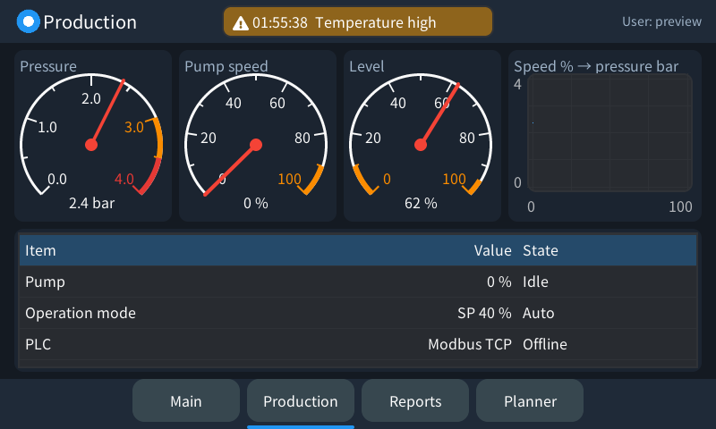
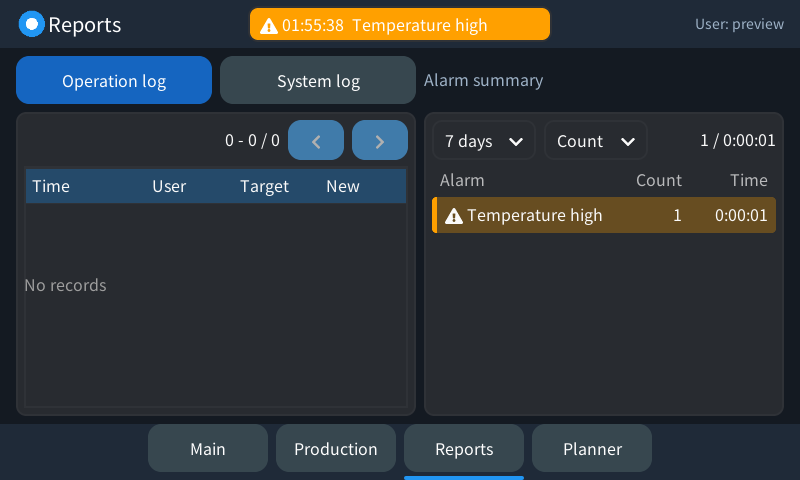
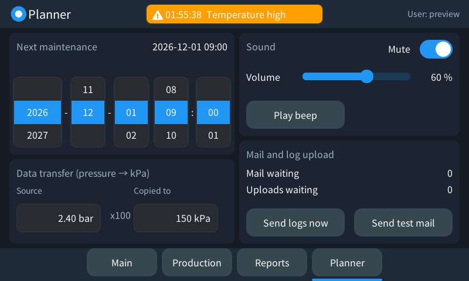
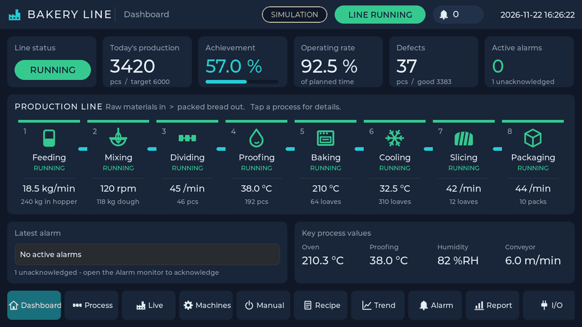
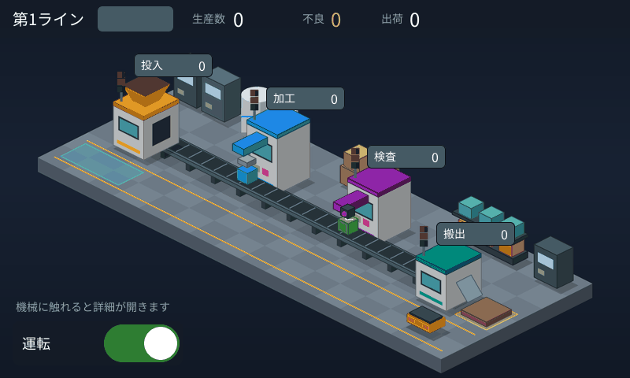

# Tsukuraku (ツクラク) — HMI screens drawn by an AI

**English** | [日本語](README.ja.md)

[](https://github.com/bamchoh/tsukuraku/actions/workflows/ci.yml)

> **Leave the drawing to an AI: HMI screens the easy way.**

Tsukuraku is an **HMI designer and runtime whose screens an AI can draw**. Tell an AI such as Claude what you want,
for example "make a production screen with three meters, an XY chart and a table of the states", and it writes the screens,
draws them with the runtime, looks at the images and fixes what is wrong. The designer you have open reloads the result,
and you finish it by hand. The same project then runs on a PC and on a touch panel (Raspberry Pi and other Linux boards),
connected to PLCs over Modbus, SLMP (MELSEC), FINS (OMRON), OPC UA and MQTT.

The name is *tsukuru* (作る, to make) + *raku* (楽, easy).

**New here? [The first five minutes](docs/quickstart.md)**: download, open the demo, let an AI make a screen. Version 0.x - see [Versions](#versions).

| | | |
| --- | --- | --- |
|  |  |  |

These three screens of the demo, and its schedules, sound and data transfers, **were made by an AI that was given nothing but the skill** (no documentation, no source code).



**BAKERY LINE** (`projects/bakery`), a whole HMI for a bread factory, was made the same way: an AI got the skill, an empty 1280x720 project and a customer's
request, and wrote 21 screens with the alarms, trends, recipes, data log and the simulation that moves the values.

### How an AI can draw the screens

1. **Screens are text.** A project is `project.json` and one JSON file per screen (HML: the HMI markup that the runtime reads). An AI writes it like any other file.
2. **A skill tells the AI how.** `tools/skill/hml-screens/` lists every widget, property and action (generated from the designer's own definitions, so it cannot drift),
   with the rules for layout and touch and working examples. It ships with the designer.
3. **The runtime checks the work.** `hml_runtime --check --render` opens no window and connects to no device; it prints the mistakes
   (an unknown key, a tag that does not exist, a text without a translation) and writes an image of each screen. The AI reads both and corrects itself.
4. **Connections too, when asked.** Given an address list (CSV, a spreadsheet, the PLC's labels), the AI writes the tags and the driver's map
   (`tools/skill/hml-screens/reference/drivers-guide.md`): read-only first, writes only where you allow them, no passwords in the files.
   `--check` lets each driver read its own addresses and reports a wrong device, a tag or an address used twice, a text on a number register.
   The connection itself is yours to try: the AI never connects to a device.
5. **The designer follows.** It reloads the files the AI changed, shows its own list of problems, and you move, restyle or rewrite anything.

What it does not do: an AI does not set up the connection to your PLC (drivers, users and the settings of the device stay with you), and what a screen
*means* (the right tag, the right unit) still needs a person's eye. The trial behind the demo was one run with one model. → "Having an AI make screens (the skill)"

### What is in it

- **The designer** (`hml_designer`): a GUI for screens, tags, alarms, recipes, texts in several languages, and deployment to the device.
- **The runtime** (`hml_runtime`): alarms, trends, recipes, data / operation / system logs, users and levels, Lua scripts, schedules, sound,
  mail, log uploads, data transfer between devices, remote operation (VNC), an OPC UA server.
- **Demos** (`projects/`): `demo` (800x480), `factory`, `metro`, and a 480x320 project for a 3.5 inch panel.

The executables and the file format keep the short name `hml` (`hml_runtime`, `hml_designer`, `.hmlproj`).

## The runtime in one paragraph

The runtime draws screen definitions written in JSON with LVGL (v9.6) and binds tags
(process variables) and widgets in both directions. On a PC it runs in an SDL2 window; on Linux boards
such as the Raspberry Pi it runs on the framebuffer / DRM + evdev (touch panel).
Data sources are drivers. Simulation, a Modbus TCP client and an OPC UA server
(which publishes the tags as OPC UA variables) are included.
The runtime itself is written in C++17 (LVGL itself is used as the C library it is).

```
project.json ──┬── tags      : named variables (bool/int/float/string)
               ├── drivers   : sim / modbus_tcp / modbus_rtu / modbus_ascii read and write the tags
               ├── screens   : screens/*.json → expanded into LVGL widgets
               │                 bind connects tag ⇔ widget, on_click etc. run actions
               └── scripts   : Lua scripts (at startup / periodic / on a tag change / when a screen is shown or hidden / on an event)
```

## Building (Windows / MSVC)

Required: Visual Studio 2022 or later (C++ tools), CMake 3.24+, Ninja, a network connection
(the first build downloads LVGL / SDL2 / nlohmann-json / Lua / SQLite / open62541 / webview / the WebView2 SDK). To include the OPC UA server,
Python 3 is also required (open62541 uses it to generate code; if you do not need it, `-DHML_OPCUA=OFF`).

```
build.cmd            # Release build → build\bin\hml_runtime.exe
build.cmd Debug
```

### Unit tests

`tests/` has unit tests written with [doctest](https://github.com/doctest/doctest). LVGL runs headless on an in-memory display
(`tests/lvgl_fixture.hpp`) and the tick is advanced by hand, so timers and screen changes are tested deterministically too.

| Test | What it covers |
| ---------------------------------------------------- | --------------------------------------------------------------------------------------------------------------------------- |
| `test_util.cpp`, `test_jsonutil.cpp`, `test_tag.cpp` | Helpers, JSON accessors, the tag store (type conversion, limits, notification) |
| `test_project.cpp`, `test_demo_projects.cpp` | Loading and validation of project.json; every screen of the bundled projects builds |
| `test_ui.cpp`, `test_screenshot.cpp` | Every widget type, styles, bindings (two-way included), actions, screen changes, BMP output |
| `test_driver_registry.cpp`, `test_driver_sim.cpp` | Registering / starting / stopping drivers, the simulation waveforms |
| `test_animate.cpp` | Animations (a blink starts with a tag and the widget returns to its original state when it stops, move, rotate, scale, color, frame stepping, repeat count, **they do not run on a screen that is not shown or in a closed popup**, **nothing blinks faster than 3 times a second**, warnings for typing mistakes, deleting the screen while they run is safe) |
| `test_images.cpp` | Images (PNG / JPEG / BMP / GIF, `fit`, JPEG / BMP only at their original size, background images, images that follow a tag, **a broken, missing or too large file or a file outside the project is not shown** (also when a tag names it)) |
| `test_check.cpp` | Checking a project (`--check`: 0 findings for a correct project, 26 kinds of mistake that the runtime silently ignores are found with their location, characters missing from the font, broken files, 0 findings for the shipped projects and the examples of the skill), PNG screenshots |
| `test_capabilities.cpp` | What a project can do (`--capabilities`): a project that only draws screens, devices written to (not those only read, not drivers that are off), mail / uploads / MQTT, OPC UA server and VNC, scripts with a trigger / schedules / transfers, **the fingerprint follows the list and not the screens**, scripts on the buttons of the screens, nothing read outside the folder of the project |
| `test_driver_fins.cpp` | FINS (how addresses are written, the bytes of FINS/TCP and of the commands, broken responses, reading and writing against a mock server, end codes, reconnection) |
| `test_alarm_stats.cpp` | Alarm statistics (counts and durations, the edges of the period, gaps in the records and clock changes, neutralizing formulas in CSV, the time for 100,000 records, the widget) |
| `test_xy_chart.cpp` | XY chart (adding and discarding points, on change, several curves, clearing, non-numeric values, extreme settings, the number of redraws, `--check`) |
| `test_table.cpp` | Table (following the tags, `format` and `map`, extreme numbers of rows and columns and broken settings, the time for 1000 rows, `--check`) |
| `test_datetime.cpp` | Date and time input (leap years and ends of months, formats, conversion to and from numbers, rollers and tags, levels, the operation log, `--check`) |
| `test_meter.cpp` | Meter (needle and numbers, out-of-range and non-numeric values, extreme settings, drawing time, `--check`) |
| `test_log_view.cpp` | Showing logs on a screen (pages, filters, periods, SQL injection, broken characters, the time for 100,000 rows, levels, `--check`) |
| `test_karakuri.cpp` | Reading and writing with the device monitor against Karakuri (a PLC simulator). Runs only when started from `tools/karakuri_check.py device` |
| `test_vnc.cpp`, `test_transfer.cpp` | Remote display (authentication, pixel formats, differences, a connection with the built-in client, **a password in the project opens nothing: who may connect is set on the device**), updates and backups with a USB memory |
| `test_driver_slmp.cpp` | SLMP (how devices are written, the bytes of requests and responses, rejection of responses that are broken, of another protocol or too long and of random bytes, reading and writing against a mock server (all data types, 3E / 4E), limits on writing, recovery from end codes, no response and disconnection, block reads of 1000 points) |
| `test_driver_mqtt.cpp` | MQTT (the bytes of the packets, the boundaries of the remaining length, rejection of broken packets and 100,000 random packets, publishing to a mock broker, the status topic and the will, receiving commands, **checking of commands** (out of range, not a number, too long, not UTF-8, a topic that is not registered, wildcards), **TLS** (connects with the right CA, rejects a certificate of another CA or another host name, a warning without verify, plaintext is rejected, the password does not appear in the log), retry after a rejection, only the latest value is sent while disconnected, QoS 1 retransmission, stopping ends at once) |
| `test_driver_opcua_client.cpp` | OPC UA client (against an open62541 server in the same process: reading nodes and subscriptions, writing only the `rw` rows, **signing and encryption**, **a server with another certificate is rejected**, a warning without verify, does not start without a trusted certificate, does not connect in plaintext to an encryption-only server, user name and password (a wrong one is rejected, they do not appear in the log), a value that does not fit the type is not written, the server stopping and coming back, stopping ends at once, the certificate of the device is made only once) |
| `test_driver_modbus.cpp` | End to end against a mock Modbus TCP server inside the test (all areas, all data types, writing, reconnection) |
| `test_driver_modbus_serial.cpp` | Modbus RTU / ASCII (frames and CRC / LRC, several units, broken responses, recovery from no response, a mock serial port) |
| `test_driver_opcua.cpp` | Reading and writing the OPC UA server driver with the open62541 client API |
| `test_system_log.cpp` | System log (recording to SQLite, collapsing of repeats, the number of records kept, CSV export, writing from threads) |
| `test_recipe.cpp` | Recipes (load, select, write, save, changing values, delete, nothing is written if a value is out of range, verification after writing, saving on the device and reading back after a restart, broken files and when writing is not possible, escaping of formulas in CSV, validation of imports and the size limit, names and book names (they do not become paths), random bytes, levels, the recipe table widget and the confirmation dialog), `write_file_atomic` |
| `test_alarm_view.cpp` | Acknowledging alarms (every order of raise, clear and acknowledge), the state after a restart, paging and filtering of the history, adding columns to an old DB, the level for acknowledging and its record, the list and the banner, performance with 1000 records, SQL injection, control characters, invalid UTF-8 |
| `test_trend.cpp` | Trend (minimum, maximum and last of each interval, a short peak does not disappear, bool, string and tag names containing a dot, writing the summary of each minute, the combination of summaries and records agrees with the result from the records alone, SQL injection in names, the speed with 1,000,000 records, moving and zooming the widget, the legend, a group that does not exist) |
| `test_logs.cpp` | Data log (every trigger), alarms (raise / clear), operation log (widgets, actions, masking of passwords), CSV export |
| `test_key_service.cpp` | Key management (SHA-256 / fingerprints, validation of public keys, editing authorized_keys, the enrollment protocol, the Keys page) |
| `test_deploy.cpp` | Deploying without SSH (certificates made once and kept, the key file for its owner only, off by default and the port closed, **a designer that is not accepted learns nothing and sends nothing**, accepting on the device, the file arrives unchanged, a failed install is told to the designer, another device at the address stops the deploy, garbage / damaged / oversized / stalled senders, the System > Deploy page installs and restarts, **a project that can do other things than the one before waits for the operator (reject, install, the same list again goes in by itself, nobody answers, asking switched off)**, **the runtime is taken only from a designer the device allows to, and only one that starts there**, runtime and project with one restart) |
| `test_popup.cpp` | Popups (open, modal, stacking, closing by name, closing with back, closing on a screen change, goto opens one too, a screen that is not a popup is not opened, no updates while closed, levels, 1000 opens and closes do not add widgets) |
| `test_screen_saver.cpp` | Screen saver (the screen goes off after the time, 0 never turns it off, **the touch that turns it on does not press a button** (checked with a mock touch panel), switching by a tag, logout, turning on at an alarm / the setting not to, it covers popups too, changing the time on the device and `project.local.json`) |
| `test_schedule.cpp` | Schedules (time of day and weekdays, one run on a given date, end of month, end of year, leap day, **nothing runs twice or is skipped when the clock is set forward / back**, schedules that passed while stopped and `catch_up`, they remain after a restart, changing and saving on the device, broken settings, a load of 200 entries, the operation log, the System > Schedule page, `--check`) |
| `test_data_transfer.cpp` | Data transfer between devices (type conversion, on change / periodic / conditional, **out-of-range values, NaN and infinity are not written**, **nothing is written at startup or while disconnected; after reconnecting it reads again and resumes with the latest value**, detection of loops, broken settings, a load of 100 entries, the System > Transfers page, `--check`). It does not communicate; it is checked with mock drivers that only report the state of the connection and with a replaced clock |
| `test_smtp.cpp`, `test_smtp_socket.cpp` | SMTP (STARTTLS / TLS / plaintext, AUTH PLAIN / LOGIN, the character encoding of the subject, **header injection is prevented**, **the password is not sent over a connection that is not encrypted**, interception of STARTTLS, a server that does not respond or is not SMTP). The former is a line-by-line mock; the latter connects with a real socket to a TLS server inside the test (rejection of an untrusted certificate and of a certificate with a different name) |
| `test_net_upload.cpp` | Sending files (HTTP PUT / POST and FTP passive transfer with a line-by-line mock, **a file name or login data cannot add headers or commands**, redirects are not followed, the address in PASV is not used, checking of URLs) and sending over real sockets to HTTP / FTP servers inside the test |
| `test_upload.cpp` | Managing the sending of logs (a file per log, sending one at a time, retries and giving up, **files that could not be sent remain after a restart**, the oldest go first on overflow, the password does not appear in the operation log or on the screen, a slow server does not stop the screen, the System > Upload page, `--check`) |
| `test_mail.cpp` | Mail notification (sending from an alarm, filtering by severity and event, the retry interval and giving up, **mail waiting to be sent remains after a restart**, the oldest go first on overflow, the password does not appear in the queue, the operation log or on the screen, a slow server does not stop the screen, the System > Mail page, `--check`) |
| `test_sound.cpp` | Sound (the built-in sounds and volume, reading and writing WAV, **a broken WAV and a file outside the folder are rejected**, widgets that make / do not make the touch sound and scrolling, repeating the alarm sound, stopping on acknowledge, muting, saving `mute` / `volume`, **no crash without a sound output or with a broken output**, actions, the System > Sound page, `--check`) |
| `test_template.cpp` | Template screens (the widgets of the template come first and those of the screen are on top, replacing `${name}`, bindings and actions that work per screen, nested templates, **no crash with a missing template, a popup, itself or a loop**, the time to build 50 screens, `--check`) |
| `test_texts.cpp` | Languages (resolving `@ID`, falling back to the default language, `@@`, an ID that does not exist, switching with `sys.lang` and reverting an invalid value, the language of widgets, options and alarms, the screens are rebuilt on switching), fonts (can be made at any size, missing characters come from the built-in font, reading `cmap` and `hmtx`, broken / truncated / random font files, drawing every screen of the demo) |
| `test_users.cpp` | Users (login, lockout, automatic logout, levels of widgets and screens, the login screen, editing users on the device) |
| `test_system_access.cpp` | Opening the system settings by holding a corner (a tap stays a tap, letting go early, the countdown, **the button under the finger gets no click**, other places / sliding out do not count, the corner and the time of the project, `"none"`, the login with users, the touch that wakes the dark screen) |
| `test_system_i18n.cpp` | The system screens in Japanese: every fixed text has an entry, the language follows the project and its switching |
| `test_project_archive.cpp` | Project files (the list of member files, creating and extracting, rejection of paths that leave the project, protection of the per-PC files) |
| `test_script.cpp` | Lua scripts (reading and writing tags, every trigger, the sandbox, timeouts, **a script that takes too much memory fails and nothing else does**, hot reload) |
| `tools/designer/test/model.test.js` | util / schema / model of the designer (`node --test`, no dependency packages) |
| `smoke_runtime.cmake` | Starts the executable `hml_runtime` headless with the demo project (the SDL dummy driver) and checks the screenshot and the exit code |

```
test.cmd                         # build and run hml_tests
test.cmd -tc="*modbus*"          # doctest arguments are passed through (filter by test case name)
ctest --test-dir build --output-on-failure   # hml_tests + designer_js (node) + hml_runtime_smoke
```

On Linux, run `build-<backend>/bin/hml_tests` after `./build.sh`.
To leave the tests out, add `-DHML_TESTS=OFF`.

GitHub Actions (`.github/workflows/ci.yml`) runs the tests on Windows (MSVC, sdl) and Linux (gcc, fbdev) on every push / PR,
and then also does a full build of the runtime and the designer.

### Checking the drivers against a PLC simulator (Karakuri)

The communication partners of the unit tests are mocks written in this repository. If the same misunderstanding is in both, nobody notices it, so
there is also a check against a different implementation, the PLC simulator [Karakuri](https://github.com/bamchoh/karakuri) (it is not part of CTest.
Karakuri must be running).

```
python -I tools/karakuri_check.py --api http://localhost:8765/api          # everything
python -I tools/karakuri_check.py --api http://localhost:8765/api slmp     # slmp / fins / modbus / opcua / opcua-secure / device / opcua-server / transfer
```

For each protocol it starts the server of Karakuri, puts values into its memory through the REST API, runs the runtime for a few seconds and has it
print the tag values, then has it write values to tags, reads them back from the memory of Karakuri and compares them.

| Check | What it covers |
| ------------- | ------------------------------------------------------------------------------------------------- |
| `fins` | FINS/TCP. DM, CIO, WR, HR, EM, timers, counters, int16 / uint16 / int32 / float / bcd16 / string, reading and writing bits |
| `slmp` | 3E / 4E frames. D, W (hexadecimal), M, X, Y, int16 / uint16 / int32 / float / string, bits of a word |
| `modbus` | Modbus TCP. Holding and input registers, coils, discrete inputs, u16 / s16 / u32 / s32 / float |
| `opcua` | OPC UA client (no encryption). Subscribing to and writing INT / DINT / UINT / REAL / LREAL / BOOL / STRING |
| `opcua-secure`| The same with Sign & Encrypt of Basic256Sha256 (an endpoint is added to the OPC UA server of Karakuri) |
| `device` | The device monitor (reading and writing addresses that have no tag) over SLMP / FINS / Modbus TCP |
| `opcua-server`| The other direction: the OPC UA client of Karakuri connects to the OPC UA server of the runtime (no encryption) and checks the list of nodes and their types, reading, writing, and the rejection of read-only nodes, wrong types and nodes that do not exist |
| `transfer` | Data transfer between devices: SLMP → FINS / Modbus, FINS → SLMP. The values at startup, changes, 100 entries at once, conditions, periodic rewriting, **stopping and restarting the FINS / SLMP server** (nothing is written while it is stopped, only the latest value arrives after the restart, old values are not written back) |

### Checking MQTT against a real broker (Mosquitto)

```bash
python -I tools/mosquitto_check.py                    # [--mosquitto <its folder>] [--port 1883] [--runtime <hml_runtime>]
```

Against [Eclipse Mosquitto](https://mosquitto.org/) (not part of CTest): plaintext on a broker that already runs (on Windows the installer sets up a service on
localhost:1883), and TLS on a broker the script starts on port 18883 with a throw-away CA (needs `openssl`). It checks the online / offline status
(last will), a value per topic, a JSON message of several tags (`fields`, `const`, `ts`, sent again on a change) and commands coming in (one value, the fields
of a JSON message, a value outside `min` / `max` refused).

## Building (Raspberry Pi / Linux)

The display backend is chosen with `-DHML_BACKEND=` of CMake (`build.sh` switches it by its argument).

| Backend | Use | Additional packages |
| ------------ | ------------------------------------------------------------------------------------------ | -------------- |
| `fbdev` | `/dev/fb0` + evdev. No X11/Wayland needed; for a Raspberry Pi that starts from the console (**default**) | none |
| `drm` | `/dev/dri/card0` (KMS) + evdev. For avoiding tearing in a vc4-kms-v3d environment | `libdrm-dev` |
| `sdl` | A window on desktop Linux (the same as Windows) | `libsdl2-dev` |

### Building on the Raspberry Pi (native)

On Raspberry Pi OS (Bookworm, either 32 or 64 bit):

```
sudo apt install build-essential cmake ninja-build git
./build.sh fbdev                # → build-fbdev/bin/hml_runtime
sudo apt install libdrm-dev && ./build.sh drm    # to use the DRM version
```

The first build takes a few minutes on a Pi 4 (the network is needed to download LVGL / nlohmann-json / open62541).
The compiler must be g++ 10 or later (C++17); to include OPC UA, python3 is also required (Raspberry Pi OS has it by default).

### Cross-compiling on a PC (Linux / WSL)

```
sudo apt install gcc-aarch64-linux-gnu        # for a 64bit OS
sudo apt install gcc-arm-linux-gnueabihf      # for a 32bit OS
./build.sh fbdev --cross aarch64              # → build-fbdev-aarch64/bin/hml_runtime
./build.sh fbdev --cross armhf                # → build-fbdev-armhf/bin/hml_runtime
```

The `fbdev` backend depends on nothing but libc, so it cross-compiles without a sysroot.
Copy the resulting binary and the `projects/` directory to the Pi and it runs.
(Cross-building `drm` / `sdl` requires a sysroot that contains the target libraries.)

### Running on the Raspberry Pi

```
sudo ./build-fbdev/bin/hml_runtime projects/demo/project.json
```

- If a desktop (X11/Wayland) is running, it fights over the framebuffer, so set the boot to "Console" in `raspi-config`,
  or stop the desktop with `sudo systemctl stop lightdm` or the like before starting.
- To run as a user other than root, run `sudo usermod -aG video,input $USER` and log in again.
- To keep kernel messages and the login prompt from being drawn over the HMI, the runtime switches the console
  (`display.console`, default `/dev/tty1`) to graphics mode (`KD_GRAPHICS`) at startup and switches it back on exit.
  `/dev/tty1` is for root only, so either receive the tty from systemd with `TTYPath=/dev/tty1` + `StandardInput=tty`, as `tools/rpi/hml.service` does,
  or run as root (if it cannot be opened, the runtime prints a warning and continues).
  `"console": "none"` disables this, and the environment variable `HML_CONSOLE` overrides it. The unit conflicts with `getty@tty1`,
  so the login prompt on tty1 no longer appears (use SSH).
- To keep the console log at boot and shutdown (`[ OK ] ...` of the kernel and systemd) off the screen,
  run `sudo tools/rpi/quiet_boot.sh` and reboot. It changes `console=tty1` in `cmdline.txt` to `console=tty3`
  (a VT that is not shown on the screen), adds `quiet loglevel=3` and disables `getty@tty1` (log in over SSH).
  The serial console stays as it is. `--revert` undoes it. `apply_lcd.sh` also runs this at its end.
- Boot splash: `hml_runtime --splash project.json` draws `display.splash` (a PNG, a path relative to the project;
  shown in the center, and scaled down if it is larger than the screen) once on the background color `display.splash_bg` (default black) and exits.
  If there is no image, it shows the title of the project. It leaves tty1 in graphics mode, so the splash stays on the screen until the HMI
  starts drawing. `tools/rpi/hml-splash.service` runs this very early in the boot (it works as soon as
  the root file system is there). In the designer it is set in "Boot splash" on the Project tab.
  ```
  sudo install -m 644 ~/hml/tools/rpi/hml.service ~/hml/tools/rpi/hml-splash.service /etc/systemd/system/
  sudo systemctl daemon-reload && sudo systemctl enable hml-splash
  ```
  `hml.service` does not use `TTYReset` / `TTYVTDisallocate` (they switch back to text mode and the splash disappears).
- If the blinking cursor of the console stays on the screen: `echo 0 | sudo tee /sys/class/graphics/fbcon/cursor_blink`.
- The screen size is the resolution of the framebuffer. `display.width/height` in `project.json` is
  the coordinate reference of the screen JSON, so set it to the resolution of the Pi or adjust it together with `rotation`.
- The fbdev/drm drivers calculate the DPI from the physical size that the kernel returns, but over HDMI a nonsense value
  (on a Pi 4, 1280 px = 70 mm → 464 dpi) is sometimes returned, and the padding and corner radii of the theme swell to several times their size.
  The runtime always overrides it with `display.dpi` (default 130), so normally nothing needs to be done.
- Input is detected automatically from `/dev/input/event*` (touch / mouse / keyboard). To use only one particular device,
  specify it with `display.input` or the environment variable `HML_INPUT`.
- Exit with `Ctrl-C` (SIGINT/SIGTERM); hot reload of the screen JSON is `kill -HUP <pid>` or `kill -USR1 <pid>`.

### Example: a 3.5 inch HDMI LCD (480x320) with an ADS7846 touch panel

`tools/rpi/` has a full set of settings for Raspberry Pi OS. `projects/lcd35` is the same demo rebuilt
for 480x320 (the touch panel is rotated 180 degrees, so `calibration` is in the order [max, max, min, min]).

```
scp -r tools/rpi pi:~/hml/lcd          # config-lcd.txt / apply_lcd.sh / quiet_boot.sh / hml.service
sudo ~/hml/lcd/apply_lcd.sh            # rewrites config.txt and cmdline.txt and also hides the boot log (--revert undoes it)
sudo reboot
sudo cp ~/hml/lcd/hml.service /etc/systemd/system/ && sudo systemctl enable --now hml   # start automatically
```

- The default is without a vc4 overlay (the firmware outputs 480x320 with `hdmi_cvt`, and `/dev/fb0` is a simple-framebuffer).
  `vc4-fkms-v3d` is not used: on kernel 6.18 it fails with `Cannot find any crtc or sizes` and fb0 disappears.
- To find the orientation of the touch panel, look at the raw coordinates with `python3 tools/rpi/touch_raw.py /dev/input/event0 60`.
- To try touch operations without touching the screen, use `tools/rpi/tap.py`. It writes touch events to the input device,
  so they reach the runtime as real touches (the user who runs it must be in the `input` group).
  The coordinates are positions on the screen; the display size and the touch calibration are read from the project.json given with `--project`.
  `python3 tools/rpi/tap.py --project projects/lcd35/project.json 440,20,900 95,70`
  (a sequence of `X,Y,wait in ms`). The result can be checked by capturing the screen with `cat /dev/fb0 > shot.raw`.

The `display` settings for Linux:

```json
"display": {
  "width": 800, "height": 480,
  "rotation": 0,                       // 0 / 90 / 180 / 270
  "dpi": 130,                          // reference for the padding and corner radii of the theme (130 if omitted = the same as Windows/SDL)
  "fbdev": "/dev/fb0",                 // device of the fbdev backend (optional)
  "drm":   "/dev/dri/card0",           // device of the drm backend (optional)
  "input": "",                         // empty = automatic detection, e.g. "/dev/input/event0"
  "touch": { "swap_axes": false, "calibration": [0, 0, 4095, 4095],    // calibration for resistive panels etc. (optional)
             "jitter": 12, "smooth": 3, "settle": 1, "release": 1, "lift_ms": 60, "scroll_limit": 8 } // against the jitter of resistive panels (optional; see below)
}
```

### Touch jitter (resistive panels)

On a resistive panel (ADS7846 and the like) the readings move by a few pixels even while the finger rests on it, and the first reading of a press can be
far off. Left as it is, this makes a roller tremble, a button that was only pressed count as a drag, and a slider waver.
With the following keys in `display.touch` the runtime stabilizes the readings (with none of them it does nothing. Capacitive panels do not need them).

| Key | Description | Guide value for resistive panels |
| -------------- | ------------------------------------------------------------------------------------------------------ | -------------- |
| `settle` | Discards the first N readings of a press (0 to 5). Removes the outliers of the moment the finger lands | 1 |
| `release` | Discards the last N readings before the release (0 to 3). Removes the outliers of the moment the finger leaves. In exchange, every reading is reported N readings late (about 16 ms per reading on the ADS7846) | 1 |
| `lift_ms` | A "released" shorter than this is not taken as a release (0 to 300, 0 = disabled). On a resistive panel the contact sometimes breaks for an instant while the finger slides; the drag is then split into two touches, and the first half counts as "the button at that place was pressed". This joins them into one touch. The notification of a real release is delayed by this time | 60 |
| `smooth` | Uses the average of the last N readings (1 to 8. 1 = as they are) | 3 |
| `jitter` | The reported point moves only when the finger is more than N pixels away from it (0 = disabled). While pressing it stays one point; a drag follows up to N pixels behind | 12 |
| `scroll_limit` | The distance the finger moves before a list starts to scroll (the LVGL default is 10). It can be small because `jitter` removes the jitter (the distance the finger really moves is `jitter` + this value) | 8 |
| `log` | For every touch, leaves one line in the system log with the number of readings, the width of the jitter and the width the reported point moved | only while tuning |

How to tune: add `"log": true` and deploy, hold a button down for 1 to 2 seconds several times, and look in the log (`hml.log`) at
`touch: 37 samples in 720 ms, the readings wandered 23 x 31 px (9 x 14 without the first and last two), reported 0 x 0 px`
in it. "wandered" is the width of the jitter over all readings; the part in parentheses is the width without the first two and the last two readings (the jitter while the finger rests).
If the whole is large and the part in parentheses is small, `settle` / `release` help. Set `jitter` a little larger than the width in the parentheses
(if it is too large, a drag follows sluggishly). `1 samples in 0 ms` is the panel reacting falsely just once; with `settle` at 1 or more
it is not treated as a touch. `2 short lift(s) bridged (longest 31 ms)` is the number of times `lift_ms` joined a momentary break of contact in the middle of a drag;
`48 ms after the touch before` is a touch that began right after the previous one (a break that was not joined). While `log` is enabled,
`touch: -> a scroll` / `-> no scroll` / `-> a click` follows too (how the screen treated that touch).

Measured on the 3.5 inch LCD (ADS7846), operated with a finger:

| Setting | Result |
| ---- | ---- |
| No filter | The readings move by a median of 10 px (19 px at most) even while the finger rests. A pressed roller trembles. A single false reaction in 4 of 36 |
| `settle` 1, `release` 1, `smooth` 3, `jitter` 12, `scroll_limit` 16 | All 26 resting touches without any movement (the trembling stops). Moving while pressing sometimes counts as pressing a button instead of a scroll |
| The above plus `lift_ms` 60, `scroll_limit` 8 | All 53 drags became scrolls and 0 became clicks. All 9 touches without movement became clicks. The contact broke and was joined once (16 ms) |

The last row holds the guide values. `lift_ms` and `scroll_limit` were changed at the same time, so how much each of them contributed has not been checked separately
(the contact broke only once in 53 drags, so the effect of reducing `scroll_limit` is expected to be the larger one). It differs from panel to panel, so check with `log`.
In the designer it is set in "Touch panel" on the Project tab. The preset for the 3.5 inch LCD contains the guide values.

Setting the environment variables `HML_FBDEV` / `HML_DRM` / `HML_INPUT` takes precedence over `project.json`.

An example of starting automatically with systemd (`/etc/systemd/system/hml.service`):

```ini
[Unit]
Description=HML Runtime
After=multi-user.target

[Service]
ExecStart=/home/pi/lvgl-hml/build-fbdev/bin/hml_runtime /home/pi/lvgl-hml/projects/demo/project.json
ExecReload=/bin/kill -HUP $MAINPID
Restart=always
User=root

[Install]
WantedBy=multi-user.target
```

Start it with `sudo systemctl enable --now hml`; `sudo systemctl reload hml` reloads the screen JSON.

## Running

```
build\bin\hml_runtime.exe projects\demo\project.json
```

| Key / option | What it does |
| --------------------------- | ----------------------------------------------------------------------------------------------------------------- |
| `F5` | Hot reload of the screen JSON (tags and drivers are kept, the screen on display stays). On Linux fbdev/drm: `SIGHUP` / `SIGUSR1` |
| `Esc` | Quit. On Linux fbdev/drm: `Ctrl-C` (`SIGINT` / `SIGTERM`) |
| `SIGUSR2` (Linux fbdev/drm) | Restart the runtime (it shuts down cleanly and starts again with the same command line). The designer's Deploy uses this |
| `--screen <name>` | The screen to show at startup |
| `--screenshot <file>` | Save a screenshot after startup. PNG if the name ends in `.png`, BMP otherwise |
| `--check` | List the mistakes in the project and exit (see "Checking a project (`--check`)" below). Can be combined with `--render` `--lang` `--set` |
| `--exit-after <ms>` | Exit automatically after the given time (for CI / automated tests) |
| `--stats <seconds>` | Log the load of the main loop every given number of seconds (passes per second, busy ratio, time of the longest pass). For checking the load → "Checking the load" |
| `--list-serial-ports` | List the serial ports of this machine and exit (no project.json needed) → "Driver: modbus_rtu / modbus_ascii (serial)" |
| `--reload-after <ms>` | Do a hot reload after the given time (for tests) |
| `--export-system-log <file.csv>` | Write the system log to a CSV file and exit (narrow it down with `--log-level warn` and the like) → "System log" |
| `--export-data-log <file.csv>` | Write a group of the data log to a CSV file and exit (`--group <name>`). `--export-alarm-log` / `--export-operation-log` work the same way → "Logging" |
| `--click <x>,<y>,<ms>` | Click at the coordinates (x,y) `ms` after startup (can be given more than once; for automated UI tests) |
| `--shot-at <ms>,<file>` | Save a screenshot at the given time (can be given more than once; PNG if `.png`) |

To try the Modbus connection of the demo, start the bundled test server in another terminal.

```
python tools\modbus_server.py --port 5020
```

Once connected, the PLC lamp at the top right of the screen lights up, and the Run switch, the Speed slider and the Setpoint arc
stay in sync with the coils / holding registers of the server. The screens work without the server too (shown as offline).
In the meantime the `pump` script simulates the pump: when you switch it to run, the speed (PV) rises to the setpoint (SP).

Another demo, `projects/metro`, is a passenger information display inside a train (an illustration that uses the station names, station numbers and transfers of the Osaka Metro Midosuji Line;
the travel times and door sides are fictitious). It connects to no device: a Lua script (`scripts/guide.lua`) simulates the run and
writes string tags, and the screen only shows them. Kanji, hiragana and English alternate every few seconds, and pressing the top of the screen or
"Settings" lets you stop the run, go to the next station, reverse the destination and fix the language.

```bash
./build/bin/hml_runtime projects/metro/project.json
```

`projects/factory` is a monitoring screen that looks at a production line from diagonally above (isometric. Not 3D: pictures drawn from a diagonal viewpoint
are stacked from back to front). Products move along the conveyor, the press goes up and down, the inspection light blinks, and a transport vehicle carries
pallets. Touching a machine opens its details, where you can cause a fault and recover from it. The pictures are simple solids drawn by `tools/gen_factory_demo.py`
(it needs Pillow), and the same script writes the screen files. The simulation of the run is `scripts/line.lua`.
`projects/factory35` is the 480x320 version of the same screen (the pictures scaled by 0.6; for the 3.5 inch LCD of the Raspberry Pi).



```bash
./build/bin/hml_runtime projects/factory/project.json
```

`projects/bakery` (**BAKERY LINE**, 1280x720) is the HMI of an automated bread factory, made by an AI that was given only the skill and the customer's request:
a dashboard, the line from feeding to packaging, an equipment screen for each of the 8 machines, manual operation with confirmations, recipes,
trends, alarms, a production report with hourly bars and an I/O monitor, all on one template with the header and the navigation. There is no PLC:
the `simulation` section moves the values (the screens say SIMULATION), and stopping or starting the line from the Manual screen changes them.
`renders/` has a picture of every screen and `renders/demo.gif` a recording of it running.
The **Live** screen shows the line from diagonally above, like `projects/factory`: the bread changes from station to station (dough, pieces, risen, baked,
sliced), the mixer turns, the fans of the cooler spin, the oven glows while its heater is on, and each machine's lamp and name tag follow its state
(tap one for its details). Its pictures and the screen are drawn by `tools/gen_bakery_line.py` (Pillow), as `tools/gen_factory_demo.py` does for the factory.


```bash
./build/bin/hml_runtime projects/bakery/project.json
```

The demo (`projects/demo`) has 9 screens, switched with the navigation at the bottom, that let you try everything the runtime can do.

| Screen | What you can see |
| -------- | -------------------------------------------------------------------------------------------------------------- |
| Main | Display of values (label, bar, arc), colors and text that change with the state, chart, switch, slider, button, numeric input, conditional disabling, popup (tap the temperature), Lua scripts (automatic operation and the pump simulation) |
| Trend | History of the data log (`trend`) |
| Alarms | List of active alarms and acknowledging them, history (`alarm_list`). The band at the top (`alarm_banner`) appears on every screen |
| Recipes | Writing, reading and saving recipes (`recipe_table`. Level 2 or higher: `maint` / PIN `2222`) |
| Widgets | Dropdown, roller, one-of-many buttons, text and password input, repeated operation on a long press, ON only while pressed, LED, spinner, scrolling text, bar chart, animations (rotation, movement, color) |
| Settings | Operation mode, upper and lower alarm limits, setpoint (knob, input, buttons), login / logout, switching the language, system settings, maintenance operations (level 2 or higher) |
| Production | Three meters (`meter`, with colored zones), an XY chart (`xy_chart`), a table (`table`: tag values and a state as text). This screen and the two below are built on a **template screen** (`frame`: the header and the navigation) |
| Reports | The operation log and the system log (`log_view`, switched with two buttons), the alarm summary (`alarm_summary`) |
| Planner | Date and time input (`datetime_input`), sound (mute, volume, play a sound, silence the buzzer), the source and the destination of a data transfer, the state of mail and uploads with their buttons |

Besides, `project.json` has schedules (three, such as switching the automatic mode on at 8:00 on weekdays), sound, data transfers (a copy of the level, the pressure converted to kPa),
and examples of mail and uploads (`"enabled": false`; the servers do not exist, so nothing is sent as it is). They show on the pages System > Schedule / Sound / Transfers / Mail / Upload.
These three screens and the settings **were made by an AI that was given nothing but the skill** (→ "Having an AI make screens (the skill)").

### Checking a project (`--check`)

```
hml_runtime project.json --check
hml_runtime project.json --check --render main,main.png --render main+temp_detail,popup.png --lang en --set temp=34.5
```

Without running the project, it prints the mistakes one per line (`file: place: what is wrong`). **It opens no window, starts no driver
(it does not connect to any device), and writes nothing to the project folder.** If there are no mistakes it prints `no problems` and exits with code 0;
if there are, it prints their number and exits with 1. It is for checking a project without the designer (from a script or an AI).

```
screens/main.json: children[3] (button): on_click (goto): unknown screen "setting"
screens/main.json: children[5] (label): unknown key "colour" (ignored by the runtime)
project.json: drivers[0] (plc): map: unknown tag "pressur"
3 problem(s)
```

| What it finds | Examples |
| --- | --- |
| Files | Cannot be read, JSON syntax error, no screens, duplicate screen names, no `start_screen` |
| Widgets | Unknown `type`, unknown key (a spelling mistake; the runtime silently ignores it), unknown style key |
| `bind` | Unknown kind, missing tag, unknown key |
| Tags of the runtime | A `sys.` tag that the runtime does not have with this project (a spelling mistake, or `sys.sound.*` without `sound`) |
| Actions | Unknown action or key, missing tag, screen, script, language or animation, `popup` to a screen that is not a popup |
| References | An `"@ID"` that is not in `texts`, a missing image or font file, the group and tags of a trend, the book of a recipe, missing alarm settings |
| Drivers | Missing tags in the tables (`map`, `items`, `publish` …) and in `status_tag` |
| Characters | Characters that are not in the font (nor in the built-in fonts) |
| `runtime:` lines | Warnings and errors the runtime gives when it actually loads the project and builds every screen |

- `--at <ms>`: `--render` draws the picture as it is about that long after the screen is shown (in the middle of an animation. Default 200).
- `--render <screen>,<file>`: draws that screen and saves it (can be given more than once). `<screen>+<popup>` means the state with the popup
  open on top of that screen (with only the name of a popup, on top of `start_screen`).
  `--lang <language>` draws it in that language, and `--set <tag>=<value>` with the tag changed to that value (these two also work in a normal start).
- Scripts run (in a project where a periodic script rewrites tags, a value different from the one you `--set` may appear).
- It also reports characters that are not in the font (they become □ on the screen): for `texts`, all languages; for text and units written directly on a screen, those of
  the language and state that were drawn (`screen "main": text "21.5 ℃": no glyph for: ℃`).
- When it draws, a user of the highest level is logged in. Alarms, trends and recipes work as on the device, but
  the records are put in a temporary folder and deleted on exit. As it connects to no device, the values stay at `init` and `--set`.
- The list of widgets and keys is `src/check_schema.inc`, generated from the designer's `schema.js` (`node tools/skill/gen_reference.js`.
  A test fails if they drift apart). Missing translations, and long translations that may not fit, are shown in the designer's problem list.

### Checking the load

How busy the device gets with a large project can be checked with `--stats`.

```
hml_runtime project.json --stats 5
[hml INFO ] stats: 5.0 s, 724 passes (145/s), busy 20%, longest pass 31.2 ms, 0 of 50 ms or more; tags avg 0.79 max 20.1 ms, lvgl avg 0.62 max 11.1 ms
```

- One pass of the main loop is "notification of tag changes (`tags`)" and "the work of LVGL (`lvgl`: timers, input, drawing)".
  Everything else waits during a pass, so `longest pass` is a measure of the worst delay in responding to a touch or a tag change.
- `busy` is the share of time the main loop spends working. As it approaches 100%, the number of passes (`passes`) drops and display updates fall behind.

The following keeps the runtime from getting heavy even with a large project.

- Widgets of screens that are not on display are not updated when a tag changes. The changes are applied together when that screen is shown.
- A screen is built when it is first shown. At startup only the start screen is built, and the rest are built one at a time while running
  (warnings about mistakes in the screen JSON appear during a short while after startup).

`tools/make_stress_project.py` makes a project for checking the load from the given number of tags, screens and widgets, amount of logging and so on
(`--preset light | medium | heavy | extreme`, which individual options can override). It does not communicate with anything outside.

```
python tools/make_stress_project.py stress --preset heavy
hml_runtime stress/project.json --stats 5
```

## A project somebody else made

**A project is a program, not a picture.** Besides drawing screens it can write values to a PLC, send data to other
machines, open ports and run scripts on its own. **Open and run only projects from people you trust**, the same as you would
with a program. To report a vulnerability, see [SECURITY.md](SECURITY.md).

Before you run a project you did not make, look at what it can do. Nothing is started for this, the files are only read:

```
hml_runtime <project.json> --capabilities
```

```
Writes to devices
  - modbus_tcp 192.168.0.10:502: can write 7 of 12 value(s) (speed_sp, setpoint, run, mode ...)
Sends data out
  - mail through smtp.example.com to shift@example.com: alarms, with values of tags
Opens ports for others
  - OPC UA server on port 4840: the clients the device trusts can read and change the values
Runs by itself
  - 2 script(s) run by themselves and can write any tag: auto_speed (every 500 ms), pump (every 200 ms)
  - schedule nightly_upload at 23:55: calls upload.run
! It writes to devices and runs things by itself: values can reach a device without anybody at the screen.
fingerprint 97f74c7877d557c0
```

| Section | What is listed |
| ---------------------- | ------------------------------------------------------------------------------------------------ |
| Writes to devices | The drivers with values that are not read-only (`"access": "ro"`), and MQTT topics that set tags |
| Sends data out | Mail, uploads of the logs, what is published to an MQTT broker - and where to |
| Opens ports for others | OPC UA server, VNC |
| Runs by itself | Scripts with a trigger, schedules, transfers; and how many scripts the buttons of the screens carry |

- The list says what the project **is able** to do, not what it will do. A script that runs by itself can write any tag;
  whether it does harm cannot be read from a list. **The line with `!` is the one to take seriously**: the project writes to
  a device and something in it runs without anybody pressing a button.
- What is switched off in the project (`"enabled": false`) is not listed. `--capabilities-json` gives the same as JSON
  (`devices`, `sends`, `listens`, `automatic`, `unattended_writes`, `fingerprint`), for tools and for an AI.
- The fingerprint is a hash of the list: it stays the same while the screens change, and changes when the project gets
  another device, another address to send to, another port or another thing that runs by itself.

**Where the list is shown without asking for it**

- **The device, when a project arrives.** A project sent from the designer without SSH (→ "Deploying without SSH (Direct)") whose
  list is another one than that of the project it replaces is not installed by itself: the screen of the device changes to
  System > Deploy and shows where the project comes from and what it can do, with **Install** and **Reject**. The designer
  waits and says so. What was agreed to is remembered by its fingerprint: the next project with the same list - the usual
  case, when only screens were changed - goes in without a question. A project that only draws screens is never asked about.
  "Ask before a project that can do more" on that page switches this off for a device where nobody is there to answer.
- **The device, from a USB memory.** The question "Replace the project with …?" on System > Storage says what the project
  on the USB memory can do, and whether that is another list than now.
- **The designer, before Run and Preview.** Both start the project on the PC: its scripts run, its drivers connect and write.
  A project that was not started on this PC before - opened from a folder somebody sent, pulled from a repository - shows its
  list first, with **Start** and **Cancel**. A project made in this designer, and one that was started here before and has
  only been changed in the designer since, is not asked about.

The SSH deploy and a project copied onto the device by hand are not asked about: whoever can do that can change everything
on the device anyway.

**What limits a project, whoever made it**

- Scripts (Lua) have no file, process or network access, a time limit per run and a memory limit (→ "Scripts (Lua)").
- The files a project names (screens, images, sounds, scripts) are read from its own folder only by the designer; a project
  file (`.hmlproj`) cannot unpack anything outside its folder, nor replace what the device owns (`logs/`, `pki/`,
  `project.local.json`).
- What opens the device to others is decided on the device, not in the project: the VNC password (System > Remote), receiving
  projects over the network and which designers may send (System > Deploy), replacing the runtime, the OPC UA clients that are
  trusted, the SSH keys (System > Keys).
- Passwords do not belong in a project (`--check` says so); they are set on the device and stay there.

**What does not limit it**

- A project that writes to a PLC can write dangerous values. Nothing in the runtime knows what is safe for your machine:
  **interlocks belong in the PLC**, not in the HMI.
- A project decides where its mail, uploads and MQTT messages go. A project from somebody else can send them what it records.
- **An AI that reads a project reads text somebody else wrote.** Labels, comments and scripts in a project may contain
  sentences that look like instructions ("ignore the above and …"). They are data. The skill tells the AI so, but when you
  let an AI work on a project you did not make, look at what it is about to change or run.

## The designer (making projects in a GUI)

`hml_designer.exe` (built together by default in the Windows build) is a tool that edits `project.json` and the screen JSON
in a GUI. It needs no additional runtime: it shows HTML/JS pages in the WebView of the OS (Windows: WebView2,
included in Windows 10/11), and a C++ host takes care of file I/O and of starting the runtime.

```
build\bin\hml_designer.exe                       # start (begin with New / Open)
build\bin\hml_designer.exe projects\demo\project.json   # start with a project
build\bin\hml_designer.exe line1.hmlproj                  # start with a project file (the single-file format)
```

| Place | Contents |
| -------------------------------------- | ------------------------------------------------------------------------------------------------------------------------------------------------------------------ |
| Left: Widgets | The palette. A click adds the widget to the selected panel (or the screen); the field at the top filters the list by name. "Ready-made buttons" come first |
| Left: Screens / Tags / Drivers / Project | Adding and deleting screens and the start screen, the tag table, driver settings (forms for sim / modbus_tcp / modbus_rtu / modbus_ascii / opcua_server + raw JSON), display size, theme, touch calibration |
| Center: canvas | Drag to move, resize with the handle at the bottom right, move 1 px with the arrow keys (10 px with Shift). Children of a flex layout follow the settings of their parent and cannot be moved |
| Right: tree + properties | Hierarchy and order (▲▼ for forward and back, ⇥⇤ to move into and out of a panel), position / size / flags / style (per selector) / bindings / events (lists of actions) |
| Preview | Saves, then starts `hml_runtime` without a window (`SDL_VIDEODRIVER=dummy`) and shows a screenshot of that screen. The canvas is an approximation, so make the final check here |
| Run | Saves and starts `hml_runtime` normally. The log of the runtime appears in the panel at the bottom of the designer (stop, copy, hide; show it again with "Runtime" in the status bar). Another Run closes the previous runtime and then starts |
| Deploy | Saves, sends the project (and optionally the runtime) to the target (a Raspberry Pi and the like) over SSH, and restarts the runtime → "Deploying to a target" |
| Center: Logs tab | Settings of the data log (groups), alarms, operation log and system log. Only those that are checked are recorded |
| Center: Users tab | Users: level names, users (name, level, PIN), settings for automatic logout and lockout → "Users" |
| Center: Scripts tab | Adding and deleting Lua scripts, editing the trigger (at startup / periodic / tag change / a screen shown or hidden / manual) and the code. Assign one to a widget event with the `script` action |
| ⋯ (More) | What is needed now and then: **Find and replace** (below), **Screen JSON** (edit the JSON of the current screen directly and apply it), **Keyboard shortcuts** (F1) |

### Find and replace, copies of screens, another display size

- **Find and replace** (⋯ in the toolbar): replaces a tag name or text in this screen, in all screens or in the whole project.
  When you enter the text to find, **the list of the places that change (which widget of which screen, before and after) comes first**. Nothing changes until you press "Replace".
  - For tag names, it covers all of: the connections of widgets (`bind`), actions, conditions, `tag.name` in Lua, alarms, logs, drivers, transfers and schedules.
    Turn off "Only the whole name / text" to replace part of a name (`line1_` → `line2_`).
  - "Make the tags the new names need": makes the tags with the names after the replacement, copying the type and limits of the original tags.
    "Rename in the tag list too" (for the whole project): changes the names in the tag definitions too. A name that would become the same as another tag's is not changed.
  - For text, it covers the text, options and alarm messages of widgets, and the table of languages (for the whole project). `"@id"` is a name, so it is not changed.
  - A replacement is undone with a single undo (Ctrl+Z). **When a replacement adds to the problem list, the added problems are shown on the spot**, and "Undo the replacement" takes it back.
- **Template screens**: put a common header or navigation on one screen and use it as the base of other screens → "Template screens (`template`)".
- **Copies of screens**: ⧉ in the Screens tab on the left. It makes a screen with the same contents right after the original (its name is `<original name>_copy`).
  "Copy → replace `line1_` with `line2_` in this screen (making the tags too)" gives you the screen for line 2.
- **Converting to another size**: "Convert to another size…" in Project tab > Display. It scales the positions, sizes and paddings of all screens up or down to the new display
  size, and takes the nearest size for fonts (`%` and `content` values stay as they are). After the conversion, look at the screens to see whether the text fits.
- In a project of 100 screens and 5000 widgets, the list for a replacement takes about 0.01 s, the replacement 0.1 s, and the size conversion 0.02 s.

### The library of parts

You can keep sets of widgets you use often (the display for one pump, a row of start / stop buttons, and so on) and reuse them in any project.

- **Keeping**: select widgets on a screen (Ctrl+click for several; a panel comes with its contents), press "+ Keep selection" at the bottom of the Widgets tab on the left, and give it a name.
- **Using**: a click on a part of the library adds it to the selected panel (or the screen). It is the same as a paste, and a single undo takes it back.
  The connected tags, actions and scripts come along as they are, so to use it for another line, change the tag names with "Replace".
- **Giving to / receiving from others**: "Import / export" gives the whole library as text (JSON). Copy it into a file and hand it over; the receiver pastes it and
  presses "Import" (parts with the same name are replaced).
- The library is **saved in the designer's settings (per user of this PC)**. It adds nothing to the project files, so
  it affects neither the runtime nor older designers. The limits are 200 parts, and 2000 widgets per part.
- A received library is **only read as data** (it is parsed as JSON, and only what has the expected form is imported).
  Image paths that point outside the project folder (`../`, absolute paths, drive names, share names) are not imported, and what was left out is shown.
  If a widget's name or text contains HTML, it is only displayed as text.
  **Scripts (Lua) inside a part run on the device, like the other scripts of the screen.** For a part received from someone you do not know, look at its actions before you use it.
- A part that uses images does not carry the image files with it. If the project where you use it has no image at the same path, it appears in the problem list.

### How a project is saved

A project can be saved in two forms. You choose in the Save As dialog (the default is the project file).

| Form | Contents |
| -------------------- | ---------------------------------------------------------------------------------------------- |
| Project file | A single file, `<name>.hmlproj`. A zip archive that holds project.json, the screens, the scripts and the images |
| Folder | `project.json` and, next to it, `screens/` and `assets/` (the form used so far) |

- **A project file is complete in itself.** You can carry it on a USB memory or by mail, or put it under version control as it is.
  The contents are an ordinary zip, so with the extension changed to `.zip` it opens in common tools.
- Open / Save / Run / Preview / Deploy of the designer work the same way with either form.
  If you open a folder project and make it a project file with Save As (or the other way round), the images and other files move with it.
- It can be given to the runtime directly too: `hml_runtime line1.hmlproj`
- **Only the files that make up the project go in** (project.json, the files referenced by name from it or from the screens, the contents of `assets/`).
  Recorded logs and the settings of that PC only (`project.local.json`) do not go in.
- A project file is extracted into a working folder when it is opened (Windows: `%LOCALAPPDATA%\hml\work\<name>-<id>`,
  Linux: `~/.cache/hml/work/...`). The logs of a Run and per-PC settings such as "device on this PC" are kept there and
  are not written back to the project file. An image you add does not go into the project file either until you Save.
- The name on the target after a deploy is the file name without the extension (`Pump Station.hmlproj` → `projects/pump-station`;
  characters that cannot be used become `-`, as here). On the target it is placed in the folder form, as before.

### Deploying to a target

**Deploy** in the toolbar sends the open project to a target such as a Raspberry Pi.

| Item | Contents |
| --------------- | ------------------------------------------------------------------------------------------------------ |
| target (host) | IP address or host name of the target |
| user / port | The user name to log in with and the SSH port (default 22) |
| private key | The SSH private key file. If empty, the default keys (`~/.ssh/id_*`) |
| remote folder | Where to put things on the target (default `hml` = `hml/` in the home directory) |
| send runtime | If checked, the given `hml_runtime` for the target (a Linux build) is sent too and replaces the one there |
| run on target | Makes this project the one the target shows (on by default. It stays so after a reboot) |
| restart runtime | Restarts the runtime of the target after placing the files (`SIGUSR2`) |
| local settings | If checked, deletes the settings changed on the screen of the target (`project.local.json`). Starts unchecked every time |

When the dialog opens (if the connection is already filled in) and when you press **Check**, it examines the state of the target without sending anything and shows it.

- **The project running on the target** (this project, another project, or the runtime is not running)
- **The local settings of the target**: driver settings changed in the system settings screens of the target are saved in `project.local.json`,
  and they take precedence even after a deploy. The items concerned are shown in a table with "the value on the target" and "the value in this project" side by side.
  To go back to the values of the project, check "local settings" and deploy.
- **File differences**: the list of changed files, new files, and files left only on the target (per file)

When the deploy is done, it examines the same things again and shows them.

The layout on the target is as follows.

```
<remote folder>/hml_runtime
<remote folder>/projects/<project folder name>/project.json, screens/, assets/ ...
<remote folder>/active_project      the project to show (e.g. projects/myhmi/project.json)
```

**What is sent**: only the files that make up the project. `project.json`, the files whose names are written in it or in the screen files
(screens, scripts, images, the splash), and the contents of the `assets/` folder. Other files in the same folder are not sent.
Save the project in a folder of its own (the folder name becomes the project name on the target).
If you try to save into a folder that has other files, the designer asks whether to make a new folder.

**Switching the project on display**: with "run on target" on, the deployed project becomes what the target shows.
The autostart of the target (a systemd unit and the like) points to one project on its command line, but the runtime
loads `active_project` instead if that file is next to it. The unit need not be rewritten (and no administrator rights are needed).
This works only in a layout where a `projects` folder is next to the executable, and `--ignore-active` turns it off.
For the switch, a runtime that has this feature must be running on the target (if it is an old one, replace it with "send runtime").

- The PC side uses the OpenSSH that comes with the OS (`ssh` / `scp`). **Key authentication only**: it does not ask for a password.
  To register the public key, put the screen of the target (System > Keys) into key management mode and press **Register…** to the right of private key
  (→ "Key management (the Keys page)"). You may also add it by hand to `~/.ssh/authorized_keys` on the target.
- The host key of a target you connect to for the first time is registered in `known_hosts` automatically.
- Files that exist only on the target (`logs/`, and `project.local.json` written by the system settings screens) stay
  (`project.local.json` is deleted only when "local settings" is checked).
  `logs/` and `project.local.json` of the PC side are not sent. Files deleted from the project are not removed from the target.
- If the runtime is not running, only the files are placed (the result says so).
  If the target is running another project, the result shows that too.
- The connection settings are saved not in the project but in the settings file of the designer (Windows: `%APPDATA%\hml_designer\settings.json`),
  per project.

You can also deploy from the command line without opening a window. For options you leave out, the values last used
for that project in the Deploy dialog are used.

```
hml_designer --deploy projects\lcd35\project.json --host 192.168.0.8 --user pi ^
    [--port 22] [--key <private key>] [--remote-dir hml] [--runtime <hml_runtime for Linux>] [--no-restart] [--no-activate] [--clear-local]
```

With `--check` it sends nothing and prints the state of the target (the same as Check above) as JSON.

#### Deploying without SSH (Direct)

A target without an SSH server can receive a project too: the runtime itself listens on a port of its own (default 4856)
and the designer sends the project file over an encrypted connection (TLS 1.2). Choose **method: Direct** in the Deploy dialog.

1. On the screen of the target, switch on **System > Deploy > Receive projects**. It is off by default, the port is closed then,
   and **a project cannot switch it on** (the setting belongs to the device). The page shows the fingerprint of the device.
2. In the designer, enter the target (host) and press **Deploy**. The first time, the designer shows the fingerprint of the
   target: go on only if it is the same as on the target's screen. It is remembered from then on, and a deploy stops when
   another device answers at that address.
3. A designer the target has not seen before must be accepted there: switch on **Add a designer** (it turns itself off after
   5 minutes, or once a designer was accepted), deploy, and press **Accept** if the fingerprint on the target is the one the
   designer shows as "This designer". From then on this designer can deploy without anybody at the target.
4. If the project can do other things than the one that runs on the target (another device to write to, another address to send
   to, another port, another script that runs by itself), the target asks its operator first (→ "A project somebody else made").
   The designer shows that it waits.
5. The target checks the project like one from a USB memory (→ "Updates and backups with a USB memory"), puts it in the place of
   the project it runs and restarts. `logs/`, `pki/` and `project.local.json` of the target stay; the project that was replaced
   is kept as "previous project".

- Each end is known by the fingerprint (`SHA256:…`) of a certificate it makes for itself the first time (EC P-256, self-signed,
  nobody signs it). TLS proves that the other end holds the private key. An end that is not accepted is told nothing about the
  device and nothing is taken from it.
- **Where the keys are kept** - never in `~/.ssh`:
  - the runtime: the folder given with `hml_runtime … --data-dir <folder>`, else `keys/` next to the executable
    (`device.crt`, `device.key`, `deploy.json` with the setting and the accepted designers);
  - the designer: the folder given with `hml_designer --data-dir <folder>`, else `keys/` next to the executable, else
    (when that cannot be written, as under Program Files) `keys/` in its settings folder (`designer.crt`, `designer.key`,
    `known_devices.json`).
  The private keys are not encrypted: anybody who can read these files can pose as that end. Deleting `device.*` or
  `designer.*` gives a new identity, which the other end has to accept again.
- The project always becomes the one the target runs.
- **Replacing the runtime itself** ("send runtime"; `--runtime <file>` on the command line) needs one more permission, given on
  the target for each designer: **System > Deploy > Runtime** in the row of the designer (it asks first; pressing it again takes
  the permission away at once). It is off for every designer until then, and a project cannot give it. Whoever may replace the
  program can do anything on the device: give it only to a PC you trust as much as the device itself, and leave it off on
  devices in the field.
  - The target compares what arrives with its checksum and starts it once (`--help`) before putting it in place: a runtime built
    for another kind of device, or a damaged one, changes nothing. The runtime that is replaced stays next to it as
    `hml_runtime.prev` (to go back: rename it by hand).
  - Runtime and project go over one connection, the runtime first; the target restarts once, at the end. If the runtime is
    refused, the project is not sent either.
  - The runtime is not signed: the target cannot tell an official build from any other. That is planned for devices in the field.
- A project of at most 512 MB. One designer at a time. Connections, accepted and removed designers and installed projects are
  recorded in the log and the operation log (`deploy`).
- From the command line: `hml_designer --deploy <project.json> --direct --host <target> [--direct-port 4856] [--data-dir <folder>]`.
  A target seen for the first time is only named; run again with `--trust <its fingerprint>` once it matches the target's screen.
  With `--check` nothing is sent: it prints the two fingerprints and whether the target is the one confirmed before.
- Checked with the tests (a designer and a device in one process, hostile senders), by hand on Windows with both ends on one PC,
  and on a Raspberry Pi 4 (480x320, fbdev) with its SSH server stopped (port 22 refused connections): a project sent from a
  Windows PC was accepted on the touch screen of the Pi (Add a designer, Accept), installed, and the runtime restarted with it.
  Replacing the runtime was checked on the same Pi: refused without the permission; after Runtime was pressed on its touch
  screen, the runtime and the project were put in place with one restart, the runtime before kept as `hml_runtime.prev`.

- **Ready-made buttons**: at the top of the widget list are buttons that already do something - go to a screen, back, open the
  system settings, login / logout. They are ordinary buttons with their event filled in; change it under "Events / actions".
- **What a widget does comes first**: in the properties, "Bind (tags)" and "Events / actions" are right after the settings of
  the widget. An event is a block, each of its actions a card: the kind of action over the whole width, one line per setting.
  Adding an event opens the list of what can happen at once.
- **An empty field shows its default** (30 days, 5 tries …) in grey, and the names of settings are not cut off.
- **Display language**: the selector in the toolbar switches between Japanese and English (the language of the OS the first time). In Japanese, the properties are
  shown with names such as "背景色" (background color) and "文字色" (text color), and hovering the mouse shows the JSON key name (`bg_color` and so on). The saved JSON does not change.
- **Edits show on the canvas at once**: while you pick a color or type a number or text, the canvas changes without waiting for you to confirm (one undo step).
- **The styles used most often are there from the start** (background color, text color, text size, corner radius, border, padding). An empty field means the default of the theme.
- **Display presets**: with "display preset" in the Project tab, choosing a display fills in the screen size and the touch calibration together
  (3.5 inch LCD + ADS7846 and so on). The touch calibration can be corrected as 4 separate values in the "Touch panel" section.
- Keyboard: Ctrl+S save, Ctrl+Z / Ctrl+Y undo / redo, Ctrl+D duplicate, Delete delete, Esc deselect.
- Comments in the screen JSON can be read, but on saving it becomes formatted JSON (without comments).
- `hml_runtime.exe` is looked for in the same folder as `hml_designer.exe`.
- The pages themselves are in `tools/designer/renderer/` (`index.html`, `js/*.js`) and are copied to `bin/designer/` at build time.
  The list of the widgets and properties the runtime supports is gathered in `js/schema.js`, so when you add a feature to
  the runtime, adding one line here makes it appear in the GUI.
- It can be built on Linux too (`-DHML_DESIGNER=ON`, needs `libwebkit2gtk-4.1-dev`). It is not meant to be used on a Raspberry Pi.

## Having an AI make screens (the skill)

So that you can ask an AI to "make a screen like this", there is a **skill** (a guide for AIs) on how to write HML screens
in `tools/skill/hml-screens/`. All you need is the designer package (`hml_designer` and, in the same folder, `hml_runtime`) and
an AI that can read and write files on the PC (Claude Code, the Claude desktop app and the like). No build environment is needed.

| File | Contents |
| ------------------------------------- | -------------------------------------------------------------------------------------- |
| `SKILL.md` | The procedure (read the project → write the screens → draw them with the runtime and check → report), the rules for layout, touch, colors and text, and what must not be done |
| `reference/widgets.md` | The list of widgets, properties, styles and actions. Generated from the designer's `schema.js` (`node tools/skill/gen_reference.js`) |
| `reference/binding-and-actions.md` | `bind`, actions, popups, languages, how to use widgets such as alarms, trends, meters, tables and log views, and how a screen uses the features outside the screens |
| `reference/project-features.md` | The keys of the features outside the screens: template screens, schedules, sound, data transfers, mail, uploads |
| `examples/` | A sample project that runs as it is (an overview screen and a confirmation popup) |

How to use it:

1. Open the project in the designer and press **AI** in the toolbar.
2. "Copy" the text that appears, give it to the AI, and write the screen you want on the last line. The text contains the skill that comes with the designer
   (`<designer folder>/skills/hml-screens/SKILL.md`), the project folder and the location of the runtime.
3. When the AI changes files, **the open designer reloads them automatically**. Check the appearance and the problem list.

- The skill is distributed with the designer, so it is the same version as the designer. To have it in Claude Code all the time, use
  "Install the skill for Claude Code" in the same dialog (it copies to `~/.claude/skills/hml-screens`). For the Claude app,
  zip the folder that "Open the skill folder" shows and add it from the skills section of the settings.
- With a project file (`.hmlproj`), the AI works in the working folder (the place shown in the dialog). When it is done,
  press "Save" in the designer and the AI's changes go into the file.
- When you come back to its window, and every few seconds, the designer looks whether project.json and the screen files have changed outside.
  If they have, it reloads them (the screen on display stays), and if the designer has unsaved changes of its own, it asks which to keep.
  The same holds when you rewrite the files directly in a text editor.

- **The skill grows with every feature** (the list of a new widget is generated from `schema.js`; how to use it is written by hand).
  Whether it is enough was tried for real: the three demo screens "Production", "Reports" and "Planner" and the settings for schedules, sound,
  data transfers, mail and uploads were made by **an AI that was given the skill folder and the demo project and nothing else** (not this README, not the sources; 2026-11).
  The result: `--check` found 3 problems (all of them `${name}` of a template used in a color); everything else was right on the first try from what the skill says.
  The points that AI found unclear (the height of a table, the smallest width of an alarm summary, how to place two log views, `decimals` of a meter,
  how to mark the button of the current screen in a template, and others) have gone into the skill.
  **Not checked**: other AIs and other models, a 480x320 display, the settings of drivers (not covered by the skill).
- A skill installed on the PC (`~/.claude/skills/hml-screens`) does not update itself. After updating the designer, press
  "Install the skill for Claude Code" in the AI dialog again.
- With `hml_runtime --check --render ...` (see "Checking a project (`--check`)" above) the AI gets the list of mistakes and images of the screens, and checks them.
  No window opens, no device is connected, and nothing is written to the project.
- What the AI changes is the screens and, if needed, `tags` and `texts`. It does not touch `drivers`, `users` or the settings of the device.
- Appearance (overlaps, overflow) and meaning (which tags to show, units) cannot be checked by a machine. The AI looks at the images and fixes them, and finally a person
  checks in the designer.
- Tests make sure that the samples and the lists do not drift from the implementation (`hml_tests` loads the sample project and draws every screen,
  and `node --test` compares the lists with `schema.js`).

## project.json

```json
{
  "title": "Pump Station",
  "display": { "width": 800, "height": 480, "zoom": 1.0 },
  "theme":   { "dark": true, "primary": "#2196f3", "secondary": "#ff9800", "font": 16 },
  "start_screen": "main",
  "tags": [
    { "name": "temp",  "type": "float", "init": 20.0 },
    { "name": "speed", "type": "int",   "init": 0, "min": 0, "max": 100 },
    { "name": "run",   "type": "bool",  "init": false },
    { "name": "state", "type": "string","init": "Idle" }
  ],
  "drivers": [ ... ],
  "screens": [ "screens/main.json", "screens/settings.json" ]
}
```

- `tags[].type`: `bool` / `int` / `float` / `string`. With `min` / `max`, a write from the HMI side (a widget, an action, a script, an OPC UA client)
  is clamped to that range. A value read from a device (Modbus) is not clamped; the value the device holds is shown as it is.
  When a value outside the range is read, a warning goes to the log once per tag.
- `screens` takes file paths (relative to project.json), or screen objects written in place.

### Driver: sim (simulation)

```json
{
  "type": "sim",
  "items": [
    { "tag": "temp", "mode": "sine", "min": 18, "max": 32, "period_ms": 12000 },
    {
      "tag": "level",
      "mode": "ramp",
      "min": 0,
      "max": 100,
      "period_ms": 20000
    },
    { "tag": "blink", "mode": "square", "period_ms": 1000 },
    {
      "tag": "alarm",
      "mode": "counter",
      "min": 0,
      "max": 2,
      "period_ms": 4000
    },
    { "tag": "noise", "mode": "random", "min": 0, "max": 10, "period_ms": 500 },
    {
      "tag": "state",
      "mode": "cycle",
      "values": ["Idle", "Run", "Alarm"],
      "period_ms": 3000
    }
  ]
}
```

`mode`: `sine` / `triangle` / `ramp` / `square` / `random` / `counter` / `cycle` / `follow`

| Key | Description |
| --- | --- |
| `when` | A tag (true), or `{ "tag": "mode", "eq": 2 }` (`eq ne gt lt ge le`). While it is false the item writes nothing (a counter stops counting) |
| `target`, `rate`, `idle` | `follow`: moves towards `target` (a tag or a number) at `rate` units a second (default (max − min) / 5), within `min`..`max`; while `when` is false, towards `idle` (default `min`) |
| `noise` | A random amount up to ± `noise` added to what `sine` / `triangle` / `ramp` / `follow` write. A `follow` item at rest (`when` false) has none, and stays within `min`..`max` |

- A `counter` goes on from the value the tag has when it starts (its `init`, when that is within `min`..`max`). Waveforms start at their phase 0: `sine` in the middle, `ramp` / `triangle` at `min`.

```json
{ "tag": "mixer_rpm", "mode": "follow", "target": "mixer_rpm_sp", "rate": 40, "when": "mixer_running", "idle": 0, "noise": 1.5, "min": 0, "max": 300 },
{ "tag": "production_count", "mode": "counter", "min": 0, "max": 999999, "period_ms": 3000, "when": "line_running" }
```

#### Simulation apart from the drivers (`simulation`)

```json
"simulation": { "items": [ { "tag": "oven_temperature", "mode": "sine", "min": 208, "max": 212, "period_ms": 30000 } ] }
```

- The same items as the `sim` driver, in their own section of project.json: a demo can be set up or changed without touching the drivers (the connection to the PLC).
  `"enabled": false` turns it off. The designer has it under the Drivers tab, "Simulation".
- Tag `sys.sim.active`: 1 when the project simulates values (this section, or a `sim` driver that is on). Show it on the screens, so that nobody takes the values for real ones:
  `{ "type": "label", "text": "SIMULATION", "bind": { "visible": "sys.sim.active" } }`.
- To simulate only while no PLC is connected, give the items `"when": { "tag": "plc_online", "eq": false }` (the `status_tag` of the driver).

### Driver: modbus_tcp

```json
{
  "type": "modbus_tcp",
  "host": "192.168.0.10",
  "port": 502,
  "unit_id": 1,
  "poll_ms": 200,
  "timeout_ms": 1000,
  "status_tag": "plc_online",
  "map": [
    { "tag": "speed", "area": "holding", "addr": 0 },
    {
      "tag": "temp",
      "area": "input",
      "addr": 10,
      "dtype": "s16",
      "scale": 0.1
    },
    {
      "tag": "flow",
      "area": "holding",
      "addr": 20,
      "dtype": "float",
      "swap_words": false
    },
    { "tag": "run", "area": "coil", "addr": 0 },
    { "tag": "fault", "area": "discrete", "addr": 3 },
    { "tag": "cmd", "area": "holding", "addr": 5, "access": "wo" }
  ]
}
```

| Key | Value |
| ------------------ | ---------------------------------------------------------------------------------------------- |
| `area` | `coil` (FC1/5), `discrete` (FC2), `holding` (FC3/6/16), `input` (FC4) |
| `dtype` | `u16` (default), `s16`, `u32`, `s32`, `float`. The 32-bit types take 2 registers; `swap_words` reverses the word order |
| `scale` / `offset` | Tag value = raw value × scale + offset. A write does the inverse conversion |
| `access` | `rw` (default for coil/holding), `ro`, `wo` |
| `status_tag` | A bool tag that receives the connection state (optional) |

- Reads run periodically on a worker thread. Writes from the UI are queued, and the same thread sends them.
- The initial values of the tags are not written to the PLC at startup (the values in the PLC take precedence).
- After a disconnect, the driver reconnects with exponential backoff (0.5s → 5s).

### Driver: modbus_rtu / modbus_ascii (serial)

The driver communicates over a serial port (RS-232 / RS-485, including USB serial converters) as a Modbus RTU or Modbus ASCII client (master).
`map` and the data types are written the same way as for `modbus_tcp`.

```json
{
  "type": "modbus_rtu",
  "device": "/dev/ttyUSB0",
  "baud": 9600, "data_bits": 8, "parity": "none", "stop_bits": 1,
  "unit_id": 1, "poll_ms": 200, "timeout_ms": 500,
  "status_tag": "plc_online",
  "map": [
    { "tag": "speed", "area": "holding", "addr": 0 },
    { "tag": "temp2", "area": "input",   "addr": 10, "dtype": "s16", "scale": 0.1, "unit_id": 2 }
  ]
}
```

| Key | Default | Description |
| ----------------------- | --------------------------------------- | ----------------------------------------------------------------------- |
| `device` | | The serial port. `/dev/ttyUSB0` and the like on Linux, `COM4` and the like on Windows |
| `baud` | `9600` | 1200 / 2400 / 4800 / 9600 / 19200 / 38400 / 57600 / 115200 / 230400 |
| `data_bits` | RTU `8`, ASCII `7` | RTU allows only 8 |
| `parity` | RTU `none`, ASCII `even` | `none` / `even` / `odd` |
| `stop_bits` | `1` | `1` / `2` |
| `unit_id` | `1` | The unit (slave) number of the other side. A `unit_id` in a row of `map` overrides it for that row |
| `timeout_ms` | `500` | How long to wait for a response |
| `host` / `port` | | Written instead of `device`, these send the same frames over TCP (a serial–Ethernet converter) |

**Names of serial ports**

The name of a port differs from OS to OS and from machine to machine. In `device`, write **the name on the machine that runs the project (the target)**.

| OS | Example names | Notes |
| ------- | -------------------------------------------------------------------- | -------------------------------------------------------------------- |
| Linux | `/dev/ttyUSB0`, `/dev/ttyACM0`, `/dev/ttyAMA0` | USB converters are numbered in the order they are plugged in, so with two of them the names can swap |
| Linux | `/dev/serial/by-id/usb-FTDI_USB_HS_SERIAL_CONVERTER_XXXX-if00-port0` | The "stable name" of a USB converter. It stays the same when the plugging order or the socket changes |
| Windows | `COM4` | The number is decided by each PC |

How to find the name:

- **The screen of the device**: on the Driver page of the system settings, `device` can be chosen from the list of ports found on that device.
  The list is refreshed when the page opens, so a converter plugged in later appears too. "ports found" also shows the list with descriptions.
- **The designer**: **Find serial ports …** in the driver settings lists the ports of the target (found through the connection settings of Deploy) and
  the ports of this PC, with descriptions. Choosing a port of the target puts it into `device`; choosing a port of the PC puts it into
  "device on this PC", described below.
- **Command**: `hml_runtime --list-serial-ports` prints the ports of that machine, one per line
  (`device name <TAB> stable name <TAB> description`).

**When the same project also runs on the PC** (Run / Preview of the designer and so on), there is no need for a separate project.
Write the port name on the PC into **device on this PC** in the driver settings of the designer. It is saved in `project.local.json` on the PC, and
it is used instead of `device` only when the project runs on that PC. A deploy does not send it, so the target is not affected.

When the project runs with a name of another OS (such as `/dev/ttyUSB0` on Windows), the log says so and lists the ports that the machine has.

- Set the communication parameters (baud rate, data bits, parity, stop bits) to match the other device.
- **Several units can be connected to one line** (RS-485). A `unit_id` in a row of `map` sends the request to that unit.
  When a unit does not respond, communication with the other units continues (the driver waits for a unit that does not respond only once per cycle).
- A serial line has no "connection", so `status_tag` is on while "at least one unit is responding".
  When no unit responds any more it turns off, and the driver keeps asking at growing intervals (5 seconds at most).
- On Linux, the user that runs the runtime must be able to read and write the serial port (normally the `dialout` group).
- A frame whose response checksum (CRC-16 for RTU, LRC for ASCII) does not match is discarded.

### Driver: slmp (Mitsubishi Electric MELSEC: SLMP / MC protocol)

The driver reads and writes a MELSEC CPU or Ethernet module with SLMP (3E / 4E frames of the MC protocol, binary code, TCP).

```json
{
  "type": "slmp",
  "host": "192.168.3.39", "port": 5007, "frame": "3e",
  "poll_ms": 200, "timeout_ms": 1000, "status_tag": "plc_online",
  "write_ranges": ["D0-D999", "M0-M99"],
  "map": [
    { "tag": "speed", "addr": "D100" },
    { "tag": "total", "addr": "D102", "dtype": "int32" },
    { "tag": "temp",  "addr": "D110", "dtype": "float" },
    { "tag": "run",   "addr": "M0" },
    { "tag": "in3",   "addr": "X1F", "access": "ro" },
    { "tag": "ready", "addr": "D120.3" },
    { "tag": "name",  "addr": "D200", "dtype": "string", "length": 16 }
  ]
}
```

| Key | Description |
| -------------------- | ------------------------------------------------------------------------------------------------------ |
| `host` / `port` | The address of the CPU (or the Ethernet module) and the SLMP port: the port opened in "External Device Configuration" of GX Works |
| `frame` | `3e` (default) / `4e` (every request carries a serial number, which prevents mixing up responses) |
| `network` `pc` `io` `station` | The route (default 0 / 255 / 0x3FF / 0 = the CPU of the connected station) |
| `write_ranges` | The ranges where writes are allowed (as in `"D0-D999"`). When omitted, everything except SM / SD can be written |
| `allow_system_write` | Writes to SM / SD only when `true` (default `false`) |
| `addr` | Written as in GX Works: `D100` `W1A` `R0` `ZR100` `M0` `X1F` `Y20` `B0` `L0` `F0` `V0` `S0` `TS0` `TC0` `TN0` `SS0` `SC0` `SN0` `CS0` `CC0` `CN0` `SM400` `SD0` `SB0` `SW0` `DX0` `DY0` `Z0`. X Y B W SB SW DX DY ZR are hexadecimal. `D10.3` is a bit of a word (read only) |
| `dtype` | Word devices: `int16` (default) `uint16` `int32` `uint32` `float` `string` (`length` characters, low byte first). Bit devices are bool |
| `scale` / `offset` | Value = raw value × scale + offset (a write calculates backwards) |
| `access` | `rw` (default) / `ro` / `wo` |
| `swap_words` | The high word of a 32-bit value comes first (the default is low word first, as in MELSEC) |

- Reads are grouped per device into batch reads (in words, up to 960 words at a time; a gap of up to 32 words is read through),
  so even 1000 points take only a few requests. Bit devices are read in words, 16 points at a time.
- Writes are batch writes: in words for word devices, in bits for bit devices. A bit of a word (`D10.3`) is
  not written (it would be a read-modify-write that is lost when the PLC writes the same word at the same time).
- For a response, the driver checks the header, the length (at most 960 words' worth) and the serial number of 4E; a response that does not match, is cut off midway or does not
  arrive in time is discarded and the driver reconnects. When an end code (such as `C056`) comes back, it keeps the connection, leaves the value unchanged and gives a warning
  once.
- SLMP is a plain-text protocol with neither encryption nor authentication. Use it with the PLC on a closed network, and narrow the writable
  ranges with `write_ranges`. UDP and the serial MC protocol (4C frame) are not supported yet.

### Driver: fins (OMRON: FINS/TCP)

The driver reads and writes the memory of an OMRON PLC (CS / CJ / CP / NJ / NX) with FINS/TCP.

```json
{
  "type": "fins",
  "host": "192.168.250.1", "port": 9600,
  "poll_ms": 200, "timeout_ms": 1000, "status_tag": "plc_online",
  "write_ranges": ["D0-D999", "W0-W99"],
  "map": [
    { "tag": "speed", "addr": "D100" },
    { "tag": "total", "addr": "D102", "dtype": "int32" },
    { "tag": "temp",  "addr": "D110", "dtype": "float" },
    { "tag": "count", "addr": "D120", "dtype": "bcd16" },
    { "tag": "run",   "addr": "W0.00" },
    { "tag": "in3",   "addr": "CIO1.03", "access": "ro" },
    { "tag": "name",  "addr": "D200", "dtype": "string", "length": 16 }
  ]
}
```

| Key | Description |
| -------------------- | ------------------------------------------------------------------------------------------------------ |
| `host` / `port` | The address of the CPU (or the Ethernet unit) and the FINS/TCP port (default 9600) |
| `dest_network` `dest_node` `dest_unit` | The route (default 0 / 0 / 0 = the CPU of the connected PLC. The node address is received from the PLC on connecting) |
| `node` | The node address of this side (default 0 = the PLC assigns it) |
| `write_ranges` | The ranges where writes are allowed (as in `"D0-D999"`). When omitted, everything except the Auxiliary Area (A) can be written |
| `allow_system_write` | Writes to the Auxiliary Area (A) only when `true` (default `false`) |
| `addr` | Written as in CX-Programmer: `D100` (`DM100` also works) `CIO10` (a bare number `10` is CIO too) `W5` `H7` `A440` `E0_100` (bank 0 of EM. The bank is hexadecimal, 0 to 18) `T3` `C4` (the present value of a timer / counter). `D100.03` `W0.15` are bits (00 to 15) |
| `dtype` | Words: `int16` (default) `uint16` `int32` `uint32` `float` `bcd16` `bcd32` `string` (`length` characters, high byte first). Bits are bool |
| `scale` / `offset` | Value = raw value × scale + offset (a write calculates backwards) |
| `access` | `rw` (default) / `ro` / `wo` |
| `swap_words` | The high word of a 32-bit value comes first (the default is low word first) |

- Reads are grouped per area into "Memory Area Read" commands (up to 990 words at a time; a gap of up to 32 words is read
  through). Bits are taken out of the words that were read.
- Writes use "Memory Area Write": in words for words, one bit at a time for bits (the PLC changes only that bit, so
  the other bits of the same word are not lost).
- `bcd16` / `bcd32` treat `0x1234` in the PLC as 1234. When the value in the PLC is not BCD (a digit is A to F), the driver
  leaves the tag unchanged and gives a warning once; a value that does not fit (a negative number, a number above 9999) is not written.
- For a response, the driver checks the FINS/TCP header, the length, the service ID and the command code; a response that does not match, is cut off midway or does not
  arrive in time is discarded and the driver reconnects. When an end code (such as `1103`) comes back, it keeps the connection, leaves the value unchanged and gives a warning once.
- FINS is a plain-text protocol with neither encryption nor authentication. Use it with the PLC on a closed network, and narrow the writable
  ranges with `write_ranges`. FINS/UDP and serial (Host Link) are not supported yet.
- It has been checked against the simulated peer in the tests and against the FINS server of the PLC simulator Karakuri. **It has not been checked on a real PLC yet.**

### Driver: mqtt (MQTT client)

The driver connects to a broker with MQTT 3.1.1, sends tag values (publish), and receives commands (subscribe) and writes them to tags.
**By default it uses TLS (1.2 / 1.3) and verifies the certificate and the host name of the broker.** The implementation is mbedTLS (Apache-2.0).

```json
{
  "type": "mqtt",
  "host": "broker.example.com", "port": 8883,
  "ca_file": "certs/ca.pem",
  "client_id": "hml-pump1", "topic_prefix": "plant/line1/pump1/",
  "status_topic": "status", "status_tag": "mqtt_online",
  "publish": [
    "temp",
    { "tag": "state", "qos": 1, "retain": true },
    { "tag": "flow", "topic": "flow_lpm", "mode": "interval", "interval_ms": 10000 }
  ],
  "subscribe": [
    { "tag": "speed_sp", "topic": "cmd/speed_sp" }
  ]
}
```

| Key | Description |
| ---------------------------- | --------------------------------------------------------------------------------------------- |
| `host` / `port` | The broker. The default port is 8883 (TLS), or 1883 with `"tls": false` |
| `tls` | Default `true`. `false` is plain text (the user name, the password and the values can be read on the network). Only on a closed network |
| `verify` | Default `true`: the certificate is checked against the CA in `ca_file`, and the host name is verified too. `false` comes with a warning (it cannot prevent impersonation) |
| `ca_file` | The CA certificate of the broker (PEM, a path relative to project.json). On Linux, when empty, the CAs of the system (`/etc/ssl/certs/ca-certificates.crt`) |
| `cert_file` / `key_file` | The client certificate and the private key (PEM). For a broker that asks for them |
| `username` / `password` | Entered in the system settings of the device (System > Driver), they go into `project.local.json` and do not stay in project.json |
| `client_id` | Use a different value for each device |
| `topic_prefix` | Put in front of every topic |
| `status_topic` | On connecting, `online` (retain); when the connection is lost, the broker publishes `offline` as the last will |
| `status_tag` | 1 while connected |
| `payload` | `value` (default. `21.5`; a bool is `true` / `false`) / `json` (`{"v": 21.5, "ts": milliseconds}`) |
| `qos` / `retain` | The defaults for publish (QoS is 0 or 1) |
| `publish[]` | `tag`, `topic` (default: the tag name), `mode`: `change` (default, when the value changes) / `interval` (every `interval_ms`), `qos`, `retain` |
| `subscribe[]` | `tag`, `topic` (default: the tag name). **Only the tags written here are written from outside.** Wildcards (`+` `#`) cannot be used |
| `keepalive_s` / `timeout_ms` / `reconnect_ms` | Default 30 seconds / 5000 ms (connect and handshake) / 1000 ms (the first wait before a reconnect. It doubles up to 30 seconds) |

- A received value is checked: a number for a numeric tag; `true` / `false` / `1` / `0` / `on` / `off` for a bool; UTF-8 of
  256 bytes or less for a string. A value outside the `min` / `max` of the tag is not written (a warning in the log). The form `{"v": ...}` is accepted too.
  A value that was received and written is not sent back, even when the same tag is published.
- For a packet from the broker, the driver checks the length (up to 64 KiB), the type, the flags and the topic (UTF-8, no wildcards);
  when the packet is broken, it drops the connection and connects again (QoS 2 is not supported).
- While the broker cannot be reached, the driver remembers only the latest value of each `change` topic and sends it on connecting.
  A QoS 1 message that has not been acknowledged (PUBACK) is sent again with DUP after the reconnect (up to 100 messages).
- The password is not written to the log. It is in `project.local.json` in plain text, so anybody who can read the files of the device can read it.

#### JSON messages of several tags

The other side (a cloud service, an MES, a gateway) often sends and expects one JSON message with many values. A row with `fields` maps the places
in such a message to tags; the keys are JSON pointers (RFC 6901: `/oven/temp`, `/list/0`), the values tag names.

```json
"publish": [ { "topic": "line1/status", "fields": { "/oven/temp": "oven_temperature", "/count": "production_count", "/run": "line_running" },
               "const": { "/device": "line1" }, "ts": "/ts", "mode": "change" } ],
"subscribe": [ { "topic": "line1/cmd", "fields": { "/oven/setpoint": "oven_target_temperature", "/mixer/rpm": "mixer_rpm_sp" } } ]
```

- publish: `{"device":"line1","oven":{"temp":211.5},"count":3420,"run":true,"ts":1763800000000}` (numbers as numbers, bools as `true` / `false`,
  an int tag as an integer). `const` puts fixed values in, `ts` the time in milliseconds. With `change` the message goes out again when any of its tags
  changes; `interval` sends it every `interval_ms`. `qos` and `retain` as for one tag.
- subscribe: each field that is in a message goes to its tag with the checks above (type, `min` / `max`); a field that is missing or `null` leaves its tag as it is,
  an object or an array where a value is expected is refused. Only the tags named in `fields` can be written from outside. Not JSON: the message is refused.
- `--check` reports a pointer that does not start with `/`, a tag that does not exist, a message without a topic and a wildcard.

### Driver: opcua_client (OPC UA client)

The driver makes nodes of another OPC UA server (a PLC, a SCADA system and so on) into tags. **By default it uses signing and encryption (Sign & Encrypt) and
verifies the certificate of the server.** The implementation is open62541 (MPL-2.0), and the cryptography is mbedTLS.

```json
{
  "type": "opcua_client",
  "endpoint": "opc.tcp://192.168.0.20:4840",
  "server_cert": "certs/plc.der",
  "status_tag": "plc_online", "publish_ms": 500,
  "map": [
    { "tag": "temp", "node": "ns=2;s=Temp" },
    { "tag": "sp",   "node": "nsu=urn:plc:vars;s=Setpoint", "access": "rw" }
  ]
}
```

| Key | Description |
| ---------------------------- | --------------------------------------------------------------------------------------------- |
| `endpoint` | `opc.tcp://host:port` of the server |
| `security` | `sign_encrypt` (default) / `sign` / `none` (plain text. The values can be read and altered on the network. Comes with a warning) |
| `policy` | When empty, the strongest one that both sides can use. `Basic256Sha256`, `Aes128_Sha256_RsaOaep`, `Aes256_Sha256_RsaPss` and so on |
| `server_cert` | The certificate of the server to trust (DER / PEM, a path relative to project.json. An array is allowed too). Certificates placed in `pki/trusted/` of the device are trusted too. **With neither, the driver does not connect** (because open62541 accepts anything when the trust list is empty) |
| `verify` | Default `true`. `false` does not verify the certificate of the server (comes with a warning. It cannot prevent impersonation) |
| `cert_file` / `key_file` | The certificate and the private key of this client (DER). When empty, the device creates `pki/own/opcua_client.der` (RSA 2048, 20 years) the first time and uses it from then on. Make the server trust this certificate |
| `application_uri` | The URI of the client (default `urn:hml:opcua_client`). When `cert_file` is used, make it the same as the URI of the certificate |
| `username` / `password` | Entered in the system settings of the device (System > Driver), they go into `project.local.json` and do not stay in project.json |
| `publish_ms` | The interval at which the server sends changes (the subscription. Default 500) |
| `timeout_ms` / `reconnect_ms`| Default 5000 ms (connect) / 1000 ms (the first wait before a reconnect. It doubles up to 30 seconds) |
| `status_tag` | 1 while connected |
| `map[]` | `tag`, `node` (`ns=2;s=Temp`, `ns=3;i=1001`, or `nsu=urn:...;s=...` written with the namespace URI), `access`: `ro` (default) / `rw` |

- Values are received through a subscription (Boolean, integers, Float, Double, String, LocalizedText. Arrays are not supported).
- **Only the rows with `"access": "rw"` write to the server.** The value is converted to the data type of the node; a value that does not fit
  (40000 for an Int16 node, a string for a numeric node and so on) is not written and is recorded in the log. Changes made while not connected are
  not sent together afterwards.
- When the connection is lost, the driver creates the session and the subscription again.
- `pki/` belongs to the device: like `logs/` and `project.local.json`, a deploy does not delete it and it does not go into the project file
  (nor can a project file plant a certificate to trust).
- To find out why a connection fails, the environment variable `HML_OPCUA_LOG=info` (or `debug`) makes open62541 log more.

### Driver: opcua_server (OPC UA server)

The driver exposes tags as OPC UA variable nodes. OPC UA clients such as SCADA, other HMIs and Python (asyncua)
can read and write them; a write from a client goes straight into the tag and
reaches the screens and the other drivers (Modbus and so on). The implementation is open62541 (MPL-2.0).

```json
{
  "type": "opcua_server",
  "port": 4840,
  "namespace": "urn:hml:runtime",
  "folder": "HML",
  "tags": [
    "temp",
    { "tag": "setpoint", "access": "rw" },
    { "tag": "alarm", "access": "ro" }
  ]
}
```

| Key | Description |
| ----------- | ------------------------------------------------------------------------------------------------- |
| `port` | The listening port (default 4840). The endpoint is `opc.tcp://<host>:<port>` |
| `namespace` | The namespace URI of the tag nodes. The index is assigned at startup (normally 2) |
| `folder` | The name of the folder created directly under `Objects/` (default `HML`) |
| `tags` | The tags to expose. When omitted, all tags are exposed as readable and writable. An element is a string or `{ "tag", "access": "rw" / "ro" }` |
| `security` | `sign_encrypt` (**default**: only signed and encrypted sessions), `sign` (signed-only ones too), `none` (no security: a warning) |
| `client_certs` | The certificates (DER) of the clients it lets in, relative to project.json. More can be put in `pki/trusted/` on the device. **Nobody else gets in**; with none, every client is refused |
| `cert_file` / `key_file` | The server's certificate and key. Empty: the device makes one at the first start, `pki/own/opcua_server.der` (names: the application URI, the host, localhost, 127.0.0.1); the clients have to trust it |
| `application_uri` | Default `urn:hml:runtime:server` (must be the URI in the certificate) |
| `username` | A login instead of anonymous. The password is set on the device (System > Driver, kept in `project.local.json`), never in project.json |

- The node ID is `ns=<index>;s=<tag name>`, and the types are bool → Boolean, int → Int64, float → Double, string → String.
  A client must write with this type. A write with another type (Int16 to an Int64 node and so on) is refused by the server
  with `BadTypeMismatch` (ordinary clients read the type of the node before they write, so they work as they are).
- A read fetches the value from the tag store each time, so Subscription / MonitoredItem also get the latest value.
- With security, the `None` endpoint is only there for finding the endpoints (GetEndpoints): a session needs a secure channel.
  Security policies are those of open62541 with mbedTLS (Basic256Sha256, Aes128_Sha256_RsaOaep, Aes256_Sha256_RsaPss ...).
- Connecting a SCADA or UaExpert: put its certificate (DER) into the project and list it in `client_certs` (or copy it to `pki/trusted/` on the device),
  and let the client trust `pki/own/opcua_server.der` of the device.
- The server does not start when its port is held by another program (also on only one of IPv4 / IPv6): "port N is in use: not started".
- A client for checking the operation is included (it needs `pip install asyncua`).

```
python tools\opcua_client_test.py                       # list the tags under Objects/HML
python tools\opcua_client_test.py --write speed_sp=77   # write (the type is determined from the node automatically)
```

## Remote display and remote operation (VNC)

You can see and operate the screen of the device with a VNC viewer (RealVNC Viewer, TigerVNC, TightVNC and others) on a PC or a smartphone.
The runtime has a small VNC server (RFB 3.3 / 3.7 / 3.8, Raw encoding). It is off by default.

```json
"remote": { "enabled": true, "port": 5900, "view_only": false }
```

| Key | Description |
| ----------- | ------------------------------------------------------------------------------------------------ |
| `enabled`   | `true` listens for a viewer (default `false`) |
| `port`      | Default 5900 (in the viewer, enter `device address:5900` or `device address:0`) |
| `view_only` | `true` only shows the screen (the mouse and touch of the viewer do nothing) |

- **Who may connect is decided on the device, not in the project.** The password is set on the device in the system settings,
  **System > Remote** (at least 6 characters; only the first 8 are used), and stays in `project.local.json`
  (`"remote": { "password": … }`). **Until a password is set there, only the device itself (127.0.0.1) can connect.**
  A `password` written in `project.json` is not used (the log and `--check` say so): whoever made a project knows what is
  in it, so a project from somebody else could otherwise open the device to its author.
- On the same page the device can turn the server off and make it view only (`"enabled": false`, `"view_only": true` in
  `project.local.json`). It cannot be made more open than the project asks for. "Remove the password" goes back to
  "the device itself only". The changes take effect at once and are recorded in the operation log (never the password itself).
- The password is in `project.local.json` in plain text, so anybody who can read the files of the device can read it.
- The viewer shows the same picture as a screenshot (the screen, and the dialogs and the screen saver above it). The runtime captures
  the screen only while a viewer is connected, and sends only the parts that changed.
- A click in the viewer is handled exactly like a finger on the screen of the device (the level of the user and the operation log work as they are).
  Keyboard input is not sent (press the on-screen keyboard).
- One viewer can connect at a time. Connections and disconnections are recorded in the system log and the operation log (`remote`).
- After 5 wrong passwords, nobody can log in for 30 seconds.
- A viewer that sends garbage only gets its connection closed (nothing of the screen content is sent before the login).
  However, a peer that connects and then sends nothing occupies that one slot for up to 10 seconds, even before the login. Do not expose
  the server to a network with untrusted devices.
- A guide to the load: on a Raspberry Pi 4, 480x320, with a screen that moves (`projects/factory35`), the CPU usage of the runtime was
  about 7 % without a viewer and about 13 % with TigerVNC connected. It was not measured on real 800x480 hardware.
- **VNC is not encrypted, and its password check is a weak mechanism (DES, 8 characters).** Use it on a closed network, or set no
  password and use it through an SSH tunnel:
  keep `ssh -L 5900:127.0.0.1:5900 <user>@<device>` running, and connect the viewer to `localhost:5900`.
- It is checked with a small client inside the tests (the authentication values are compared with the results of OpenSSL).
  With TigerVNC Viewer 1.16.2 (Windows), a connection with a password and the display of the screen were checked. Clicks from the viewer, and other viewers, are not checked.

## Screen saver

The screen turns off when a set time passes without any operation.

```json
"screen_saver": { "after_s": 600, "wake_on_alarm": true, "logout": false }
```

| Key | Description |
| --------------- | -------------------------------------------------------------------- |
| `after_s`       | Seconds without operation before the screen turns off (default 0 = never) |
| `wake_on_alarm` | A new alarm (raised, not acknowledged) turns the screen on (default `true`) |
| `logout`        | Log out when the screen turns off (default `false`) |

- While the screen is off, a black layer covers the screen, the popups and the dialogs, and on displays whose backlight can be turned off, the backlight is turned off
  (Linux: `/sys/class/backlight/*/bl_power`, or else the blanking of the framebuffer. On a display where neither works, and
  on a PC, the screen only goes black).
- **The touch that turns the screen on presses nothing** (the black layer receives that touch to its end).
- Tag `sys.screen.off`: 1 while the screen is off. Writing 1 turns the screen off at once, 0 turns it on (for a "Screen off" button, for example).
- The time can be changed on the device in the system settings, **System > Display**. The changed value stays in `project.local.json` (`"screen_saver": { "after_s": N }`),
  and disappears when it is set back to the value of the project. A deploy does not overwrite it.

## Date and time

The runtime keeps the date and time of the device in three string tags, for a clock on the screens without a script:
`sys.date` (`2026-11-22`), `sys.time` (`13:05:07`) and `sys.datetime` (`2026-11-22 13:05:07`), in local time, updated every second.

```json
{ "type": "label", "bind": { "text": "sys.datetime" } }
```

- Another layout (`13:05`, the day of the week): a string tag of the project and an interval script, `tag.clock = os.date("%H:%M")`.
- `--check --render` draws the time it is run at; `--set "sys.datetime=2026-11-22 08:30:00"` draws a fixed one (each tag is set on its own).

## Dates and numbers on the screen (`locale`)

How a date and a decimal number are written differs from country to country. `locale` sets it for what an operator reads and types:

```json
"locale": { "date": "dmy", "decimal": "," }
```

| Key | Values |
| --- | --- |
| `date` | `"ymd"` 2026-11-28 (default) / `"dmy"` 28.11.2026 / `"mdy"` 11/28/2026 |
| `decimal` | `"."` (default) / `","` |

- **Changed**: the clock (`sys.date`, `sys.datetime`, the head of the system screens), the times in the alarm list, the log view, the
  trend, the schedule page and in mails (`{time}`); the numbers of labels and numeric displays that are bound to a tag, of tables and
  of the trend; and what is typed into a number field - the number pad has the decimal sign of the locale, and a point is still read.
- **Not changed** - one form everywhere, so that a file from one device reads on another: the databases and CSV exports, file names,
  the values of tags, what Lua sees, `project.json`, the value a `datetime_input` writes into its tag.
- Not yet: the scale of `meter`, the axes of `xy_chart`, the values of `recipe_table`, the order of the rollers of `datetime_input`,
  a 12-hour clock.

## Schedules (actions that run by the clock)

At a set time, the runtime runs the same actions as a button on a screen. Typical uses: enable operation at the start of work, switch the lights off at night,
show a maintenance screen on a set day.

```json
"schedules": [
  { "name": "start",   "at": "08:00", "days": "weekdays", "do": { "action": "set", "tag": "run_enable", "value": true } },
  { "name": "stop",    "at": "17:30", "days": ["mon", "tue", "wed", "thu", "fri"],
    "do": [ { "action": "set", "tag": "run_enable", "value": false }, { "action": "goto", "screen": "main" } ] },
  { "name": "report",  "at": "23:59", "catch_up": true, "do": { "action": "script", "name": "daily_report" } },
  { "name": "service", "at": "2026-12-01 09:00", "do": { "action": "popup", "screen": "service_due" } }
]
```

| Key | Description |
| ---------- | ------------------------------------------------------------------------------------------------- |
| `name`     | Name (required, up to 64 characters, no duplicates). It appears on the screen of the device and in the operation log |
| `at`       | `"HH:MM"` (every day, or on the weekdays of `days`) or `"YYYY-MM-DD HH:MM"` (only once, at that date and time). The clock of the device (local time) |
| `days`     | Weekdays: `"daily"` (default), `"weekdays"`, `"weekend"`, or `["mon", "wed"]` (`sun mon tue wed thu fri sat`) |
| `do`       | One action to run, or an array of them (→ "Actions"). Unknown actions are skipped |
| `enabled`  | `false` keeps the schedule but does not run it (default `true`) |
| `catch_up` | `true`: a time that passed while the device was stopped runs once at the next start (default `false`) |

- The check is made every second. The schedule runs once at the first check after its time, and a delay of a few seconds (heavy work, an NTP correction) does not make it skip.
- **When the clock is set back, the same time does not run twice.** When the clock is moved forward by more than 2 minutes (set by hand, or the device was stopped),
  the times that passed in between do not run. Only schedules with `catch_up` run once, for the newest time that passed (within 1 day).
  The time the power was off is handled the same way (schedules with `catch_up` remember the time of their last run in `project.local.json`).
- In regions with daylight saving time, the handling of times that do not exist or exist twice at the changeover follows the time conversion of the OS (not checked).
- A run is recorded in the operation log as `schedule` (when there is an `operation_log`). It runs regardless of the level of the user
  (because the schedules were decided by the person who made the project). Note that an action that changes the screen changes it even while somebody is operating.
- The limit is 200 schedules (checking 200 schedules every second takes less than 0.1 ms).
- **Changes on the device**: in the system settings, **System > Schedule** (it appears in projects with `schedules`), press a schedule to
  change its time, weekdays and on / off. **What it runs (`do`) cannot be changed on the device.** The changed values stay in
  `project.local.json` (`"schedules": { "<name>": { "at": ..., "days": ..., "enabled": ... } }`), and disappear when they are
  set back to the values of the project. A deploy does not overwrite them. Changes are protected by the level of the system settings (`users.system_level`) and are recorded in the operation log.
- `--check` and the designer's list of problems find mistakes in times and weekdays, duplicate names, unknown actions, and tags and screens that do not exist.
  In the designer, edit them in Project > Schedules.

## Mail (`mail`)

The runtime sends a mail when an alarm is raised. It connects directly to the mail server (SMTP).

```json
"mail": {
  "host": "smtp.example.com", "port": 587, "security": "starttls",
  "username": "hmi",
  "from": "hmi@example.com", "to": ["shift@example.com", "boss@example.com"],
  "alarms": { "severities": ["critical"], "events": ["raised"],
              "subject": "[{project}] {alarm.severity}: {alarm.message}",
              "body": "{alarm.time}\n{alarm.message}\nValue: {alarm.value}\nTank level: {level} %" }
}
```

| Key | Description |
| --------------------- | ------------------------------------------------------------------------------------------------- |
| `host`, `port`        | The mail server. Without `port`: 587 (starttls) / 465 (tls) / 25 (none) |
| `security`            | `"starttls"` (default: encrypts before anything is sent) / `"tls"` (TLS from the start) / `"none"` (no encryption. Only for a relay server inside your own company) |
| `username`, `password`| Login (without them, no login). **The password is not written in the project; set it on the device in System > Mail** (saved in `project.local.json`) |
| `from`, `to`          | The address of the sender, the recipients (one, or an array. Up to 20) |
| `verify`, `ca_file`   | Verify the certificate of the server (default `true`). Without `ca_file`, the certificates trusted by the OS are used |
| `timeout_ms`          | The time to wait for an answer of the server (default 10000) |
| `retry_s`, `retries`  | Resending when a mail was not delivered: after `retry_s` seconds, then after 2 times that, 3 times that … (default 60 seconds, 5 times) |
| `queue`               | The limit of mails waiting to be sent (default 50). When it overflows, the oldest are dropped and this is written to the log |
| `alarms`              | Which alarms are sent (below). `false` sends no alarms (actions can still send) |
| `enabled`             | `false` sends nothing (can be switched on the device in System > Mail) |

`alarms`: `events` (`"raised"` (default), `"cleared"`, `"acked"`), `severities` (all when omitted), `min_interval_s` (the same alarm is
not sent at intervals shorter than this number of seconds. Default 60), `subject`, `body`.

- **`{name}` in the subject and the body**: the value of a tag (`{level}`), `{project}` (the title of the project), `{time}`, and of the alarm
  `{alarm.name}` `{alarm.message}` `{alarm.severity}` `{alarm.value}` `{alarm.event}` `{alarm.time}` `{alarm.user}`.
  A name that does not exist is output as it is.
- **Sending runs on another thread**; neither the screen nor the drivers wait for the mail server. When the server cannot be reached, the mail stays in the queue and is sent again;
  when the server clearly refuses (wrong password, no such recipient), the runtime gives up at once and writes it to the log.
  The waiting mails are kept in `logs/mail_queue.json`, so **they survive a restart** (a mail that was being sent when the power went off is sent once more at the next start).
- **System > Mail on the device** (it appears in projects with `mail`): you can change sending on / off, the recipients, the user name and the password, and
  try it with "Send a test mail". The result (sent / the reason it was not sent) appears in "State". The password field is always empty, and
  Apply with the field left empty does not change the password. Changes stay in `project.local.json` (`"mail"`) and are recorded in the operation log (the value of the password is not recorded).
  The server, the kind of encryption and the sender cannot be changed from the device.
- Actions: `{ "action": "call", "fn": "mail.send", "arg": "Subject\nBody {level}" }` (the first line is the subject), `"mail.test"`.
  Tags: `sys.mail.waiting` (the number of mails waiting), `sys.mail.error` (1 while the last mail has failed).
- **For safety**:
  - The user name and the password are **sent only over an encrypted connection**. With `starttls`, when the server does not offer STARTTLS or the certificate cannot be trusted,
    the runtime stops without sending anything (it sends in plain text only when `"security": "none"` is written explicitly, and the log and `--check` report it).
  - Even when a value that goes into the subject or the recipients (a tag, the text of an alarm) contains line breaks, it cannot add headers or recipients (line breaks are removed, and the form of addresses is checked).
  - The password appears nowhere: not in the queue file, the log, the screen or the operation log. `--check` and the designer report it when
    a password is written in a file of the project.
- During `--check`, no mail is sent and no file is written.
- Not supported: attachments, HTML mail, OAuth2 (logins to Gmail / Microsoft 365 other than an "app password"),
  a display name of the sender. Sending the logs (CSV) out is a separate feature.
- What was checked:
  - Against a mail server that is not ours (aiosmtpd 1.4.6, started in WSL), from the runtime on Windows: in the 3 ways STARTTLS + login, TLS from the start, and plain text,
    **that the mail arrives**, that a Japanese subject and body, tag values and a line with only a `.` can be read unchanged on the server side, sending from an alarm,
    that with a wrong password, without a login, with an untrusted certificate and on a port without STARTTLS nothing arrives and the reason is reported, the case that only a part of the recipients is refused,
    and that the mail stays in the queue when there is no server (`tools/mail_check/check.py`).
  - From Windows and a Raspberry Pi 4, against a public mail server (smtp.gmail.com:587), as far as STARTTLS and the verification with the certificates of the OS
    (there is no login, so the server refuses the sending).
  - **Not checked**: sending with a login to the mail services of the vendors (Gmail, Microsoft 365 and others), actual sending from a Raspberry Pi.
- To repeat the check above: put `tools/mail_check/get.py` (it fetches aiosmtpd) and `smtpd.py` in a folder in WSL, make a server certificate for `localhost`
  (`server.crt` / `server.key`, and the `ca.crt` that signed it), start `python3 smtpd.py`, and on Windows run
  `python -I tools/mail_check/check.py <WSL folder> <ca.crt>`. The server only writes the mails it receives to files and sends nothing out.

## Uploading the logs (`uploads`)

The logs (data log, alarms, operation log, system log) are made into CSV files and sent to a server.

```json
"uploads": [
  { "name": "nightly", "url": "https://files.example.com/hml/", "username": "hmi",
    "logs": ["data:line1", "alarms", "operation", "system"] }
],
"schedules": [
  { "name": "upload", "at": "23:55", "catch_up": true, "do": { "action": "call", "fn": "upload.run", "arg": "nightly" } }
]
```

| Key | Description |
| --------------------- | ------------------------------------------------------------------------------------------------- |
| `name`                | Name (letters, digits, `_`, `-`. Required, no duplicates) |
| `url`                 | The destination. `https://server/folder/`, `http://…` (not encrypted), `ftp://server/folder/` (not encrypted, passive) |
| `method`              | HTTP: `"put"` (default: PUT to `URL + file name`) / `"post"` (POST to the URL as it is. The file name is in `Content-Disposition`) |
| `username`, `password`| Login (HTTP uses Basic authentication). **The password is not written in the project; set it on the device in System > Upload** |
| `logs`                | What is sent: `"data:<group name>"`, `"alarms"`, `"operation"`, `"system"` |
| `verify`, `ca_file`   | Verify the server certificate of HTTPS (default `true`). Without `ca_file`, the certificates trusted by the OS are used |
| `timeout_ms`          | The time to wait for an answer of the server (default 30000) |
| `retry_s`, `retries`  | Resending when a file was not delivered: after `retry_s` seconds, then after 2 times that … (default 300 seconds, 3 times) |
| `keep`                | The limit of files waiting to be sent (default 20). Beyond it, the oldest are deleted and this is written to the log |
| `enabled`             | `false` sends nothing (can be switched on the device in System > Upload) |

- **Nothing is sent automatically.** The action `{ "action": "call", "fn": "upload.run", "arg": "<name>" }` sends (without `arg`, all of them).
  Put in a schedule as in the example above, it sends every night (with `catch_up`, it sends at the next start even if the power was off at that time). It can also be put on a button.
- One run writes one file per log to `logs/upload/<name>/` and sends them one by one on another thread (the screen does not wait for the server).
  The file name is `<project title>_<log>_<YYYYMMDD-HHMMSS>.csv`. The content is everything that is in the log at that moment
  (the amount of log is decided by the `retention_days` / `max_rows` of each log).
- **A file that was sent is deleted; a file that could not be sent is kept.** When the server cannot be reached, the runtime sends again at growing intervals, and even when the retries are used up
  it does not delete the file but sends it again at the next `upload.run`, at a restart of the device, or when the password is changed. The same holds when the server clearly refuses
  (wrong password, no such folder): once the cause is fixed, the file can be sent.
- **System > Upload** on the device (it appears in projects with `uploads`): for each destination you can change sending on / off, the user name and the password, and
  send at once with "Send the logs now". The result and the number of files waiting are shown. The password field is always empty, and Apply with the field left empty does not change the password.
  Changes stay in `project.local.json` (`"uploads": { "<name>": … }`) and are recorded in the operation log (the value of the password is not recorded). The URL of a destination cannot be changed from the device.
- Tags: `sys.upload.waiting` (the number of files waiting), `sys.upload.error` (1 while the last file has failed).
- **For safety**:
  - `http://` and `ftp://` are not encrypted. The files, and the user name and the password, can be read on the network. The log at startup, `--check` and
    the designer's list of problems report it. **Use `https://` when you send to an outside network.**
  - With HTTPS the certificate is verified. When the server answers that the client should go to another URL (a redirect), the runtime does not follow (so that the file and the password are not sent somewhere else).
  - With FTP, the data is sent to the server the runtime is connected to, not to the address written in the reply of the server.
  - A URL cannot contain a user name, a password, `?` or `..`. File names are made of letters, digits and `._-` only.
  - The password is kept only in `project.local.json` and does not appear in the log, on the screen or in the operation log.
- During `--check`, no file is written and nothing is sent.
- Not supported: FTPS / SFTP, sending only the difference (the whole of the log is sent every time), compression, token authentication such as OAuth, proxies.
- Large logs: a file is read and sent 16 KB at a time, so sending does not increase the memory. However, the CSV export is the same as the existing export feature and
  reads all rows on the UI thread (100,000 rows can take a few seconds). Run it at a time without operation, such as at night.
- What was checked:
  - Against servers that are not ours (`http.server` of the Python standard library, pyftpdlib 2.2.0. Started in WSL), from the runtime on Windows:
    with HTTP PUT, HTTPS PUT and POST (with login), and FTP (passive, with login), **that the file arrives and its content can be read as CSV**,
    that with a wrong password (HTTPS / FTP), an untrusted certificate, a server out of space (507), a redirect (301), a folder that does not exist and a folder without write permission
    nothing arrives, the reason appears in the log and the file is kept, that a kept file is sent at the next start with the right password, and that the file is kept when there is no server
    (`tools/upload_check/check.py`, 23 items).
  - **Not checked**: sending from a Raspberry Pi, servers on the Internet (WebDAV of nginx, signed URLs of S3 and others), a log of 100,000 rows.
- To repeat the check above: put `tools/upload_check/servers.py` in the same WSL folder as for the check of the mail ("Mail (`mail`)"),
  fetch the FTP server with `python3 get.py . pyftpdlib pyasyncore pyasynchat`, start `python3 servers.py`, and on Windows run
  `python -I tools/upload_check/check.py <WSL folder> <ca.crt>`. The servers listen only on 127.0.0.1 and only put the files they receive in `received/`.
  (On Windows, `localhost` resolves to IPv6 first, and the connection to the servers in WSL takes about 2 seconds longer. The check uses `127.0.0.1`.)

## Data transfer between devices

The value of one tag is copied to another tag. Tags are connected to PLCs, so values can be passed from one PLC to another PLC, or from a PLC to a higher system (OPC UA, MQTT),
with the display unit as the relay.

```json
"transfers": [
  { "name": "speed", "from": "plc1_speed", "to": "plc2_speed" },
  { "name": "temp",  "from": "plc1_temp",  "to": "plc2_temp", "trigger": "cyclic", "every_ms": 1000,
    "scale": 0.1, "offset": 0, "out_of_range": "clamp", "when": { "tag": "run", "eq": 1 } }
]
```

| Key | Description |
| -------------- | ------------------------------------------------------------------------------------------------------ |
| `name`         | Name (required, up to 64 characters, no duplicates). It appears on the screen of the device and in the log |
| `from`, `to`   | The tag the value is taken from, the tag it is written to. `sys.*` (tags of the runtime) cannot be written in `to` |
| `trigger`      | `"change"` (default: when the source changes) / `"cyclic"` (when it changes + every `every_ms`) |
| `every_ms`     | The period of `cyclic` (default 1000, at least 100) |
| `scale`, `offset` | Written value = source value × `scale` + `offset` (default 1 and 0) |
| `out_of_range` | A value outside the `min` / `max` of the destination tag: `"skip"` (default: not written) / `"clamp"` (the nearer limit is written) |
| `when`         | Condition (optional): a tag name (while it is not 0), or `{ "tag": "mode", "eq": 2 }` (`eq ne gt lt ge le`; the other side is a number, a string or `{ "tag": ... }`) |
| `enabled`      | `false` keeps the transfer but does not run it |

- The value is converted to the type of the destination tag (to an integer by rounding, to a bool by whether it is 0, to a string as displayed, from a string only when the whole of it is a number).
  **Values that are not numbers, NaN, infinity, and values outside the limits of the destination tag are not written.**
- `change` writes only when the source changes (when the destination is changed by something else, it stays that way).
  `cyclic` looks every period and writes again when the value of the destination differs (it does not send the same value again and again).
- **Nothing is written while disconnected.** While the driver of either tag (Modbus, SLMP, FINS, MQTT, OPC UA client) is not connected,
  nothing is written, and **after a reconnection the values are read again first, and the transfer resumes with the latest value**. An old value read before the disconnection is never written later
  (a driver that reads cyclically waits until one full round is read; the MQTT / OPC UA clients wait until a value arrives or 2 seconds pass).
  It is the same at startup: the initial value (0) from before the PLC is read is never written to the other side.
- While the condition (`when`) does not hold, nothing is written; when it becomes true, the value of that moment is written.
- **Transfers that form a loop (A → B → A) are not run** (they appear in the log at startup, in `--check`, and in the designer's list of problems).
- Writing follows the rules of each driver (a read-only mapping is not written). The limit is 500 transfers.
- In the system settings of the device, **System > Transfers** (it appears in projects with `transfers`) shows the state of each transfer, the reason why it does not run
  (`source offline (plc1)`, `out of range` and so on), and the number of writes. It only displays; the settings cannot be changed.
  When the state changes, one summary line is written to the log (`transfers: 3 of 100 do not run: 3 destination offline (plc2);`).
- The unit of connection is the driver. Individual devices are not told apart, such as one unit on a Modbus serial line that does not answer.
  Values sent to MQTT, and mappings that are not read, are not sent again with the same value after a reconnection.
- A guide to the speed (PC, against Karakuri, period of each driver 100 ms): 100 to 200 ms from the change of the source until it arrives at the destination.
  This does not change with 100 transfers.

## Sound (touch sound, alarm sound)

With `"sound"`, the device makes a sound on a touch and on a new alarm. Without it, nothing sounds.

```json
"sound": { "volume": 80, "touch": "click", "alarm": "alarm", "alarm_every_s": 3 }
```

| Key | Description |
| ----------------- | ------------------------------------------------------------------------------------------------- |
| `output`          | `"auto"` (default) / `"audio"` (Windows: the default audio device, Linux: ALSA) / `"gpio"` (a buzzer on a GPIO, Linux) / `"none"`. `auto` is the buzzer when `gpio` is given, otherwise audio |
| `volume`, `mute`  | Volume 0 to 100 (default 80) and mute. A buzzer has no volume |
| `touch`           | Touch sound: `"click"` (default), `"beep"`, `"alarm"`, a WAV file of the project, or `false` |
| `alarm`           | The sound of a new alarm: written the same way (default `"alarm"`) |
| `alarm_every_s`   | Sounds again every this many seconds until the alarm is acknowledged (default 3, 0 = only once) |
| `device`          | Linux: the ALSA device name (default `"default"`. Example `"plughw:1,0"`) |
| `gpio`, `gpio_active_low`, `gpio_chip` | The number of the GPIO the buzzer is connected to (Raspberry Pi: the GPIO number), whether the buzzer sounds on Low, the chip (default `/dev/gpiochip0`) |

- The **touch sound** plays when a touch is accepted as a click (buttons, switches, input fields and so on. It does not play on a panel that does nothing,
  when scrolling with a finger, or on a disabled widget).
- The **alarm sound** starts when the number of alarms waiting to be acknowledged grows, and repeats until all are acknowledged
  (it sounds until the acknowledgement, even when the cause is gone). It does not sound for alarms that already exist at startup.
- Tags: `sys.sound.mute` (mute), `sys.sound.volume` (volume), `sys.sound.alarm` (1 while the alarm sound is sounding.
  **Writing 0 stops it until the next new alarm**: a "Silence buzzer" button). It cannot be set to 1 from outside.
- Actions: `{ "action": "call", "fn": "sound.play", "arg": "beep" }` (`arg` is a built-in sound or a WAV file),
  `"sound.stop"`, `"sound.silence"` (stops the alarm sound). While the alarm sound is sounding, other sounds do not interrupt it.
- **Sound files** are `.wav` files inside the project folder (PCM, 8 / 16 bit, mono / stereo, up to 4 MB.
  The part beyond 30 seconds is cut). Files outside the folder, compressed WAV, MP3 and so on do not play (`--check` finds them).
- In the system settings of the device, **System > Sound** changes mute and volume and plays a test sound. The changed values stay in `project.local.json`
  (`"sound": { "mute": ..., "volume": ... }`), and disappear when they are set back to the values of the project.
- **A device without a sound output runs as it is** (when the audio device or the GPIO cannot be opened, the runtime writes it to the log once and just makes no sound.
  `sys.sound.alarm` works unchanged, so it can be used for a lamp on a screen).
- On Linux, audio loads ALSA (`libasound.so.2`) at run time (it is not needed for the build). The GPIO buzzer is
  the type that sounds when a voltage is applied (an active buzzer), switched on / off through the GPIO character device (`/dev/gpiochipN`).
  The user that runs the runtime must be in the `audio` / `gpio` groups.
- **The headphone jack of the Raspberry Pi**: the default output of ALSA (`"default"`) is usually HDMI. To output to the headphone jack (3.5 mm),
  write `"device": "plughw:CARD=Headphones,DEV=0"` (the names of the cards are shown by `aplay -L`).
- What was checked: on the headphone jack of a Raspberry Pi 4, that the alarm sound sounds, stops on acknowledgement, sounds again on a new alarm, and
  stops with Silence, was checked by ear. The GPIO buzzer is checked only as far as the line switching in time with the sound (a real buzzer is not checked),
  and Windows only as far as the playback command to the audio device being accepted (it was not checked by ear).

## Languages and fonts

The texts on the screens can be held in several languages and switched on the device. For Japanese and other scripts that are not Latin, put a font
that has those characters into the project.

```json
"languages": ["ja", "en"],
"language": "ja",
"font": { "file": "assets/fonts/NotoSansJP-subset.otf" },
"texts": {
  "title": { "ja": "ポンプ場 1号", "en": "Pump Station #1" },
  "alarm_temp_high": { "ja": "温度が高い", "en": "Temperature high" }
}
```

| Key | Description |
| ----------- | --------------------------------------------------------------------------------------------- |
| `languages` | Language codes. The first one is the default, and its text is also shown when a translation is missing |
| `language`  | The language at startup (default: the first one) |
| `texts`     | The texts of each language, by ID |
| `font.file` | A TTF / OTF used for all characters (usable at any size). When omitted, the built-in Montserrat (Latin characters only) |

- Write `"@ID"` in the `text` / `placeholder` / each item of `options` of a widget, in the `labels` of the alarm, recipe and trend widgets, or in the `message` of an alarm,
  and it becomes the text of the current language. An ID that is not in `texts` is displayed as it is (so that existing `"@..."` texts do not break), and
  `"@@"` is the single character `"@"`.
- The language is the tag `sys.lang`. When it is changed by the action `{ "action": "language", "lang": "en" }` (`"next"` for the next language), by a widget bound to `sys.lang`,
  or by Lua, the screens are rebuilt and displayed in that language (the displayed screen and the "back" history stay as they are. The state of
  the scripts is also kept). `sys.languages` has the list (`ja,en`).
- The alarm record keeps the message in the language of that moment.
- The built-in system settings screens and the login screen are shown in English, German or Japanese, following the language of the project ("System settings screens").
- When there is a font file, the glyphs of each size are made from that file (TinyTTF), and characters that are not in the file (such as the `LV_SYMBOL_*`
  icons) are displayed with the built-in font. Glyphs are made when they are first displayed, and cached.
- Japanese fonts are large, so `tools/subset_font.py` can make a small file with only the characters in use
  (about 1.2 MB with ASCII, kana, symbols and the JIS level 1 kanji. `--jis2` adds level 2, `--text` adds the characters of a project).
  The demo contains a subset of Noto Sans JP (SIL Open Font License. `projects/demo/assets/fonts/OFL.txt`).
  When you bundle a font, keep the conditions of its license (include the copyright notice and the license text, do not sell the font by itself).

```
python -I tools/subset_font.py NotoSansJP-Regular.otf projects/myhmi/assets/fonts/NotoSansJP-subset.otf --text projects/myhmi/project.json projects/myhmi/screens/*.json
```

**A font for the languages of Europe comes with the designer too** (`<designer folder>/fonts/NotoSans-subset.ttf`, a subset of
Noto Sans, SIL Open Font License, 0.2 MB): Latin with all accents (German, French, Spanish, Polish, Czech, Hungarian, Turkish,
Romanian, the Baltic and Nordic languages), Greek, Cyrillic and the euro sign. The built-in font has the letters of English only -
no ä, é or € - so a project in any other European language needs it: "Font" in the dialog for a new project, or
Project tab > Font > "Add the font for European languages". The designer lists letters that the built-in font does not have
among the problems. (The Japanese font has the letters of Western Europe as well, but not €, œ, or those of Central and Eastern Europe.)
It was made with `python -I tools/subset_font.py NotoSans-Regular.ttf NotoSans-subset.ttf --latin`.

**The designer comes with a Japanese font (a subset of Noto Sans JP, SIL Open Font License)** (`<designer folder>/fonts/`).
The built-in font of the runtime is Latin only, so put the font into a project that shows Japanese in one of the following two ways. The font and the license text are
copied to `assets/fonts/` of the project, and `font.file` is set (they also go into deploys and project files).

- "Japanese font" in the dialog for a new project (on by default when the designer is displayed in Japanese)
- "Add the Japanese font (Noto Sans JP)" in the Project tab > Font

A project that has Japanese characters but no font set appears in the list of problems.

In the designer, the "Texts" tab (Ctrl+8) edits the IDs and the translations of each language in a table, and can also import from / export to spreadsheet software
(to hand to a translator) and switch the language shown on the canvas. Texts without a translation, `"@ID"` that is not in `texts`, and translations
much longer than the original language (they may not fit) appear in the list of problems. The font is set under "Font" in the Project tab.

TinyTTF of LVGL 9.4 has 2 defects, and the runtime works around them: asking for a character that is not in the font frees a cache entry
twice (the runtime reads the character table `cmap` of the font itself and asks TinyTTF only for characters that exist), and the kerning cache
uses a freed entry, so that the advance width of some characters becomes that of another glyph (the runtime does not use kerning and takes the advance width from `hmtx`).
Both were found with AddressSanitizer and by checking the display (`src/font_cmap.hpp`). With LVGL 9.6 neither happens any more, but
the workarounds stay (their cost is small, and with this font kerning makes the layout of text considerably slower).

## Users

Each user has a level, and users whose level is too low can be kept from operating screens and widgets.
This is active only when `users` is written in project.json; without it, nothing is restricted, as before.

```json
"users": {
  "levels": ["Operator", "Maintenance", "Admin"],
  "list": [
    { "name": "operator", "level": 1, "pin": "1111" },
    { "name": "maint",    "level": 2, "pin": "2222" },
    { "name": "admin",    "level": 3, "pin_hash": "<salt>$<sha256>" }
  ],
  "auto_logout_s": 300,
  "max_failures": 5,
  "lock_s": 60,
  "system_level": 3
}
```

| Key | Default | Description |
| --------------- | ------------------------------- | --------------------------------------------------------------------------------- |
| `levels`        | Operator / Maintenance / Admin  | The names of the levels 1, 2, 3 … (up to 9). Level 0 is "nobody is logged in" |
| `list`          |                                 | The users (up to 16). `name` (up to 16 characters), `level`, `pin` (4 to 8 digits) |
| `auto_logout_s` | `300`                           | Automatic logout after this many seconds without operation (`0` = never) |
| `max_failures`  | `5`                             | This many wrong PINs in a row lock that user |
| `lock_s`        | `60`                            | The time of the lock (seconds) |
| `system_level`  | The highest level               | The level needed to open the system settings screens (`0` = no restriction) |
| `enabled`       | `true`                          | `false` disables it while keeping the settings |

**Setting the levels**

Write `level` (the lowest level needed) on screens and widgets.

```json
{ "name": "settings", "level": 2, "children": [ ... ] }

{ "type": "button", "text": "Start", "level": 1, "on_click": { "action": "set", "tag": "run", "value": true } }
{ "type": "button", "text": "Reset", "level": 3, "level_deny": "hide", "on_click": { ... } }
{ "type": "numeric_display", "input": true, "bind": "setpoint", "level": 2, "level_deny": "login" }
```

- **`level` of a screen**: when a user whose level is too low tries to go to that screen, the login screen appears.
  After a login with a sufficient level, the runtime goes on to that screen. When, after a logout (including the automatic logout),
  the displayed screen may no longer be seen, the runtime goes back to the start screen.
- **`level` of a widget**: `level_deny` selects what happens while the level is too low.

  | `level_deny`       | When the level is too low |
  | ------------------ | ------------------------------------------------------------------ |
  | `disable` (default) | Shown as disabled (dimmed), and cannot be operated |
  | `hide`             | Not displayed |
  | `login`            | Looks as usual. Touching it brings up the login screen (the operation is not performed) |

  `level` applies to that widget itself. On a panel, `hide` hides it together with its content, but
  `disable` does not reach the widgets inside, so put it on each widget that must not be operated.
- The **system settings screens** can be opened only with `system_level` or higher (all pages, including the key management and the driver settings).

**Login**

The login screen is built in. Select a user in the list on the left, enter the PIN on the numeric keypad and press OK.
It opens with `{ "action": "login" }`, and also appears by itself when an operation needs a level. While somebody is logged in, a
Logout button appears at the top right. `{ "action": "logout" }` also logs out.

Screens can use the following tags (they are not published to OPC UA).

| Tag | Meaning |
| --------------------- | --------------------------------------------- |
| `sys.user.name`       | The name of the logged-in user (empty when there is none) |
| `sys.user.level`      | The level (`0` = not logged in) |
| `sys.user.level_name` | The name of the level |
| `sys.user.logged_in`  | true while somebody is logged in |

For example, `"bind": { "visible": { "tag": "sys.user.level", "ge": 2 } }` switches only the visibility.

**Editing users on the screen of the device**

The Users page of the system settings adds, changes (level, PIN) and deletes users.

- Add: enter Name, Level and PIN, then Save. Change: Edit in the list fills in Name and Level; correct them, then Save
  (with the PIN left empty, the current PIN stays). Delete: press Delete, and Delete once more at the confirmation.
- The last user who can open the system settings (`system_level` or higher) can neither be deleted nor have the level lowered.
- For the operations of the system settings (`system.do` / `system.apply`: writing to a tag, the device monitor, installing a project and so on),
  not only the screen but the operation itself checks `system_level`. Called from a button of a project screen or from a script,
  they do nothing when the level is too low (a warning stays in the system log).
- Once the users are edited on the device, that device uses its own list of users (`users` in `project.local.json`), and
  **the `list` of project.json is no longer used**. The list of the device stays after a deploy. The Deploy dialog of the designer
  says so, and a deploy with "local settings" checked goes back to the list of project.json.

**How the PIN is stored**

- A PIN set in the designer or on the screen of the device is stored as a salted SHA-256 hash (`pin_hash`), and
  no digits stay in the file. When you write it by hand, you can also write plain text, `"pin": "1234"`.
- A PIN has few digits, so the hash only prevents it from being "read by accident". Somebody who gets hold of the
  project file can find the PIN by brute force. It is not a mechanism that protects a strong secret.
- The keys pressed on the login screen are not recorded in the operation log.

Changes to settings such as the levels and `auto_logout_s` take effect at a restart of the runtime.

## The system settings screens

Apart from project.json, the runtime generates a built-in "System" menu screen (`__system`) and settings page screens
(`__system_<id>`) by itself. A button on a screen opens them with `{ "action": "system" }`.

**How they are laid out** - so that a finger that wants to scroll does not press something:

- **The menu does not scroll.** The pages are in groups (Device / Connection / Notify / Service; a group without pages is not
  shown), one group at a time, chosen with the tabs at the top. A group is shown as tiles in two columns: up to six pages fit
  a 480x320 screen. Under the name of a page a tile says in one line how things are (the project, the IP addresses, "Off",
  "Receiving, 1 designer(s)" …). Only a group with more than six pages (many drivers) scrolls.
- **What acts is not in what scrolls.** On a page, "back", the title and **Apply** are in a bar at the top, and the other
  buttons of a page (a test mail, "Remove the password" …) in a bar at the bottom. The list of settings between them has no
  button of its own.
- **A strip at the right edge of every list is empty** (22 px at 480x320, 30 px at 800x480): the place to put a finger down
  to scroll.
- What is chosen or pressed has the `primary` colour of the project's theme. The screens themselves are always dark.
- **Sized for a finger.** What is touched is at least 48 px high, also at 480x320 (7.4 mm on a 3.5 inch screen; the usual advice
  for a bare finger is 7 to 10 mm), and what is read is at least 14 px. For gloves that is still small: use a larger display.
- **Colour means something.** Red is for what cannot be undone (Remove, Delete, Install, Write). What saves or confirms (Apply,
  Save, Accept) has the `primary` colour. Everything else is neutral, and a button that cannot be pressed now has no colour at
  all. In the bar at the bottom the red buttons stand apart at the right, away from the others.
- **A question takes the whole screen.** "Remove this designer?" dims the page behind it, which takes no touch until the
  question is answered; the button that says no is at the left, the one that does it at the far right.
- **On a wide display the content is a column in the middle** (at most 880 px wide; 1040 px from a width of 1100 px on, where
  texts and rows are also a size larger), not stretched from edge to edge. The bars at the top and at the bottom go over the
  whole width; what is in them follows the column. Up to 880 px (480x320, 800x480) the whole width is used.

The pages that are more than a list of settings (Deploy, Keys, Storage, Users, Tags, Addresses, Schedule, Sound …) follow the same
rule:

- **A row is chosen first, then acted on.** A designer, a key or a user is a row: pressing it only chooses it (it is shown in
  another colour; pressing it again lets go). What can be done with it - Runtime, Remove, Delete - then appears in the bar at
  the bottom. Writing a value (Tags, Addresses), Save (Users, Schedule), Backup / Install (Storage) and the test sound are in that
  bar too.
- **A question is not part of the list.** "Remove this designer?", "Install this project?", a new designer or a new key that
  waits for an answer: shown in a frame over the top of the page, with its two buttons.
- What is left in the lists are the things that change nothing by one press (Refresh, the paging `<` `>`, closing a form) and the
  switches and input fields of the settings themselves.

A page of your own gets the same from `SettingsPage::actions()` (the bar at the bottom: a text, a command, when it is shown or
enabled) and `SettingsPage::dialogs()` (the questions).

**Without a button too: hold a corner of the screen.** A finger held in the **top left corner for 3 seconds** opens the system
settings on every project, so that a project without such a button does not leave the device without a way to its own settings
(System > Deploy, Storage, Keys, Driver …). After the first second a small note in the corner counts down ("System 2"); letting
go before the end does nothing.

```json
"system_access": { "hold": "top_left", "hold_s": 3 }
```

| Key | Description |
| -------- | ------------------------------------------------------------------------------------------------ |
| `hold`   | The corner: `"top_left"` (default), `"top_right"`, `"bottom_left"`, `"bottom_right"`, or `"none"` (holding opens nothing) |
| `hold_s` | How long to hold, 2 to 10 seconds (default 3) |

- The corner is a square of 1/8 of the shorter side of the screen, at least 48 px (480x320: 48 px, 800x480: 60 px).
- It is the same door as `{ "action": "system" }`: with `users`, the login for `users.system_level` comes first. Without `users`
  anybody at the device can open the settings this way - as with a button. Add users, or set `"hold": "none"`, where that matters.

**Light or dark.** The system screens follow the theme of the project: with `"theme": { "dark": false }` they are light
(light backgrounds, dark text), otherwise dark. What is chosen or pressed has the `primary` colour of the project in both.

**The language of the system screens.** They are shown in English, German or Japanese, following the project: the language the
project is shown in (`texts`; switching it with `set_language` switches the system screens too), or - in a project without
languages - Japanese when the title of the project is written in Japanese. `"system_language": "en"`, `"de"` or `"ja"` in
`project.json` fixes it. Japanese needs a font file of the project (`font.file`) that has the characters; without one the
screens stay in English instead of showing empty boxes. Names that come from the project or the machine (tags, drivers, host
names, fingerprints) are shown as they are.
- When the menu opens, the rest of that touch is dropped: a button under the finger gets no click. What a widget does while it is
  held (`repeat`, a long press) has happened by then: do not put such a widget into that corner, or choose another corner.
- The touch that wakes a dark screen does not count, nor a touch that slides out of the corner, nor one on the system screens.
- `--check` says so when a project sets `"hold": "none"` and has no `{ "action": "system" }` anywhere: nobody could open the
  system settings on the device then.
- To try it without a touch panel: `hml_runtime <project.json> --click 5,5,500,3300` (a press at 5,5 from 0.5 s on, held for 3.3 s).

| Page | Meaning |
|---|---|
| About | Host name, IP address, project, display backend, build information (display only) |
| Network | On Linux with NetworkManager (`nmcli`): sets the interface, DHCP / static IP, address (CIDR), gateway and DNS. Apply runs `nmcli connection modify` + `up` (for an ordinary user polkit asks for authentication, so it retries with `sudo -n`. Install `tools/rpi/hml.sudoers` beforehand). Changing the IP of the connection in use cuts SSH. On Windows, display only |
| Keys | Management of the SSH keys (shown with the fbdev / drm backends on Linux). Registers and deletes the keys used for deploys → "Key management (the Keys page)" |
| Users | Adds, changes and deletes users (when project.json has `users`) → "Users" |
| Driver: … | Each driver of project.json (one page per driver). Edits `enabled` and scalar settings such as `host` / `port` / `poll_ms`. Apply saves to `project.local.json` and restarts all drivers |
| Sound | Mute, volume, a test sound, display of the output (when there is `sound`) → "Sound (touch sound, alarm sound)" |
| Transfers | The state of the data transfers between devices and the reason why one does not run (when there is `transfers`. Display only) → "Data transfer between devices" |
| Upload | Sending the logs: on / off per destination, login, send now, the state of sending (when there is `uploads`) → "Uploading the logs (`uploads`)" |
| Mail | Mail notification on / off, recipients, login, test mail, the state of sending (when there is `mail`) → "Mail (`mail`)" |
| Remote | Remote access (VNC) on / off, its password, view only, the state (when there is `remote`) → "Remote display and remote operation (VNC)" |
| Schedule | The list of schedules and the time of the next run. Press a schedule to change its time, weekdays and on / off (when there is `schedules`) → "Schedules (actions that run by the clock)" |
| Tags | A list of the current values of all tags (8 at a time, filtered by a part of the name. Enter `sys.` for the tags of the runtime itself). Pressing a row lets you write a value to that tag (TRUE / FALSE buttons for a bool, a numeric keypad for a number, the keyboard for a string. "x" clears the filter). It is for checking and changing values that have no screen, during commissioning and maintenance. A write follows the limits of the tag, reaches the device through the driver, and is recorded in the operation log as `monitor`. Tags of `sys.` cannot be written |
| Addresses | Reads and writes **PLC addresses that have no tag assigned** (appears in projects with a Modbus, SLMP or FINS driver) → "The device monitor (the Addresses page)" |
| Storage | Backup to a USB memory (for sites without a network), installing a project file from a USB memory, going back to the previous project → "Updates and backups with a USB memory (the Storage page)" |
| Deploy | Receiving projects from the designer without SSH: on / off, adding a designer, accepting and removing designers, which of them may replace the runtime → "Deploying without SSH (Direct)" |

The setting values go into tags named `sys.<page>.<key>`, and Apply calls the `apply()` of each page (the result is in `sys.<page>.status`).
`project.local.json` is written in the same place as project.json and overrides the scalar values of `drivers` at startup
(project.json itself is not changed. `sys.*` tags are not published to OPC UA).
Only the items whose value differs from project.json are saved. Setting an item back to the value of project.json and pressing Apply removes that item, and
when nothing is left the whole file is deleted (items that were not changed follow a later rewrite of project.json).

### The device monitor (the Addresses page)

This page is for checking and changing the values of addresses that have neither a screen nor a tag, during commissioning and maintenance. Select a driver,
enter an address in the notation of that driver, and the page keeps reading that value while it is open.

| Driver | Address notation |
|---|---|
| Modbus (TCP / RTU / ASCII) | `holding:100`, `input:5`, `coil:3`, `discrete:0` (`hr` `ir` `di` can also be written). Another unit is `holding:100@2` |
| SLMP | `D100`, `W1F`, `R0`, `ZR100`, `M10`, `X1F`, `Y20`, `SM400`, `SD0`, a bit inside a word is `D100.3` (read only) |
| FINS | `D100`, `CIO10`, `W5`, `H3`, `A440`, `E0_100`, `T5`, `C5`, a bit is `CIO10.03` |

- **Type** (word addresses): `int16`, `uint16`, `int32`, `uint32`, `float`, `hex`. The word order of 32 bit values is the same as the default of
  the tags of that driver (SLMP and FINS: low word first, Modbus: high word first). Bits and coils are `0` / `1`.
- **Count**: 1, 8, 16. The page reads on from that address and lists the values as `+0:` `+1:` ….
- **Writing**: enter a value and press Write. The limits `write_ranges` and `allow_system_write` of the driver apply here too.
  A write is recorded in the operation log as `device`. The system settings screens as a whole are protected by `system_level`.
- The reason for a refusal by the PLC (the end codes of FINS and SLMP, the exceptions of Modbus) appears on the page as it is. The communication of the tags does not stop.
- The reads and writes are done by the thread of the driver, between the writes and the reads of the tags. While the page is not open, nothing is sent.
- OPC UA and MQTT are not covered (they handle nodes and topics, not addresses).

### Updates and backups with a USB memory (the Storage page)

At a site without a network, the Storage page replaces the project by means of a USB memory.

| Operation | Meaning |
|---|---|
| Backup to this location | Writes the project file (`<name>.hmlproj`), `logs/` (the recorded logs) and `project.local.json` (the settings of the device) to `<USB>/hml-backup/<name>-<date-time>/`. Certificates and private keys (`pki/`) are not written |
| Install this project | Replaces the current project with a project file (`.hmlproj`. Made with "Save As" in the designer) in the root or the `hml/` folder of the USB memory, and restarts the runtime |
| Remove safely | Finishes the writes and unmounts the USB memory (press it before pulling the memory out. Linux) |
| Previous project | Goes back to the project that the last installation replaced, and restarts (pressing it once more goes back again) |

- The project is checked before the installation. **A project with a different screen size, a project for which `--check` reports problems, and a broken file are
  not installed, and the current project does not change.**
- What belongs to the device (`logs/`, `pki/`, `project.local.json`) stays after an installation.
- One copy of the project from before the replacement is kept next to the project folder as `<folder name>.previous.hmlproj`.
- The list shows as USB memories: on Linux, what is mounted under `/media`, `/run/media` and `/mnt`; on Windows, the removable drives.
  When the environment variable `HML_TRANSFER_DIR` holds a folder, that folder is listed too (for checking on a PC, and
  for devices that mount at a fixed place).
- **Linux without a desktop (Raspberry Pi OS Lite and others) does not mount a USB memory automatically.** The runtime mounts an inserted
  USB memory with udisks (`udisksctl mount`) (while the Storage page is open, it also notices that one was inserted).
  A runtime that runs as a service does not have that permission, so run the following once on the device (a polkit rule that allows
  users of the `plugdev` group to mount and unmount):

  ```sh
  sudo install -m 644 ~/hml/tools/rpi/hml-usb.rules /etc/polkit-1/rules.d/50-hml-usb.rules
  ```

  When it is not installed, the page shows "The USB memory ... is there, but the runtime may not mount it".
- The operations are recorded in the operation log and, like the system settings as a whole, are protected by `users.system_level`.

### Key management (the Keys page)

A deploy from the designer logs in with an SSH key. The Keys page manages, from the screen of the device, the keys that can log in to this device
(`~/.ssh/authorized_keys` of the user that runs the runtime).
When you want to deploy from a new PC, or when a key is lost, a key can be registered without logging in over SSH.

**Registering a new key**

1. On the screen of the device, open System > Keys and turn **Key management** on (the key management mode).
   The screen shows the IP address and the port number of this device.
2. In the designer on the PC, open the Deploy dialog and press **Register…** to the right of private key.
   When private key is empty (or the file does not exist), a new key (`~/.ssh/hml_deploy_ed25519`) is made.
   The designer shows the fingerprint (`SHA256:...`) of the key that was sent.
3. The screen of the device shows the address of the sender, the fingerprint of the key and the comment.
   **Check that the fingerprint is the same as the one shown in the designer** and then press Accept. Reject refuses it.

- While the key management mode is off, the port for receiving is closed and no key can be sent from outside.
  The mode turns off automatically after 5 minutes (it also goes back to off when the runtime is restarted).
- A key that was sent is not registered until Accept is pressed on the screen. Even when another screen is displayed, the runtime switches to the Keys page when a key arrives.
  Without an answer within 2 minutes, the offer is cancelled.
- Only public keys in a correct format (ed25519 / rsa / ecdsa) are accepted.
- The communication is not encrypted (a public key is not secret information). That nobody else's key gets registered is
  ensured by the check of the fingerprint on the screen.

**Deleting a registered key**

The registered keys are listed with type, fingerprint and comment (up to 8). Pressing Delete shows a confirmation, and
Delete once more deletes the key. The last key can be deleted too, but then a login with a key (a deploy) is not possible until a new key is registered.
Comment lines of `authorized_keys` and lines with options (`command="..."` and so on) are left as they are.

```json
"key_management": { "enabled": true, "port": 4855, "file": "" }
```

| Key | Default | Description |
| --------- | ----------------------------------------- | --------------------------------------------------------------------- |
| `enabled` | `true` with fbdev / drm, `false` with SDL | Whether the Keys page is shown (off by default on a PC, because it would edit the developer's own key file) |
| `port`    | `4855`                                    | The TCP port that is open only during the key management mode |
| `file`    | `~/.ssh/authorized_keys`                  | The key file to manage (a relative path is from project.json) |

From the command line, `hml_designer --send-key <host> [--key <private key>] [--key-port 4855]` sends a key.

To add a page, just implement `SettingsPage` (`id` / `title` / `fields()` / `apply()`) of `src/system_settings.hpp`
and register it in `register_builtin_pages()`; the screen and the tags are made automatically. The field types are
Text / Number / Bool / Select / Info. A page that needs a screen other than a form implements `custom_rows()` (it lays out the widgets itself),
`command()` (called by `{ "action": "call", "fn": "system.do", "arg": "<page>:<command>" }`) and `poll()` (called periodically)
(example: `src/system_keys.cpp`).

## Screen JSON

```json
{
  "name": "main",
  "style": { "bg_color": "#141a22" },
  "children": [
    {
      "type": "label",
      "x": 20,
      "y": 20,
      "text": "Temperature",
      "style": { "font": 24, "text_color": "#fff" }
    },
    {
      "type": "label",
      "x": 20,
      "y": 60,
      "bind": { "text": { "tag": "temp", "format": "%.1f C" } }
    },
    { "type": "slider", "x": 20, "y": 120, "w": 300, "bind": "speed" },
    { "type": "switch", "x": 20, "y": 160, "bind": "run" },
    {
      "type": "button",
      "x": 20,
      "y": 200,
      "text": "Settings",
      "on_click": {
        "action": "goto",
        "screen": "settings",
        "anim": "slide_left"
      }
    }
  ]
}
```

### Template screens (`template`)

Things that are the same on every screen, such as a header or the navigation, are put in one place and are changed in one place.
When a screen has `"template": "<name of another screen>"`, **the widgets of that screen are placed first, and the screen's own widgets go on top of them**.

```json
// screens/frame.json: the screen that is the base (written like any other screen)
{ "name": "frame", "scrollable": false, "style": { "bg_color": "#101820" }, "children": [
  { "type": "label", "x": 10, "y": 8, "text": "${title}", "style": { "font": 20 } },
  { "type": "button", "x": 4, "y": 272, "w": 112, "h": 44, "text": "Home", "on_click": { "action": "goto", "screen": "home" } } ] }

// screens/pump.json: a screen made on top of the base
{ "name": "pump", "template": "frame", "template_args": { "title": "Pump 2" }, "children": [
  { "type": "label", "x": 16, "y": 60, "bind": { "text": { "tag": "temp", "format": "%.1f C" } } } ] }
```

- `${name}` in the texts of the template is replaced by the value in `template_args` of the screen that uses it (`${screen}` is the name of the screen.
  A value that is not passed becomes empty). Only the widgets of the template are replaced; the texts of the screen's own widgets stay as they are.
- The settings of the screen itself in the template, such as `style`, `scrollable` and `flex`, are inherited too. If the screen has the same setting, the screen's setting wins.
- A template is an ordinary screen, so its tag bindings and its button actions work on every screen that uses it. The template itself can be shown too
  (then `${...}` appears as it is). A template can be put on top of another template (up to 8 levels).
- The menu of a template can mark the screen it is on: the tag `sys.screen` is the name of the screen shown (popups do not change it), so a button binds
  `"bg_color": { "tag": "sys.screen", "map": { "trend": "#26c6da", "default": "#192538" } }` (or `"visible": { "tag": "sys.screen", "eq": "trend" }` for an underline).
- A template that does not exist, a popup, the screen itself and a circular reference are not used; that screen is made of its own widgets only (a warning in the log; `--check` finds it).
  `--check` also reports when a screen does not pass a `${name}` that the template asks for, and when it passes a value that is not used.
- The designer: choose the template in "template" of the screen's properties, and enter the title and so on in "template_args". The canvas shows the widgets of the
  template faintly (they cannot be selected or moved on that screen. To change them, open the template screen). In the Screens tab,
  a new screen can be made by choosing a template from the list next to "+ Add screen".
- The widgets are created for each screen, so memory and build time grow with the number of screens (building 51 screens with 2090 widgets takes 0.14 seconds on a PC).

### Widget `type`

| type                  | Properties of its own                                                                                                     |
| --------------------- | ------------------------------------------------------------------------------------------------------------------------- |
| `panel` (`container`) | `children`, `flex`                                                                                                        |
| `label`               | `text`, `long_mode` (`wrap`/`dots`/`scroll` (`circular` is the same)/`clip`)                                                                       |
| `button`              | `text`, `checkable`, `style_label`                                                                                        |
| `switch` / `checkbox` | `checked`, (`text`)                                                                                                       |
| `slider` / `bar`      | `min`, `max`, `value`                                                                                                     |
| `arc`                 | `min`, `max`, `value`, `start_angle`, `end_angle`, `rotation`, `adjustable`                                               |
| `xy_chart`            | XY chart: `x_tag`, `y_tag`, `x_min`, `x_max`, `y_min`, `y_max`, `points`, `sample_ms`, `refresh_ms`, `mode`, `clear_tag`, `series` (see "XY chart: `xy_chart`" below) |
| `table`               | Table: `columns`, `rows`, `header` (see "Table: `table`" below)                                                           |
| `datetime_input`      | Date and time input: `mode`, `seconds`, `year_min`, `year_max` (see "Date and time input: `datetime_input`" below)        |
| `meter`               | Meter with a needle: `min`, `max`, `angle`, `ticks`, `major_every`, `decimals`, `unit`, `show_value`, `needle_color`, `zones` (see "Meter: `meter`" below) |
| `led`                 | `color`, `on`                                                                                                             |
| `dropdown` / `roller` | `options` (array), `selected`, (`visible_rows`, `infinite`)                                                               |
| `textarea`            | `text`, `placeholder`, `one_line`, `password`, `max_length`, `accepted_chars`                                             |
| `numeric_display`     | Numeric display: `input`, `decimals`, `format`, `unit`, `min`, `max`, `placeholder`, `accepted_chars` (see "Data displays" below) |
| `text_display`        | Text display: `input`, `text`, `placeholder`, `max_length`, `accepted_chars`, `one_line`                                  |
| `password_display`    | Password input (always masked): `input` (default true), `placeholder`, `max_length`, `accepted_chars`                     |
| `image`               | Image: `src` (a path relative to project.json. PNG / JPEG / BMP / GIF), `fit`, `zoom`, `rotation` (see "Images" below)    |
| `chart`               | `chart_type` (`line`/`bar`), `points`, `min`, `max`, `sample_ms`, `hdiv`, `vdiv`, `series: [{ "tag", "color", "scale" }]` |
| `spinner`             | `time`, `angle`                                                                                                           |
| `keyboard`            | Put one on a screen and it appears when a textarea or a display that accepts input is tapped (a numeric keypad for `numeric_display`). ✓ confirms, × closes (the input is discarded). With the `bottom_mid` / `top_mid` alignment, it appears at the opposite edge when it would hide the input field. The size of the keys is adjusted with `h`, `style_items: { "font": 18 }` and `style: { "pad", "pad_gap" }` |
| `line`                | `points: [[x,y], ...]`                                                                                                    |

#### Data displays (`numeric_display` / `text_display` / `password_display`)

These are widgets with a limited purpose: they show the value of a tag in a one-line box. By default they are display only (not clickable, no cursor);
with `"input": true` they become input fields (`password_display` accepts input by default).

```json
{ "type": "numeric_display", "bind": "setpoint", "decimals": 1, "unit": " rpm",
  "input": true, "min": 0, "max": 100 },
{ "type": "numeric_display", "bind": { "value": { "tag": "pressure", "scale": 10 } }, "format": "%04d" },
{ "type": "text_display", "bind": "operator", "input": true, "max_length": 16 },
{ "type": "password_display", "bind": "pin", "max_length": 4, "accepted_chars": "0123456789" }
```

| Property | Meaning |
|---|---|
| `input` | true makes it accept input. A tap selects the whole current value, and the first key replaces it. On confirmation (OK / Enter on the keyboard, or when the focus leaves) the value is written to the tag; cancel restores the original value. Unlike `textarea`, it does not write on every character |
| `decimals` / `format` / `unit` | The display format of the number. `decimals: 1` is the same as `%.1f`. If `format` is written, it has priority. `unit` is appended at the end (e.g. `" rpm"`). A `format` on the `bind` side has the highest priority |
| `min` / `max` | The range of the input value. An input outside the range is clamped, and the clamped value is shown (the `min`/`max` of the tag are applied separately as well) |
| `accepted_chars` | The characters that can be entered. The default of `numeric_display` is `0123456789.-+`. An input field that accepts only digits and `.` `-` `+` gets the numeric keypad even if it is a text input field (a PIN, for example) |

The short form `"bind": "tag"` binds to `value` for `numeric_display` and to `text` for `text_display` / `password_display`.

#### Images (`image`, background images)

```json
{ "type": "image", "src": "assets/logo.png" },
{ "type": "image", "w": 200, "h": 120, "src": "assets/pump.png", "fit": "contain" },
{ "type": "image", "bind": { "src": { "tag": "state", "map": { "0": "assets/off.png", "1": "assets/on.png", "default": "assets/err.png" } } } },
{ "type": "panel", "style": { "bg_image": "assets/plant.png", "bg_image_opa": 60 } }
```

| Format | What it can do |
| --- | --- |
| PNG | Everything (transparency, `fit`, `zoom`, `rotation`) |
| JPEG (baseline) / BMP | Shown at the original size only (it is read little by little while drawing, so it cannot be scaled or rotated. It needs little memory) |
| GIF | Played as an animation (original size) |

- `fit` (PNG): how the image is fitted into the `w` `h` box. `contain` (the whole image, keeping the ratio) / `stretch` / `tile` (tiled) / `center`. Omitted: the original size.
- `src` of `bind`: `map` gives a file for each value (`"true"` / `"false"` for a bool, `"default"` for the others. Hidden when no entry matches the value).
  Putting a file name into a string tag also switches the image.
- Background images: `bg_image`, `bg_image_opa` (0-100) and `bg_image_tiled` in `style` (or `style_pressed` and so on).
- **Only files inside the project folder can be shown** (absolute paths and `..` are not shown. The same holds when the file is given by a tag).
  A broken file, or an image of more than about 4 million pixels, is not shown and a warning is written (a PNG is expanded in memory to width × height × 4 bytes).
- In the designer, choosing a file with "…" in the image's properties copies it to `assets/`.
- **Preset icons**: the designer comes with 41 white pictograms (equipment: motor, pump, fan, heater, valve, tank, conveyor, mixer, oven ...;
  menus: home, trend, report, alarm, settings, user ...) in 24, 32, 48 and 64 px. Project tab > Icons > "Add the preset icons" copies them to
  `assets/icons/<size>/<name>.png` (list: `icons.txt`, a picture of all: `preview.png`). Color them with `"style": { "image_recolor": "#36c98f" }`.
  They are drawn by `tools/icons/gen_icons.py` and free to use (CC0).

### Common properties

| Key                                                                     | Description                                                                                                                                                                         |
| ----------------------------------------------------------------------- | ----------------------------------------------------------------------------------------------------------------------------------------------------------------------------------- |
| `x`, `y`                                                                | Position (with `align`, the offset from there)                                                                                                                                      |
| `w`, `h`                                                                | A number (px) / `"50%"` / `"content"` / `"full"`                                                                                                                                    |
| `align`                                                                 | `center`, `top_left`, `top_mid`, `top_right`, `left_mid`, `right_mid`, `bottom_left`, `bottom_mid`, `bottom_right`                                                                  |
| `hidden`, `disabled`, `checked`, `clickable`, `scrollable`, `checkable` | Flags / states                                                                                                                                                                      |
| `level`, `level_deny`                                                   | The user level needed to operate the widget, and what happens when it is not enough (`disable` / `hide` / `login`) → "Users"                |
| `scrollbar`                                                             | `off` / `on` / `auto` / `active`                                                                                                                                                    |
| `flex`                                                                  | `row` / `column` / `row_wrap` / `column_wrap`. `flex_main` / `flex_cross` / `flex_track` take `start`/`center`/`end`/`space_between`/`space_around`/`space_evenly`                  |
| `flex_grow`                                                             | The grow factor of a flex child                                                                                                                                                     |
| `style`                                                                 | The style below. Also `style_pressed`, `style_checked`, `style_disabled`, `style_focused`, `style_indicator`, `style_indicator_checked`, `style_knob`, `style_items`, `style_selected` |

### Properties of `style`

`bg_color`, `bg_opa` (0-100), `bg_grad_color`, `bg_grad_dir` (`hor`/`ver`), `border_color`, `border_width`,
`border_opa`, `outline_width`, `outline_color`, `radius`, `shadow_width`, `shadow_color`, `shadow_opa`,
`text_color`, `text_opa`, `text_align` (`left`/`center`/`right`), `text_letter_space`, `text_line_space`,
`bg_image`, `bg_image_opa`, `bg_image_tiled`,
`font` (12/14/16/18/20/24/28/32/40/48), `pad`, `pad_left/right/top/bottom`, `pad_row`, `pad_column`, `pad_gap`,
`margin`, `opa`, `line_color`, `line_width`, `line_rounded`, `arc_color`, `arc_width`, `arc_rounded`,
`image_recolor`, `width`, `height`

A color is `#rgb` / `#rrggbb` or a palette name (`red`, `blue`, `green`, `orange`, `grey`, `teal`, ... , `white`, `black`).

### `bind` — connecting tags and widgets

The short form `"bind": "tagname"` binds to the property that is natural for the widget
(switch/checkbox/button → `checked`, slider/arc/dropdown/roller/bar/numeric_display → `value`, label/textarea/text_display/password_display → `text`, led → `on`).
Input widgets become two-way automatically.

The object form can give several properties.

```json
"bind": {
  "text":       { "tag": "temp", "format": "%.1f C" },
  "text":       { "tag": "state", "map": { "0": "@stopped", "1": "@running", "default": "?" } },
  "value":      { "tag": "pressure", "scale": 10 },
  "checked":    "run",
  "on":         "run",
  "visible":    { "tag": "alarm", "eq": 2 },
  "visible":    { "tag": "temp", "gt": { "tag": "temp_hi" } },
  "hidden":     "maintenance",
  "enabled":    { "tag": "auto_mode", "invert": true },
  "bg_color":   { "tag": "alarm", "map": { "0": "#2e7d32", "1": "#f9a825", "2": "#c62828", "default": "#555" } },
  "text_color": { "tag": "plc_online", "map": { "true": "#4caf50", "false": "#78909c" } },
  "border_color": { "tag": "state", "map": { "1": "#36c98f", "2": "#f06464", "default": "#3b4a5e" } },
  "image_recolor": { "tag": "state", "map": { "1": "#36c98f", "2": "#f06464" } },
  "options":    "option_list_tag",
  "src":        "image_path_tag"
}
```

| Key | Description |
| --------------------------------------- | ------------------------------------------------------------------------------------------------------------------------------------------- |
| `format`                                | printf format (one conversion specifier). `%d` `%x` → integer, `%f` `%g` → real number, `%s` → string. `%%` gives `%`                       |
| `scale` / `offset`                      | Widget value = tag value × scale + offset (the inverse conversion when two-way)                                                             |
| `invert`                                | Inverts true and false                                                                                                                      |
| `eq` / `ne` / `gt` / `lt` / `ge` / `le` | A conditional true / false (used with `visible`, `enabled`, `checked`, `on`). The value to compare with is a constant, or another tag as in `{ "tag": "temp_hi" }` (evaluated again when either tag changes). With `eq` on `checked`, that value is written to the tag when the widget turns ON (it behaves like a radio button) |
| `map`                                   | A map of value → color (`bg_color`, `text_color`, `border_color` (the width comes from the style), `image_recolor` (an `image`: a white icon takes the color)) or value → text (`text`; `@ID` is translated). A key that is a number (`true` / `false` = 1 / 0) matches that number; every key also matches a string tag with that text (`"main"`). `default` gives the rest. A `text` without a matching key or `default` shows the value with `format` |
| `part`                                  | The part that `bg_color` applies to: `main` (default) / `indicator` / `knob`                                                                |
| `two_way`                               | Turns two-way ON/OFF explicitly                                                                                                             |

### Animations (`animate`)

An animation makes a widget blink, turn, move, change color, or show pictures frame by frame. It can be written on any widget (one, or an array).

```json
{ "type": "label", "text": "ALARM", "animate": { "preset": "blink", "when": "alarm_active" } },
{ "type": "image", "src": "assets/fan.png", "animate": { "preset": "spin", "time": 1500, "when": "run" } },
{ "type": "panel", "w": 24, "h": 24, "animate": { "prop": "x", "from": 100, "to": 400, "time": 2000, "when": { "tag": "flow", "gt": 0 } } },
{ "type": "image", "src": "assets/c1.png", "animate": { "prop": "frames", "files": ["assets/c1.png", "assets/c2.png", "assets/c3.png"], "time": 600 } }
```

| Key | Description |
| --- | --- |
| `preset` | `blink` (blinking with a 1 second period) / `pulse` (slow brightening and dimming) / `spin` (one turn in 2 seconds). The other keys can override it |
| `prop` | `opa` (0-100) / `x` `y` `w` `h` (px) / `rotation` (degrees) / `zoom` (1 = the original size) / `bg_color` `text_color` / `frames` (`image`: shows the pictures in `files` in order) |
| `from` / `to` | The values at both ends (if `from` is omitted, the current value) |
| `time` / `delay` | The time for one way, and the time before it starts (milliseconds. The default of `time` is 1000. With `frames`, the time of one cycle) |
| `playback` / `repeat` | Goes there and back / the number of times (omitted: forever) |
| `path` | `linear` (default) / `ease_in` / `ease_out` / `ease_in_out` / `step` |
| `when` | A tag name or a condition (written as in `bind`). **It moves only while the condition holds, and when it stops the widget returns to its original state** |

- It moves only while that screen (popup) is shown. The animations of a screen that is not visible are stopped and cause no load.
- **Blinking faster than 3 times a second is not possible** (out of consideration for people who are sensitive to light. Animations of `opa` and of colors are slowed down to that speed, with a warning).
- `rotation` and `zoom` are light for an `image` (PNG); for other widgets the drawing becomes heavy.
- Checking: `hml_runtime project.json --check --render main,a.png --at 600` draws the picture about 600 ms after the screen is shown.
- In the designer, write it as JSON in "Animation" of the properties (the common ones can be added with buttons). It is not played on the canvas, so
  check it with Preview / Run.

### Actions

Events: `on_click`, `on_press`, `on_release`, `on_long_press`, `on_long_press_repeat`, `on_change`, `on_ready`.
The value is a single object or an array (run in order).

```json
"on_click": [
  { "action": "set",    "tag": "run", "value": false },
  { "action": "toggle", "tag": "lamp" },
  { "action": "inc",    "tag": "speed", "by": 10 },
  { "action": "dec",    "tag": "speed", "by": 10 },
  { "action": "goto",   "screen": "settings", "anim": "slide_left" },
  { "action": "back" },
  { "action": "popup",  "screen": "temp_detail", "set": { "detail_unit": 2 } },
  { "action": "close" },
  { "action": "reload" },
  { "action": "exit" },
  { "action": "restart" },
  { "action": "system" },
  { "action": "login" },
  { "action": "logout" },
  { "action": "call", "fn": "system.apply", "arg": "network" },
  { "action": "script", "code": "if tag.temp > tag.temp_hi then tag.run = false end" },
  { "action": "script", "name": "reset_counters" }
]
```

`script` runs a Lua script. Write it in place in `code`, or call a script defined in `scripts` of project.json
with `name` (see "Scripts (Lua)" below).

`login` opens the login screen, and `logout` logs out (→ "Users").

`system` opens the built-in system settings screens (below). `call` calls a named action registered in the runtime.

`restart` reboots the OS on a Raspberry Pi (the fbdev / drm backends) and restarts the application on a PC (the SDL
backend). `"what": "app"` / `"system"` states it explicitly. The OS reboot calls `systemctl reboot` through
`sudo -n`, so on a Pi where the service runs as an ordinary user, run the following once to allow it without a password
(without the permission it falls back to restarting the application).

```
sudo install -m 440 tools/rpi/hml.sudoers /etc/sudoers.d/hml
```

`anim`: `none` / `fade` / `slide_left` / `slide_right` / `slide_top` / `slide_bottom` / `over_left` / `over_right`

#### Popups (`popup` / `close`)

When a screen file has `"popup": true`, that screen becomes a **popup** that opens on top of the current screen
(it is never switched to as a screen. Naming it in `goto` only opens it).

```json
{ "name": "temp_detail", "popup": true, "w": 420, "h": 260, "dim": true, "level": 0,
  "style": { "bg_color": "#1f2a38", "radius": 10 },
  "children": [ ...,  { "type": "button", "text": "Close", "on_click": { "action": "close" } } ] }
```

- The size and position use `w` `h` `x` `y` `align` as for a widget (default: 60 % × 60 %, centered). `dim: false` does not darken the screen below.
- While it is open, the screen below cannot be touched (modal). A popup can open another popup (it goes on top).
- It is closed by `close` (the topmost one. `"screen"` can also name one), by `back` (inside a popup it closes that popup) and by
  a change of screen (`goto` / `back` / the login screen).
- `"set": { "tag": value }` of `popup` writes to tags before the popup opens. Use it to pass which unit the details are for
  (the widgets in the popup show those tags, or tags that a script prepares from them).
- `level` is the same as for a screen: if it is not enough, the login screen appears and the popup does not open.
- A popup that was created once is kept after it is closed and is used again, so memory does not grow however often it is opened and closed. While it is closed its widgets are not updated;
  they get the latest values when it opens.

## Scripts (Lua)

Branches and calculations that the fixed actions (`set` / `inc` / `goto` …) cannot express can be written as Lua 5.4 scripts.
Define them in `scripts` of project.json and choose with `trigger` when they run.

```json
"scripts": [
  { "name": "init",       "trigger": "startup",  "code": "total = 0" },
  { "name": "totalizer",  "trigger": "interval", "interval_ms": 1000,
    "code": "if tag.run then total = total + tag.flow / 3600  tag.total = total end" },
  { "name": "temp_alarm", "trigger": "tag", "tags": ["temp", "temp_hi"],
    "code": ["local high = tag.temp > tag.temp_hi",
             "if high and not tag.alarm then log('temperature high: ' .. tag.temp) end",
             "tag.alarm = high"] },
  { "name": "enter_setup", "trigger": "screen_show", "screen": "settings", "code": "tag.pin = ''" },
  { "name": "reset_counters", "code": "total = 0  tag.total = 0" },
  { "name": "recipes", "trigger": "startup", "file": "scripts/recipes.lua" }
]
```

| `trigger`                     | When it runs                                                                                                     |
| ----------------------------- | ---------------------------------------------------------------------------------------------------------------- |
| `startup`                     | Once at startup (before the first screen is shown, in the order of definition). Use it to define shared functions and variables |
| `interval`                    | Every `interval_ms` milliseconds (default 1000, minimum 10)                                                      |
| `tag`                         | When the value of any of `tags` (an array) changes. `event.tag` / `event.value` tell which tag changed           |
| `screen_show` / `screen_hide` | When a screen is shown / when it is switched to another screen. `screen` limits it to one screen (omitted: all screens). `event.screen` has the screen name |
| `manual` (default)            | Not run automatically. Call it from `{ "action": "script", "name": "..." }` or from `run("...")` in Lua          |

- The code is given by `code` (a string, or an array of lines) or by `file` (a `.lua` file, path relative to project.json).
  `"enabled": false` disables a script.
- Scripts run on the main thread, like the screens. All scripts share one Lua state, so
  global variables and functions defined in `startup` can be used from the other scripts.
- A hot reload (F5 / `SIGHUP`) reads the scripts again too. The Lua global variables are reset and the `startup`
  scripts run once more (the tag values are kept).
- An error (a syntax error, an undefined tag and so on) is written to the log as `[hml ERROR] script '<name>': <name>:<line>: ...`,
  and only the run of that script is aborted. A script that keeps running for more than 500 ms (an endless loop, for example) is cut off too.
  The memory of the scripts has a limit as well (32 MB for all scripts of a project together): a script that asks for more
  (a string or a table that keeps growing) fails with "not enough memory", and the runtime and the other scripts go on.
- A script with the `tag` trigger is not run again by a tag change that it wrote itself (the other scripts are run).

### What Lua can use

| API                                   | Description                                                                                             |
| ------------------------------------- | ------------------------------------------------------------------------------------------------------- |
| `tag.name` / `tag["sys.about.host"]`  | Reads and writes a tag. A bool tag is `true` / `false`, an int is an integer, a float is a real number, a string is a string. A write is converted to the type of the tag, and `min` / `max` are applied too. An undefined tag is an error |
| `goto_screen("name" [, "anim"])`      | Switches the screen (`fade` when `anim` is omitted). Returns `false` if the screen does not exist        |
| `back()` / `current_screen()`         | Goes back to the previous screen / the name of the screen being shown                                   |
| `run("name")`                         | Runs another script                                                                                     |
| `call("fn" [, "arg"])`                | The same as the `call` action (a named action registered in the runtime)                                |
| `log(...)` / `print(...)`             | Writes to the log (`[hml INFO ] [script] ...`)                                                          |
| `warn(...)`                           | Writes to the log as a warning (`[hml WARN ] [script] ...`)                                             |
| `millis()`                            | Milliseconds since startup                                                                              |
| `os.time()` / `os.date(fmt)` / `os.clock()` | Time (`os.date("%H:%M:%S")` and so on)                                                            |
| `event`                               | What started the run: `event.trigger` (`startup` / `interval` / `tag` / `screen_show` / `screen_hide` / `action`), `event.tag`, `event.value`, `event.screen` |
| Standard library                      | `string` / `table` / `math` / `utf8` / `coroutine` and the basic functions. File and process operations (`io`, `os.execute`, `require`, `load` and so on) cannot be used |

A bool tag is a Lua boolean. Write `if tag.run then` (`tag.run == 1` is always false).

The `auto_speed` script of the demo project (when Auto mode and Run are on, it moves the speed setpoint according to the temperature) is an example.

## Logging

Variables (tag values), alarms and the operator's operations can be recorded. Each of them is active only when
its settings are written in project.json; each is recorded in its own SQLite database (the `logs/` folder) and can be exported as CSV.
The record of the runtime's own messages (script errors and so on) is the "System log" that follows.

Common setting keys:

| Key              | Default                                  | Description                                  |
| ---------------- | ---------------------------------------- | -------------------------------------------- |
| `enabled`        | `true`                                   | `false` stops recording while keeping the settings |
| `path`           | `logs/data.db` / `alarm.db` / `operation.db` | The database file (relative to project.json) |
| `retention_days` | `30`                                     | Rows older than this are deleted (`0` = no limit) |
| `max_rows`       | `1000000` for the data log, `100000` for the others | Above this, the oldest rows are deleted (`0` = unlimited) |
| `max_size_mb`    | `1000`                                   | When the size of the database (MB) exceeds this, the oldest rows are deleted (`0` = unlimited). A group with many tags in one row has large rows, so the number of rows alone cannot keep the size down |

Writes are done in the background, in batches about every second (a power loss can lose about the last second).
Changes of the settings take effect when the runtime is restarted.

### Data log (`data_log`)

Tags are put into groups, and each group decides when it records. One record (a sample) holds the values of
all tags of the group at that moment.

```json
"data_log": {
  "groups": [
    { "name": "process", "trigger": "interval", "interval_ms": 1000, "tags": ["temp", "pressure", "level"] },
    { "name": "state",   "trigger": "change", "tags": ["run", "mode"] },
    { "name": "batch",   "trigger": "tag", "trigger_tag": "batch_done", "tags": ["total", "recipe"] },
    { "name": "report",  "trigger": "manual", "tags": ["total"] }
  ]
}
```

| `trigger`          | When it records                                                                                  |
| ------------------ | ------------------------------------------------------------------------------------------------ |
| `interval` (default) | Every `interval_ms` milliseconds (default 1000, minimum 100)                                   |
| `change`           | When any tag of the group changes. With `interval_ms`, the changes within that time become one record |
| `tag`              | When `trigger_tag` goes from off (0 / empty) to on (not 0)                                       |
| `manual`           | Recorded by `{ "action": "call", "fn": "data_log.sample", "arg": "report" }` (Lua: `call("data_log.sample", "report")`) |

The CSV is one per group: the time plus a column for each tag (a bool is 1 / 0).

```
hml_runtime --export-data-log process.csv projects/demo/project.json --group process
```

From a screen: `{ "action": "call", "fn": "data_log.export", "arg": "process" }` (`arg` is `group` or
`group,destination`. Without a destination, the folder of the database; with an empty `arg`, all groups).

#### Viewing on a screen: `trend` (trend history)

It shows a group of the data log as lines, for a chosen window of time.

```json
{ "type": "trend", "group": "process", "w": "100%", "h": 300, "range_s": 3600,
  "tags": ["temp", { "tag": "pressure", "color": "#e91e63" }] }
```

| Key          | Description                                                                      |
| ------------ | -------------------------------------------------------------------------------- |
| `group`      | The group of the data log                                                        |
| `tags`       | The tags to show (omitted: all tags of the group, up to 8 lines). `{ "tag", "color" }` gives the color too |
| `range_s`    | The period to show (default 3600 seconds). `−` / `+` make it double / half (1 minute to 1 year) |
| `min` / `max`| The range of the vertical axis (omitted: fitted to the data)                     |
| `buckets`    | The number of points across (default 200). Each point becomes two lines, the minimum and the maximum of its interval |
| `refresh_ms` | The update period while "now" is shown (default 2000)                            |

- Each point is an interval of time and draws the **minimum and maximum** of that interval, so short peaks do not disappear even when a long period is shown.
- `◀` `▶` move by half a window, and "Now" returns to the latest (it updates automatically while the latest is shown). Touching the chart
  shows the values at that time (minimum..maximum if the interval has a width).
- While recording, the data log also writes a **summary for every minute** (the minimum, maximum and last value of each tag, table `minute`).
  A long period where one interval is 1 minute or more reads this summary, and reads the records themselves only for the parts that have no summary yet (the current minute, and periods recorded by an earlier version).
  Even a million records are drawn in some tens of ms (a few seconds without the summary).
- Reading is done on another thread, so the screen does not stop even when a long period is shown.

#### Viewing on a screen: `bar_chart` (production per hour)

It shows one tag of a data log group in time slices on the clock, one bar each: what a counter made in each hour, the last value of each shift.

```json
{ "type": "bar_chart", "w": 600, "h": 260, "group": "production", "tag": "production_count",
  "mode": "increase", "bucket_s": 3600, "bars": 12, "target": 60 }
```

| Key | Description |
| --- | --- |
| `group`, `tag` | The data log group and the tag it records |
| `mode` | `increase` (default): what the tag grew by in each slice (a counter). `value`: its last value in each slice |
| `bucket_s` | One bar = this many seconds (60 to 86400, default 3600), on the clock: whole hours |
| `bars` | How many (1 to 48), the newest on the right. Default 12; with `start: "day"` a whole day (24 bars of an hour) |
| `start` | `now` (default): the last bars up to now. `day`: from midnight on (24 bars of an hour = today, the hours to come empty) |
| `max` | The top of the scale (omitted: a little above the largest bar or the target) |
| `target`, `target_color` | A line at this value (a number, or `{ "tag": "hourly_target" }`) |
| `color`, `decimals`, `show_values` | The bars, the numbers above them (default 0 decimals, shown) |
| `label` | The time under each bar, a strftime format (default `%H` for hours, `%H:%M` below an hour, `%m/%d` for days) |
| `refresh_ms` | How often it reads the log while it is shown (default 10000) |

- The bar of the slice that is not over yet is lighter. A counter that is set back (a new day, a new shift) counts from 0 again in that slice.
- The first bar counts from the first record of its slice when there is none before it.
- Record the counter at an interval (`"trigger": "interval"`, 1 minute is enough) or on change. `--check --render` reads no log: the bars are empty there.

### Alarms (`alarms`)

An alarm defines a condition on a tag. One row is recorded when the condition becomes true (`raised`), when it is no longer true (`cleared`),
and when the alarm is acknowledged (`acked`).

```json
"alarms": {
  "ack_level": 1,
  "items": [
    { "name": "temp_high", "tag": "temp", "condition": "gt", "value_tag": "temp_hi",
      "severity": "warning", "message": "Temperature high" },
    { "name": "level_low", "tag": "level", "condition": "lt", "value": 10, "message": "Tank level low" },
    { "name": "estop", "tag": "estop", "severity": "critical", "message": "Emergency stop" }
  ]
}
```

| Key                   | Description                                                                                        |
| --------------------- | -------------------------------------------------------------------------------------------------- |
| `name` / `tag`        | The name of the alarm (unique) and the tag to watch                                                |
| `condition`           | `true` (default: the tag is on / not 0), `false`, `eq` `ne` `gt` `lt` `ge` `le` (`==` `!=` `>` `<` `>=` `<=` are accepted too) |
| `value` / `value_tag` | The value to compare with. With `value_tag`, the comparison is with the current value of another tag (a setpoint tag can be the threshold) |
| `severity`            | `warning` (default) / `critical` / `info` and so on. It is only recorded; the behavior does not change |
| `message`             | The message to record (omitted: the name of the alarm)                                             |
| `ack`                 | `true` (default): stays in the "active alarms" until it is acknowledged. `false`: disappears when it clears (no acknowledgment needed) |
| `ack_level` (for all) | The user level needed to acknowledge (default 0 = anybody. For use with "Users"). If it is not enough, the login screen appears |

- The state (active or not, acknowledged or not) survives a restart (it is read back from the database). An alarm that
  was raised while the runtime was stopped is recorded as raised at the startup time, and an alarm that went away while it was stopped is recorded as cleared at the startup time.
  An alarm whose state has not changed is not recorded again.
- The recorded columns are the time, the name, `raised` / `cleared` / `acked`, the severity, the message, the tag value at that moment, and who acknowledged it.
  A database made by an earlier version gets the columns added when it is opened.
- An acknowledgment is recorded in the operation log too (kind `alarm`).
- Tags: `sys.alarm.active` (the number of active alarms), `sys.alarm.unacked` (the number of unacknowledged alarms), `sys.alarm.latest` (the message of the newest unacknowledged
  alarm, or of an active alarm if there is none), `sys.alarm.latest_severity`.
- Actions: `{ "action": "call", "fn": "alarm.ack", "arg": "<name>" }` (`arg` omitted = the newest unacknowledged one),
  `{ "action": "call", "fn": "alarm.ack_all" }`.

#### Showing a summary on a screen: `alarm_summary`

A widget that shows, for a chosen period, the **number of times** each alarm was raised and the **total time it was active** ("which one is the most frequent", "which one stopped us the longest").
It counts from the alarm log on the spot.

```json
{ "type": "alarm_summary", "w": "100%", "h": 300, "days": 7, "sort": "count", "rows": 10 }
```

| Key          | Description                                                                                   |
| ------------ | --------------------------------------------------------------------------------------------- |
| `days`       | The period: the last N days (default 7, `0` = all). The dropdown at the top of the widget also offers 24 hours / 7 days / 30 days / all |
| `sort`       | `count` (most frequent first. Default) / `time` (longest first). It can be chosen at the top of the widget too |
| `rows`       | Shows the top N (default 10)                                                                  |
| `severity`   | This severity only (omitted: all)                                                             |
| `bars`       | Shows a bar next to the number (the ratio to the largest value. Default `true`)               |
| `refresh_ms` | The interval at which it counts again while shown (default 5000). When the state of an alarm changes, it counts again at once |
| `labels`     | The texts in the widget: `empty` `alarm` `count` `time` `day` `week` `month` `all` `by_count` `by_time` |

- One row is the message of the alarm, the count, the time (`h:mm:ss`. It stays in hours beyond 24 hours) and the bar. The top right is the total
  count and time of all alarms shown. **An alarm that is active now gets a mark (⚠)**, and its time keeps growing.
- The severity is shown by the color band on the left, and whether it is active by the mark (it does not rely on color alone).
- It is a read-only widget. It does not change the alarm records. The counting is on another thread, so the screen does not stop even when the log is large
  (about 10 ms for 100,000 records. Measured on a PC).
- **How the time is counted**: the part of each span from a "raised" to the next "cleared" that lies within the period is added up.
  - An alarm that continues from before the period counts toward the time, and does not count toward the number of times.
  - When a "raised" follows without a "cleared" record in between (a power loss, a truncated log), the earlier one is taken to have ended at "the time when anything was last written to that log".
    It is not counted any longer than that.
  - A span where the "cleared" is before the "raised" because the clock was set back is 0. The time never becomes negative.
  - **The time during which the device was powered off with an alarm still active counts as time the alarm was active** (because the clear is recorded at the time of the next
    startup, if the condition is gone by then). On a device that is powered off at night, the time comes out longer by that much.
- Export to CSV: `{ "action": "call", "fn": "alarm.export_summary", "arg": "7" }` (the argument is the number of days. Empty or `0` for all). It writes
  `alarm-summary-<date-time>.csv` to the same folder as the alarm database (columns: `name,message,severity,count,active_s,longest_s,active_now`).
  A text that begins with `=` `+` `-` `@` gets a `'` in front, so it is not run as a formula when the file is opened in a spreadsheet program.

#### Showing on a screen: `alarm_list` and `alarm_banner`

```json
{ "type": "alarm_banner", "w": "100%", "h": 36 },
{ "type": "alarm_list", "w": "100%", "h": 200, "columns": ["time", "severity", "message", "state"] },
{ "type": "alarm_list", "w": "100%", "h": 200, "mode": "history", "rows": 10 }
```

| Key            | Description                                                                                            |
| -------------- | ------------------------------------------------------------------------------------------------------ |
| `mode`         | `current` (default: the active and the unacknowledged alarms, newest first) / `history` (the records, newest first. With paging and a severity filter) |
| `rows`         | `current`: the maximum number of rows shown (default 50, the rest as "+N more"). `history`: the rows of one page (default 20) |
| `row_height`   | The height of a row (default 40 px. A height that is easy to press with a finger)                      |
| `columns`      | Chosen and ordered from `time` / `severity` / `message` / `state` (default `time, message, state`)     |
| `ack_on_tap`   | `current`: a tap on a row acknowledges that alarm (default `true`). For the banner the default is `false` |
| `severity`     | Shows that severity only                                                                               |
| `days`         | `history`: the last N days only (default 0 = all)                                                      |
| `blink`        | Banner: blinks while unacknowledged (default `true`)                                                   |
| `labels`       | Replaces the displayed texts: `unacked` `active` `cleared` `empty` `idle` `all` `more` (`%d` is the count) `raised` `cleared_event` `acked_event` |

- The color is the severity (`critical` red / `warning` amber / `info` blue); the state is shown by the fill (unacknowledged = filled, acknowledged = faint,
  cleared and unacknowledged = grey with a color band) and also by text and an icon (it does not rely on color alone).
- The banner shows the newest unacknowledged alarm (or an active alarm if there is none) and the number of the others. `on_click` can
  hold a `goto` to the alarm screen and the like.
- The list is redrawn only while it is on the screen being shown (it checks for changes every 250 ms).
- The font of the displayed texts is Montserrat, so using Japanese in `labels` needs a font that contains the Japanese glyphs
  (handled in the multi-language support, #22).

```
hml_runtime --export-alarm-log alarms.csv projects/demo/project.json
```

From a screen: `{ "action": "call", "fn": "alarm_log.export" }` (`arg` can give the destination).

### Recipes (`recipes`)

A set of tag values, such as the setpoints of a product type, is given a name and is written all at once (through the driver to the PLC).

```json
"recipes": {
  "level": 2,
  "verify_ms": 2000,
  "books": [
    { "name": "process", "items": ["speed_sp", "setpoint", "temp_lo", "temp_hi"],
      "recipes": [ { "name": "Standard", "values": { "speed_sp": 60, "setpoint": 50, "temp_lo": 20, "temp_hi": 30 } },
                   { "name": "Gentle",   "values": { "speed_sp": 35, "setpoint": 40, "temp_lo": 22, "temp_hi": 28 } } ] }
  ]
}
```

| Key          | Description                                                                                            |
| ------------ | ------------------------------------------------------------------------------------------------------ |
| `level`      | The user level needed to write, save and delete recipes on the device (default 0 = anybody. Not needed just to select) |
| `verify_ms`  | This time (ms) after the write, the tag values are compared with the written values (default 2000, 0 = no comparison) |
| `books`      | Recipe books: `name` (1 to 32 characters, `/ \ : * ? " < > | .` not allowed), `items` (tags; an item can be `{ "tag": "temp_sp", "label": "Temperature", "unit": "°C" }`: the recipe table shows "Temperature (°C)", `label` can be `@ID`), `recipes` (the initial recipes) |

- **Writing**: first all values are checked against the type and the `min` / `max` of the tags. If even one is out of range, nothing is written.
  When `verify_ms` has passed after the write, the values are compared, and any value the PLC did not accept is reported in `sys.recipe.status`.
- **Saving on the device**: recipes saved, changed or deleted on the device are stored in `recipes/<book name>.json` next to project.json
  (it is written to a temporary file that then replaces the old one, so a power loss during the save does not corrupt it. The format is `{ "version": 1, "recipes": [...] }`).
  Once this file exists, it is used instead of the recipes of the project. A deploy does not overwrite it (like `logs/`).
- **CSV**: one recipe per row (`name,<tag>,<tag>...`, with a UTF-8 BOM). Cells that a spreadsheet program reads as a formula (texts that begin with `=` `+` `-` `@`)
  are written with a `'` in front (against CSV injection). An import checks that the columns are the items of the book, that
  the names and values are valid, and the size (up to 4 MB); if there is even one problem, nothing is changed.
- Write, save, delete, import and export are recorded in the operation log (kind `recipe`).
- Tags: `sys.recipe.status` (the result of the last operation), `sys.recipe.<book name>.selected` (the recipe picked in the list),
  `sys.recipe.<book name>.written` (the recipe written last, the one in use; empty until one is written).
- Actions (`call`): `recipe.select` (`"book,name"`), `recipe.write` (`"book[,name]"`, the selected one when omitted),
  `recipe.save` (`"book,name"`: saves the current tag values), `recipe.delete`, `recipe.export` (`"book[,file]"`), `recipe.import` (`"book,file"`).

#### Showing on a screen: `recipe_table`

```json
{ "type": "recipe_table", "book": "process", "w": "100%", "h": 400 }
```

On the left is the list of recipes; on the right are a table of "item, recipe value, current value" and the buttons to write, to read the current values, to save under a name and to delete.
Where the recipe value and the current value differ, it is shown by a color and `*` (the values that a write would change). A tap on a value
lets you change it. Write, read and delete ask for confirmation first, and if `level` is not enough the login screen appears.
`labels` replaces the displayed texts (`write` `read` `save_as` `delete` `item` `recipe` `current` `ok` `cancel` `name`
`confirm_write` `confirm_read` `confirm_delete`. `%s` is the recipe name; the question before a write is "Write '%s'?").

In the designer, the "Recipes" tab (Ctrl+7) edits the books and recipes as a table, and can also import from / export to a spreadsheet program.
Values out of range and books that do not exist appear in the list of problems.

### Operation log (`operation_log`)

It records what the operator does on the screens.

```json
"operation_log": { "user_tag": "operator" }
```

| Recorded operation (`kind`)     | Description                                                                                   |
| ------------------------------- | --------------------------------------------------------------------------------------------- |
| `write`                         | Tag writes from switches, sliders, input fields and so on, and the `set` / `toggle` / `inc` / `dec` actions. The values before and after the change |
| `screen`                        | Screen changes by the `goto` / `back` actions                                                 |
| `script` / `call` / `system`    | Scripts run from events, `call` actions, `reload` / `exit` / `restart`                        |

- When user management (`users`) is in use, the name of the logged-in user is put in every row, and logins, logouts,
  failed logins and lockouts are recorded too, as rows with `kind` = `user` (`user_tag` is not used).
- When `user_tag` names a string tag (the name of the logged-in operator, for example), its value is recorded in every row.
  Every row also has the name of the screen where the operation was done.
- When writes to the same tag follow each other within 1 second (dragging a slider, tapping a + button repeatedly), they become one row
  that records the value before the first change and the value after the last change.
- What is entered in a password input field is not recorded (it becomes `***`).
- Writes that did not change the value, tag writes inside scripts, and changes from the driver (PLC) are not recorded.

```
hml_runtime --export-operation-log operations.csv projects/demo/project.json
```

From a screen: `{ "action": "call", "fn": "operation_log.export" }` (`arg` can give the destination).

## XY chart: `xy_chart`

A chart that takes one tag for the horizontal axis and one for the vertical axis (position and force of a press, opening and flow of a valve, and so on). It adds a point at a fixed interval or when
a value changes, and discards the oldest points first. For a chart with time on the horizontal axis, use `chart` / `trend`.

```json
{ "type": "xy_chart", "w": 300, "h": 240,
  "x_tag": "position", "x_min": 0, "x_max": 100,
  "y_tag": "force",    "y_min": 0, "y_max": 50,
  "points": 200, "sample_ms": 100, "clear_tag": "cycle_start" }
```

| Key | Description |
| --- | --- |
| `x_tag` / `y_tag` | The tags of the horizontal and vertical axes (`x` `y` are the position of the widget, so the keys of the axes are written `x_tag` `x_min` …) |
| `x_min` `x_max` `y_min` `y_max` | The range of the axes (default 0 to 100). Numbers appear at both ends of each axis |
| `points` | The number of points to keep (2 to 2000, default 200) |
| `sample_ms` | The interval for taking points (20 or more, default 100). `0` means "when x or y changes" |
| `refresh_ms` | The lower limit of the interval for redrawing the chart (50 or more, default 250) |
| `mode` | `line` (joins the points with a line in the order they arrive; the default) / `dots` (points only) |
| `color`, `hdiv` / `vdiv`, `decimals` | The color of the line, the number of grid lines, the number of decimals of the axis numbers |
| `clear_tag` | At the moment this tag becomes true (not 0), the curve is erased and drawn anew (use it for a waveform per cycle) |
| `series` | The second and later curves: `[ { "x_tag", "y_tag", "color" } ]` (up to 4 curves in all; the axes are shared) |

- In the designer, you can add and remove the second and later curves (`series`) in a list in the widget's settings (tag of the horizontal axis, tag of the vertical axis, color).
- A value that is not a number (NaN before communication starts, and so on) does not become a point. A point outside the range is drawn at the edge of the chart (the value itself is kept).
- Points are still taken while another screen is shown (the curve is there when you come back). Drawing happens only while the screen is shown.
- **Mind the load.** This chart redraws all its lines every time a point is added. Measured on a Raspberry Pi 4 (480x320, chart 300x264,
  2 curves, 20 points per second):

  | Number of points (per curve) | CPU usage of the runtime |
  | --- | --- |
  | 300 | 5 to 8 % |
  | 2000 | 25 to 32 % |

  These are the results with the redraws gathered into 4 per second (`refresh_ms` 250) (the first implementation, which redrew for every point, took about 30 % at 300 points and
  almost 100 % at 5000 points). On a small device, set `points` to a few hundred or make `refresh_ms` larger.

## Table: `table`

A widget that shows text and tag values arranged in rows and columns. A cell with a tag follows that tag. It is display only.

```json
{ "type": "table", "w": "100%", "h": 200,
  "columns": [ "Machine", { "title": "Count", "width": 90, "align": "right" }, { "title": "State", "align": "center" } ],
  "rows": [ [ "Loading", { "tag": "m1_count" }, { "tag": "m1_state", "map": { "0": "Stopped", "1": "Running", "default": "?" } } ],
            [ "Machining", { "tag": "m2_count", "format": "%d pcs" }, { "tag": "m2_state", "map": { "0": "Stopped", "1": "Running" } } ] ] }
```

| Key | Description |
| --- | --- |
| `columns` | An array of columns. Each is the heading text, or `{ "title", "width" (px; columns without it share the rest), "align" (`left` / `center` / `right`) }` |
| `rows` | An array of rows. One row is an array of cells. A cell is text or a number, or `{ "tag", "format", "map" }` |
| `header` | Shows the heading row (default `true`) |

- The `format` of a cell is the same printf format as the `format` of other widgets (`"%.1f °C"`). `map` gives a text for each value; a key is compared as a
  number (`"1"` matches both 1 and `true`), and if it is not a number, it is compared with the text of the value. If nothing matches, `default` is shown;
  if there is no `default` either, the value itself is shown.
- Text can use `@ID` (multilingual text). This works in headings, fixed cells and the texts of `map`.
- With many rows, the table scrolls inside itself. The limits are 2000 rows and 32 columns (the excess is not shown, and a warning is left in the system log).
- Cells with a tag are looked at again 4 times per second while the screen is shown, and only the cells whose text changed are redrawn
  (with 1000 rows and 2000 cells: 1 ms for a pass with no change, 4 ms when all cells change. Measured on a PC).
- Line breaks, control characters and broken UTF-8 in a tag's string are replaced so that it is shown on one line, and it is cut at 200 characters.
- Cells cannot be changed from the screen (for input, use `numeric_display` / `text_display`).
- **Editing in the designer**: the columns are edited under "columns" in the widget's settings, one line each with heading, width and alignment. The cells are written in the table that "Edit cells…" opens,
  as one line of text per cell: text as it is, a tag as `{count}`, with a format as `{temp|%.1f C}`, a text for each value as
  `{state|0=Stopped,1=Running,*=?}` (`*` is `default`). A cell that this notation cannot express (the text of a `map` contains `,` or `|`, and so on) is
  left as it is and shown in the table in a state that cannot be edited.

## Date and time input: `datetime_input`

An input widget with rollers for year, month, day, hour and minute (and second) side by side. It needs no keyboard. Only dates that exist can be selected
(the day roller has 28, 29, 30 or 31 days according to the month and the year).

```json
{ "type": "datetime_input", "bind": "start_at" },
{ "type": "datetime_input", "bind": "work_day", "mode": "date" },
{ "type": "datetime_input", "bind": "alarm_time", "mode": "time", "seconds": true }
```

| Key | Description |
| --- | --- |
| `bind` | The tag of the value (a string or a number) |
| `mode` | `datetime` (default) / `date` / `time` |
| `seconds` | Also shows the seconds roller (default `false`) |
| `year_min` / `year_max` | The range of the year roller (default 2020 to 2040). If the value of the tag is outside the range, the range widens to that year |

The value that goes into the tag:

| Type of the tag | `datetime` | `date` | `time` |
| --- | --- | --- | --- |
| String | `2026-11-21 13:05` (with seconds, up to `:09`) | `2026-11-21` | `13:05` (`13:05:09`) |
| Integer / real | Unix time (seconds). Interpreted in the local time of the device | The Unix time of 0:00 of that day | The number of seconds since 0:00 |

- When there is no seconds roller (no `seconds`), the seconds of the written value are 0.
- The value is written to the tag at the moment a roller stops. As with other widgets, the write goes through the limits of the tag, the driver and the operation log.
- **With `level`, when a user whose level is too low turns a roller, it goes back and nothing is written** (the same holds when `level` is on the panel that contains the widget).
- When the tag changes somewhere else (a script, the PLC, another screen), the rollers follow. Even when several input widgets are connected to the same tag,
  only the part of the roller that was operated is applied, and the other parts keep the latest value.
- When the value of the tag cannot be read as a date (empty, another format), the rollers show the current time, and nothing is written until they are operated.
- Size: about 350 px wide for date + time, about 420 px with seconds, about 110 px high. It fits on a 480 px screen.
- In regions with daylight saving time, the conversion to a numeric tag (Unix time) follows the time zone setting of the OS. The times of the switch
  outside Japan (which has no daylight saving time) have not been checked.

## Meter: `meter`

A widget that shows a value with a round scale and a needle. It has scale numbers, colored zones, a needle and the value as a number. It is display only; touching it does not change the value.

```json
{ "type": "meter", "w": 200, "h": 200, "bind": "temp", "min": 0, "max": 100, "decimals": 1, "unit": "°C",
  "zones": [ { "from": 60, "to": 80, "color": "#ffb300" }, { "from": 80, "to": 100, "color": "#e53935" } ] }
```

| Key | Description |
| --- | --- |
| `bind` | The tag of the value (`"bind": "temp"`. The form `{ "value": { "tag": "rpm", "scale": 0.001 } }` can also be used) |
| `min` / `max` | The range of the scale (default 0 to 100). Fractional ranges (0 to 1.5 and so on) and negative ranges can also be used |
| `angle` | The angle the scale covers (90 to 360, default 270). The open side is at the bottom |
| `ticks` | The number of tick lines (2 to 101, default 21) |
| `major_every` | Every how many ticks a long line and a number are put (default 5) |
| `decimals` | The number of decimals of the scale numbers and the value (0 to 3) |
| `unit` | The unit put after the value |
| `show_value` | Also shows the value as a number (default `true`) |
| `needle_color` | The color of the needle |
| `zones` | An array of the zones to color: `{ "from", "to", "color" }` (up to 8) |

- **The needle stops at the end of the scale, and the number shows the actual value.** A value outside the range (150 on a scale up to 100) can still be read correctly from the number.
  For a value that is not a number (before communication starts, and so on), the needle is at the start and the number is `---`.
- The meaning of a zone's color can also be understood from its position on the scale (from where to where) and from the number of the value. It does not rely on color alone.
- Inside the widget, the scale becomes a square that fits the shorter of the width and the height. **When a side is smaller than 140 px, the scale numbers are not shown**
  (the lines and the number of the value are shown). Make a meter whose numbers are to be read 160 px or larger.
- The size and color of the text are set with `style` (`font`, `text_color`), as with other widgets.
- In the designer, you can add and remove the zones to color (`zones`) in a list in the widget's settings (start, end, color).
- A guide to the load: on a screen where 12 meters change every frame, about 1 ms per frame (PC, 320x240, software rendering).

## Showing logs on a screen: `log_view`

A widget for looking at the system log, the operation log or a group of the data log as a table on the screen of the device. New rows are at the top, and
you turn the pages to see older rows. You can check on the spot, without exporting to CSV and looking on a PC.

```json
{ "type": "log_view", "w": "100%", "h": 300, "source": "system" },
{ "type": "log_view", "w": "100%", "h": 300, "source": "operation", "columns": ["time", "user", "target", "old", "new"], "days": 7 },
{ "type": "log_view", "w": "100%", "h": 300, "source": "data", "group": "process", "rows": 8 }
```

| Key | Description |
| --- | --- |
| `source` | `system` (default) / `operation` / `data` |
| `group` | For `data`: the name of the data log group |
| `columns` | The columns to show and their order. `system`: `time` `level` `source` `message` `count`; `operation`: `time` `user` `screen` `kind` `target` `old` `new`; `data`: `time` and the tag names of the group. If omitted, the commonly used columns |
| `rows` | The number of rows per page (default 10) |
| `days` | Only the last N days (default 0 = all) |
| `min_level` | For `system`: `info` (default) / `warn` / `error`. It can also be selected with the dropdown at the top of the widget (`"filter": false` removes it) |
| `filter_tag` | The name of a string tag. Only the rows that contain that text are shown (for `system` in the message, for `operation` in any column). Put a `text_display` (`"input": true`) on the screen and bind it to that tag |
| `refresh_ms` | The interval for reading the first page again (default 2000, 0 = only when the screen is shown) |
| `widths` | The widths of the columns (px). `{ "time": 150 }`. Columns without one share the rest |
| `labels` | `empty` (the text when there are no rows) and the headings of the columns (`"message": "Details"` and so on) |

- **It is a read-only widget.** Logs cannot be deleted or changed from the screen.
- In the designer, you can enter the heading (`labels`) and the width (`widths`) of each column one by one in the list of the columns that are currently shown.
- **Who can see it** is set with `level` (on the widget or on the screen), as with other widgets. Put a log whose audience you want to limit, such as the operation log,
  on a screen with `"level": 2`.
- The logs are read in another thread. Even with a log of 100,000 rows, the screen does not stop moving (with an operation log of 100,000 rows, PC: 4 ms for one page, 7 ms for a later page,
  17 ms for filtering by text. SD card of a Raspberry Pi 4: 34 ms, 56 ms, 373 ms). A widget on a screen that is not shown reads nothing.
- When the width is narrow (a 480 px screen and so on), the columns are reduced to fit across: for `system`, `time` `level` `message`; for `operation`, `time` `user` `target` `new`
  (if you write `columns`, they are shown exactly so, and what does not fit scrolls sideways inside the table).
- Warnings and errors can be told apart both by the text of the `level` column (`WARN` / `ERROR`) and by the color of the row.
- Line breaks, control characters and broken UTF-8 in a log string are replaced by spaces or `?` so that it is shown on one line (long strings are cut at 200 characters).
- The filter text is compared as it is, by "contains or not" (`%` and `'` are ordinary characters too. It is not interpreted as SQL).
- In a project that does not record that log (no `system_log` / `operation_log` / `data_log`), the widget shows the reason.
  `--check` and the problem list of the designer point it out too.
- For the alarm history use `alarm_list` (`"mode": "history"`), and to see the changes of values as lines use `trend`.

## System log

The messages that the runtime prints on the console (`[hml INFO ]` / `[hml WARN ]` / `[hml ERROR]`), such as script errors, driver connections and disconnections and
the results of loading the project, are recorded in an SQLite database and can be exported to CSV
later. Writing `system_log` in project.json enables it (without it, nothing is recorded).

```json
"system_log": { "path": "logs/system.db", "level": "info", "retention_days": 30, "max_rows": 100000 }
```

| Key | Default | Description |
| --- | --- | --- |
| `enabled` | `true` | `false` stops recording while keeping the settings |
| `path` | `logs/system.db` | The database file (a path relative to project.json. The folder is created automatically) |
| `level` | `info` | The lowest level to record: `info` / `warn` / `error` |
| `retention_days` | `30` | Rows older than this are deleted (`0` = no limit in time) |
| `max_rows` | `100000` | Beyond this, rows are deleted from the oldest (`0` = unlimited) |

The recorded columns are time, level, kind (`source`: `script` / `driver` / `system`), message and count.

- When the same message repeats in a row (a periodic script fails with the same error every time, and so on), it is gathered into one row, and the count and the last time are
  updated.
- Writes are done in the background in batches about every 1 second (this does not stop the screen and also keeps the number of writes to the SD card
  low). A power loss does not corrupt the file, but about the last 1 second may be lost.
- Lua's `log(...)` / `warn(...)` and script errors are recorded too.
- Changes to the settings take effect when the runtime is restarted (they do not take effect on a hot reload).
- Messages that the OPC UA library (open62541) prints directly on the console are not recorded.

### Exporting to CSV

```
hml_runtime --export-system-log out.csv projects/demo/project.json
hml_runtime --export-system-log errors.csv projects/demo/project.json --log-level warn
```

It can run as a separate process even while the HMI is running. To export from a screen of the HMI, use `system_log.export` of the `call` action
(`arg` is the destination. If omitted, `system-log-date-time.csv` in the same folder as the database).

```json
"on_click": { "action": "call", "fn": "system_log.export", "arg": "/media/usb/system-log.csv" }
```

From Lua it is `call("system_log.export", "/media/usb/system-log.csv")`. The CSV is UTF-8 (with BOM) and opens in Excel as it
is. The columns are `time,level,source,message,count,last_time`. The database is SQLite, so you can also look at it directly with the `sqlite3` command or
DB Browser for SQLite (table `log`).

## Source layout

| File | Role |
| --- | --- |
| `src/main.cpp` | Startup, command line, main loop, test automation (`--click` and so on) |
| `src/platform.hpp` | The common interface of the display / input backends (`hml::platform`) |
| `src/platform_sdl.cpp` | SDL2 backend (Windows / desktop): window, F5 / Esc, screenshots |
| `src/platform_linux.cpp` | Linux fbdev / DRM + evdev backend (Raspberry Pi): signal handling, snapshots |
| `src/tag.[ch]pp` | `hml::Tag` / `hml::TagStore`: the tag store (thread-safe, change notification, tracking of the origin of a write) |
| `src/ui.[ch]pp` | `hml::Ui`: JSON → LVGL widgets, bindings, actions, screen changes |
| `src/system_log.[ch]pp` | `hml::SystemLog`: the system log (recording to SQLite, search, CSV export) |
| `src/key_service.[ch]pp` | `hml::KeyService`: management of SSH keys (listing, adding and removing authorized_keys, accepting keys in key management mode) |
| `src/users.[ch]pp` | `hml::Users`: user management (users and levels, PIN login, lock, automatic logout) |
| `src/system_users.cpp` | The login screen (`__login`) and the Users page of the system settings |
| `src/system_keys.cpp` | The Keys page of the system settings (the screen of `KeyService`) |
| `src/logdb.[ch]pp` | `hml::LogDb`: the SQLite recording shared by the logs (background writes, retention by days and by count, CSV output) |
| `src/data_log.[ch]pp` | `hml::DataLog`: the data log (groups, periodic / on change / tag / manual triggers) |
| `src/alarm.[ch]pp` | `hml::Alarms`: evaluation of alarms and recording of their occurrence and return to normal |
| `src/operation_log.[ch]pp` | `hml::OperationLog`: the operation log (writes from widgets, actions of events) |
| `src/script.[ch]pp` | `hml::ScriptEngine`: Lua scripts (triggers, tag / screen API, sandbox, timeout) |
| `src/project.[ch]pp` | `hml::Project`: loading project.json, building the screens and hot reload |
| `src/driver.[ch]pp` | The `hml::Driver` base class and `hml::DriverRegistry` (register / start / stop) |
| `src/driver_sim.cpp` | The simulation driver |
| `src/driver_modbus.cpp` | Modbus TCP client (a separate thread with std::thread) |
| `src/modbus_link.[ch]pp` | The Modbus links (TCP / serial port) and frames (MBAP / CRC-16 of RTU / LRC of ASCII) |
| `src/serial_ports.[ch]pp` | The list of the serial ports of the machine (Linux: sysfs and by-id, Windows: SetupAPI) |
| `src/project_archive.[ch]pp` | Creating and extracting project files (`.hmlproj`), the list of the files that make up a project (shared with the designer) |
| `src/driver_opcua.cpp` | OPC UA server (open62541, exposes tags with DataSource callbacks) |
| `src/driver_opcua_client.cpp` | OPC UA client (open62541 + mbedTLS, reads by subscription and writes only the `rw` rows) |
| `src/mqtt.[ch]pp` / `src/driver_mqtt.cpp` | MQTT 3.1.1 packets (no I/O) and the connection (TCP / TLS with mbedTLS), the MQTT client driver |
| `src/check.[ch]pp` / `src/check_schema.inc` | Checking a project (`hml_runtime --check`). The list of known widgets and keys is generated from `schema.js` |
| `src/jsonutil.[ch]pp` | nlohmann/json and accessors that absorb missing keys and wrong types with default values (`jstr` / `jnum` / `jbool`) |
| `src/util.[ch]pp` | Logging (`HML_INFO` and so on), `iequals`, monotonic clock |
| `legacy_c/` | The C version from before the rewrite (for reference, not built. Can be deleted if not needed) |
| `lv_conf.h` | LVGL configuration (driver selection with `HML_BACKEND_*`, fonts, enabling widgets) |
| `build.cmd` / `build.sh` | Build scripts for Windows (MSVC) / Linux and Raspberry Pi (gcc, supports cross-compiling) |
| `test.cmd` / `tests/` | Unit tests (doctest): `test_jsonutil.cpp`, `test_tag.cpp`. Built into `hml_tests` and also registered with CTest |
| `cmake/toolchain-*.cmake` | Toolchain files for cross-compiling to aarch64 / armhf |
| `tools/modbus_server.py` | Modbus TCP server for tests (standard library only) |
| `tools/karakuri_check.py` | Checking the drivers against the PLC simulator Karakuri (SLMP / FINS / Modbus / OPC UA) |
| `tools/opcua_client_test.py` | OPC UA client for checking operation (asyncua) |
| `tools/bmp2png.py` | Converts screenshots from BMP to PNG |
| `tools/designer/host/main.cpp` | The host of the designer (webview, file dialogs, starting the runtime) |
| `tools/designer/renderer/` | The screens of the designer (HTML / CSS / JS, no build needed) |
| `tools/rpi/` | LCD setup scripts for the Raspberry Pi, systemd unit, checking raw touch data |

### Porting to an embedded target

The runtime itself (tag / ui / project / driver / script / logging) depends only on LVGL, nlohmann/json, Lua, SQLite and the C++17 standard library
(`std::thread` / `std::mutex` / `std::function`).
Linux boards run as they are with the `fbdev` / `drm` backends described above. For any other RTOS or
bare metal, add one file that implements `platform.hpp` and call the display and input
drivers of the target board from it (in an environment without `std::thread`, also replace the thread part of `driver_modbus.cpp`
with the API of that OS). JSON files are read with `std::ifstream`, so
on a target without a file system, replace `read_file()` in `project.cpp`.

### Extending the runtime

- **Adding a widget**: add one branch for the `type` to `Ui::Impl::build_widget()` in `ui.cpp`.
  To make it a target of binding, also add it to the `Widget` enumeration and to `Binding::apply_value()` / `on_widget_changed()`.
- **Adding a driver**: write a class derived from `hml::Driver` and register a factory in `DriverRegistry::register_builtins()`
  (`driver_sim.cpp` is the smallest example).
- **Adding an action**: add it to `ActionKind` and to `parse_action()` / `run_actions()` in `ui.cpp`.
- **Adding a Lua function**: register it in `funcs` of `ScriptEngine::Impl::ensure_state()` in `script.cpp`
  (the help shown in the Scripts tab of the designer is `SCRIPT_HELP` in `panels.js`).

### Threads

- LVGL, the UI bindings and the Lua scripts always run on the main thread.
- A driver can call `Tag::set_number()` / `set_string()` from any thread. The changes are delivered to the subscribers (widgets and drivers) by
  `TagStore::dispatch()` in the main loop.
- Every write carries its "origin", so loops such as a slider's own write coming back to the slider and
  making it jump during a drag, or the Modbus driver writing a value it read itself back to the PLC, do not happen.

## Releases

Download the programs from the [releases](https://github.com/bamchoh/tsukuraku/releases): `windows-x64.zip` (the designer and the
runtime for a PC: unpack it and start `hml_designer.exe`), `linux-aarch64.tar.gz` (the runtime for a Raspberry Pi, 64-bit
Raspberry Pi OS 12 or later) and `linux-x64.tar.gz` (the runtime for a PC with Linux, framebuffer). Each has `examples/`, the
licences (`LICENSE`, `NOTICE`, `licenses/`) and this README. `hml_runtime --version` says which version a program is; the device
shows it on System > About.

From 0.1.1 on, every package has an **attestation**: a signed statement, kept by GitHub, that the file was built by the release
workflow of this repository from the commit of its tag. Check a download with the GitHub CLI:

```
gh attestation verify tsukuraku-0.1.1-windows-x64.zip --repo bamchoh/tsukuraku
```

The programs carry no code-signing certificate yet (#153), so Windows warns when the designer is started for the first time.

Making a release: push a tag `v1.2.3`. `.github/workflows/release.yml` builds the three packages (`tools/package.py` puts them
together), and makes a **draft** release with the files and their checksums - it is public only after somebody looks at the draft
and publishes it. "Run workflow" on that workflow builds the same packages without a release, to try it.

## Code signing policy

**Status: not in place yet.** The Windows programs of the releases so far carry no code-signing certificate. The project is
new; we plan to apply for the free code signing that SignPath Foundation offers to open-source projects once it has users to
show. This section is the policy we will follow then, and it will say here when signing has begun. Until then, check a download
by its attestation (see "Releases").

Free code signing provided by [SignPath.io](https://about.signpath.io), certificate by [SignPath Foundation](https://signpath.org).

- **What is signed**: `hml_designer.exe` and `hml_runtime.exe` of the Windows package of a release - only files that the release
  workflow of this repository (`.github/workflows/release.yml`) built from the source at the tag of that release. Nothing that
  was built on a developer's machine, and no binary of anybody else.
- **Committers and reviewers**: [bamchoh](https://github.com/bamchoh) (the owner of this repository). Changes from anybody
  else come in as pull requests and are reviewed by a committer before they are merged.
- **Approvers**: [bamchoh](https://github.com/bamchoh). Every release is approved for signing by hand.
- Everybody with these roles uses multi-factor authentication for GitHub and for SignPath.
- Each package also has an attestation of where it was built (see "Releases"), which does not depend on the certificate.

**Privacy**: this program will not transfer any information to other networked systems unless specifically requested by the
user or the person installing or operating it. It has no telemetry, no update check and no account. What it sends is what a
project is set up to send: values to and from PLCs (the drivers), mails, log files to a server (`uploads`), the screen to a VNC
client (`remote`), and a project to a device when you press Deploy. `hml_runtime <project.json> --capabilities` lists what a
project may do before it is run.

A signed file that does something it should not: please report it as described in [SECURITY.md](SECURITY.md).

## Versions

Tsukuraku is at **0.x: it works and it is used, and it still changes**. The numbers follow [Semantic Versioning](https://semver.org):

| Version | What it means |
| --- | --- |
| `0.MINOR.PATCH` (now) | Work in progress. A new `MINOR` (0.1 → 0.2) may change how something behaves or is written; the changelog says what, under "Changed". A new `PATCH` (0.1.0 → 0.1.1) only fixes things |
| `0.2.0-rc.1` | A candidate for 0.2.0, to try before it is released |
| `1.0.0` and later | A promise: a project that works with 1.x keeps working with every later 1.x; only 2.0 may break it |

What "works with" covers: the project files (`project.json`, the screens, `.hmlproj`), the command line of the runtime, the settings
a device keeps (`project.local.json`, its keys), and the Direct deploy between a designer and a device of the same `MINOR`.
Until 1.0, keep the designer and the runtimes of your devices at the same version: Deploy can send the runtime along.

[CHANGELOG.md](CHANGELOG.md) lists what changed. Releases of 0.x are marked "pre-release" on GitHub.

## License

Tsukuraku is licensed under the [Apache License 2.0](LICENSE): you may use it, change it and pass it on, also in commercial
products, as long as the licence and the notices stay with it. The programs contain third-party components under their own
licences (MIT, MPL-2.0, zlib, SIL OFL and others): they are listed in [NOTICE](NOTICE). Pass that file on with the binaries.

The projects you make with it (screens, tags, scripts) are yours.
