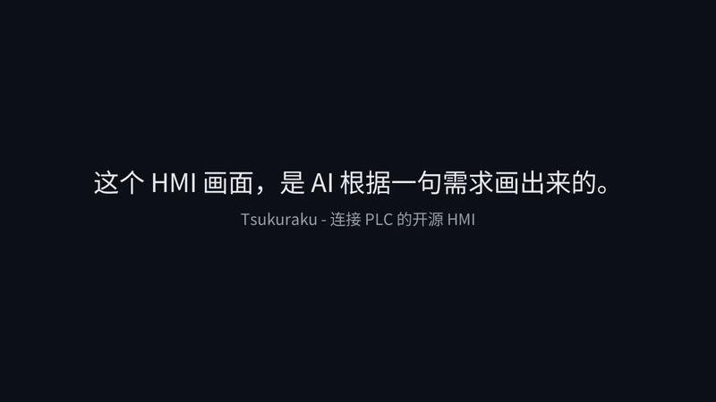
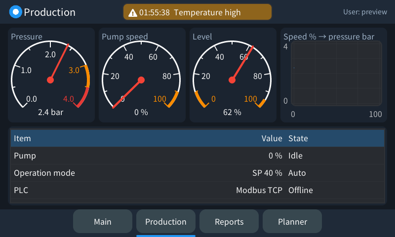
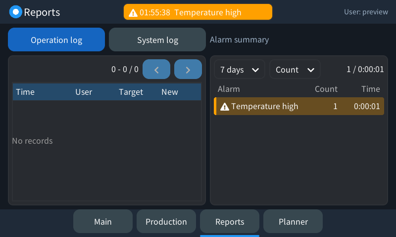
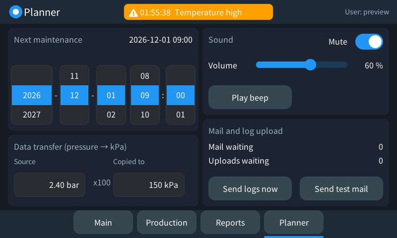

# Tsukuraku (ツクラク) — 由 AI 绘制画面的 HMI

[English](README.md) | [日本語](README.ja.md) | **简体中文**

> 本文是英文版 [README.md](README.md) 的简要中文说明，只包含概要。各项功能的详细说明请看英文版。
> 中文由 AI 翻译，尚未经过以中文为母语的人校对。如有错误，欢迎在 [issues](https://github.com/bamchoh/tsukuraku/issues) 中指出（可以用中文）。

[](https://github.com/bamchoh/tsukuraku/actions/workflows/ci.yml)

> **画面交给 AI 来画，轻松做出 HMI。**

Tsukuraku 是一套**可以让 AI 绘制画面的 HMI 设计器和运行程序**。对 Claude 等 AI 说出你想要的画面，例如
"做一个有三个仪表、一个 XY 图和状态表的生产画面"，AI 就会编写画面、用运行程序把画面画成图片、查看图片并自行修改。
打开着的设计器会自动重新读取结果，最后由你手动完成。完成的项目可以直接在 PC 和触摸屏（树莓派等 Linux 板）上运行，
并通过 Modbus、SLMP（三菱 MELSEC）、FINS（欧姆龙）、S7（西门子）、OPC UA 和 MQTT 连接 PLC。



*一句需求，3 分 24 秒，绘制并修改 6 轮，没有人工修改：这是一个只通过说明（skill）了解本工具的新 AI 做出的画面。
每一轮的图片和 AI 的笔记在 [`projects/bottling/renders`](projects/bottling/renders) 中。*

名字来自日语的 *tsukuru*（作る，制作）+ *raku*（楽，轻松）。

**第一次使用？请看 [最初的五分钟](docs/quickstart.md)**（英文）：下载、打开演示项目、让 AI 做一个画面。版本为 0.x，见下文"版本"。

| | | |
| --- | --- | --- |
|  |  |  |

演示项目的这三个画面，以及定时任务、声音和数据传输的设置，**都是由只拿到说明（skill）的 AI 做的**（没有给它文档，也没有给源代码）。

## AI 为什么能画画面

1. **画面是文本。** 一个项目由 `project.json` 和每个画面一个 JSON 文件组成。AI 可以像写其他文件一样写它。
2. **说明（skill）告诉 AI 怎么写。** `tools/skill/hml-screens/` 列出了所有部件、属性和动作（由设计器自身的定义生成，不会和实际不一致），
   还有布局、触摸操作的规则和可以运行的示例。它随设计器一起发布。说明是英文的。
3. **运行程序检查结果。** `hml_runtime --check --render` 不打开窗口，也不连接设备；它列出错误
   （未知的键、不存在的变量、没有翻译的文字），并把每个画面画成图片。AI 读这两样东西，然后自己修改。
4. **设计器跟着更新。** 它会重新读取 AI 改过的文件，显示问题列表，你可以移动、改样式或重写任何东西。

它不做的事：AI 不会设置与 PLC 的连接（驱动、用户和设备的设置由你决定），画面的*含义*（变量对不对、单位对不对）仍需要人来确认。
AI 只写文件，不会连接设备。

## 包含什么

- **设计器**（`hml_designer`，Windows）：画面、变量、报警、配方、多语言文字的编辑，以及向设备部署。
- **运行程序**（`hml_runtime`，Windows / Linux / 树莓派）：报警、趋势图、配方、数据 / 操作 / 系统日志、用户和权限级别、Lua 脚本、
  定时任务、声音、邮件、日志上传、设备之间的数据传输、远程操作（VNC）、OPC UA 服务器。
- **设备上的系统设置画面**：网络、显示、用户、驱动、变量、PLC 地址、部署、U 盘更新。可以显示英文、德文、日文或**简体中文**
  （`"system_language": "zh"`）。
- **中文字体**：设计器附带简体中文字体（Noto Sans SC，GB 2312 的 6763 个汉字）。在新建项目的对话框中选择"Simplified Chinese"，
  或在项目页的"Font"中添加。
- **演示项目**（`projects/`）：`demo`（800x480）、`bakery`（面包工厂，21 个画面）、`bottling`（上面视频中的灌装线）、`factory`、
  `metro`，以及 3.5 英寸 480x320 面板用的项目。

可执行文件和文件格式保留简称 `hml`（`hml_runtime`、`hml_designer`、`.hmlproj`）。

## 让 AI 做画面

需要的只有设计器的安装包（`hml_designer` 和同一文件夹中的 `hml_runtime`），以及一个能在电脑上读写文件的 AI
（Claude Code、Claude 桌面应用等）。不需要编译环境。

1. 在设计器中打开项目，按工具栏上的 **AI**。
2. "复制"出现的文字交给 AI，在最后一行写上你想要的画面。文字中包含随设计器附带的说明（skill）、项目文件夹和运行程序的位置。
3. AI 改了文件后，**打开着的设计器会自动重新读取**。请检查外观和问题列表。

**关于在中国使用的 AI：** 我们只用 Claude Code 试过。说明（skill）使用通用的 Agent Skills 格式（`SKILL.md`），
Qwen Code、TRAE、Kimi Code 等工具也能读取这种格式。但 Tsukuraku 需要 AI 能够**查看图片**（`--render` 画出的画面），
请使用支持图片的模型。我们还没有用这些工具实际试过；如果你试了，欢迎告诉我们结果。

## 支持的 PLC 和协议

| 驱动 | 连接对象 |
| --- | --- |
| `modbus_tcp` / `modbus_rtu` / `modbus_ascii` | Modbus 设备（RTU / ASCII 用串口） |
| `slmp` | 三菱 MELSEC 的 CPU 或以太网模块（SLMP / MC 协议的 3E / 4E 帧，TCP） |
| `fins` | 欧姆龙 PLC（CS / CJ / CP / NJ / NX，FINS/TCP） |
| `s7` | 西门子 S7-300 / 400 / 1200 / 1500（S7-1200 / 1500 需要在 CPU 中允许 "PUT/GET 通信"）。只用模拟 PLC 和 Snap7 服务器测试过，尚未用真实的 PLC 测试 |
| `opcua` | OPC UA 服务器（客户端）。运行程序自身也可以作为 OPC UA 服务器 |
| `mqtt` | MQTT broker |
| `sim` | 没有设备时的模拟 |

各驱动的设置写法见英文版 README 和 `tools/skill/hml-screens/reference/drivers.md`。

## 下载

请从 [releases](https://github.com/bamchoh/tsukuraku/releases) 下载：

| 文件 | 内容 |
| --- | --- |
| `windows-x64.zip` | PC 用的设计器和运行程序。解压后启动 `hml_designer.exe` |
| `linux-aarch64.tar.gz` | 树莓派用的运行程序（64 位 Raspberry Pi OS 12 或更新版本） |
| `linux-x64.tar.gz` | Linux PC 用的运行程序（framebuffer） |

从 0.1.1 起，每个安装包都有 **attestation**（由 GitHub 保存的签名声明，证明文件是由本仓库的发布流程，从对应标签的提交构建的）。
可以用 GitHub CLI 检查：

```
gh attestation verify tsukuraku-0.1.1-windows-x64.zip --repo bamchoh/tsukuraku
```

程序还没有代码签名证书，所以第一次启动设计器时 Windows 会显示警告。

如果从中国访问 GitHub 下载较慢，目前还没有国内的镜像。

## 版本

Tsukuraku 目前是 **0.x：可以使用，但仍在变化**。版本号遵循 [语义化版本](https://semver.org/lang/zh-CN/)。
0.x 期间，新的次版本号（0.1 → 0.2）可能会改变行为或写法，[CHANGELOG.md](CHANGELOG.md)（英文）的 "Changed" 中会写明。
在 1.0 之前，请让设计器和设备上的运行程序保持相同版本（部署时可以一起发送运行程序）。

## 许可证

Tsukuraku 使用 [Apache License 2.0](LICENSE)：可以使用、修改和再分发，也可以用于商业产品，只要保留许可证和声明。
程序中包含使用其他许可证（MIT、MPL-2.0、zlib、SIL OFL 等）的第三方组件，列在 [NOTICE](NOTICE) 中，请与二进制文件一起分发。

用它做出的项目（画面、变量、脚本）归你所有。

安全问题请按 [SECURITY.md](SECURITY.md) 报告。
