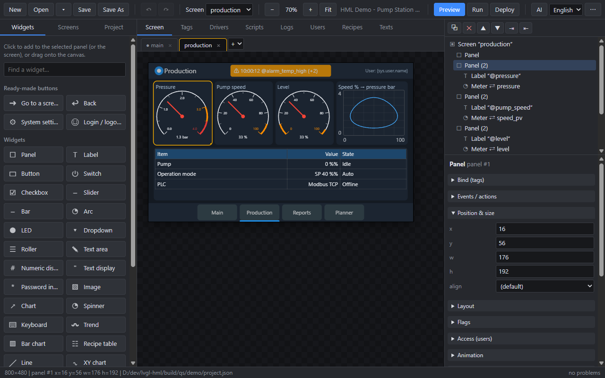
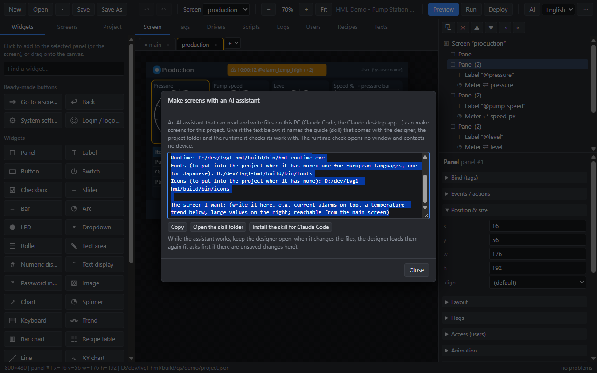

# The first five minutes

From the download to a screen that an AI made for you. You need a Windows PC; a Raspberry Pi is for the last step only.

> Tsukuraku is at version 0.x: it works, and it still changes. See "Versions" in the [README](../README.md#versions).

## 1. Download and start

1. Get `tsukuraku-<version>-windows-x64.zip` from the [releases](https://github.com/bamchoh/tsukuraku/releases) and unpack it anywhere.
2. Start `hml_designer.exe`.
   The programs are not signed yet, so Windows may show "Windows protected your PC": **More info** > **Run anyway**.
   The designer uses the WebView2 runtime of Microsoft Edge: part of Windows 11, and on Windows 10 it comes with Edge.

Nothing is installed: delete the folder to remove it.

## 2. Open the demo

**Open** > `examples/demo/project.json`.



- Left: the widgets to place, the list of screens, the settings of the project.
- Middle: the screen. The tabs above it are the rest of the project: tags, drivers (the connection to PLCs), scripts, logs, users, recipes, texts.
- Right: the widgets of the screen as a tree, and the properties of the one that is selected.

Press **Run**: the runtime (`hml_runtime.exe`) starts with the project in a window, as it would on a touch panel. The demo needs no PLC - a
simulation moves its values. Close the window to stop it.

## 3. Change something

1. Stop the runtime, pick the screen `production` in the **Screen** list of the toolbar.
2. Click a meter. Its properties appear at the right: change `max`, or the colour of a zone.
3. **Preview** draws the screen with the real runtime and shows the picture; **Run** starts it again.
4. **Save** (Ctrl+S).

A project is plain text: `project.json` and one JSON file per screen in `screens/`. That is what makes the next step possible.

## 4. Let an AI make a screen

You need an AI assistant that can read and write files on your PC and run a program, such as
[Claude Code](https://claude.com/claude-code).

1. In the designer press **AI**.

   

2. Replace the last line of the text with what you want, for example:

   > The screen I want: a "Shift report" screen. Large numbers for the pump speed and the pressure, the active alarms below, and a button
   > back to the main screen. Reachable from the main screen.

3. **Copy**, and paste it to the assistant. (With Claude Code, "Install the skill for Claude Code" once makes the guide known to it without the path.)
4. The assistant reads the guide that comes with the designer (`skills/hml-screens`), writes the screen, checks it with
   `hml_runtime --check`, renders it to a picture, looks at the picture and fixes what is wrong. It tells you what it made.
5. Keep the designer open meanwhile: it loads the changed files by itself. Look at the result, then finish it by hand.

What the assistant is told - the rules for layout, touch sizes, colours, what it must ask you and what it must never do (connect to
your PLC, for one) - is in [`skills/hml-screens/SKILL.md`](../tools/skill/hml-screens/SKILL.md). Read it; change it if your plant has other rules.

Text in a language other than English needs a font in the project: **Project** tab > **Font** > "Add the font for European languages"
(or the Japanese one). The built-in font has no ä, é or €.

## 5. Put it on a Raspberry Pi (when you have one)

1. On the Pi (64-bit Raspberry Pi OS 12 or later), unpack `tsukuraku-<version>-linux-aarch64.tar.gz` and start the runtime with an example:

   ```
   tar -xzf tsukuraku-*-linux-aarch64.tar.gz && cd tsukuraku-*-linux-aarch64
   sudo ./hml_runtime examples/demo/project.json
   ```

   It draws on the screen that is connected to the Pi (framebuffer) and reads the touch panel. `examples/lcd35` is for a 3.5 inch
   480x320 panel. Starting it at power-on, hiding the boot text and the settings of small LCDs are in the README:
   [Running on the Raspberry Pi](../README.md#running-on-the-raspberry-pi).

2. On the Pi's screen, hold the **top left corner for 3 seconds**: the system settings open. **Service** > **Deploy** > switch on
   "Receive projects" and "Add a designer".
3. In the designer on the PC: **Deploy**, method **Direct**, the address of the Pi. The first time, both sides show a fingerprint:
   check that they are the same and accept on the Pi's screen. From then on **Deploy** sends the project and the Pi restarts with it.
   Details: [Deploying without SSH (Direct)](../README.md#deploying-without-ssh-direct).

## Where to go from here

- Connect a PLC: the **Drivers** tab (Modbus, SLMP for MELSEC, FINS for OMRON, S7 for Siemens, OPC UA, MQTT) - [README](../README.md#projectjson).
- What a project may do, before you run somebody else's: `hml_runtime <project.json> --capabilities` - [A project somebody else made](../README.md#a-project-somebody-else-made).
- Found a problem, or something unclear in this page? [Open an issue](https://github.com/bamchoh/tsukuraku/issues) - in English or Japanese.
